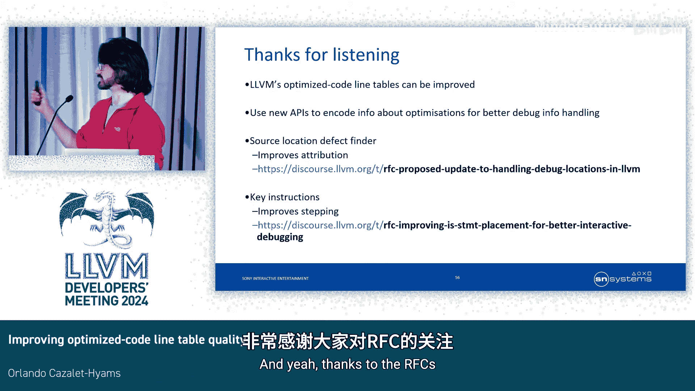

# 【2024-LLVM开发者大会-•-中英】-p22-P22-Improving-optimized-code-line-table-quality--BV18eNfepENu_p22-

买冇拦佢。I'm going to be talking to you about work that Jeremy there。

 Stephen and myself have been doing on improving。Optimize code， linetable quality。

I'll just give a very quick outline of the line table and then talk about two projects we've been working on。

 one that automates。Finding source location defects in LLVM。

 the origin of source location defects in LLVM and another that improves is statement placement for better interactive debugging the first is pretty much done and the second project is more of a work in progress。

So the line table is used to map instruction addresses to source locations and vice versa。

 loads of tools use this， debuggs are obvious example。

 SPGO uses the line table to describe execution in terms of source code so that the compiler can understand the profile。

And on the slide here， compiler Explorer is Coling instructions based on their source location。In IR。

 we track instruction source locations。Using DI location metadata。

 also sometimes called a debug lock， you may recall propagating or setting one yourself using set debug lock at some point。

 which leads me straight to my first problem， which is that sometimes。

Debug locations are not updated correctly during transformations。

Here's a graph It shows you unique source locations in optimized CT mark binaries over LLVM versions there's a kind of bright red line in the middle that's the average and you can see that we're tending towards fewer unique source locations over LVM versions and that could be the result of more aggressive optimizations。

In newer versions， or it could be the result。Of new optimizations failing to update debug info correctly。

 so we figured this warranted investigation。And one of the possible causes and the issue that this first project that I'm talking about focuses on is misattribution。

 this is when an instruction is mistakenly given an incorrect or no source location。The compiler。

This is the compiler Explorer screenshot I showed on the first couple slides。

 the code on the left compares to strings and does something if they're equal and on the right we've got the optimized assembly you may have spotted that there's a debug info defect here that these instructions don't have associated source locations。

Technically， they line zero， but for the purpose of the talk it doesn't really matter。

If there's a crash at one of the point of D references in that block of code。

 then the stack trace is going to point to the function。

 but it's not going to give you a line number， and this gets exacerbated with heavy inlining。

 code motion and scheduling。Other issues that arise from misattribution include crashlights with incorrect as well as missing source locations。

 bonus coverage， which is when an instruction is moved out of its block。

 but it keeps its source location so sometimes that can make it look like a branch being taken when it hasn't and obviously that's bad for SPGO and debugging and a similar case is stepping to unreachable code。

 which is obviously undesirable and lying to the user。

So let's find the cause for this particular example。

 this is the optt pipeline viewer in compiler Explorer showing the IR before and after aggressive inchcom。

 and you might notice that aggressive in combine is expanding the Str comp in line。

But you might also notice that it doesn't apply the debuggg locations to the new instructions。

So in this case， the fix is pretty simple。But finding that a fix is needed as a tool can be tricky。

 we do have existing tooling that can help with this。

 there's a tool called debuggify that lets you build a codebase and have LLVM generate an HTML report with reports the number of drop locations per optimization pass。

But there's a problem， and that is that it can generate false positives。

And that's because sometimes in LLVM， we intentionally drop debug locations and debugggify can't discern those cases from genuine bugs。

So our solution is pretty simple， we just have past authors declare that they did mean to drop a debug location they're doing on purpose using a new API to signal their intent。

 the slide contains a diF。Replacing a default debug lock constructor call with a function that would be included in this API。

And yeah， deboify can then use the additional information that we've got to discern accidental drops from intentional drops。

Importantly for compiler performance， I just noticed that the time is not running， by the way。

 so I don't know how long it've got， importantly for compiler performance。

 the new API will do nothing by default， you'll opt in enabling this flag with a unit。

Enabling this in your build with a C flag。 And because it's an optin feature。

 we go a little bit wild in wild in terms of compiler development rather than simply eliminating false positives in debuggographyify we can also stuff provenance information for debuggg opt changes into the metadata itself And then what that can give us is we can put stack traces in the H reports that point to exactly where an LVM the defect originates and going one step further we can also provide an opt bisect limit number so that you can then create a reproducer and you've been pointed to where an L ofVM happens and can generate a reproducer so it makes fixing the issue fairly easy。

And yeah， on this slide， we have such a stack trace for the Strcomp example I showed you a minute ago。

 and this was generated while building CT mark test suite with this flag enabled in LloVM。

In the LopiumBuilds。So in summary for that project， misattribution causes SPGO and debugging bugs。

 we've expanded on debugggerified to find where there are drop locations without false positives and it points to exactly where an LLVM they come from。

It just requires past authors to encode a little bit more information using a new API。

 we're currently working on fixing the issues that we found and then once that's done。

 we'd love to get this on a buildbo to automatically find and report issues in future patches。

Now changing gears and talking about the second project in which we。

Reduce the jumpiness of optimized code debugging。I'll start this section with a capture of an optimized code debugging session。

 Sing stepping through some linear code。And drawing a history of the debugging trace over the top that records where which lines we've already visited。

And on the right we're going to step through the same program with the same optimizations enabled。

 and in fact the tech section is identical to the first。

 but you can see that the stepping history is a beautiful staircase。

 there's no jumping back and forth。😊，And in this part of the talk。

 I'm going to explain to you how we can get from the left to the right debugging experience。

 and it's possible we have a prototype。😊，So。To understand the problem and the fix we first have to talk about is statement。

 it's a flag applied to line table entries to indicate that a particular instruction is a recommended breakpoint location。

Just a way of communicating from the compiler that debugger that it's a good place to stop。🤧嗯。

L of Vms。Strategy for applying a statement， the moment is very simple。

 is' slightly more complicated than this， but essentially while generating object code。

 we look at each instruction and if the line number has changed since the previous instruction。

 then we set his statement。That's basically it。And it results in， you know， it kind of works。

 but it results in excessively jumpy stepping behavior and if you've tried debugging optimize code。

 you're probably familiar with that and the core of the issue here is that LVM is conflating attribution and stepping。

And I'll explain that with an example。So here we have some code in the top left。

 and it's very simple。 There's just two identical expressions， and they are candidate for CSE。

So the second mole gets erased and the ret now uses the first mole， then later on incom comes along。

 simplifies the branch condition so that it doesn't need the mole。

 and then that mole gets sunk to its only remaining use。

 which is the rat that keeps a steep location。And so a statement is applied at dwarf mission time。

 but for the illustrative purposes， let's just imagine that we're going to apply a statement now。

Using LvN strategy。So the result is that this statement is applied to the entries with the orange boxes on slide。

 so if the branch condition is true and we're stepping through it， we'd step from line6 to seven。

 then back to six then to eight and it's the second step to line six that's the problem。

 it's accurate attribution that's where the instruction comes from but it's not a desirable stepping location。

And the good news is that other people have solved this problem in the past。

 the two papers cited on the slide have guided our approach to trying to solve the problem。

 especially Caroline Tyce's work on key instructions。😊。

The core of the idea is as follows source code is made up of interesting atoms such as control flow。

 assignments and callss and other things。Atoms typically have one instruction that implements the functionality。

 that instruction causes or finalizes the operation from the perspective of someone debugging。

So the observation is， why don't we just apply a statement to those key instructions and then if we reorder non key instructions。

That doesn't degrade the debugging experience because only the key instructions will be stepped on。

We have a prototype， as I mentioned， and it looks something like this at the moment。

 We get two additional fields in D location。 They're both numbers。

Atom group and atom rank instructions with the same atom group number are part of the same source atom。

Typically， only the final instruction in a group with the lowest rank gets a statement。

 so atom rank is just a way of specifying precedence within a group。

And so before optimization passes run， we have a pass that uses heuristics to apply this new metadata to the instructions。

 most optimization passes don't have to do anything。

 and then at permission time we use the new metadata to determine a statement placement。呃。

that was right before discussing the evaluation I want to cover the costs so the prototype currently causes a compile time speed regression of 0。

6 ish for LTO release builds with debug info which we think is reasonable given the improvement to debugging it is higher for00 builds just over 1。

6% and I include00 here because key instructions does affect00 debugging behavior and I think it's important to have the same baseline I think we should enable it for 002 if we do go ahead for this project and most of the costs come from the two linear scans over the instructions that we're adding we might be able to reduce it to just one scan but you'll have to check out the R ofC for those details and another cost is to pass authors so you might be might care more about that one that is that once again more information is required from you guys for key instructions to work just for some transformations。

Specifically transformations that duplicate control flow。

 I'll use loop unroll to illustrate so we have an assignment。

 a loop in a loop and it gets duplicated during unrolling and we want to be able to step on each instance of the assignment obviously so cloning and instruction clones as debulock and therefore that those new fields atom group and atom rank。

So by default， the duplicated instances of the assignment get the same group number indicating they're all part of the same group。

 which results in likely only one of them getting a statement。

To enable stepping on each of these assignments we need to remap the group numbers so that each assignment gets put in a distinct group so that's the extra work that's required and this just involves signaling what's going on using a new API which is the value map of class so on the slide I've got the diF the loop on roll which is just two lines plus some comments and because most of it can sit in common helper functions the like clone basic block I found relatively few sites that actually need special attention so I've got the files listed on the right where that is the case and for both of these projects where we're introducing new APIs we'll be paying the upfront cost of updating existing LLBM passes。

So that sounds good in theory， hopefully to you， but of course there are risks and one of the main risks is that we accidentally drop breakpoint locations that we want to keep dueta bugs or something we haven't thought about and the good news is that。

We still have source attribution， so crashes and SPGO are unaffected and it can be slightly mitigated the prototype currently excuse me unconditionally applies this statement to calls and we could do the same for any other instructions that we feel is necessary。

 and I argue to you that the overall improvement to stepping is going to be worth that relatively small risk。

But how can I evaluate this work in order to make that claim？

Ideal breakpoint locations can be subjective。Unlike for performance or variable location coverage or even source location coverage。

 there's not an easy irraccular number we can point out and say this strategy is better than that one and indeed。

 we couldn't find a quantitative measurement that we were happy with。

 but we have found a good visual qualitative measurement that has been helpful to evaluate the project。

 So if we plot the debugging traces， those quicklyquiggly lines I showed you in the debugging videos onto a graph that enables us to compare the behaviors at a glance fairly easily。

😊，So on this graph， each line is a stepping trace， the green is gathered from an00 build。

 orange from an O2 build and purple from an O2 build with key instructions enabled the new feature。

 and you can see that there's a lot of jumpiness in the O2 build while the green and purple lines are identical。

And this is showing you that the stepping experience at O2 with key instructions is exactly the same as00 which is great and yeah I've automated collecting and plotting these traces using our debugger driverriver tool called Dexter and because it's automated as easy to get lots of these on real code so I'll walk you through some examples now。

😊，This is a trace taken from debugging a function in the Luer code base。

First thing to note there's a step missing with O2 with key instructions enabled。

 but it's missing at O2 without it enabled as well。

 so it's not a regressiongression and it's possibly unrecoverable so not very interesting but what is interesting is there's loads of jumping back and forth at O2 without key instructions and where we turn on key instructions the purple line that completely goes away and the purple line looks much more similar to the green line which is00 so that's another great win。

Here's a function that gets in line when you turn on optimizations in Opent。

 similar to the previous example， there's some steps missing at both O2 and O2 when you enable key instructions。

 it's not terribly interesting。And again， what is interesting for this project is there's loads of jumping back and forth at O2 and as soon as you turn on key instructions that all goes away。

😊，Here's another simple example， we have some jumpy back and forth at  O2 and it surprise goes away and you turn on key instructions。

So here's a slightly different example to the previous ones from B to mark。

If weoo zoom in on this pattern here， there's some back and forth jumping at 02 and 00。

 and that could indicate the presence of a loop， and I was kind of worried when I first saw that because obviously you can see on the graph the purple line doesn't replicate it would be bad if key instructions wasn't let you see loops。

 however。Does the video play， yes， here we go stepping through an00 build。

 we can see that there's just some jumping back and forth over a multi line statement。At00。

 and arguably that's undesirable。 that also goes away if we enable key instructions for00。

So I've looked at quite a lot of these graphs and I've stepped through a lot of source code using the prototype。

 and in my opinion， as the person doing the project is looking pretty good。 Yeah。

 and I found a couple of existing compiler bugs and debugger bugs while staring at these graphs。

The graphing thing has been helpful outside of the project in a small way。

It's worth noting that the jumpiness is unavoidable。In some cases。

 we can't get rid of bull jumpinginess。Such as when key instructions are reordered relative to other key instructions。

 so on the slide there there's a huge back step in some linear code because a bunch of stores to globals get reordered and all those stores are key instructions。

Happily， we think that this is a desirable level of transparency for a debugger user because while we are reducing noise overall。

 we're still being truthful about the optimizations that affect key instructions。

We're coming to the end now。Wrapping up in summary for this project。

We can reduce stepping entropy introduced by scheduling and code motion and all other optimizations with smarter is statement placement。

 and all we need from the of Young community is pass authors to encode some more intent about what the optimizations are doing。

 and that is basically it。the compile time cost and there's possibly some work to do in front ends。

 but once again you'll have to see the RFC for that as it stands， no front end work is required。

And yeah， that's coming to the end of the talk。 So in summary of everything I've just thrown at you。

We can deliver higher quality optimized code line tables in L ofVM by improving attribution and stepping and separating those two things and I've covered projects that we've been working on to this end。

 both of which require past authors to call new APIs to encode more information about the transformation is taking place and yeah there's some links to the RFCs if you miss them earlier please get involved with them。

 let us know what you think and yeah， I think we've got time for questions。

Yeah， please step up if you want to have asked questions or if anyone wants to come。Any questions。

Crickets。Have you attempted turning a difference to O0 into a metric of sorts？Yes。

 so that's where I started before I got to the graphs。

And if anyone has any good ideas of how to turn this into a metric。

 I would love to hear it because my first Naiveva temple is basically a string distance thing。

Sometimes the best thing to do is have misordered steps such as when key instructions get reordered and sometimes the best thing to do is to not step on a line。

 so it's really difficult to score different things going on and boil that down to a metric。

But wouldn't the odd。Version be even worse， right if the key instructions are actually mised。

 wouldn't be no No yes or no but because the old way。You know， not using key instructions。

Might get a score that is better by accident， but because of the fact that。

The different let's just talk about string distance。To pretend we're talking about string distance。

 like the different operations that you need to do to the string。😊。

If you just say they will have the same weight， then missing a step。

Might not be the right thing to do， but I'm not explain this very little。

 I can explain more offline maybe if you like， but yeah。

 if anyone has any good ideas how to boil this down to metric， I'd be all liz。嗯。Thanks。

Happy news thank you very much How much do we gonna be jumping around in an LTO style build I didn't see any of the LTO examples up there probably on purpose I just haven't got any trace for LTO builds I will get some I'm post on the RFc so watch the RFC thank you very much I'm guessing it's going to be still a bit crazy but。

It should be an improvement stone。Anyone knows。There's one hand over there。So if I。

 thanks to the presentation， if I understand correctly， the simple PGO based on De information。

 do you think it going to impact some quality profile information。Basedt on how they we simply。

 So the second project won't affect profiling at all because it only moves its statement so。Yeah。

 but the first project where we're trying to stop misattribution。

 that will positively affect PGO or SPGO。Do you have any comment on the symbolplification of the stis？

Can you repeat that question， please， so basically。The simpleimplification over the stack choices。

 do you think he's going to improve that as well？W are the Korean section right should they should as well。

 Yeah， basically any time the point of that project is to remove。

Accidental line zeros is basically what it comes down to。

 so every time Lovm puts in a line zero by accident， the first project is trying to reduce that。

So yes， it should improve fucking side traces。In rare cases， whereas it gets it wrong at the moment。

notes。Okay， then let's thank the author。

で。