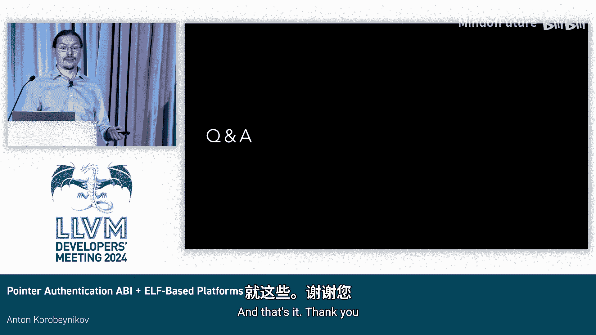

# 【2024-LLVM开发者大会-•-中英】-p23-P23-Adding-Pointer-Authentication-ABI-support-for-your-ELF-platform--BV18eNfepENu_p23-

Thank you。 And it's almost 10 of the conference and 10 of the day。 But still， let's talk about some。

😊，Tings about the like point authentications and eo basedase platforms。 And as I said。

 so it's just to。Parts of the talk， so first let's talk about the point authentication itself。So。

Point authentication is the security mitigation technique and to understand what's going on so let's take a look at what's going on with the code pointers in the and whether what they do so usually they start from some redunding memory that you're not going to change then you cloud these into some register or some like temporary storage then the pointer got spilled to like readwr memory then eventually it's reloaded back to the register and the point itself is used to perform the like indirect call or indirect jump or in some rare cases to do the data access。

Now let's just imagine that salarrow is able to change the memory， so it has the memoryite primitive。

 so then the attacker could just substitute the pointer value in the rer memory and as a result the like cold chain would be compromised and。

In then the。Bed code would be called or well。Data would be accessed from some。

Like inappropriate location。How does the pointer authentication try to solve this problem。

 so the idea is that the code pointers are never stored well。

Bre in the readr memory instead the potential like cryptographical signature is attached to the pointer while they are like in the register。

 and we kind of assume that the attacker could not change what is in the register list directly。

Then it like pointer with the。Signature don't is spilled to the memory and after it's reloaded。

 then the special step is done to authenticate whether the pointer is intact and if not。

 then we might attack that it was changed by someone else and do whatever is necessary。啊。

So how does it work， So there are pre components， essentially for the point authentication。 So。

 first of all， the set of instructions here rely on like different set of keys。 Plus。

 there is the additional modifier value。 so that could be used to well， have the。

To change this signature depending on some kind of context， more on less later on。

 So and then the like point authentication instruction， they just oh。

Like uses all this information so they' combine together and the click。

Signature is calculated and attached to the point itself。 And as a result。

 we get the pointer with the like。Attched signature and usually this works because well some high bits are unused in many platforms like but we're talking about A 64。

 so usually the top bits are like reserved and we can use to attach the signature there。

So the point ofification is the instruction set extension， so I think it first appeared in Ar 648。3。

 so there were also some additional changes in these subsequent instruction set architecture versions。

 I think the original version thats around maybe 150 instructions。

 so some of them are in the hand space， meaning that well they're just knobs on the older super course so they could be even used to。

Deploy something well in more or less compatible way for the older course。

 but the majority of them are well just direct instructions here。But still， we are not。

Programming in assembly these days anymore， right？ So， well， at least， but in the majority of cases。

 So and it's the open question。 So not the open question。

 So it' just the question of how we go from this set of instructions to the high level languages。

 right。 So usually we write code on the right and not the code on the left。

So and the answer is that we need to go down to the particular implementation right。

 so how the code is essentially lower down。in my particular case。

 we need to think about the how they well they。Rial functions are implemented in C++ so and what are the code pointers out there and in our case we have like three different pointers that might deserve to be protected like meaning the visual function table point and pointers to the visual functions well C+ speaking the type in fork could be also deserve some protection as well。

 but let's s it for a moment。All right。Mean that how we can know which point us to protect。

 so what should be done and how to do this， all these things。

So and the answer to that is the point authentication C++ ABI originate which was presented five years ago right so and Ahmed and John like presented that so you could check the details on their talk。

Until recently， it was available only on Apple platforms in Apple downstream ClangFork so we could check the description of what is available in the downstream fork and well。

It was not。AAilable for the majority platforms in the just hour clank my line。

And it's essentially the different elements of the。ABI， that dictates which。

Pointer should be protected right and it turns out that there is more or less limited set of indirect jumps for indirect calls and imported code pointers that should be protected。

 So usually it's like Quions and switches， some symbol imports like CN++ like visual functions like simple++ member pointers plus some other like more interesting things。

 for example， well we might have the pointers to the functions that perform the static object constructors。

 we also have some extensions according the compute go to on certain platforms like Apple platforms that are also some additional things in the objective CEOs there are like block extension well so etctera etc ce and essentially it's the API so the sign a scheme that specifies like which particular key should be used in how to compute that additional modifier more about modifiers。

The instruction set allows abit 64 bit modifiers to be used。And the ADI essentially。

Provides two so-called flavors of diversity。 One way is that we can use the storage address of point itself as a modifier。

 This certainly comes with additional complications。

 meaning that well the copy of pointer definitely requires a resigning。

 so we need to authenticate the point and then res if we just copy that and this might not be compatible with many many things。

 for example， with for the cases， then the point pointer should be just trivially copyable。

Plus we can have a so- calledled semantic diversity so we can use semantic of the point ch or data as the mod itself。

 think about that well we can use different modifierifies for the visual functions as compared to the well like C++ member function pointers as the like plain C style pointers。

 etctera， etc ceter。So they could be derived from different sources。

Like be used to split the signatures into kind of like namespaces right。

 so meaning that we cannot substitute the pointer from one named namespace with a point to another namespace。

And another nice thing is that usually the top 16 bits of address is usually reserved。Useful。

 like memory taking extensions or some other things。 But from our perspective。

 that means that we can even combine both address diversity and semantic diversity， right。

 So if we can just put the like top 16 B of the modifier。From the semantics， right。

 so we can try to use both。Add se， diverse and semantic diversity。All right。

 so what's going on on Al platforms because as I said， so until now。

 this was only available on Apple platforms。First of all。

 there is the specification for the policy pointin authentication APIB for Al platforms。

 so developed by P。Someone else I don't know from R。 So there is the spec So the link is here。

 currently is alpha state。 so I meaning that well， it might change， but。I don't think we。

It would change the early。A lot。 So essentially， that spec provides a set of alpha specific relocations and relocation operations。

 plus specifies how we can mark the E object。 So we can ensure that we don't mix and match like incompatible stuff。

 Plus it also specifies couple of platform decisions that we might take。

 So it usually includes whether we want to sign the global offset table or not and whether we。😊。

We want to sign the PLC， essentially。Right， so what do we have in L M 19。 So first of all。

 the majority of required front10 patches to be reported from Apple Dussey Fox So thanks like everyone who will respond for this so thank you。

 Ima John Akira Oliver drove and well。😊，Whoever I probably forgot。

 So also the required cogen support they ploted from the Apple plant as well。

 We provided the support for the L specific point health cogen plus changes into the Linux itself and object file support and we added the experimental like test APIB for a6 for Linux more on this later on。

 but the like long story short， the。I won't test you twice bunch of。

Other things that we tried they just work with point authentication enabled。

So I would mention that we have theplex so-called PLs test A。

 so that is the like special named A because we are not in the position to define the pointser authenticdiation A。

 let's say for Linuxux or for other L platforms， so there is the testing it mostly follows the arm 64 E that is。

Use an Apple platform for signing scheme for things like that。

 one can enable it using the MAABI switch。PF test environment in the target triple and MAS which essentially normalized to environment in the triple itself。

 pretty much similar as EIB hot floating point is done on the such arm。Plus。

 we added so-called well test vendor to ensure the elf marking because again we are not in the position to define new vendors at all。

 and we don't encode the version instead we encode the entire science cu place of version。

 so meaning that if you have any like ABM matches and stuff you just during the testing you catch the well the difference is easier。

And well， certainly PT requires the point authentication enabled standard library to complement the binaries。

There are a few known issues so far well a couple of corner cases are still well not always working so usually it's rewi around like no accept things so we already discussed this little bit today on the roundtable plus we missing few diagnostics for some unsupported cases in the computer gotos well good thing is that the code we just crash so pleased you。

We all know what's going on。Leban wine steel could matter wise pointers is not very secure well where cross exceptions been from。

 so meaning that well it might contain some shinying oracles。

 but yeah if you want to enable the point ofification add point authentic support for your platform。

 it's still pretty manual， so we don't have any like fancy hook so far。

 like that we have for the sanitizers for example。Plus there are still some things missed from the LM 19 release。

 so there are few pull under review but that's mostly around design got support and few pullQu for the TLS support。

 there is open RFC for this special PO qualifier that makes live much more easier if you want to use the pointer authenticated pointers。

Like manually， plus。There is lots of things that could be done with respect to optimization and relaxations。

 so some patchologyology do exist in the Apple downstream3。

 so this should be just essentially be port to Ol mainline。

 there is also some demand of some coification and cleanup because there is some divergence in with respect to the pathway functionality plus well so we need to ensure that all this。

Poins are authentication related security features outlined to each other。

 so plus the documentation is still well missing。All right。

If you want to add point authentication for the new platform， so what should you do？

First and the most important thing is that point authentication isn't an API， right。

 so means that you cannot safely mix code that use a different API。

And if we try to scope all the things， so certainly the point authentic could be deployed as the like default platform。

 aBI on say some bare metal platform or could be deployed as the subset on usual platform for like as isolated like Os kernel or some security critical process。

And there are four companies that should be well essentially implemented if you want to deploy point authentication for your platform so it first is the kernel support well definitely you want kernelnel to support these set of operations so this includes the key allocation so there are a set of five keys and some of them are expected to process dependent you definitely wants to ensure that key are preserved on well switched during the context switches。

 there are some additional assumptions how few registers are well。Treated plus， well。

 some things might be a little bit tricky things about folk， right。In some cases。

 you want the keys to be well inherited there。But if you run in， let's say， on Linux。

 or if you have the Parre already on your platform， well you're usually don here。

Another important thing is the signing scheme and how the things are implemented。

 it's essentially kind of like building block。😊，And what is currently available allows lots of different variations in customizations like discriator usage。

 what to sign， etctera， etc cea。 What is important is every variation effectively defines entirely new A that you cannot mix and if you want to deploy usually well you could probably start stitching to the default set so it's more less similar to like what we have on RM 64 EOPL test so you might probably just decide whether you want function points that discrimination or not plus there are lots of options so yeah you would probably want to decide if you want to expose all of them to your users or just stick to some default set。

😊，Another thing is diversion and marking， so the elf standard like for the point authentication。

Said that， well， the glue property notes I used to mark the object files。

 So indefinite to define the platform。 You need to define how you specify and how you encode the version。

 Probably you might want to encode some additional metadata in that version。 Well。

 it's up to you and。Note that both staticlink and dynamic load are expected to check ABI compatibility。

 Stalink is already the there， so it's all supported in LD， well if you use like LD or gold well。

 sorry you need to do something else in dynamic load is on your own。

Finally the final component is the libraries compiler runtime should work straight out of the box like Kpsy++ Lib and W and compiler R so they are all ported you definitely need to add support in the dynamic order like support for the point health relocations like decide what to do with the shared libraries like you need to also decide whether you have read only or readwr like got and PLT all these kind of things plus you want to have some support in the C standard library。

 think about like code that invo static constructors and thes plus you little bit crazy thingsve like say jump on jump you want like if you have the post extended library we like signal so you also need to do something there。

😊，We have the proof of concept implementation for all this bitten muscle so we could just take this as the basin。

Like adapting your needs or if you have entirely custom standards library， well it's。

You need to do that on your own。Finally， testing is a little bit nontri will。

 right so like Crysal did awesome talk to you during the Euro VM that well we can just match the well。

😊，The expected cut property， like cut patterns and。Pretend that well securities is enough。 So no。

 we're currently working on kind。 we call it crash and test suite。

 So essentially the test suite tries to perform pointer substitution in different contexts。

 and mean that if the point authentication works， then substitution would fail and the test would just crash。

 otherwise， well， the substitution would success。 So and well nothing will crash and well。

 we can see that well， some particular component is not either protected by point authentication or well not work properly。

 is's currently working in progress， we hope to make it open source pretty soon。 So yeah。

 and well maybe we need to decide if we going to well follow on on the some other tools。

 like for example， po like checkers and extent to check not for the pocketre but for the entire。

Point of synation C+ plus AB， and that's it， Thank you。

Thank you。So any questions， it's questions？How do you debug it。So。Well， debugger is。

 I think the LDB support is pretty solid， so I think like many patches were provided by。

Apple Fox and but for debugging well from thebuger perspective things are I would say in many cases are simple。

 so debu we just well still the signatures right so we only need to ensure that well should we should something that happen we will be able to debug there are a few cases then like for example。

 if the。If the explicit check fail， right， so at least the key that used to be checked is encoded in the brake instructions。

 so well。But definitely debugging， is's a little bit nontri， right， essentially。

 especially if you do some well。Things that in the works undefined be able let's say that。

Anyone else。Thank you。