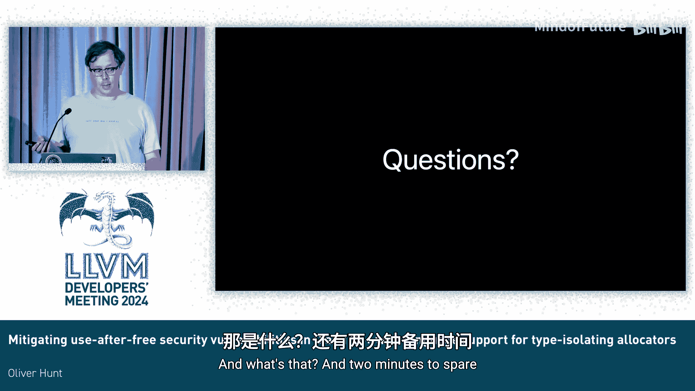

# 【2024-LLVM开发者大会-•-中英】-p24-P24-Mitigating-use-after-free-security-vulnerabilities-in-C-and-C++-with--...--BV18eNfepENu_p24-

Hopefully winning the award for longest title in any presentation day for this conference。

 I'm Oliverhan， I work at Apple， I work primarily in the compiler team。

 but my drop is at the intersection of compiler engineering， PLT and platform security。

And that's what I'm going to be talking about today。

 we're going to be looking into mi the use mitigating use out free security vulnerabil as and C andC++。

And the whole pile of words here and not everyone in the room is going to be familiar。

 so we're going to actually introduce a bunch of these concepts to exactly what a use afterfr era is。

 why they're bad， and they' talk about type isolating allocators。And how they are good。

And then we're talking about what we actually did inside Klang at Apple to try and bring these two things together to make the world a better place。

The fundamental use after free。Era is a particular class of memory safety vulnerability that is very highly exploitable。

It is also very difficult to prevent statically inside CNC++ code just due to the nature of how language's work。

And what makes it particularly highly exploitable is that open sea。Fundamentally。

 it is that I have used a piece of memory after I have freed it and after it has been reallocated as something else。

And this creates a very， very exploitable primitive because it introduces a path to type confusions down the line and future memory and corruptions of the heap and corruption of user data of your program data。

The fundamental problem here is the attacker has used the type can use this era to get control over。

Data that you would otherwise consider trusted or consider useful to contain a specific kind of information。

 and this can be used to give remote code execution， elevate privileges of a piece of code。

 or just generally corrupt every senior program state。And what of the mitigations we've introduced？

Progressively over the last decade is the concept of a type isolating all。Type isolating allocators。

 basic idea is。The core exploitable element of we use after free bike is the subsequent type confusion。

So if we ensure that we can guarantee that a single piece of memory or a single address in your address base is only ever used for a specific type or a specific subsetsid of types。

You can drastically reduce the power of the primitive or the power of the era。

This means that you get the ability to prevent attackers from conflating pointers and user data。

 pointers and control data and things like that。And this kind of defense， there this mitigation。

Is effective in a number of different securities sensitive environments。At Apple。

 we've deployed it extensively through our ExAU kernelnel for iOS and Macs。

Through the CalLic type system。And this kind of mitigation was also used extensively in all modern browsers。

through a variety of different libraries， things like Lib Pass， Poition LAec。And to a lesser extent。

 there are third party independent libraries things like Ioelic。

That provide a similar functionality for other environments。The underlying problem， however。

 or the problem that we've been trying to address。Is that the manual adoption？

Of type based diallic isolation is very expensive， it requires a lot of annotations。

 requires a lot of work and a lot of adjustments to existing code。

And the reason for this is because you do need to provide that type information。To your allocator。

 if you've said， I want type my allocator to separate different types。Of memory。

 the allocator needs to know what a different type of memory is。And。

This is difficult in existing code because the overwhelming majority of allocation APIs are untyped。

 if you think of your malic or Po memo line， these things just take a， I want this number of bytes。

 They don't say I want the bytes for this type。啊。And then we get to another issue。

 which is fundamentally C based languages don't have the concept of a type that is usable as a runtime value。

And as a result， all of this。The overwhelming majority of existing CNC plus plus code is written in terms of entirely untyped APIs。

So to try and mitigate this。To try and mitigate list， we introduce the concept of。

Tyd memory operations。And what these are is an annotation that a library author can use。

To not that this is an allocation API， this allocation API has a type of equivalent that you can use instead you're aware if you have support for this feature。

And then Klang will do the heavy lifting of migrating the code over to that。

 And it doesn't do this by。 this is not a。Pt your code or a manual rewriting or update or anything that involves changing your code。

The code that is in neuro reppoitory this just happens automatically as part of the co generation process。

啊。The annotation。Let's you specify what your type entry point is and it also provides you an ability to say。

 hey， this particular parameter is a thing that is going to contain the type of information。

And then you can perform your inference over the compiler will perform inference over that。

And we will then subsequently call your typed API。Currently。

 we've just got this up as an RFc on eium。org。And we're going through some feedback process on that。

嗯。The fundamental model does to give an idea of just how lightweight this is。

From an annotation point of view， is。What we have here。

As library also you'll just add your declaration for your type entry point and then you attribute your allocation API where say。

 this is what my type entry point is and this is the parameter I want you to infer over。

So mele is a particularly trivial case because it's a single parameter。

But there are plenty other the APIs that people have。And the annotation extends to those。

Once you've done this。What will happen？What happens during coaching is we will claim looks at your call sites。

Looks at the expressions that you passed that you have said this is what I wanted to type and then simply replace that call with with the call to your type entry point。

And it'll pass in a type， and we're just going to leave what that type is for now。And just like。

 this is the general model of how this feature works。But of course。

 we do need to actually represent that type。As the example indicated。

 we kind of care about this for general system allocator level APIs。

 which means there is a much higher code size constraint than there is。

In many other cases or individualized cases， so we've had to focus on。

Minimizing the impact of binary size。And we also have to deal with another problem。

 which is we're inferring a type， which means the types that we infer may not actually exist as a C or C++ level type。

And the source， people often just do single allocations where they combine multiple types together。

And then even once we do have that type， we do need to provide some semantic information about other type。

 it's not just a matter of saying I have a type name， we need to know what that type contains。

To that end， at Apple we've developed a type descriptor and a type descriptor is just a very compact representation of a type。

That tries to achieve every single goal we had was making no trade off whatsoever。嗯。Unfortunately。

 that was not possible so it made a bunch。It is a single 64 bit value。

Where we have reserved a set of bits in that value to provide semantically important information about the pipe。

 and we'll get to that。As well as an identity of the type。

There is no additional metadata beyond a 64 bit value， it is not a pointer。

 and o which means the total overhead of this is the cost of passing a 64 bit parameter at the corsi。

Currently， the information we provide is very， very basic core elements of a type things like is it a polymorphic type does they have a V table。

 are the unions we know from prior experience with security vulnerabilities。

That attackers will frequently target objects that do intermingle do overlay different types together。

 so unions seem like something that are semantically relevant and we have other things like does an object contain a pointer。

 an object that contains no pointers is less overtly attackable than something that contains pointers。

And an object that contains a code pointer seemed even more valuable at the target。

In addition to that， we also want call site information because we again from prior experience。

 we know that there is a difference in the attackability of a memory allocation of a fixed size versus a non fixed size。

And a difference in the semantic behavior of。An array allocation versus just a general Pb allocation。

By providing the semantic information， we allow a allocator to provide a more nuanced。

Approach to how it isolates types。As it is not necessarily feasible to just say every single unique type gets its own unique storage that has a significant memory cost。

But just having the semantic information is not sufficient。

 it's not enough to say I want to keep data types separate objects from types that contain pointers。

 we need to know we still need to have some unique identifier for a given type because。

You want to in addition to keeping data away from pointers。

 you want to keep pointers in different objects away from pointers and other objects。

And for that reason we have a type identifier and a type identifier is a structural hash of the type。

 we're not concerned about the name， we're not concerned about the sea level idea of what a type is。

What we do is we linearize the。The type， essentially you can think of this as being a product of the struck layout algorithm。

And then we can enumerate every single bitete in that type and say。

 this is the kind of data held at that bite。The goal here is not to produce anything that would be useful from a reflectionlection point of view。

 the goal here is to create。An idea of a type where different types get a different number at the end。

And the same type get the same number at the end。Having done this。

 we can then hash it all together to get into the space we have available。啊。

This is what is derived from the work we did a few years back to support XNU's Kac type model is just made more compact because of its more generally widespread usage。

嗯。And。The。The typeness of that is。There is a very compact idea of what a type is if we do care about something being a pointer。

 we don't care about what it is a pointer to， and beyond the things like code versus data versus something that might be pointer authenticated as En might be familiar with。

啊。And but we still have to get to the automatic adoption that I have been promising you。This is done。

By a very， very basic concept of type inference， we know that there are a number of standard allocation patterns that people use。

 standard expression patterns。And from there， we can try and work out what types are being allocated at a specific location and try and build out from there。

There's no。Particular priority in this list is suggest just to give you an example of the kind of patternss we're matching against it's going to be obvious extended as time goes by。

啊。And I included the。Type of T plus type of U example。

 just to give you an indication of the idea of the situation where we might have a type that does not match anything。

At the sea level， But we also have to deal with the fact that this influence can fail。

It's a very basic infferencing， the ability for people to do things with C is large and unending。And。

 you know， when push comes to shove， it is possible for people to just pass the random to do tic。啊。

So whilst this works with the default option and they now experience it covers most cases。

It can still fail。And there are common idioms that will defeat the inference。

We have things like rappers。It is not uncommon for people to have helper wrappers around malck。

 things that will do a check to see where they return a null pointer and crash， whatever。U。

 and similarly， even more subtle things like a style guideline。

 if you have something like the Olium style guidelines。

 which say you must not have more than X characters in an expression。😊。

People break the E codeda and this inference for performance reasons that's very， very localized。

 doesn't require any flow control or anything like that。Which means that breaks the inference。

There are ways you can work around us in the wrapI case。

We have provided a built in called built in TmoO kit typepe descriptor where you can just pass the ty of the expression so it works source macros nicely。

And it will produce you a descriptive that matches the kind of descriptive the inference would produce。

At Apple， we have deployed this across multiple platforms across the entirety of user pay on。

Our platforms， in fact， and we have not noticed any significant code size or runtime impact。

would've not noticed any impact on build times and the overwhelming majority of course slide successfully infer what pipe is being allocated and infer that correctly。

Now I know a lot of people here are more interested in C++ than they are in C。We。嗯。

And C++ does provide a slightly different environment from C C++ memory allocation is actually semantically visible。

Unfortunately， whilst it is visible to the compiler。 whilst it is visible to user。

 it is not visible to the allocator。 And to that end， we Louis。

Liuie Dion and I have proposed P2719 to the C++ Committee。Which is。

A language level specification for type ofware allocation and the allocation functions。

Whatat list does is it。Increases the the。Explanatory power of operating new and operate delete。

 do actually say to the。In a way that is visible to code， what type is being allocated or deleted？啊。

It is a fairly self explanatory model， the only reason for the typeite entityT flag is because we need some way of distinguishing between existing code。

And these type allocators， so type identity is an empty structure so it has zero cost。

And I do mean literally zero costs as a zero sizestruct and all modern APIs。

 a zeroci Str does not take a register or anything like that。啊。啊。If you are on a。

 if you're in an environment where you're wanting to use the type memory operations。

 you're obviously going to care about how the C++ model interacts with。The TMO model。

And it's a fairly simple one， which is you can just use the builtton。

That we provided to give you the type ofscriptor and has' just overla through it semantically and practically identical。

哦。Anyway， in summary。We've introduced an attribute that lets you annotate untyped API to provide an automatically adoptable typed version of that API。

That API， that annotation allows Kang to automatically redirect calls to the untyped API to the type version。

It provides enough information for an allocator to make meaningful security and policy decisions that have。

Adjustable and actually effective performance metrics。And we have。Proposal and I received for us。

And based on fun feedback with。Data discussing ways to add additional schemas rather than just a specific type ofscriptor model。

And we briefly touched on the C++ proposal， which provides the more standards pass based。

Approach to this particular problem。And was that？And two minutes spare。

Questions。What do。Whereise questions？Sounds like it was flawless。是。Is there a question out？

So you didn't mention too much about what happens inside the allocator with this。

 like does it affect the memory over like what happens there？

That's an allocated implementation detail what we've done is made it so that we provide enough information for the allocateator to make its own decisions。

I alluded it to it briefly， there is a platonic ideal of the allocator ensuring that a piece of memory is never used for any kind of separate distinct type at all and every single type gives its own memory for all time the cost of that is too high in the general case and what we've tried to do is make it possible for。

Is provide enough information for an allocator implementation。

To coalesce allocations in a way that provides decent performance whilst also allowing reasonable security trade offs。

佢啊。Thank you very much。So quick。