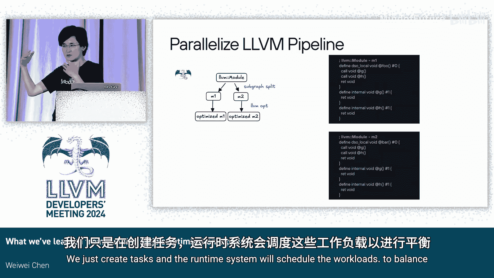

# 【2024-LLVM开发者大会-•-中英】-p25-P25-What-we-learned-from-building-Mojo’s-optimization-pipeline--BV18eNfepENu_p25-

Hello， I'm Wei Wei。 I work on the Mo language team at Moular。 Today。

 I'm going to talk little about what we've learned from building Mo's compilation optimization pipeline。

Just a quick overview of my talk today。 We will first take a glance at the module language and then a general view of how the compilation pipeline looks like。

 And then we will dive deep into dive deep， dive deep into the two parts of the pipeline。

 the ML part and the L part and share a bit the things that we've learned from building these two parts。

 And at the end， well have some discussions and questions。Just a quick overview。 quick look at Mojo。

 So Mojo is a new Pythonic system programming language that was firstly announced early last year and is still very actively developed underdevelopment at modular if you take a look at the right side of the slide。

 It has this python Pythonic kind of aesthetic of the language and has a lot of python compatible features。

 So in addition to that， Mojo also has some superpower features like extensive generic programming capability pipe system safe efficient memory model。

 it gives you sea level kind of control in terms of program performance。

 we also support kind of heterogeneous programming model so that you can write both CPU code and GPO code altogether with synchronous programming。

 So some of my colleagues are going to talk a little bit about some of the new features that we are adding to the programming language。

Both today and tomorrow， if you are interested in the details。These are the， sorry。

 These are the great talks to， to go to。But today， we're going to more look at what the compil。

 How does the completion look like。 So the module compiler is built based on top of the M framework with L of V as a backend。

 So here is a general kind of flow of the compilation。

 We have the module program do module file go first go through the module pass。

 and then we will enter the the I， which is in the parameter domain。

 So this is still generic So we will pack some of the library code into module package。

 which can be used later by other program so that we don't have to go through the pass again。

 we will do some optimizations in the generic domain。 Then we will enter the elaboration phase。

 Elaboration is kind of a module specific term。 It's pretty similar to C+ template instantiation。

 So we will run a bunch of interpreters and try to。Materialize the IR after the elaboration。

 we will get materialize the IR。 we will perform a little bit more optimizations and then translate the module dialectgs that we have into all VM dialgs and then use the LVM infrastructure to go to the final binary targeted code we also do a little more things here kind of using LV in un conventional way。

 I will expand into the details a bit in the rest of my talk。

 module also use a library driven compilation model for heterogeneous platforms。

 So for GPU code when you write the GPU code， you will always write some host code CPU and the GPU part and then maybe some other host code。

 So in module GPU part is a parametric function。 That's why the GPU related compilation happens during elaboration time。

 instead of running the interpreter try to。When we try to materialize the GPU code。

 we run a co compil for GPU。 So this part is pretty much as similar as the， the main part here。

 I'm just like briefly because I want to put it on the slide。

 And then we generate PT T X code as the result for elaboration plug it back into the elaboration phase for the host code and then go down。

So as most compiler needs is like the goal we want to achieve for module compil is that we want a fast completion time。

 and we also want to generate performance generated code。

But a few things that we found when we first initially initially implement a compiler that what we figure out is that actually takes a really long time in the overall module computation time。

 about 60 to 80% of computation time。 and as you can see from the time tracing here。

 We also figure out that00 computation time is an order of magnitudes lower than03。

 which is a bit counter intuitivetu because00， we are running way less optimizations。

 is supposed to generate less performance code， but now we are taking longer time and generate worse code。

 That's not great。 So what we figure out is that first of all。

 Mo has very extensive generic programming support。

 This actually leads to like really large IR size after elabo。 its kind of code size explosion。

 and especially for00 versus03。00 is actually significantly larger。

I size is significantly larger than03。 as you can see。

 some of the providing data here before L of M optimization00 is about tax larger than03。

 And after L of V M it's some of them are like about100 x difference so。For0。

 when we have really large I size， it put a lot of pressure on the whole competition pipeline。

 both the L of M part and the M L part。So with that in mind， with all these observations。

 what we are trying to do is you know at the M level because we have full control。

 we are building that part。 We are trying to replace some of the optimizationizing and try to really guing down the I size every step of the way so that we don't have to send a large amount of I to the pipeline and make that pipeline to do a lot of work。

 So we have a bunch of optimization passes at the M level including through ourCCP rollings that we use simpathifies。

 These are very similar to whatium has but we kind of lift them earlier to the M level so that we can keep the of the I size in check while still like doing all those performance related optimization we also have some functionality specific passes at level。

 for example， for closures and。Routs， we， of course， also run some of the basic passes。

 including canicals， C S C and eliminate that things。

So in addition to keep the IR sites in check at MI level。

 implementing some of the optimization at M level is also very beneficial because we have a higher level I representation at M I level for example。

 we have I representations of is code routines like stack allocation know some operations for variety packs。

 So they have more meaning to the program which can help us to simplify the implementation of the optimization passes MI level。

 we also have a regionbased structured control flow representation。

 which is different from the generic CG that we usually have in L of B I or generic M I where you have straight line code in basic blocks and just branches at the end of the basic block So we have the this structured control flow representation where you can see that we have a loop。

 we have if and we can have。Early access in the middle of the regions so that it matches better with the kind of higher level representation with the program logic。

 This actually really help us to guarantee some of the best case scenarios when we implement data flow analysis like SCCP andurac。

And more， when we try to implement the passes at the M L level。

 we also really focus on parallelization。 That is mostly for computation time。 First of all。

 M L framework has just， you know， natural support for parallel paralleling function of level passes。

 So we just may need to make sure that when we create the pass manager。

 we will create the passes accordingly so that we can just automatically leverage the parallelization from provided by the framework。

We also， when we implement those intraprocedure optimizations like module of level passes。

 we also try to inject intrapa parallelizations to parallelze them。 For example。

 for the in liner that we have at ML level we really try to to implement it so that within the passes we have parallelization。

 for example， when we inline call graph we want to do it from bottom to up。

 and we want to inline the call for every function and we create that for every function。

 we create asynchronous kind of parallel tasks and we set the dependencies between the the functions if there's a call graph dependency along them。

 So if they have kind of pass to each other， they have to wait for each other to finish。

 But if there's not direct path between the functions， they can actually run in parallel for example。

 here in this very simple call graph F1 and F2。R in parallel and F but the full and can run in parallel when we inline them and we also try to apply the similar kind of approach for the elaboration part。

 just like really try to bring up the level of parallelism in all the optimization passes that we have at M level。

 This really help us to improve the computation time while not to lose too much generated code performance because we are also doing optimizations like for memory you know。

 data flow analysis and things like that。 and also more importantly， keep the I in check。Now。

 let's take a look at the LVM pipeline。 We have the MR part。

 but we don't want to implement reim everything We still want to use the powerful part of L pipeline。

 So L is very good with things like scalar optimizations。

 The load store optimizations and is very good with target specific cogeneration。

 We don't have to reinvent the wheel。 we still want to keep those things。 However。

 LM is not super desirable It's not perfect。 like it has kind of a weak and unpredictable loop optimizations。

 are a lot of heuristics。 It may happen。 It may not happen from programs perspective。

 you don't really have a lot of control for that。 and also more importantly， L is single threaded。

 It's not paralyzed so that it's very hard to leverage the multiprocessor what we have in modern machines。

 So what we do when we constructing the when we are constructing the L pipeline。

 we try to really simplify it。That L of M does less work only do the important part。

 so we remove the bacteria we remove the loop enroller and we move those functionalities up to the module library。

 So you control that when you write the program。We disable related passes because we can implement cor routines and stuff at the MR level。

 And we also try to disable all the interprocedural optimization passes so that we can create like function pipeline and run them in parallel I put a question mark here because it's not exactly what happen So we we try to implement。

 we implement that。 And then we realize that actually in linening is quite critical for generated code performance。

 so we get rid of the L in liner， we get rid of all the IPO passes and we figure out that for some of the benchmark models that we are running we get about to x slowdown without in liner。

 we can actually recover the performance with very aggressive in linening strategy at M level。

 So we we do have level kind of higher level in liner。 if we become very aggressive there， we can。

get the performance back。 but there's a cost that that we are paying。

 As you can see here that with aggressive in learning。

 the CPU utilization is higher because we have more parallelization happening。 but the memory also。

You know， we need more memory because the code size is larger and overall computation time is more or less the same。

 So it's not quite helpful。 So it might be a little bit naive to think that we can just get rid of L VM and replace it。

 you know， with amount of work。Building that at M level。

 So we conclusion here is that we still needium inliner till we can build an kind of equally sophisticated one at the M level。

 So with that in mind， we still want to parallellyze the pipeline。

 So we kind of choose a two level parallelization splitting strategy to parallellyze the pipeline。

 So to parallel pipeline basically here， we just try to split the module into multiple sub modules and try to run the whole pipeline on those sub modules in parallel It's like splitting the cP file into multiple ones and compile them in parallel。

 we do a two level splitting。 The first level is that we split the the optimize module into subgraphs。

 and each subgraph will keep the full function call graph。 So that when we run the optimization。

 we can still run the in liner and they can see each other。 we keep the optimization。At that level。

 And once we optimize everything， we split the sub graph further into functions。

 Then we run the cogen part for every function in parallel。 So it's like a further parallelization。

 And at the end， we will put the the output together。 So as an example here。

 we input we have L module， which has two functions for and bar， both calling G NH。

 a very simple example， real cases， probably G NH is going to be you know。Optimize a away。

 but as a example， I'm going to show that they will stay there。

So the first step is to split the l module into subgraphs here。

 we have two subgraphs full and bar and we keep the full cost stack。 so we have GNH here。

 There's a little issue because you see there are duplicated code right GNH are duplicated and then with the subgraph we run the optimization and we get optimized modules。

 then we further split optimized l modules into per function So here now we have full and GNH and by all in separate modules。

 we can run this with codegenN。 However， the duplicated code is still here。

 and for full and bar to C GNH we also have to change symbol linkage type from internal to weak so that the linking can you know the function will now be optimized away and then the call will fail here。

 So this is not perfectly ideal because we have duplicated code。

We have to change single linkage type。 so we actually add an extra layer of we are kind of doing something very unconvental here。

 first of all， when we run the codegen part， which is similar to LLC。

 we run the full codegen doing like instruction selection and stuff like that。

 but we stop right before ASM print for each split。Then we build this thing called M link。

 which will link the codegen result in memory。 It will do a bunch of reduction kind of work to bring all the like constant pool I and global M symbols into one M context。

 And then we just run AS and print as one thing and for the link result so that we can fix the we can get rid of the duplicated functions and we can fix the symbol linkage type。

And now we have one all of M module as input and still one dot O as the output。

 It's kind of a very unconvental way to use it。 We would love to upstream this because we also run into a bunch of infrastructure issues。

 I， I believe that if we can upstream this You know， folks in the community use it。

 it can also keep this part more stable。 in in the tree。So with this M special MC link， as you see。

 you can see that for the the generated object code， we don't have duplication anymore。

 G NH actually are gone because there are internal functions。

 You should now see it in the symbol table in the output object file。 So everything is being fixed。

 great。We do run into a bunch of infrastructure challenges while try to parallelze L VM。

 First of all， it's because LVM is not threadsa。 So for things like L contacts and M contacts for optimization and cogen。

 we have to make sure that we have separate copies for each split when we run the computationil in parallel。

 and we have to make sure that the IR being moved into those contacts in efficient and also safe way。

 So we use actually bit code to serialize and decize those Is for the migration between different contexts。

 we also run into some inefficiency in L bit code that for example。

 characters are actually encoded as 64， which takes about8 x space as needed it is also not performance to do the copy of the strings and lazy loading is also pretty great for function bodies。

 but not great for。And we run into early performance issue with PTX because PTx currently know we are using it as basically just a big string in the IR as a result of thelaeration。

 So we have to somehow work around these issues， try to not fully rely on the infrastructure to do that。

And for linking at the cogen level， a similar issue that you know out of we have to when we link them together。

 we have to put all the splits back to the same LM context for linking so there's another serialization decilization happening the target machine that we use for cogen is not stateless so that we now we also have to keep multiple copies for each split that actually increase the kind of memory footprint during cogen and also for target specific backends we have to do some small modifications for the reduction and most of them are private APIs so it's kind of challenging to change access from of tree。

As a conclusion， what we figure out when we build the module pipeline is that first of all。

 computation time is a function of I input size to LBM instead of the amount of work that we want to want to optimize for。

 So to address that。 we move a lot of opt passes at the level so that we can progressively optimize the I and choke the final size to keep the I size in check。

 We also have a higher level representations of the I so that it helps us to simplify some of the implementations of the passes。

 We also try really hard to leverage the parallelization for know inject parallelization into the passes。

 We are kind of using L in a pretty unconventional way we do this twole level of splitting and try to do the m linking to make sure that we have parallelization。

 We also have like write cogen and result。So as a result， today。

 LBM pipeline takes about 20 to 30% of completionil over， over module computation time。

 So as a conclusion， we think we can build a compiler to leverage the best part of both M I R and LBM。

 We don't have to build a compiler purely in LBM or purely in M IR。

 We can have both of them work together。Thank you very much。 This is the end of my talk。

 Any questions。👏Any questions you have mics here， and I can bring him back to you。

You didn't talk about the runtime performance impact of this I mean would you have any numbers on runtime performance runtime you mean when the code is being run I don't have that because this is most of a computation sorry。

So when you split into subgraphs， right and you kind of。

You duplicate the function sometimes right but you split to parallelize to improve the compile time right but then if you duplicate then the compile compile time of each subgraph is going to be regressing right so what's your approach to solve this？

Not very sophisticated。 We do try to sort the I size kind of as an estimation for how long it will take for the optimization and try to balance the workload。

 But right now， were just creating like a parallel tasks and let the runtime system that we have to。

 to schedule the the code。 So it's， it's not just we are creating threads。

 We actually have asy runtime system。 We just create tasks and the runtime system while schedule the workload。

To balance to a code。Sorry， I'm curious if there's a module size below which you don't see a benefit to further parallelization。

 You know， like what's the minimum granularity that you would want to make modules before you you give up and say。

m I'm not going to bother paralyzing anymore because of。

The overheads would dominate the speed up that you get from paralyzing。

 This is actually a very good question。 I don't think we have like a really grinding down to that details yet。

 I do see like when we have too many parallelizations。

 which is kind of well over overwhelm the system right in a sense。

 like we always say parallellyization is kind of a scam like it only beneficial when you have enough resource to riot if you don't have enough resource parallelization ads overhead。

 So it may not beneficial that is something that we definitely should when we do the fine tuning of balance the workload。

 it's something that we should work on and figure out the details。

 So are you generally compiling relatively large programs in in a compilation unit or are they smaller or。

Most of the thing that we're looking at are M L graphs。

 So machine learning learning things there normally will have at least like 100 functions。

 So per function， we have like really enough level of parallelization to leverage for this tiny example。

 probably doesn't make a lot of sense because there are only four functions。

In this example where you're showing how your cloning functions。

 I was wondering what the tradeoffs are with having internal linkage copies versus making these all of these copies be available externally and then having a separate module that contains discardable copies if anything that would have been duplicated in terms of a copy wise it's not mostly the critical thing here。

 the reason why we keep them duplicated within a module is because we want in lineer to be able to see the body of the function so that in lineer can actually do things about that。

 So IPO like interprocedural optimization can still do that。

 of course as Ru does we can just keep them as separate an external thing and do alT level kind of optimization but alTO is not as optimal as doing the things earlier I was talking about available externally linkage specifically which I think in theory is supposed to make the body available for inlining but still tells all of them to not。

Actually coachach Janet。Oh， you mean to tell all of them to go to check the external bodies。

 there is a linkage check called available externally where you're providing the body for IPO purposeses。

 but it still shouldn't get cogen。And。I'm sure there's some reason about I don't know that yet。

 but I definitely look into that。 Thank you very much。Good question out of curiosity。

 Have you looked at pastle parallelism。 There was this project in Gcc a few years back where they paralleled different optimization passes and they basically run this as a job system where an optimization depending on another constructing like a task graph and they found a fairly good speedup from that I think this have been mentioning and the keynote is like L pass manager is moving towards that direction。

 however it's kind of really hard because Lvn data structures are not spread safe So to make that work。

 we have to like very invasively like make amends to the data structures because when you run things in parallel if the context is not very safe and you're mutating the IR be thing what happen there's race condition。

 So in addition to parallel the passes， we have to make sure that the data structures are safe MR is much better than that because the framework supports that as long as you create like isolation from above。

Can do that。 L of M is moving towards that direction， but not quite there yet。 That。 Yeah Thank you。

 Thank you everybody again。 Thank you。