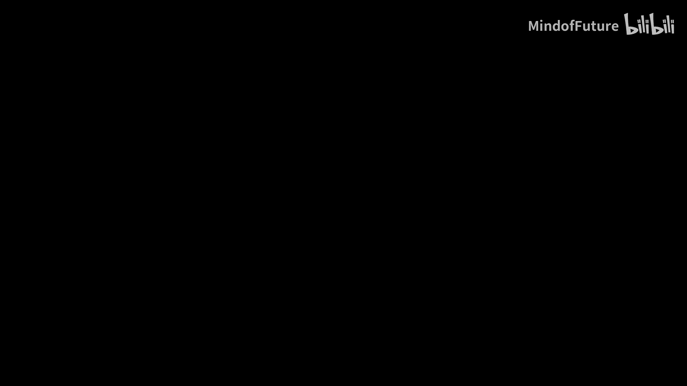
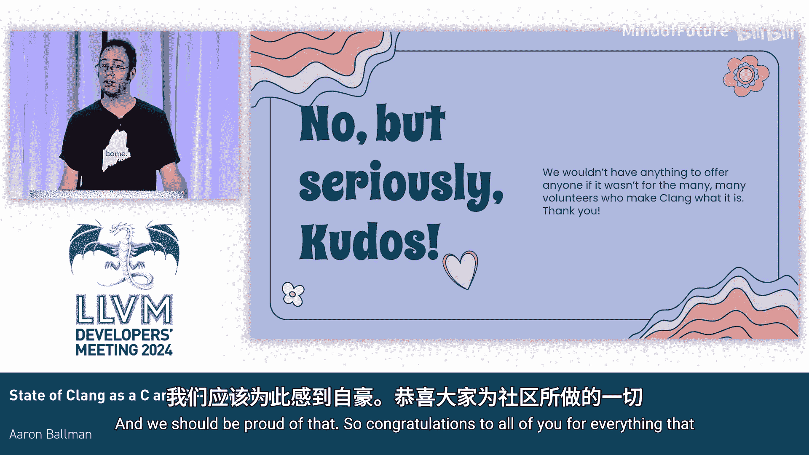

# 【2024-LLVM开发者大会-•-中英】-p26-P26-State-of-Clang-as-a-C-and-C++-Compiler--BV18eNfepENu_p26-

Hi， so as you heard， I'm Aaron。 I am the lead maintainer for Kang。

 and I just want to kind of give a whirlwinds tour of know where are we at。

 what have we been doing in Kang and kind of where are we going with it And how do people think it's going for us and mostly focusing on us as a C and C plus plus compiler for this。

😊，So starting off， we should figure out， what have we been doing for Kang 17， Kang 18， Kang 19。

 kind of what's happened recently？And one of the things we've done is we've been focusing on C plus C plus plus 2 C and C 2 Y。

 These are the next iterations of the C plus plus standards and the C standards。

We started working on these in Kang 17 and we've been expecting to see C+ sorry we've been expecting to see C++2C in 2026 and we're expecting to see C2 Y sometime this decade。

 both committees have kind of a different approach to how they do their standardization。

 but we have started working on both of these standards since Kang 17。So far。

 neither one of the standards has added anything that is like transformative and a major implementation burden for us to deal with。

 mostly it's been small features and bug fixes and that sort of thing。

But we do expect there to be some large scale things coming down the pipeline in the future as the Standard committees continue to work on their features。

So what have we been doing for C++ 2C？In Kang 17， we added the ability to have user generated static assert messages。

 These are a static asserts instead of taking a string literal can now have a context per string basically so you can call functions and have a more robust generated message for things。

We also worked on constant expert percast from voidD。

 which allows constant expressions to smuggle data through void pointers。Cang 18。

 we added unevaluated strings， which is really mostly just a language cleanup thing that says that strings that are compile time。

 strings have a particular encoding to them， but it's not necessarily related to the runtime encoding。

More interestingly， we worked on placeholder variables with no name。

These are especially useful for things like structured bindings where you have one field that you want the name of and another the third field。

 you want the name of。 But you don't care about the second field。

 So instead of having to invent a name for that thing， you can use the underscore。

 And that just tells the compiler。 Like there is an identifier here。

 you should never actually name it。 you're not going to be using this variable。In K 19。

 speaking of structured attributes， we structured bindings。

 We added the ability to add attributes onto the structured bindings individually。

And another one that we worked on in Kang 19 was equals delete should have a reason。

 which when you have a deleted method that's selected。

 you now can actually have extra diagnostic information for it。 that's user generated。

But that's not all。 We've been really working on to see。

 Other things that we've been doing is trivial infinite loops are not undefined behavior。

 You might have seen this one going around on social media quite a bit where you had a main function that had a trivial infinite loop。

 and then you had a completely unrelated function that's not being called anywhere。

 And you would run it in an optimized build， and it would call that function。 that no longer happens。

 we've closed that little loophole and yeah。So another one that we worked on in 19 was pack indexing。

 so when you have a parameter pack or something along those lines。

 you no longer need to iterate over the pack to get to the n element， you can just ask the compiler。

 please give me the n element out of this pack so it helps with compile times and that sort of thing。

Another 191 we did was disallowing binding a return to GL value to a temporary Basically that was a case where we would get dangling references quite easily and we realized we don't need to do that。

 we can catch that statically at compile time and just make it an error so it's basically closing a foot gun for people。

And then Kang 18， going back a step， were the C++ committee removed conversions from arithmetic types to enumerations and vice versa。

 and this actually turned out to be really disruptive to our users。

 So we implemented it in Kang 18 as an error。 And then we very quickly realized that it needed to be a warning that defaults to an error so that users could have a transition period to it and be able to downgrade that into a warning。

But in Kang 20， that is now back to being a hard error。At least that's the hope。

 We'll see how users react to it and whether we've had enough use enough time for the users to transition。

So we've also been working on C2 Y。This one is interesting in that the C committee oftentimes just。

 they standardize existing extensions from a lot of different implementations。

 And so a lot of the work we've been doing on C to Y is mostly just testing that the things that have been standardized are things that we're actually conforming to。

So for example， complex literals， we have the I suffix and the J suffix。

 and this is something we've supported forever， and that was just standardized for you to be able to specify a complex literal。

Another one that was really weird is you couldn't increment or decrement on a complex value。

 which was kind of nuts because everybody was allowed。

 like every implementation of complex had support for this sort of thing。

 So we just standardized it and said， okay， blessed。

One of the more fun ones for C2 Y was and type of unqual。

These features are kind of like decoal type in the C plus plus where you're able to get the type of an expression and the type comes with the qualifiers attached to it。

 So that's why there's a type of unquaal is to get the type with the qualifiers stripped。

But this actually works nicely with another feature that was added to generic selection expressions in Kang 17。

Where the way those things work for those who aren't familiar with the weird things that C does。

 this basically allows you to say， given an expression。

 I want to match whatever the type of the expression is。 so I can delegate to something。 So。

 for example， you can have a macro named s and it can delegate if it gets a float。

 it delegates to sine F。 And if it gets a double， it goes to the regular sign。

 And if it gets a long double， it goes to sine L。The problem with that was the fact that generic selection expressions worked after all the qualifiers were stripped off of the type。

And so you couldn't actually match on every type in the type system。

 And that's kind of a problem in certain circumstances。

 So it now is allowed to take a type operaand directly。

 which works really nicely with the type of operator。 because you can say， given this expression。

 get me the type of this thing with all the qualifiers still attached to it。

 And now I'm going to match on the fact that it has qualifiers。😊。

So we've also been working on C plus plus 23 and C 23。

 These are both ratified by both standards committees in 2023。 They're final， but ISO being ISO。

 they just published the C plus plus 23 standard like this week last ended last week。

 So it's you know it is now finally published。 And C 23。

 we don't know when ISO is going to get it published。 But the thing is these are final。

 The standards committees consider them to be final。 they are called C plus plus 23。

 they are called C23。 If you see Wikipedia articles calling it C plus plus 24， they are wrong。😊。

Clang 19 has been， we've been working on these for quite a while。

 And Kang 19 is almost C plus plus 23 feature complete。

 One of the big things we know we're lacking support for currently is Cons for math。

 We're hoping that we're going to be able to share a bunch of code with LVM Lib C for doing a lot of that implementation work。

 if possible。 So that way， we don't have to duplicate effort across the projects。

 But that's a significant undertaking because there are a lot of math functions that are now contexts for。

😊，We also lack support for unknown pointers in Constext expert and explicit lifetime management。

 The last one would be start lifetime as a library function that needs compiler support。

And Cl 19 also has a lot of support for C 23。 One of the big ones we're missing is decimal floating point support。

 but we also are missing some of the smaller features like adding storage class specifiers on compound literals and that sort of thing。

So what we've already done for C++ 23 is we've done deducing this that works kind of like Python's self object in that you can deduce the C qualifiers off of that object。

 We also relax some contexts for restrictions， which allows contexts for functions to do more things。

 which is great。😊，One other one we did was portable assumptions。

 this was a rather contententious topic in the Standard Committee in that most of the implementers said this is not going to do what the users expect。

 we should probably not do this， but the committee felt otherwise。

 And so we have this attribute called assume， which allows you to tell the optimizer more information that it can assume。

 And as Nikkiita mentioned yesterday， LLVM doesn't forget that very readily。

 And so you actually end up pessimizing your performance more often than not。

And because it's an optimizer thing， as soon as you mutate the code or you go to another compiler or you upgrade your compiler version。

 All those assumptions are no longer necessarily valid。

 So you have to constantly retest and retest and retest if you're using this。

 But it is something that we implemented it in Kleang 19。 and we do have full support for。

Also working on C 23 features。 So Kang 18， we removed drygraph support。

 How many people remember that was the thing。So' that's for parity with C plus plus 17。

 One of the other ones in 18 in Kang 18， that was really interesting， though， is is we added auto。

 which just came from C plus plus as well。 to be able to deduce the type of a variable。

 This only works with object definitions， though。 It doesn't work for things like function return types or function variables。

 We don't yet have template E type things in C。😊，So this is just for the object declarations。

Another one in Kang 18 that was actually a really annoying thing for a lot of people is free positioning of labels。

 So youd write a label。 And if you if you could only put a statement after that。

 you couldn't have a declaration， you couldn't have a closed curly brace。

 You had to put a semicolon in there in order to make that sort of thing work。😊，And so with C 23。

 we just decided from a language perspective， we'll pretend there was already a semi colon in there and move on and you get your declarations and you' closing curly races。

 and it all works fine。Cing 19， we added constant expertt for object definitions。

 and this is again another feature that came over from C++。

 you'll see this as a theme from the C 23 time to release。But this is only for object definitions。

 So we don't have constants for functions yet in C。

 but you can at least finally have a real true honest to goodness， constant object in C。

Which is great because a lot of people forget that if you have like constant I and then you constant I equals 12。

 and you use that in an array declaration， you just made a variable length array surprise。😊。

So now you can use con expert， and it's actually a cont。

 and it will give you a statically sized array。And another big one from Kang 19 was embed。

 This is actually a really popular feature with users。

 and the basic idea behind it is is kind of similar to include with include， you take another file。

 you grab all of its tokens and you slam them into the including file with embed。

 you take a binary file and you grab all of the binary bytes out of it and you slam it into the embedding file as a comma delimited list of integer values。

And this is helpful for an array in initialization where you've got like a two GB object that you want to stick inside of an array。

 You're not going to type out all of those numbers by hand。 Now。

 you can just embed it and you don't have to use linker scripts or funny tricks like that。

We revised the spelling of keywords in Kang 17， so you no longer have to use underscore capital B bo or include a header file in order to use it。

 we've had a long enough transition period for users to get used to the prettier names。

 and so all of the keywords from C99 have now got pretty names。

We also addedll and null puter tea again from C++。Which is a really helpful way to have a typed k null pointer。

Unreachable flow control And C++ that's stud unreachable as a library function in C。

 it's a macro named unreachable。 There are reasons for this divergence。

 I'm not particularly pleased with it， but it is what it is。

And then we have consistent initialization with open curly brace， closed curly brace。

 where it will now finally zero guarantee that it's going to zero initialize the entire object that you are trying to get initialized。

So for C++ 20 and C++ 17， C++ 20 was a major evolutionary change in C++。

 It introduced some fantastically huge features like modules and concepts in the spaceship operator。

😊，And Kang 19 is almost entirely C++ 20 complete。 The only thing we're missing is full support for modules。

 and I will get on to that one in a moment。But C++ 17 is actually interesting in that we finally are now C++ 17 feature complete as of Kang 19。

 that was thanks to some significant efforts from people on doing template resuging and template template argument matching。

 so that means that Kang 19 is now finally finished with C++ 17 features。

So in terms of the stuff we've done on C++ 20 in Kang 17。

 we added support for constantstable ball so that you can have real constant evaluation instead of deferring sometimes to run time run time if it has to。

We also added support for operator spaceship。And Kang 18 well， sorry。

 we also have lambmbdas in unevaluated contexts in Kang 17。

 This allows you to put a lambda inside of a decal type。

 and then now you get the type of that lambda so you can actually use it over and over again so you can do。

 for example， recursive lambmbda function calls this way。And in Kang 18。

 we added a generalized nontype template parameters of scalar types。

 You can use float as a nontype template parameter， for example。AndBut the real big one is concepts。

 in Kang 19， we finally were able to define the feature test macro for it。

 And so you no longer have to use stood enableable if to try and constrain template types。

 You could use concepts for it。 and it is a much more natural， easy to use syntax。

So what's going on with modules， So they were added to C++ 20。

 but we started working on modules in Kang 11。 So it's been about five years worth of work that we've put into doing C++ modules and it's still not complete。

 We don't actually we don't define the feature test macro for it。

But it's worth noting that despite us saying that it's incomplete。

 modules are actually really well supported in Kang。

 and so they should work for most everybody's usage patterns for things。

The stuff that's still to be done， we're tracking an issue 1，1，2，2，9，5。

 And the only two things that are really in there are diagnostics for T。

 local entities and module level lookup。 So those sort of things won't work as。

 you know the way that they should， but we're still working on them。

 The community is still actively working on this functionality。

 and we hope to get it completed in the future。So changing gears。 I like data and I like graphs。

 sorry you're all subjected to this， but this is about how we're doing in terms of conformance。

 So on the C side of things， we're fully conformant to C90 and we have been for a long time and we're almost fully conformant with C 99。

 we're 93% of the way there with only 7% that's just partially supported and there are no C 99 features that are mandatory that we simply don't have any support for。

Our C 11 story is pretty good too。 We're 85% of the way there。

 but we have 10% that we're just not certain whether we're conforming or not because the C Standards Committee adopts a lot of extensions and that sort of thing we just need to make sure that we have the test coverage that we actually are implementing what the standard says and that's why there's so much in the way of unknown。

 So there's between 85 and 95% of C 11 is done。C 23， a little bit worse，81%。

 but we're still doing pretty good。 There's again， about 10% that we're not certain on。

 but there's about 6% that we know we definitely still have to work on it。And then C2 Y。

506% of the way done with those features， at least currently。 and again。

24% that we still have to write the tests for。On the C+ plus side of things。

 we're fully conforming to 98， 11， 14 and 17 now， which is fantastic。

And our C plus 20 support is 91% of the way there with 9% partial。 And that 9% is all in modules。

 So that's the only real thing that's left there。Our C++ 23 support is also doing pretty good。

 It's 89% of the way done with 11% of things that we just haven't gotten around to finishing yet。

And even though it's brand spanking new， the2 C support were 83% of the way done on all of those features as well。

So switching gears a little bit and talking about defect reports。

 This is actually kind of a really interesting topic。 So in C， since C 90。

 there have been 427 total defect reports across the language and the library side of things。

 and we implement 47% of the ones that matter to the compiler。😊，35% of them。

36% somewhere in there just don't apply to the compiler。 There are things that are not a defect。

 They are things that apply to the library。 There are editorial changes。

 We don't have to do anything about。And then we've only got about 2% of CDRs that we know we don't currently implement。

 And there's about another 9% that we're not certain on。 By contrast， on C plus plus。

 the language alone has just shy of 2900 defect reports since C plus plus 98。

And we only we have 54% that we just don't know whether we implement or don't implement。

 We just know that we have 21% that are done and 2% that are definitely not done。

 But there's a massive amount of unknowns there。 And we have folks who are actively working on writing conformance tests for this。

 But the reason it's so important is that the C plus plus standards Committee assumes that every implementation implement every single defect report that they have ever put out。

 And they base new features on the fact that you have implemented these。

 So because we have quite a few unknowns in this case。

 We're not certain where we're at in terms of being able to work on new features。

 because we'll frequently run into a problem where a new feature requires work from a defect report that we haven't implemented。

And so this slows down our velocity on implementing new features and is why getting a better handle on what we're doing for defect reports is so interesting to us。

And so we have been fixing defect reports。 But you notice on the graph。

 we were doing really good and early versions of clang， getting a whole lot of them done。

 And then we kind of fell off。 And it would just be very sporadic as to when we would go get around to looking at them。

😊，But starting about incang 17 or so， that's when we started making concerted efforts to do more testing。

 to complete our DR conformance tests。 And so these are， they're claimed as fixes per release。

 But in some cases， it's already been working。 And we just have the test that verified that it's actually working。

 so we can now mark off as yes。The hope is， is that this graph continues to go up and up。

So that was how we've been doing。 Now， what kind of things are we working on。For C++ 2C。

 we already have veryatic friends and Conts replacement new in Kang 20。

There are folks who are working on reflection and contracts。

 even though these are not yet officially adopted by the C++ Committee。

 and that work is happening in forks off the end of Kang as opposed to happening on mainline Kang。

 but we do know that folks are working on them because there are folks in the clang community who are paying attention to the work that's happening there。

 or it's folks from our community who are doing that work in forks。For C++ 23。

 we've implemented lifetime extension for range based4 loops， that's a clang 20 feature。

 but we still have to work on things like constants for math and unknown pointers and references and constant expressions and that sort of thing。

For C++ 20， obviously， we're continuing to work on modules。

 that's really the primary focus for that one。And then we still do a lot of extension work。

 So extensions like Sle， extensions like open ACC。And there's one that's kind of a stealth extension。

 I think， in that we've got folks who've been working on support for real time analysis。

 for real time code。So there's a real time sanitizer now that people have been working on and their attributes to be able to space。

 say this this function be should not be blocking。 This function should never be called by something that's blocking and that sort of thing。

On the sea side of things， we're still testing for a lot of our extensions for C2 Y。

 That's just most of the effort there。 But there are some new features。 So， for example。

 C2 Y has if declarations that are similar to what is in C plus plus where you can have if and then you declare something in a semi colonlon and then in condition that's using it。

For C23。Some of the things that we've been working on recently for Kk 20 is enumerations with a fixed underlying type and improved normal enumererations。

 which is basically the fixed underlying type one is you can specify the underlying type of the enumeration as long or short or whatever you'd like it to be。

But the improvements to normal enumererations are you can now have enumerators that are no longer just sized int。

 So you can have ones that are sized long or long， long。

 And if you end up overflowing into the different types。

 it will just naturally figure out what is the correct type for the enumeration。

We are also working on a lot of extensions in C and one of the really popular ones is bound safety checking there's been talks on it this week。

 but this is actually a very， very popular feature amongst users they're really excited about this and that is something that we are continuing to work on。

And we've also been working on things like connecting flexible array members with the count so that we can have better diagnostics。

 And so both of these are really moving the needle on safety and security and see， which is great。😊。

Speaking of moving the needle on safety and security。

 we are continuing to harden diagnostics where we are turning things from warnings into warnings that default as errors because we want to help our users be successful。

 and it's really easy to ignore warnings。 It's a little bit harder to ignore these warnings。

 which defaults errors。And of course， we're still working on conformance testing stuff。So。

What are people saying about playingang out in the wild。

 The first thing I need to do is give a caveat here。 This is not scientific。

 This is some guy on the Internet said。 So take everything here with the with a grain of salt。

So one of the first things people are talking about is performance。 Obviously。

 that is the reason why people use C and C++ so much。 And so performance really matters to our users。

 And it's nice to see that our users are finding clang and GCC to be competitive at runtime performance。

 as well as clang and MSV， sometimes clang is better， sometimes MSV is better。

 sometimes Gcc is better， but we're all in kind of the same realm。

 And so it's really nice not to see like we're falling behind or lagging behind any of our competitors。

😊，But it was interesting to note that vector math apparently works really well in debug mode。

 It's actually more optimized than anyone else's vector math， which I。

 it's not what you would expect out of debug mode。 And I don't think it's because we're doing any actual optimizations on it。

 It's just the base implementation of it。 iss that good。😊，On the flip side， though。

 we have compile time performance， and that is something that is very important to users as well。

 And they are noticing our compile times are getting noticeably slower。

 And sometimes that ends up being better runtime performance， which is fine。

 And sometimes it doesn't end up giving any better runtime performance， which is kind of unfortunate。

But this does mean that our users are starting to use F time trace a lot more。

 and they're not successful with it because we haven't really done enough with it to help them be successful。

 So this is an area we should work on to help users figure out what is slowing their compile times down。

But it's worth noting that this is not just a clang problem。

 C plus plus features are just adding a significant amount of overhead inside of S T L templates and headers and that sort of stuff。

 And so this is impacting all vendors。 You switch from C plus plus 14 to C plus plus 20 without changing your code。

 Your compile times are definitely getting slower。 That's just the nature of the language。😊。

Tooling tooling definitely matters to our users quite a bit。 clang。

 tidy and clang format are seeing a lot of adoption and a lot of love from people。

 They're getting increased usage inside of pre commitit C I pipelines。 an awful lot。😊。

But it's also been nice thing。 People are integrating clang tidy into their build scripts。

 And so it's becoming part of the build process， which is really nice because you can write plugins for clang tidy。

 So you can have custom checks for your project that come in as part of your build process。

 which is nice。😊，Claying format， being integrated into basically every tool under the sun。

 which is wonderful。 And users are finding that the number of options are sometimes a bit overwhelming。

 But because formatting is such a personal choice。 It's such a stylistic choice。

 They also really appreciate the number of options we have that they can really tune it to exactly what they want。

 which tells me that we're making a really good mixture， we're setting a good。😊。

We're getting to actually a really good point where it's not too overwhelming。

 but we still have enough that people are able to be successful in formatting whatever they want with it。

And then Kang D is becoming very， very popular。 I was seeing a lot of VS code users who are really happy with it。

 but it's flexible enough to be used as a language server with basically any kind of tool you want for doing things like jump to this definition or which include files do I need to have those sort of features。

😊，So another constituency I was looking at with standards committees because our interfacing with standards committees is actually very important to us as a tool and our users as well。

 and so the C committee， they're really quite happy with adoption of C23 C99 wasn't very well adopted and C11 was a bit slow to be adopted and C23 is going lightning fast in terms of Claang and GCC's picking up the new features and so the committee is super appreciative of that。

😊，And the C plus plus committee is also really happy with Kang。

 But there is a little bit of concern about how the speed of us implementing some of the newer C plus plus features。

 And some of this is kind of an expectation setting thing where in C plus plus 14 and 17 as features were being adopted into the standard at plenary。

 We were pressing the merge button。 And so the committee got very used to us always being right on top of stuff。

 But C plus plus 20 was huge features。 and they're not things that we could keep up with anywhere near that fast。

 so。😊，It's interesting to note that they've got little concerns there。

 But I think those concerns are kind of unwarranted in some cases。

But one thing that I have seen that， I think is important for us to keep in mind is both committees have members that are concerned about our extensions eating into the design space of the programming language。

 And it's not just us。 It's all the implementations are kind of getting yelled at to some degree about having extensions that make it frustrating for the committees to add new features。

 So， for example， a recent one in C plus plus was with reflection， they were using the carrot symbol。

 followed by an open curly brace to start a reflection expression。

That's ambiguous for us because we have a blocks extension， and that's the start of a block literal。

 And so the C plus plus committee had to go back and figure out， okay。

 what's a different syntax to use。 They said， we'll use double double carrots instead。Well。

 you could have immediately invoked blocks as well。

 And so that could be an exor operator on an immediately invoked block。

 And so it's frustrating when we when we have these sort of extensions because they have to constantly work around them。

But it's a double edged sword because they also love having all of the extensions because that's how they get their newest features。

 And they get a lot of experience with features that are in progress。😊。

One thing that would be nice for us to work on is having a good mechanism for community collaboration on working on new features because the Standards Committee often wants to put out new features。

 but they want to make sure they're right。 So they like an implementation to go implement them and give them feedback。

 The downside to that is is we don't want to experiment on our users。

 and we also are penalized for being an early adopter because we implement it and then we get users using it。

 and then the Standard committee changes it and we're left holding the bag trying to figure out how to support the existing users as well as the standards conforming thing。

😊，So overall， the external perception that I'm seeing is that users are excited by our extensions。

 things like F bound safety is just， there is a wild amount of excitement around that。😊。

Users definitely appreciate having a full suite of offerings。

 they like the fact that there's one place they can go for a compiler and a static analyzer and tooling and all of that sort of stuff。

They appreciate how competitive we are in terms of the features and performance we have。

And we still have very good diagnostic messages and standards conformance。

 And that is very important to our users， very important to our users。And then also。

 they really appreciate having the compatibility with GCC and the compatibility with MSVC。

 because it allows them to try out clang so they'll get some sort of behavior from their existing compiler。

 and then they can go run it and clang and see what happens。

 And that's a really important feature for our users。

 So the compatibility work we do is quite noticed by our users。😊。

Some of the less good stuff that I was noticing is that there are still people noticing that we're not fully conforming to the latest standards。

 That's a reasonable expectation for users。 They want the newest， shiniest thing as fast as possible。

There is definitely some frustration about compile time overheads getting slower。

Our documentation is almost nonexistent and that is something that we desperately need to have a lot of love on。

And this last one was really kind of weird to me。 I was not expecting it。

 but there's a perception out there that corporate interests dictate our project direction and that we're not a real open source project。

 This is weird to me because we have a lot of corporate contributors， but we have a lot of students。

 We have a lot of volunteers。 we are an open source community that takes all comers。

 So I don't know necessarily how to you know， combat this sort of perception on things。

 But it's interesting to note that there are users out there who think Klang was an Apple project。

 And that it became a Google project。 And now it's an unowned project。 And it's like。

 that that's not how any of this works。😊，So just to give you some of my thoughts on how I think things have been going。

 these are just my personal thoughts on stuff。I just think we're doing actually a really good job and I'd like to give kudos to the entire community for this stuff because we've made some serious impactful changes with how we communicate with users。

So， for example， in Kang 13 and 14， our release notes were almost empty。

 and I found a comment on hacker news from people saying they thought Klang was a dead project because we would put out releases and they would have one or two items in the release notes and that's it。

 And they're like， this project's going nowhere they're not doing anything。

And so we noticed this that we've reacted to it。 we changed some of our practices to really encourage people to write release notes。

 And now with 1718 and 19， we actually have a lot of release notes for our users。 And they're like。

 oh， wow， this is actually a really active project。 And there's a lot of things going on。😊。

We're also improving on how we interact with our users on issues。

 So it used to be users would file an issue， and then it would just stagnate and nothing would happen。

 No one would look at it， and it would just be forgotten about for a long time。

 And now we have people who are actively triaging the issues and doing things like adding labels to them and trying to figure out if they can confirm the issue or not。

 And these sort of things really do impact our users in big ways because they don't feel like they're being ignored。

And another big thing that I think we should be really proud of is we've grown。

 There are more people now helping out with code reviews， issue triage。

 answering questions on discord or discourse， anything like that than I've ever seen before。

 and so that helps to grow like as the community continues to grow and we get more people working on these things。

 it helps to snowball to continue that growth。😊，So good work on all of this stuff。

In terms of things that I would love to see us improve。Documentation。

Especially around implementation defined behaviors and extensions。

 it's really frustrating for users to have no idea how things work。

 and our source code is open to them and they can read it。

 but no one is going to actually sit down and read their compiler' source code to figure out how anything actually works。

Testing is another big one。You saw that I was talking about conformance testing and how we have a whole lot of unknowns。

 There are commercial conformance testing suites out there。 We just can't use any of them。

 They don't have a model that supports open source。 And so we just have to figure out what do we do。

 Like， if we can't go buy something off the shelf， how can we improve our conformance testing beyond just write a few tests and see what works。

In terms of issues。I think we should be more reactive to issues than we have been。 A lot of times。

 people will write code。 They'll add their features。 Everything seems to be working fine。

 And then they forget to go look at the issue tracker after they've landed it to see what was the fallout from that。

 What crashes have started happening， What kind of things are people running into。

And so we do end up with a fair amount of regressions。

 which makes our release process harder because we have to fix a whole lot of stuff。

 And then Cherry pick them over into the release branch。We could do better with our issue management。

And then finally， growth。Even though we have been a growing community， My perception is。

 is we're growing mostly in areas of writing code， which is obviously really important。

 And it's the thing that a lot of people love doing。

 But that's not how we have a successful product in the marketplace that's really compelling to users。

 because users want things like documentation and a good issues list and that sort of stuff。😊。

How do we grow our community in these non coding areas。

 How do we get people that are excited to work on Q A QA processes or the website。

 that sort of stuff。But seriously， kudos， because we wouldn't have anything to offer anyone if it wasn't for the efforts of people in this room and people within our community。

 we all should give ourselves a big pat on the back because we are the ones who make Kang successful。

 and， and it is a very successful project。 It is a very critical project in the marketplace。

 And we should be proud of that。 So congratulations to all of you for everything that you do in the community。

😊。

So now I'll open it up for questions。Hey， I wanted to ask apart from compilation time slowdowns are there any other risks like security issues or run time issues if we move to C plus20 as the default language standard incline。

So。Part of the problem with us removing to C++ 20 is the required language standard is the support in all of the other compilers hasn't really been there。

 and so we run into a problem where we required last year's compiler for everybody and then people who are on long term support distributions have troubles contributing。

You have to buy a new compiler， if you're on Windows， those sort of things。

 So we will get there eventually。 and I think we will see a lot of benefits when we're able to use the newer language standards and the features they have。

 But it's just kind of too early to make that move right now。 but we will do it。

 We've been consistently doing that。See， thank you。 You're welcome。

So you talked about a bunch of SL class 26 features that would be really good for improving quality of life for developers what's the process for getting that stuff backported that way the standard library can start using that stuff and give delete with a reason。

 for example。So。If it's a conform， if it's something that we can use as a conforming extension。

 we've traditionally tried backboarding that stuff as much as we can。

 And that's been a double edged sword for our users because some users are like， this is great。 know。

 I love it And it's conforming and I'm usinging just extensions。

 whatever I don't compile in pedantic mode。 Other users are like， I was using C plus plus 17。

 where are these other features coming from because my other compilers that I'm compiling with。

 don't support that or my previous version of Kang doesn't support that。

 And so I think we'll continue to do it where we can on backboarding stuff。

 But we have to keep in mind the cost for it。 and the difficulties。 So in terms of process for it。

 though。😊，Right at RFC。A propose a patch， that sort of thing。

 And so it's a good place to at least start the discussion on everything。 Thank you。 You're welcome。

Aon your talk is amazing。 By the way。 Thank you。 I think you left out one small thing。 Okay。

 so it's more of a comment than a question。 One of the most impressive things that， to me。

 has happened recently with Kang is when you took the entire set of code owners and rebooted the entire thing。

😊，And made it so that Claang was actually properly structured。

 And I think that was a huge lift for the community。

 And I think it was a very thankless thing and very complicated。 I'm sure。

 But I thought it was a great standard and a great idea and a great thing that other projects and sub projectsjects could learn from。

 So thank you for doing that。 thank you。😊，嗯。The， the graph about the defect reports was super interesting。

 And I'm sure folks want to chip in and help out。 Is there anything like a monthly meeting or biweek meeting that folks should stop by and attend if they're interested in helping。

 Yes， as a matter of fact， there is。Every two weeks。

 there's a language working group meeting that happens。 It's on the community calendar。

 It's every other Wednesday。 I think it's first and third Wednesday of the month sort of thing。

 And it's basically a chance for anybody who's working on any sort of standards conformance。

 type stuff to come A talk about what it is you're working on to make sure that we're not duplicating effort across people's work。

 And B， to ask for help。 So it's a very good resource for。

 for kind of getting into doing standards conformance work。

And there are folks in the community of Lad Sarenikov， for example。

 has been working on standards conformance DR testing specifically for C++。

 And so we have people who are doing this work that I'm certain would be willing to step up and help integrate if you want to do more help on writing those kinds of tests。

 The most difficult thing with doing that is is it oftentimes requires you to read the standard。

And it's not an easy document to read， but the nice thing is。

 is there are a group of people who will help you with that standard so you can come to the language working group meeting and go you know how do I write a test for this sort of thing。

 Is it even possible to test。 So thank you， Nick。What。Great， well， let's thank Aaron again。

