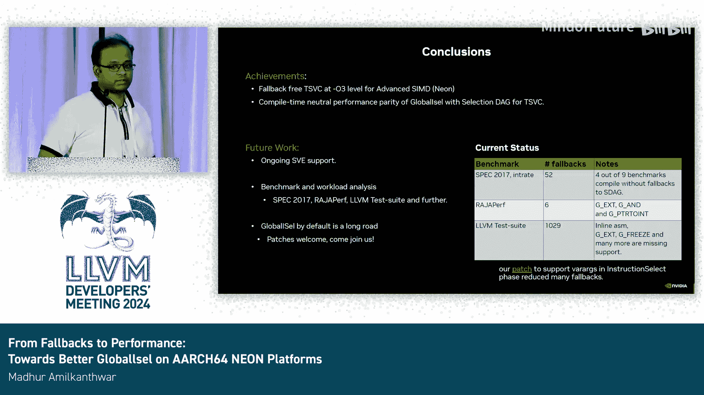

# 【2024-LLVM开发者大会-•-中英】-p27-P27-From-Fallbacks-to-Performance---Towards-Better-GlobalISel-Performance...--BV18eNfepENu_p27-

Okay， let's switch some gears and look at back end。 We all need backend。 This is mother from Nvidia。

I'm going to talk about my work， our work on global IL。

 fallbacks to performance towards better global I cell performance。

 This is what was done in collaboration with Dr and TNE。

We quickly quickly grow our global I cell for contributions， results and the next steps。

So for those who are not very aware of global IL， it's basically yet another instruction selector in the code base。

 It's been there for more than five years。 It is now default at 00 at add 64。

 but for other cases like for other optimization levels。

 it just falls back to selection rank But when you look at the global I cell as an infrastructure。

 it doesn't create the new I called dag。 and it just goes through the generic machine instructions and lowers that to the machine instructions and refines that through the multiple phases。

 But when we compiled with the different benchmarks。

 We found that a lot of them or almost all of them just falls back to the selection。 so。

In the longer term， we do want to enable it at03 for the A 64 backend but our approach is empirical。

 We do want to go with the benchmark by benchmark and see what is happening。

 but do we have a plan at this point， No， we don't have a plan。

 Do we know what the check boxes we want to take that's also not known。 but where do we start。

 So we want to start with something small and simple and fortunately。

 there is a small benchmark called TSVC， which stands for test suite for the vectorizing compilers。

 It was return with the purpose of tuning vectorizerrs。

 but it is very small enough that gets the ball rolling and it helps us in analyzing。

 it has a 152 small computation kernels。 It starts with alphabet S。 and then a number。

 And for the scope of this stock I'm going to focus on globalized cell flag and the MCP gras equal to MC equal to gra。

So when we compiled back in February 2024， we found that。

There is just this one kernel which falls back。 Everything goes。 Everything is nice。

 but this kernel particularly falls back to selection da。 So if you look at this small kernel。

 it's not pretty big。 but through the IR， it generates Fmls and but through the vectorizer。

 it gets the interleave and the interleave intrinsics。 we looked at the S dag implementation。

 we found that getting lowered with the knifeive shuffle vectors and we just imitated that in our global IL path and the badge details are there。

 And this was a first milestonestone of our work。 But what about performance after all。

 we have to tackle global I cell against the selection。

 So if you look at this graph upper half shows global IL were faster low shows global I slower。

 And there are three kernels， which are basically very slow performance when compared to selection da let's zoom in the first kernel。

 in the first kernel， if you see that it's again a pretty small kernel。

 But if you see Fmp and select。😊，And later， you see freeze instruction So through the past pipeline through the phases。

 it was basically getting scized， which is not good because eventually you have the unnecessary instructions there。

 And we fix the exact same problem。 We avoided the scization by adding the rules in the rule set。

 And eventually it just helped to fix the gap。 This is， this was of。Patch， which contributed major。

 but we have other patches。 Also we provided the details。 But after you commit this patch。

 we see that this particular kernel， which was more than 50% behind selection act， it just get fixed。

 but you still have those to other guys 3，1，1，0 and 3，1，1，1， which are basically the same kernel。

 but that was sort of a blocking the performance of the entire text suite。

If you look at that kernel further， zooming in and。here it's a very simple kernel。

 which takes a maximum of a2D array very naiveively computers。

 There is no extra business going on here。 but if you look through the global I part。

 it has load FM and max and which was sort of expected。

 But if you look the further through the multiple phases you see that there is a load instruction in the for loop。

 and beyond that there are multiple copies instruction。

 But if you very carefully the first load instruction is happening in the general purpose register and in the copy。

 you have see that the general purpose registers are getting copy to FPR floating point register bank。

 And again， back from FPR to G which is which doesn't make sense because if you have the users in the FPR bank why are you loading in the GR bank。

 That was the first question we ask And when we。D up more in that。

 we see that the Reg bank Select pass， which basically is responsible for doing all this analysis and assigning the register bank was not very。

Maatured enough。 And this is where global I cell helps us because why we should invest in global I cell is it allows us to look beyond basic blocks。

 Select is limited only to the basic block， but global I goes beyond the basic block and can trigger the selection or can trigger the optimization。

 which are not possible with the selection And that this particular kernel shows the capability。

 So we just exploited this， we just augmented the fee node mechanism the mechanism。

 which looks beyond the fee nodes。 And we found that and we augmented that if you if you are loading in a floating point register or register。

 And but your users are in a certain different register。 then why don't you take that into account。

 and use the same register bank for your all the load and the store business。

 And this was the major implementation And this was a major contribution for this particular kernel。

 now。we are talking about multiple batches here for the fixing of a particular kernel for the entire benchmark。

 but if you look at the before and the aftergraph， you basically close all the gap as a combination of these sort of 11 or 12 batches and the entire test suite now is very close to selection act the performance wise。

 but curious reader， we note that the y axis on the aftergraph is sort of shrunk It's maximum is-20% and here it was 75% because there were performance degradation but the-20% is coming only because of the noise because if you remember that these are pretty small computation kernels and there is a lot of noise even if you run it for five times take the geometric mean or take the minimum whatever statistical techniques you do there is still some sort of noise in that and getting rid of that noise is not pretty worth and because it may not lead to the new。

Ounities，So at this point， we sort of declare that we are in a ballpark distance with the selection rack。

 bar the noise and other things。Finally in the final section。

 I just want to say that we took the small benchmark P weC。

 and we showed that how you can augment the performance and how you can fix the fallbacks and you could go also beyond capabilities of the selection act you could propagate the information beyond the basic basic block。

 which triggers the new new optimization opportunities。

 And this benchmark just gave us the right platform to demonstrate that the global I has enough enough capabilities to do all sorts of optimization。

 and fortunately， this was done without any loss of compile time。

 because we remember that global I is meant to improve the compile time。

 The promises on the paper is that we want to improve the compile time。 So of course。

 if you are doing any optimization， then you don't want to lose the compile time promise。

 So when we after the patches when we。Colected all the compile them numbers。

 We do not have any regulations。 That's a good thing。 but we also get the performance back。

 right So that's the one of the important conclusion。 But the story end here。

 definitely not unfortunately did not because when you look at other benchmarks。

 there are a lot of fallbacks But interesting thing is in the spec 2017 benchmark。

 which is a very important for the CPU guys，4 out of9 benchmarks are compiling without selection without falling back to selection deck。

 which means that we are partially functional complete or at least for the spec 2017。

 But for the other benchmarks large rush up of LM test suite and all that。

 you have you need point fixes and the major theme now we are observing here is that the inline am is not very supported。

 So we just need to look at the dag and see how we can get through it and and we have a small C running internally。

 which basically text the bill。Bs the LLBM at the top of the trunk and collect these fallbacks at the using some scripts and all that。

 So these numbers are just like from the last week。 So these are very close to the reality。

 not like one month ago or something。 So you do have a lot of fallbacks there。

 And we are actively working on closing that fallback。

 And eventually going to the dream and saying that oh， yes， art 64 has enabled by default。

 which so it's not going to be a one man or one team effort。 Pates welcome and come join us。

 Thank you。 Thank you for attending。 And special thanks to our all the patch viewers。

Thank you， Madoric。