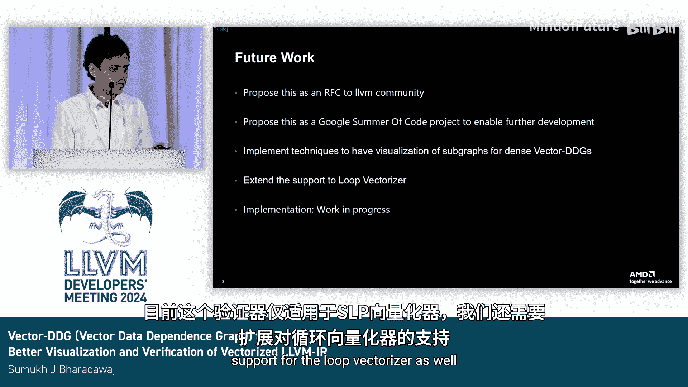

# 【2024-LLVM开发者大会-•-中英】-p28-P28-Vector-DDG-(Vector-Data-Dependence-Graph)---For-Better-Visualization-and-...--BV18eNfepENu_p28-

Hello， I'm Sook from the M D compilers team。 The topic of my presentation is vector data dependence graph for better visualization and verification of L VM IR。

My team members include Raggish， Ruman， Karik， Ihman and Minna。

 who have also greatly contributed to this project。

So the presentation is structured in the following manner。

 We will be going through each of these topics， one by one。Let let me start with the introduction。

As we all know， vectorization is an efficient technique。

 which brings great performance improvement and takes advantage of performing the same operation on。

😊，on multiple data elements simultaneously， thereby creating great performance improvements。However。

Viualizing the same vectorization in the form of a data dependence graph could be a difficult process due to the modification of the data flow。

 as well as presence of vector lanes。Due to， due to the parallellyzization that is being performed here。

Thus， our project aims to tackle this challenge by providing an extension of the existing data dependence graph。

By providing a visualization for the same， as well as utilize the constructed graphs to verify the vectorization that has been performed。

So let us consider the following example here。 we have a combination of instructions that greatly modify the data flow。

Now， if we look at the if you look at the original data dependence graph。

 we acquire no information about the the shuffle instruction。

 which performs modification in the data lanes。 Neither do we get information about the lanes from which the extract elements derives its values。

However。Now， consider the graph that。Our past produces。

We can clearly see a lane by lane dependence between the instructions。As well as the data flow。

 which is clearly represented， making it easier for us to understand the vectorization that is happening here。

In addition to this， we also plan to remove the glue instruction， such as the shuffle instruction。

 which add no logical dependence to the program logic and make the graph even simpler。

And further reduce the complexity of the graph。No。That was the visualizer part with the verifier part。

 let me start with the following example。 let us consider two incoming values， P and P2。

What we try to do here is compare the existing scalar DDG graph and the vectorized DDG graph。

 This process is not that straightforward。 So in order to make it simpler。

 we are actually going to scize the vector DDG that we have created。So by scizing。

 what I mean is a single vector instruction is going to be split。

Depending upon the number of lanes it has into nodes of its own。 So， for example。

 consider the first vector load where it has two lanes， V L lot and V1。This is going to be split。

As individual notes of their own， which can be seen in the second image。And so on。

 So the same procedure is followed for all the vector instructions that are present in our graph and will result in a scized D DG。

 which can be used for a one to one comparison with the original scalar D D G。

So in addition to the data dependence that we are representing。

 we are also going to ensure that the memory dependences are depicted accordingly。

If we see that in the original original graph， we， we understand no information about how the memory dependence exists between the two nodes。

Whereas in the second graph where we are going to scize the DD G。

 we observe a clear memory dependence between the first lane of the vector load and the0th lane of the vector store。

 So we ensure that we retain both the data and the memory flow dependence。

When we scize that vector it easy。Now， we arrive at the main definition of our algorithm for verification。

 which is， which is nothing but。Given the assumptions。

 a vector E DG is equivalent to the scalar D DG， if and only if there exists a path in the scalar D DG for every path in the scized vector E DG。

So this is， this algorithm aims to derive a 1，2，1 mapping between the two graphs that we are trying to verify。

The the elements that constitute our graph are as follows。 We have the nodes。

 which can either be the scalar instructions or the vector lanes。

 And then we have the edges that are either the data or the memory dependence。

The assumptions that are needed in order to ensure that this verifier produces a right result is that there are the same instruction sets on both the scalar DDG side as well as the vector D DG side。

 and we should also ensure that there are no nontrivial transformations that are being performed on the vector DDG because that would result in elimination of some of the nodes that we would have otherwise compared the graphs with and would lead to a wrong result。

So this is a brief description of the algorithm that we follow where we take the two graphs and traverse them in the topological order。

 and we perform a level by level comparison。😊，The incoming values are first compared。

 which form the roots of our D D G。 Once these values are compared by the method of induction。

 we can we can just ensure that the two notes of the corresponding graphs are equivalent by ensuring that the parents are identical as well。

Once this comparison is successfully done and the instruction sets on both the sites are exhausted。

 we can conclude that the graphs are equivalent。 However， if the match fails at any point。

 we can say that the graphs are not equivalent。😊，So here is an example that shows us the differences between the two graphs。

So here we in the scalar graph which is on the top right。

 we have incoming values from P0 to p3 followed by four scalar loads and then two scalar additions at the end。

We can see that there is a the scalized vector E D G also looks quite similar to how the original scalar E D G looks like。

And it also has the lanes depicted as nodes of their own in the form of wheel lot and wheel 1 for the first vector load and wheel 2 and wheel 3 for the second vector load。

The comparison is pretty simple where we first start with the roots of both the graphs。

 So we compare P n to P3 on both the sides。And once that comparison is done。

 we move to the corresponding level where we lot is compared with a lot by checking for the parents of the node and then so on until we arrive at the end of the leaf node。

Following which we can conclude that the verifier that the verification process is completed and the vectorization holds true。

So I would like to talk about the soundness of our algorithm here in in our case。

 if the ver actually concludes that the result is equivalent。

 then we can actually say that it is equivalent。 but however。

 if it besides that it is not equivalent， it could go either ways。So the。

 the verification procedure is sound in nature。However。

 the equivalent part the non equivalentent part is due to the fact that there are certain special instructions in the vector E D G parts。

 such as the shuffle instruction， the extract element insert element for which there is no correspondence。

In the scalealar E D G， even though we handle these special instructions。

 there could be other anomalies or other combination of instructions that could be that could be difficult to judge。

 and it would require further reasoning from our site to ensure that the two graphs are actually equivalent。

 Hence in those cases， we actually return the result as non equivalent。

Thereby making our verification a sound， sound procedure。In the future work。

 we plan to propose this as an RFFCC to the LDM community。

 as well as to the Google Summer of Code project for further development。

We also need to ensure that the visualizer that we have needs to be concise in nature。

 and it could the view could be very cluttered for very dense graphs。 Thus。

 we need to also represent subgraphs in a form where we could understand the graphs in a simpler manner。

And this verifier is currently only for the SLP vectorizer。

 and we need to extend the support for the loop vectorizer as well。 Thank you。

