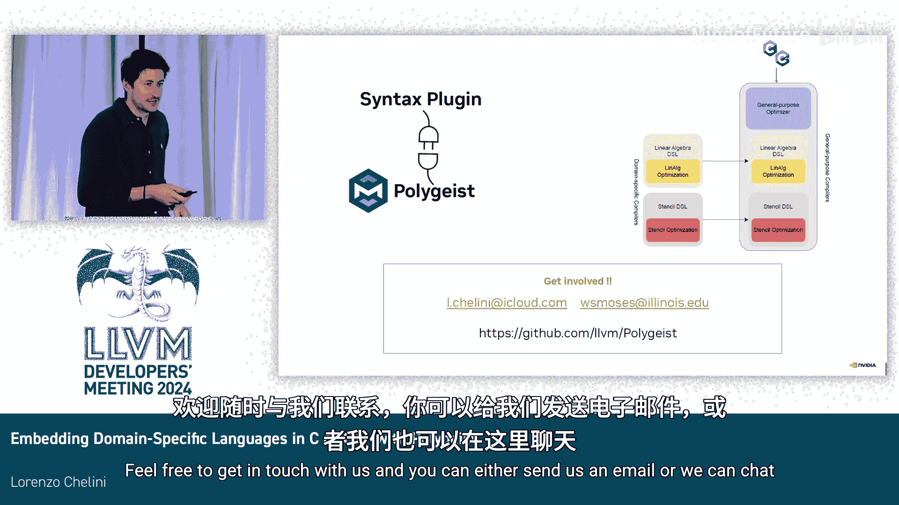

# 【2024-LLVM开发者大会-•-中英】-p29-P29-Embedding-Domain-Specific-Languages-in-C++-with-Polygeist--BV18eNfepENu_p29-

Hi everyone， I'm Lorenza from Ineddia， and today I'm going to briefly discuss a little bit how you can embed domain mainspec language in CRC++ using Pogst。

 This is a work that I have in collaboration with William Moses at the University of Illinois Ubano Champaign。

So before going into the details， let me first give you a little bit of motivation on why we want to do that。

So I don't need to convince you that today programming hardware is getting more complex。

ard itself is getting more heterothergeneous and more eyelevel and the typical response from the softwareer community to this increase our structure in the address stack has also been an increase on structure in your software and to achieve that what you can do is to essentially developing a domainmin specific language and domain specific compiler However。

 these two do not come from free， usually you have compatibility issue also and composibility issue between those and their really。

 really hard to integrate into existing large code base。And the main motivation is this。

 usually this tool be basically monolithical piece of software。

 And this means that and this actually is due to the tiny integration that exists between the language and the software。

So essentially with this project， what we aim at achieving is to design a set mechanism that allow us to bring a domain specific language to existing CC+ project in an easier way。

 so effectively what we want to do is to tear down the barrier that exists between this domain specific word and the general purposepo one。

We do that by essentially reusing novel compiler technology。

 so we build on top of MLIR and specifically what we did here is to add a and extension mechanism to polygt。

 which essentially allow you to bring a domain specific language and compiler as a set of plugin。

And we call these extension mechanism， syn plug。Yeah。

 so for those of you that do not know what polygast is， polygastte is a C or C++ frontend for MLIR。

 among many other things， and essentially what it allowed you to do is to take an arbitrary piece of C or C++ and translate to the corresponding IR that may belong to different dialect within the MLIR framework。

So this slides show a simple example， so you have a 2DS loop here on the left and on the right you have the corresponding IR and you see that the beauty of polygast is essentially that allow you to preserve the rich semantics of your language so in this case a4 in C correspond to an SCF4 in theF standard controlflow dialect in MLIR。

And also， you can preserve the dimensionality。 So in this case。

 you have a 2D array and you see also that your memory R 2D。

Essentially polys shift this I shift this by essentially relyant cl。 So you build the Kang It。

 and then it's can the IT。 and for each It node emit emit emitter the proper IR。嗯。Yeah。

 so let me tell you a little bit to what we have in mind here and how actually is the plan to bring this domain specific language and their transformation in a general purpose flow。

 So I think we need to basically work on treatment main area so the first one is that we want to bring custom syntax So for instance。

 if if you are some expert in the linear algebra domain。

 you may want to write your application using a custom syntax so you don't want or you're not interested in writing CC++。

The second way is that we also need to give you a mechanism to bring your own knowledge into the compiler。

 and this can happen essential in two ways， one as a form of rewriting rule。

 or it can happen also as a form of operation。 So you may， for instance。

 be able to dynamically inject an operation in the compiler and give semantics to the operation itself。

So for the purpose of this talk， I will just focus on syntax and ir rule in polylys we already have some experimentation with operation itself。

 so for instance， you can mark a function with pragma and then this function will get lower to a custom up in MLIR。

 but it's not dynamically so we need to basically pick a dialect and lower to it。Okay。

 so let me give a little bit of idea about the syntax。 So essentially for this syntax。

 what we did is that we implement an idea that has been proposed a few years ago by Pletal。

 which essentially consists of a clk extension that allow you to fundamentally alter this syntax that is parse by clang parser。

Essentially， what this means is that you can now go and match a mix C code with DSL code as long as some parsing rule are essentially respected。

 So， for instance， the limit will need to be balanced。And this is a simple example of that。

 So you see that now the C function has been marked with attribute Kang syntax and then within brackets。

 you have the name of the pluginin， which essentially is a simple shared library that will get loaded by polygonst and we'll tell to polygst how you should interpret the body of the function。

 So the argument our simple C code， but you see that now the body is a DSL code。

 So for this specific case we use tensor comprehension。

 which is a DSL language to express linear algebra computation。

So practically speaking this work as a twostep approach so during the parsing phase what happened is that Kang will parse the body of the function。

 so we then take the parsed token， store them away and in the next phase。

 so basically when polyge start scanning the IT and build the IR construct。

 what we do is that we retrieve the pars token and off to the plugin and the pluginin will then be responsible to emit the function body。

So as I said before the pluginin is a simple shared library and consists of parser plus an IR meter so it's fairly simple and here in this slide basically on the left you have the ISD that is generated by the pluginin which essentially represents a single transpose operation while on the right you have the emitta IR so in this case the transpose operation is lower to a linear generic which is a nileve operation that belong to the linearlic。

Notice that basically a function boundary polys will handle the IR emission， and then it will pass。

 for instance， a symbol table to the plugin so that the plugin can understand what are these argument and stuff like that。

 So， and alsos other things that we do here is that for instance。

 we upcast from memory to tensor because we want to reuse some optimization that are available in line。

Okay， so now we brought the syntax。 let's see how we can bring optimization。

 So imagine that you're writing your library。 So now you have a kind of nice way to write your transpose kernel。

 but now you want to inject an optimization there。 So to inject optimization what we provide to you is what we call tactics essentially a tactics represent how you can everywriting rule and the pattern tell you essentially what you want to match while the replacement tell you how you want to replace what has we matched。

 and in this case the tactics is fairly simple。 So is detected repo asrepose and replace with the single copy operation。

Practically speaking， these tactics get lower to the transform dialect。

 specifically to some measures that are available in the line dialect that allow you to reason a little bit about the property of the operation like the structure as well as the access pattern。

 So specifically， for instance， assuming that you want to detect the transpose what you want to make sure is that your generic is a 2D。

 then you want to also to make sure that all your dimension are parallel。

 and you also want to make sure that the input and output is consistent with what would you expect for and transpose。

 So when input one output and then you finally look into the access pattern。

 So the input must be an identity and the output must be a perfect permutation。 Finally。

 you also look at the body and make sure that the body doesn't do anything fancy。

 So in this case it should just be a pass through up。

So once once we have match what we can do is now we can go and replace。 So for this， again。

 we use transform dialect。 specifically we use the structure replace So。

 which allow you to take an input a set of SSA opera that are the new opera for the operation that you're going to inject and the payload of of the operation is the replacement。

 So the replacement in this case is yet another generic， but is copy rather than aroppo。 And I mean。

 all of this is actually generated from this。From these tas， essentially。Okay， so all in all。

 I give you a little bit of a brief idea of what we're building here。

 So essentially what we aim at achieving is to try to mix C code with the SL code。

 and I think it's quite a good time because we have another compiler technology that' allows to do that。

 and essentially the big goal that we want to do is to try to tear down this barrier that exists between this toward。

Feel free to get in touch with us。 And yeah。You can either send us with mail or we can chat also here。

 Thank you。

Thank you， Lorenzo。