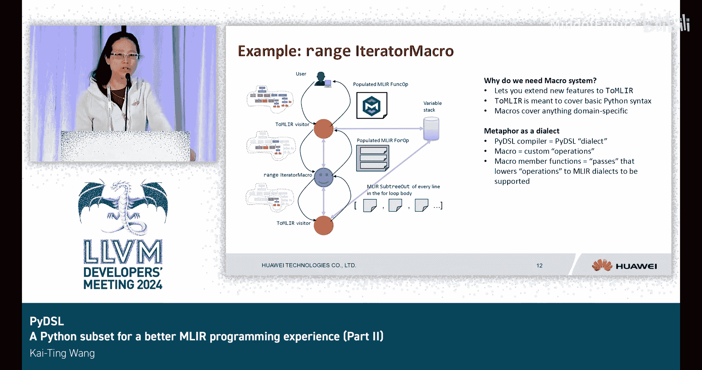

# 【2024-LLVM开发者大会-•-中英】-p30-P30-PyDSL---A-MLIR-DSL-for-Python-developers--BV18eNfepENu_p30-

Hi， my name is Amy， P DSSL for a Pyson subset for better MIR programming experience。

 It's part two of the talk。 On the right， you can see an example of a P DSL program where the loops are tagged and targeted focused optimizations are applied to the tagged loops。

😊，Okay， a little bit about motivation。 So MO IR IR or M Python bindings are very verose。

 and it is a compiler frontend output， not meant for language users to write and also Python is popular in the AI scientific community。

 So the requirements for p DSL is that it should be directly usable from Python here to default Python syntax as much as possible。

 So ideally user can take their existing Python code with very minimal changes and run on Py DL and it facilitates heterogeneous cogeneration。

 part one of the talk was given at the end of last year that's the video and the slides。

 and the p DL pars a program generates the transform dialect IR and the a kernel IR goes through the optimizer and lowers down to either kung or ascent back in。

This is the IR。 If you have to write it by hand， extremely verbose。

 And just comparing the lines of code is about 3 x productivity boost in terms of lines of code。

We benefited a lot by inspiration of external projects， including M IR Python Exs。

 which improved usability of Python binding， X DSSL。

 which is complete MO IR written in Python as well as a very lightweight P MO IR to parse and output MO IR。

 if you don't want to build a whole LVM project and want to just manipulate the MO IR。

So here is an overview of P DSSL。 It supports multiple MR dialects。

 a risk SC funk memory of a fine transform。 This bullet point on the is a little bit backwards。

 But what you meant to say is a pythonic syntax of a plus B will output an a add up of a plus B。

 and it supports compiling and calling the function directly through nupy arrays on the right。

 there is an example where you can create a nu array and just pass the array into hollowo memory and it does some computation and spits out a nupy array and you can print it out。

 So for the talk today， I'll just focus on features that were developed since end of last year。

 which is type inference as well as the macro system So type inference a symbols dimension of fine maps and all these inference。

Here it goes to a little bit of an example so because we have to generate the PSL has to literally spit our MIR and MR is you need all the type information in there。

 so it's a static typing but if you have to write type hint everywhere is a little bit laborious so we are able to infer the types of we create this number type wrapper for example for constantss 12 it's being operated on with argument A which is you in 64 therefore 12 will become an I64 type。

 So there is a little bit of help for the user。And last year。

 we presented how we write an a for loops and how explicit we had to spell out whether it's a symbol or a dimension or AM a fine map that's very laborious。

 and we have since then been able to infer that and the code on the right is now much cleaner。

 and we also added support to a fine if using integer sets。

 and we hope to contribute that to upstream。Okay， now we are at the key part of the talk。

 which is the macro systems。 So the macro system。 The name is because we are actually getting a part of the AS T node。

 And we had to spit out the corresponding MRI。 So it's a little bit like a macro expansion。

 You can think of it like that。 It's designed for extensibility and modularity。

 And it's being extensively used in the latest P D SL to refactor the code。 So how does it work。

 So you on the lower bottom， you see pyon AS T that's being generated via the AS T module that's an example from part1 of the talk。

 And there are a lot of nodes there。 And most of the nodes are pretty simple and basic python come from python syntax。

 such as when you hit a funk。Function de。 You should generate a fun alb when you hit some。

Here some constants， you should generate constant ops。 And if you hit a ad。

 you should generate an a op， these are pretty straightforward。 So when we use the Ast。

 no visitor visits through these。 these are pretty simple。

 So they can be well processed by our M IR to M visitor， which is indicated in an orange smile。

 So that's there。 So you will process that。 However， not everything is a simple in the code there。

 you will very soon hit a more complex op called a4， or a tag。

 which is for tagging loops with unit attribute。 So these ops are I mean。

 these AsT notes are more complex Y is four complex because depends on the range it behaves differently if the range is an off fine range than you need to generate a for。

 If it's Sf range， you generate SF4。So this job is a little bit too complicated for the main visitor to handle。

 So it delegates that job to the blue smile。 It's good buddy。

 It's the iterator macro in this case this example is an SCF range itator macro。

 but it could as well be a fine range macro。 This macro knows exactly how to process this for up。

 including how do I get the the upper bound lower bound and all the all the good stuff related to the for up similarly。

 the tag， you will call a call macro to process that AST note。 So as I said。

 the visitor is happily chagging along the tree and there it comes to the for up。

 So the for node on the AST there what it does is it passes itself。The visitor itself。

 as well as the entire subree of the four circle in blue to the range iterator macro。

 So therefore it says， well， I'm not gonna process this part of the subre。

 let's give it to my friend， which is the itator macro。 you will process it。

 And it knows its needs to generate an S4 up from the MR python binding。

 So it goes about doing that checks that the iterator is not a to pull some simple checking and also creates a block and this part gets interesting。

 So the iterator macro comes to process the body of the for loop and it says to itself this is not my job again because processing the body of the for loop are regular python basic common python code。

 that's the job of the main visitor conveniently， the main visitor passes itself into the M4。

 So now the macro can set。Let's pass the job back to my friend， which is the main visitor。

 So it on the bottom right hand， you can see that it invokes the the visitor to visit all the node。

Okay， so that's the part that I just talked about。 So it delegates the work back to the main visitor。

So there is a little bit of back and forth going on just to recap what's a macro system where the user the main visitor starts processing。

 generating MOIR and then passes it to the itator macro and which passes it for the body of the for loops passes it back to the orange smile which is the main visitor and the iterator macro returns and back to the main visitor so there is a double delegation going on here。

 So I guess just to drive the point home， why do we need macro system is to let the main visitor able to extend for new features that means the main visitor covers basic pythson syntax and macro covers all the domain specific stuff so you can have a metaphor in your brain。

 that p DSL dialect macros are specific custom operations where the expansions are these passes such as the un for to special。

Proed them already。 So we just refreshed the whole Pi D S O ripple yesterday so you can go have a try on the website。

😊，That's it。