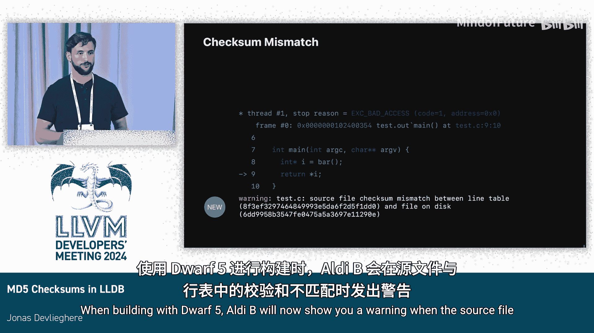

# 【2024-LLVM开发者大会-•-中英】-p31-P31-MD5-Checksums-in-LLDB--BV18eNfepENu_p31-

My name is Jonas， and I work on LDB at Apple， and today I want to talk to you about M5 checkss in LDD。

So when you're using the debugger， you probably want to see source codes rather than the machine code your compiler emitmted。

 and that is something that's made possible thanks to debug info。Dwarf。

 which is the depogainful format that we use on Linux and Darwin。

 that information is encoded in the line table。So the line table contains a mapping between instructions in your program and source code in your program。

And here is an example or a simplified example of what the line table would look like for this example。

 and as you can see， I also want to mention the way it's presented here is a lot less efficient and dwarf encodes it。

 but thats outside the scope of this presentation， but so what we can see here is the code crashed to a certain address which is highlighted in yellow。

 and so what the line table tells you it corresponds to test dot C line9 column 10。

And if you notice that the line table doesn't actually contain your source code。

 it contains a path to your source code。 So in order to show that in the debugger。

 you need to have the file locally， and more importantly， it needs to match the file you compiled。

So which brings us to the next problem。 What if your file changed between compiling and the bugging。

So let's say in my little example， the call tofo was replaced to a call to bar。

 maybe I did this before lunch， came back and forgot to rebuild。

 or maybe I was using version control and I checked out a totally different version of the file。

No matter how I got here， LDB shouldn't show you the call to bar because one of the fundamental principles of the debugger is that it doesn't lie。

So Dwarf4 provides two ways to prevent and detect mistakes like this。

 so the line table can contain the modification time and the size of the source file。

Both of these things have downsides。 The modification time can lead to false positives。

 Like I mentioned version control earlier。 It's very possible that you checked out a different version。

 change the timest， but it didn't actually change the contents of your file。

 timests also provide or timests also are problematic for reproducible bills。

 and quite often they're turned off because of that。Then the size of the file， on the other hand。

 can lead to false negatives。 like in the example before， when I change Futu bar。

 which are both three characters， we end up with a file that is the exact same size。So in Dar 5。

 these two options are extended by a third， which is the ability to encode a 16 byte MD5 checkum in the line table。

And actually， before I move on， I'll mention that Klang， when you target War 5。

 which is the default on Linux。 and as of this year， also on Darwin。

 Kang will emit the M5 checksum instead of the modification time and the line in the line table。

So with this checksum present in the line table， we also need to teach LDB about it because otherwise how it's going to detect this discrepancy。

 So there's two options to do this。 the easiest way to do this is reuse file spec in LDB file spec is the class that represents an arbitrary path all the files in the line table are represented by file specs but file specs are used for a bunch of other things as well And so if we add a checkum here。

 we're going to have a lot of instances of this class that's gotten bigger where the checkum isn't actually used so it's kind of wasteful。

The other alternative is to come up with a new class to represent basically the file spec and the checkum。

 which in this case we call a support file， The downside of this approach is that it requires teaching LB everywhere where we have a file from the line table that now it needs to know about a support file。

 which means more work and more churn。In the end， I started by prototyping the first approach because it was easier。

 but eventually I settled ongoing with support fileile。

 and the reason was that we needed it for a different reason。

 which is that Swift macros rely on a new feature intowarf6。

 which allows you to encode source code directly into the line table。

 so we had already a need to distinguish between these two things and my colleague Adrian has a talk about that here an URL VM talk called debug information for macros from last year in Vienna that you should check out if this is interesting to you。

So here's the result when building in building with D 5。

 LDB will now show you a warning when the source file doesn't match the checksum in the line table。

 Thank you。

Thank you， Jon。

