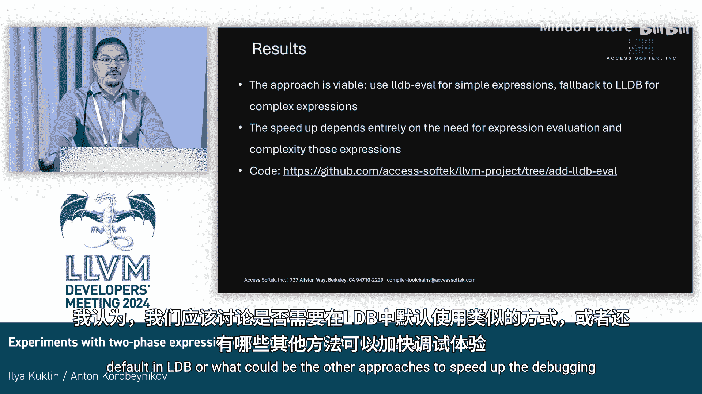

# 【2024-LLVM开发者大会-•-中英】-p32-P32-Experiments-with-two-phase-expression-evaluation-for-a-better-debugging...--BV18eNfepENu_p32-

Good afternoon， everyone。 So some of you might know， I'm nottalia。 So unfortunately。

 he was unable to present。 So I'm just talking on his， his behalf。 And I'm continuing the。

talkalk about the debuggers。 But this time， we are not talking about the precision of the debug info。

 but we are talking about the debugging experience。 So as some of you。

 you might know the debugging of large programs could be quite frustrating。

 especially these days when Is are well， pretty smart。

 So they can show you the values of lots of variables out there。 Plus。

 you might have like some custom formats。You could have some summary providers， et cetera， et cetera。

 like what you can see on the slide。 So and as a result typically when you try to debug something。

 the lots of different expressions have to be evaluated and as a result。

 overall like step over step in into it could be quite slow again because there are like many。

 many expressions that are to be evaluated。Still， it looks like that the majority of these expressions are pretty small and simple。

 and then the question is if it could be related in faster or some simpler way。

And as Ted already said， it's open source。 So we try to figure out what is already done here。

 So how can we speed up the debugging itself。And it turned out that three years ago。

 Google Fox presented LGBW here at the LVMDevelop conference。

 and LGBW for those who are not aware of， it's a very fast C++ interpretter for the small and limited language subset。

 so it comes with its own C++ parser ensure short it can handle like some arithmetics cast limited templates like really the useful subset of the language that you normally use for the expressions。

So， and it relies on the debu information retrieved over the LDB API。But well。

 because it was developed for the Stadia project。 and as you might know。

 the study is not active anymore， it's， well， essentially it's not updated these days。 plus。

 it was designed as a library so to be used directly from the I D。

 meaning that you can adjust like take the LDB wall and use it in yourB code or whatever。What we did。

 So we tried to， first of all， revamp the project。 So we rebased it on the L top of the tree。 Plus。

 we integrated it into the LGB proper so that it could be automatically used in conditional brickpoint in some like。

Values from expressions。 and essentially as the first step in the explicit expression evaluation。

And if for some reason， well， because the expression is pretty complex。

 LGB well cannot produce the value itself。 So we just fall back to the full and precise expression evaluation from LGB itself。

So， and it turned out that this approach worked pretty well。

 One example is that we enabled custom type format in one large game engine。 So， and as a result。

 debugging of well， one game using that game engine the overall time required to show the all the like essentially all the like variables in the I。

 So and that essentially the step over reduced more than 10 times or sorry。

1 hundred times from two seconds down to 100 milliseconds。 plus the the the overhead of this。

 like to pass like evaluation pretty negligable。Another case is the relation of conditional breakpoint。

 So here is you can see the example。When they put the condition that the brickpoint only fires on every like 5000 iteration and the time until brickpoint is triggered reduced more than twofold here。

 and essentially if you can look， then you could see that the overall time for the expression relation itself reduced from like 12 seconds down to just one second。

Overall， it looks like the approach is quite viable， so we can see that this twofold。

 like two step expression relation could be used。 Sp up definitely depends on like how many expressions you have in well。

 the size of the debugging for。 here is the code currently is just in the downunstream fog。

 and I think we open for the discussions Should we do something similar to this by default in LGB or what could be the other approaches to speed up the debugging experience。

 Thank you。

