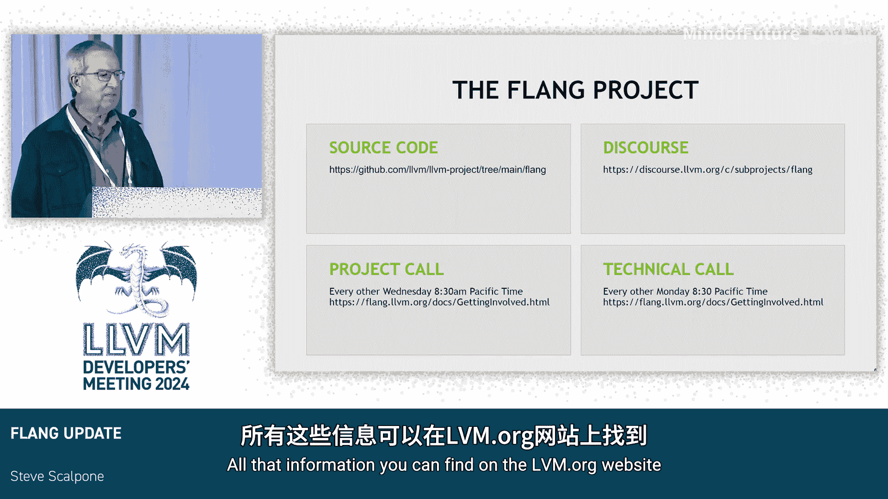

# 【2024-LLVM开发者大会-•-中英】-p33-P33-Flang-Update--BV18eNfepENu_p33-

There we are F update， how y'all do。What what's the news Well we were started a long time ago it was NSSA and the Department of Energy that kicked it off and we were the third flying or the fourth flying and we upstreamed and became an official project in 2019 and it's been quite a number of years since then so what's fresh？

The F driver， which was for years not built， and then it was called F New for a long time because we didn't really want people to use it when it wasn't ready。

Just last week or the week before we renamed it to F so in LVM20 there's going to be a clang and a flying。

 so there'll be a first class fourran compiler for CPU and it's working really well。And。

Last three months， 262 commits by NVDA contributors were still pretty much the main contributors。

 but less than half now， which is really good， 272 by 67 other people all over the place， AMD， IBM。

 arm， lots of companies。Test suites， big thanks to Fujitsu and IBM for open sourcing their huge test suites。

 So these are great 2003 Fort 2003 tests，30000 tests or something like that。

 That's really fantastic of them to do that。 It was a big process for them to go through the legal。

 And then engineering reviews of all that to get that for for all of us。😊，And in the debugging note。

There is extensions for dwarf that are for Fortrann。

 all the different kinds of arrays that you get with Fortrann。

 and that support is being updated right now just because we're talking about debugggerers today。

 I thought I'd。I just throw that in， too。Performance， people don't write Fortran or running slow。

 they don't really want it to run a program because it's a great programming language for just general purpose stuff。

 they want to run loops and they want to run them fast。

 So this is comparing to G4ran lower is better because it's in seconds and it's a benchmark suite called polyhedron which is pretty common sort of a basic beginner suite and we're just running。

Fang MLAR MLR to LVM with not a lot of optimization。

 so we've gone through and in lined a bunch of intrinsics and we're trying to get temp elimination we're trying to do provide the information that the vectorizer needs to do its job and you can see we're getting pretty close there the geoine is the interesting number。

 the geoings， the interesting number and they're pretty close。 you see a couple of outliers。

 most of those outliers are probably parameters that are being duplicated when they're past because we just haven't done the alias analysis yet。

 there's a big alias analysis for fur which is our MLIR intermediate that was upstreamed。

Last week or the week before， then two weeks ago was a big， big time for us。

So what are we looking at doing for the next year， more CPU performance improvements right we have G4 transs a good base。

 but then the commercial compilers are even better and we want to be able to use more MLLIR。

 we want to be able to use more of what LLVM has mostly in loop optimizations and vectorization。

 but also to eliminate the extra copies that we have a lot of intrinsic routines to do reductions to do sine and cosine。

 things like that need to be specially handled and to get up with those commercial compilers。

Openmp for multicore， almost every Fortran program does some sort of multicore processing。

 That's being done by arm mostly and a lot of other contributors。

 That's that's progressing really well。 They're getting to where they can run lots of programs。

 and they're trying to make it a little more user friendly。

 So things that aren't implemented will show as not implemented。

 Taking Openmp and offloading it to a GPU。 That's using a lot of the standard support that's in upstream right now for playingang。

 And it's starting to run programs pretty well too。 Sometimes they run really fast。

 Sometimes the optimization is not quite。 They're still work in progress， but good。 Ka Fortran。

 which is like Kuta， but in Fortranm。 You can write kernels。

 You can do all sorts of things and runs on the device。 That's being upstream right now。

 And then we're following that up with Open ACC， which is another way to write programs for accelerators。

And one more。We have discourse channel， we have source code， where you all know where that is。

 We have a project call every week Mondays and Wednesdays alternate， sometimes it's project business。

 sometimes it's technical business， usually they overlap all that information you can find on the LvM。

 org website and that's it for flying。

Thank you， Steve。