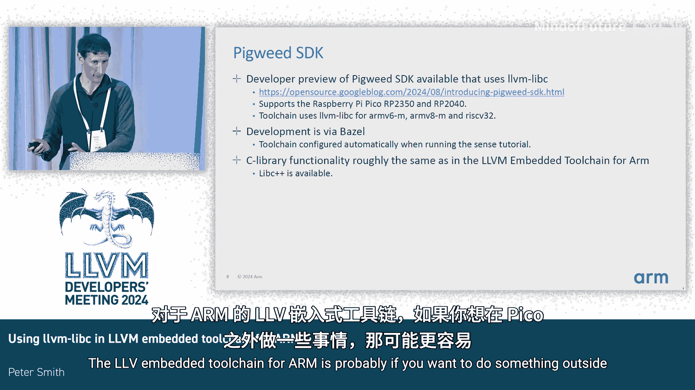

# 【2024-LLVM开发者大会-•-中英】-p34-P34-Using-llvm-libc-in-LLVM-Embedded-Toolchain-for-Arm--BV18eNfepENu_p34-

So I'm just here to talk about our experience of using LVM LibpsC in our embedded tool chain。

 So okay so this one's firstly a very， very quick one。

 I'm actually going to probably skip past this because Peter Josack talked about this this morning。

 and so essentially LVM LibpsC。 It's part of the on times build。 You want to use the fill build。

 LVMlibpsC can be built in overlay and full full means it's going to be only one an embedded systems there is only one And then there's a bare metal config which sort of tells LVM LibpsC to use various different function implementations。

 does some configuration there's one for arm and risk 5 and you can use the arm1 for I 64。Right。

 so what's available today in LLM Liberacy， So that's basically the headerophiles that you've got there now。

Whilst not being complete， it's generally fine for most embedded systems that tend to make fairly low use of the C library。

 often things like string dot HMm copy that type of thing and another subset of of ones use math library functions intensively and there is a fairly complete implementation of math library the biggest restriction I think is there's no file star so whilst you can get printf working then not sort of FO F that type of thing and as far as I understand no floating point printf in the bare metal build as well。

So what's this talk about， we have an overlay package that we've implemented for LVM Libpsy because one of the hardest things for LVM Libpsy right now on embedded systems is actually getting a tool chain with it there that you can actually use So this one last slide will be on Pickweed and again Peter Josk talked about that this morning for how you can get access to that via the pigweed SDK What we do in the LLVM embedded tool chain for arm is provide an overlay package that you can build separately that builds all of the variants that we support including sort of the V6M V7M whatever and then that basically unpacks over the main directory and then you have a config file that just changes the ci route and the multilib will do the rest for you that particular bit so's in a moment in our tool chain it's C only we haven't got Lipsy plus plus building yet with that but we hope to get that sorted out in the future。

Okay， so what you might actually have to do to do this so first awkward bit is provide your own startup codes we have got。

Some samples here that it's probably best to crib from if you're using a very。

 very simple microcontroller you can generally get away with very little there's a little bit there that sort of shows that you just need to essentially set yourself up a stack pointer do any copying you need to do I guess for microcontrollers。

 you often need to copy your rebriite data up to the right place at that particular point you also need to deal with semihoing if you're on an arm system So for that you need to implement some of the studioudio read studioudio right and all that these will essentially do is。

Forward onto。Semi hosting calls if you're using malloc or the heap， you need to provide well。

 basically a chunk of memory in your link scripts that you can then delimit with the N symbol and the allov theippsacy heap limit and if you're using anything from mathth dot H。

 you need to provide a function that can get Erno because when you do the bare metal build。

 Eno is not provided for you by the library。So this is a very， very simple， well。

 as I say proof of concept that I'm not going to execute to show what you can actually do。

 but yeah that's an example， that's probably the best easiest way if you want to run this on QuemU in the embedded tool chain there is a doc which shows how to use the overlay package but the sample is probably the best thing that you can actually do。

😊，Okay so be remissive me not to mention Pickweed so there is a tool chain provided by Google that can be used on the Raspberry Pi PCO and this is probably if you want to play with Pickweed as a whole and get a full example。

 that's probably the easiest way to go the L embedded tool chain for is probably if you want to do something outside of Pco it's probably easier from that。

Okay， finally， a load of references that you won't be able to read from there。

 But if you want to pick up the slide later， then you can go go through and pick the those later。

 So Ill better stop now。ok。