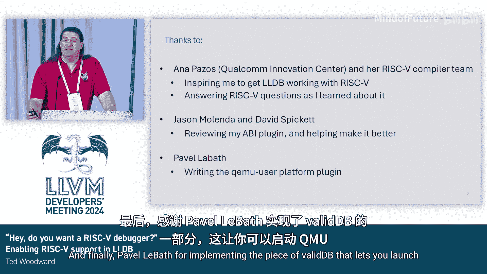

# 【2024-LLVM开发者大会-•-中英】-p35-P35-Hey,-do-you-want-a-RISC-V-debugger---Enabling-RISC-V-support-in-LLDB--BV18eNfepENu_p35-

Good afternoon。 My names Ted Woodward， and I work on debugging at Qualcomm。😊，So。In April last year。

Quualcomm's LOBM team had a meeting with management to talk about the different things we did。And。

The risk five。Compilr lead was talking about stuff， and I thought。How do you run Ri5 programs？

So I asked her， and she said， Q M U， I thought。Hey， L ODB can talk to QMU。

Do you want to risk 5 Dbugger？She said，Yeah， that'd be great。

So that started my descent down the rabbit hole。So I built a the beef for Rik 5。Really simple。

 No problem。 It's just going to work， right。Spoiler。He。

So I load up a risk5 program set a break point at Maine and run。

And as you can see from the little picture there， things are not working quite right。

We're not stopped at Maine。 We don't have a PC。Well， what's the problem。

 QMU publishes the PC and the other registers well？

LLDB couldn't figure out which register actually was the PC。So I looked into it。

 other architectures get that from an A plugin。So I go look at the risk 5 A I plug in and， oh， hey。

 it's not there。That's a problem，I went and， you know。

 did the open source thing stole from somebody else's。And wrote my wrist5 plugin。

So problem number two。We run。 We stop at Maine。But this assemblys not working so well。

 Half of those instructions aren't showing up。What turns out the atomic and。

Mulplication and division extensions aren't turned on。 So turn those on。Yeah。And assembs working。

Problem number 3。Try to do a source step in， which is supposed to go into a called function。

Sometimes it works， sometimes it doesn't。Do a little more digging。

That little circled instruction there is a compressed jump and link。

And it wasn't marked as branch in the TVD files。So。

L D B was just running past it because it didn't think it was a change of flow。Well。

 I talked to our compiler guys and they talked to upstream and got the T files changed。Suddenly。

 things are working great。So next step。Got to upstream that A B plug in， and the disassembly changes。

Well， I found out somebody had already upstreamed one， but it hadn't been looked at in a year。

So again， in great open source tradition， I stole from it。Improved mine。 Upstreamed it。

And started getting review comments。Lots of review comments。Which was good because it improved it。

Addressed them， got it approved， merged it。And now upstream LB can debug risk5 programs。

 Ri 532 and 64。So we took that code that I upstreamed， pulled it back downstreamed。

 built a tool chain and released the product with it。Based on LVM 18。

So thanks to Ana Pas and her Rik five compile compiler team at Qualcomm for inspiring me to do this and answering all my risk five questions and believe me I had a lot。

Jason， Melinda and David Spickett helped me with。The reviews and making it better。And finally。

 Palo the bath for。Implementing the piece of Val D B that lets you launch QMemia。

Thank you， have a good conference。