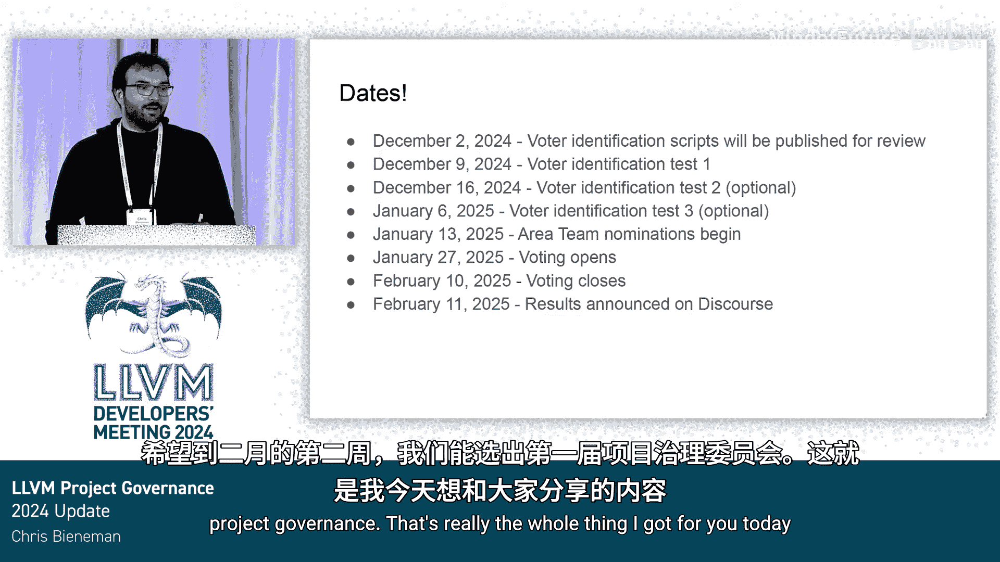

# 【2024-LLVM开发者大会-•-中英】-p36-P36-LLVM-Governance-Update--BV18eNfepENu_p36-

So last year， for those of you who were here， I gave a talk on the LVM governance proposal。

 and we've got some updates we wanted to share on where that's going and where we're going with it。

One of the big things to point out is that we went through a lot of feedback at the conference last year。

 through EuroL VM， through reviews and discussions on Discord and Github。

We got lots and lots of feedback。 It made the proposal much better。 It slim it down。

 It simplified it。 And we went through the LVM pitch process。

 to really get to a point where we felt we could make a decision in kind of the structured and proper way to make this kind of big decision to the community Last week。

 we actually had a meeting of the review managers。 This was through the pitch process and the review managers approved the proposal。

 so。😊，We're there。 We're actually going to do this。Let's talk about what that is。 We。

 we proved that we're gonna to form five initial area teams。 This is， we scoped this down so that。

 so that we have a smaller number of initial volunteers that we need。 And then we。

 we are gonna kind of。Make it the governance。Teams problem to figure out how to scale this and address the the。

 the bigger needs over time。These area teams will form the initial project council。

 and the initial project council will will handle everything else from there。

 And we're going do the first elections we're going to aim for in January of next year。

This is a starting point， this is not a solution， it's not perfect as with everything we do in LVM。

 this will be an iterative process and we really want to you make sure that this is part of LVM's culture of iterating to get to the right solution one part of that that we added in very late to the proposal was having an annual report that that is going to come out of the project Council to talk about what's going on in the governance process and how you know that's the venue that we'll use for suggesting improvements。

The really short D ODR here for， for contributors is actually a lot should stay the same。 Okay。

 today， a lot of things work。 You know， we don't want to change what's what's working and and what's allowing you to be productive。

 What we do want， though， is we really want to make sure that。

 that we have adequate maintainers and coverage of the codeb to make sure that your PRs are getting reviewed and things are going through。

The area teams are going help us make sure because we're gonna make someone responsible for making sure that that ownership is there。

The area teams are also going to make sure that that RFCs being discussed on discourse get reviewed。

 that they get the attention， that they， that they reach a decision because one of the problems that we've often had in the community is that we we don't necessarily reach a decision as quickly as we should。

And lastly， the area teams are going to take over running the the LVN proposal process for the cases where we need to use that process to reach a result。

Aa teams， this kind of quick recap to give you guys updates is there're going to be three member teams to start with。

 this again reduces our number of volunteers that we need to get this off the ground。

 but we're going allow them to grow up to up to nine just so that you as areas need more perspective and more people。

 you know you can scale them as is appropriate。Each area team has kind of a defined area in the project or scope of where they're going to be assisting and where they're going to be be focusing。

 but the mandate for the area teams is really about facilitating decision making and helping make sure that that decisions get reached。

We're going to kind of。We want the area teams to also play this role where they help groom other people into the community and help grow the talent and expand community leadership。

 And so one of the things that we have in the proposal is that you we expect that people on the area team are going to help identify maintainers。

 they're also going to help identify people who could take part in the area teams in the future and really take a shepherding role。

And， of course， this last one is like。Maintainer coverage is huge。

 This has been a problem for the community for years。 And so we really， really。

 really need to make sure that there's someone responsible for this。嗯。

The way that you get on an area team is you know we're gonna to have elections。

 you just need to be a member of the LVM GitHub organization and anyone can nominate themselves or anyone else to run for a position on the area teams in future years。

 hopefully the area teams will be actively recruiting to kind of keep people flowing through。

Project Council is going to be formed by one representative from each of the area teams。

 It's going to act as really this oversight body。 and it's it's the catch all。

 Anything that doesn't have an area team that's responsible for it。

 It bubbles up to the project council。 This means that we'd have no areas under the LVM open source project that will not have someone that is responsible for helping facilitate decision making。

The project Council is also going to be this final decision maker。

 if no one else can reach an agreement。The project council will be able to step in and say， you know。

 this is the decision we're making。 And， and one thing that so much of this is central around decision making。

 I think there's a line in the in the proposal that that I think is like really crucial to understand is like it is better to say no promptly than it is to say maybe for two years。

 And so one of the things that we really want is to make sure that decisions get made on a timeline and that everyone knows when those decisions are going be made。

And of course， the project Council， as I said before。

 is going to put up an annual report and make sure everyone knows。Here's what's going on。

 Here's how the community is growing。 Here's things that we can do to improve。

 And here's the problems that the community is facing for the next couple years。

Running the elections， anyone in the GiHub organization is going to be eligible to vote。

 we're not going to restrict voting by where you contribute or how you contribute。

 but we are going to use the Github organization as the metric for this just because it's easy This can change over time and it's not perfect but the real goal was to make this execution as simple as we can。

 We're going have some automated process to associate email addresses with GiHub Is。

 We do have policy changes that when in recently for the LVM project where we require that you have email address that you monitor associated with your Github account as long as people follow that our scripts will be able to identify that you have an email address and we'll use that for voter registration all of the voting is going to be conducted by email for the first time there's an email system voting system that's used by Python and some other projects that we're going to use。

And we'll see how this goes。 If this doesn't work， if this is a mess。

 we'll try something else next time around。Some real quick dates for people we're going do I'm going to publish the voter identification scripts at the beginning of December and we're gonna to do some tests where I'm going run the scripts。

 generate everyone's voter information send out some emails and then post on discourse to let you guys know hey。

 if you got an email， you registered to vote if you didn't tell me so that we can figure out what's going on we'll do a couple rounds of that to make sure that we have good voter coverage and then these are the dates we're going to try to do it and then after we've kind of got the logistics of that working。

 we're going to do nominations and and voting following the way that the proposal laid out how many weeks for each and then hopefully by the second week in February we will have elected our first project governance。

That's really the。Whole thing I got for you today。 I think I'm super excited that we've made progress on this and that it's going to hopefully solve a really。

 you know， long lasting problem in our community。 Thank you all。😊。

