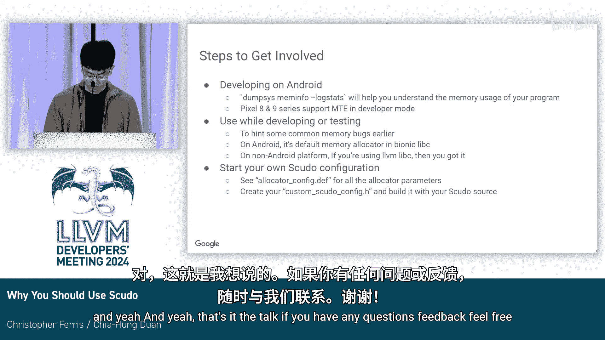

# 【2024-LLVM开发者大会-•-中英】-p37-P37-Why-You-Should-Use-Scudo--BV18eNfepENu_p37-

All right， my name is Chris， and this is Chiang， and we both work at Google on Android OS。

 and we're to give a talk about why you should use Scooto。So quick outline。

 we're going talk about the history， design of scoo， security features。

 performance and memory footprint， future works， and how to start getting involved in Sckuto。

So what is sckuo， So Scutto is basically a hardened memory allocator。

 It name comes from the Italian world word for shield， a scutto。

It essentially started life as the allocator from the LVM sanitizers。呃。

This history is more from the Android perspective than everybody else so as it was built in the sanitizers。

 it couldn't be used standalone， so the big problem was all you could do was build it it was so entwined with the sanitizer build that at some point someone wanted to we wanted to put it in other places we couldn't so there' was a lot of work done by someone named Coia who took it and refactored it and moved it out and changed the build system and got it to build in standalone way。

In about 2020， Android 11， it got adopted by Android。

 so essentially it took a lot of time there was actually it happened we were trying to adopt it for Android probably a couple years before then。

 but in order to become a system allocator， it really required extra work and some more performance。

 less memory requirements， so it took until Android release 11， 2020 for the Google Pixel devices。

 That's the first time it was actually used in a real Android device。

And for a while there it was mostly in maintenance mode， so kind of we did it all。

 we put it in and we just kind of said， okay， we'll make sure it doesn't break。

 but then in the last two years， weve really spent a lot of time in investment dedicated people working on Scutto to make sure that we improve its performance。

 improve its memory consumption。Okay， and I would like to give the brief introduction about the design sckudo。

 because we know there are a lot of allocators in each。1 has their own terminology or stuff。

 So we just want to give you a quick high level design overview。 And so in Scto。

 there are three main components。 primary allocator， secondary allocator and the cache system。

 the primary allator is the size class table based allocator。 So for each memory request。

 its size will be rounded up to the closest entry in the size class table。

And here's a term called region。 a region is used to manage the blocks with the same size。

 So so it depends on how the size class table is defined。 you will。

 will have the same number of regions for the primary locator。And yeah。

 it's just a upon pointer allator for each region。 So it's fast。

 And the secondary allocator is a me map based allocator。 So as the name is suggested。

 its if theres nothing available in the cache， then you have to fulfill it was the system code。

 So it's slower than the primary allocator。 and the third thing is the cash system。

 So it has the cash system like other allocators， the exclusive cache， which is per threat cache。

 it also has a feature called shared cache。 So it's faster than accessing the primary or secondary allocator。

 but it's slower than the per thread cache。 The benefit of the shared cache is we are able to release the block cache in the shared cache。

 So it uses less memory than the exclusive cache。ok。And。Okay。

 another I we want to mention is the proactive page releasing。 So as we know。

 the memory allocator usually prepares several pages for different sizes of location。

 And when those pages are not you in used。It may not be released just in time or you have to manually release it in sca。

 we support a mode which will proactively release the pages for you。And in scoodo， we also support a。

 an option that dumps the internal scdo status。 and it includes almost all the details information with。

Pretty easy。 read the form， and it includes some information like fragmentation info。

 your cash hitbras or any region utility stuff。 So I think that's a pretty useful stuff for understanding your program memory usage behavior。

And as mentioned at the beginning。 So one of the most important thing for sckudo is security。

 It support several security features。 And we now we just list some most important them of them。

 And the first one is the pointer randomization。 It's。In scdo， it's unlikely to have two pointers。

 two consecutive pointer allocation。Have the address next to each other because we did some randomization stuff there。

 And second thing is the pointer quarantine。 So for a free pointer， its。

 it won't be reused in a certain period of time。And other things like double free or auto of phone access detection。

 They are supported in scdo。 And one thing to mention is these checks are happened when the pointer is free。

 So it's not that powerful， like other tools or stuff， but。At the in the end。

 we have one stronger feature that called memory tag extension， which is called showed for M T E。

 It's a hardware feature in arm V 9， and it detects the invalidvalant memory load and store for。

 Yeah， it detects invalid memory access for each load and store。 And yeah。

 it's also supported by scoole。😊，And then we want to talk about the performance in footprint and we won't talk too many details here。

 So because we are working on Android and gig benchch is one of the most important benchmark that Abra cares。

 and so far， the performance is pretty close to J Malo。

 which is the previous default memorymorial locator used in Android。

 and its just the difference is less than 1%。And because of the security feature。

 we know the pointer random stuff。 It inevitably consumes more memory at the beginning than we add many efforts to try to reduce the memory usage。

 and now。😊，I think the memory usage is pretty close to each other。 And for some。third party games。

 It even consume less memory than J Mel。And there are some future works that we are still doing。

 And the first thing is we want to support more memory usage data like the page U utilization。

 This is mainly for larger location， like。100 pages location， because sometimes we we notice that。

 oh， only very few pages are dirty。 That means maybe your program doesn't need that huge memory。

 And in terms of R S S， it's fine because you are not you didn't dirty them。

 So you don't consume more memory。 But in terms of allocate performance。

 it's better to request a smaller size。 And another thing is we want to support a better recommendation system for defining the size class table stuff。

And okay， the last thing and the most important thing。

 how do you get involved with Sckudo The first thing is if you have a Android phone or a emulator or something like that。

 you can just try the AB command the dumps， main info logt for any apps or process。

 then you will see the sckudo internal information in the log and you can read it and get some idea about what sckudo looks like and the second thing you can try is if you have concern with the performance or memory or something relate to the realtime program。

 then you can try it only for developing or your testing and it helps you to detect some memory box earlier and you don't need to set up。

And like sanitizer， if that's not an easy thing。 and yeah on Android。

 it's the defaultpot memory allocator in the bionic lip see。

 And if you are using the LLVN lip see and you've got it。

And the last thing I want to mention is the configuration。

 So there is a allocator complete death file。 It contains all the allator parameters。

 So when you are ready to create your own， please check it out。 and yeah。

And yeah， that's it。 The talk， if you have any questions and feedback， be to reach out to us。

 Thank you。