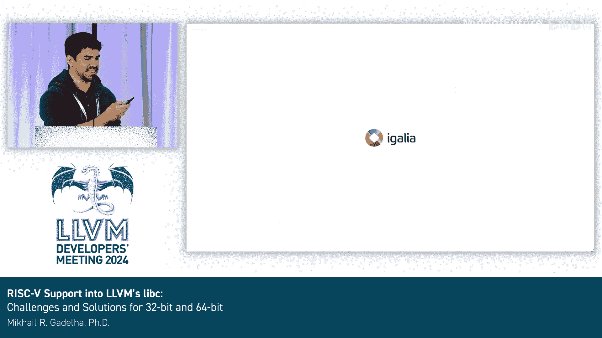

# 【2024-LLVM开发者大会-•-中英】-p38-P38-RISC-V-Support-into-LLVM’s-libc---Challenges-and-Solutions-for-32-bit-and-64--BV18eNfepENu_p38-

Okay， hi， Miko， and I'm going to talk about the process of porting Lipsy to risk 5，32 and 64 B。

Qu recap what is the Liberacy in Ilaviium。 It's a Liberacy in the project。

It supports several architectures， X 86， arm arm 64 and。sorry。And now is 5， 32 and 64。

 He also supports building 4 GP PUs， AM M D and N。 There's a great talk on it last year and is' written in C plus。

What is risk 5， it's an ISA， an open sat architecture， iss not a chip， like core7。

 it's not a part of I， like arm Cor X M。 It's an S ISA likes X 36 harm and or C。And so motivation。

 why port it to risk 5。 And there is no material motive motive。

 I just wanted to learn more about the project， about the architecture。

 And I was looking for a project to contribute on L of M。 and LibC was the perfect match。😊。

Coincidentally， there was a patch a month prior that was adding basic support for his wife on Lipsy and。

It was memory functions， some strings， C types， his skull。

 but a bunch of stuff were missing like CR R T， floating floating point environment threads。

 long jumps， side jump and others。So how do you add a new architecture to Lipsi。

 This is actually from the comet that enabled this5。You basically have to change three files。

 The first one is this Eovium Libpsy architecture you make。It basically queries from the compiler。

 the architecture name。 So， for instance， it's going query risk 5，64。

 And this is gonna to be used as a path to tool on the files entrypoint the headers where you can define the the system headers and the functions。

呃。Right， so this is the commute that enabled the risk 564 is basically just querying the compiler。

 it passes it and it finds the risk 4 risk 564， which is going to be used for the path。

 And this is the what the entry point file looks like。

 It's just a list of the functions that are going to be enabled for the architecture。And the headers。

 it's similar。 is just a list of the the headers they're gonna be enabled for the architecture。

 And that's basically you have a basic support of just these three changes of of the new architecture volume C。

 And after that， it's just a matter of adding functions， running as fixing bugs and re repeat。

So what were the challenges of supporting Ri 5？Basically。

 it was hardware was not available for me when I started。 So solution was to useful emulated。

 So there was QM U spikeike， there are others。 I actually started with KM U user。

 but it would fail in some weird ways。 Sometimes we would expect the ci calls with fail or 6 see。

 and you would just happen the other way around。 So， for instance。

 this is Po M advice a way to advise the system about the。The memory usage。

 and it returns0 on success。 But if you pass a invalid address， the first argument。

 it should return the no， no memory error 12。 And as you can see in the example。

 I'm passing new pointer and its just returning success。 and we expect it to fail。

So the solution for that is using KMu system for IV 64 is easy。

 There are a bunch of images available everywhere。 I think I started to use uunum。

 So it just works for IV 32， you need to build the image itself there are options for build Ho or Yokto。

 I use Yoto in because I wanted that my image had the compilers in it。

 So Kgan G so I can test stuff inside the KMu and I couldn't find a way to do that with beut and the only limitations that the images there are generated they are limited to1 GBogramm。

 I don't know why I。Try to find out the reason， but I couldn't。 And it's， but it is enough for。

 for testinging lipy。Another challenge， I think the biggest challenge is cico。 So risk 5。

Doesn't have backward compatibility with some old Cs calls。 They just don't don't offer them。

 So you have to update your code a bunch of if it apps to support these new C calls。 Some are simple。

 like open and link， they just change the name to open ad on link a especially for V 32。

 they just add a Suix 64 or time 64 and some other cases just get rid of a bunch of C calls and use just one is the case of weight weight B I D weight 3。

 weight 4。 you just have weight weight I D。And I'm going to show you。Some of the patches I sent。

 I don't expect you to really understand the code， but it should be simple。

 So from easiest to hardest to more difficult。 So F C andH L。

Is just a matter of changing the this is all。 And the arguments are the same。

 You don't have to worry about it。 Its just， it just works。In other cases like duop。

 So you have duop and D 3。The number is usually the number of arguments that is called takes。

 So if you want to implement D 2 with D 3， you just need a actual argument。

 the call and you just set it to 0。 It is gonna be ignored and you will behave like the 2。呃。

Some other cases。 So this is for R Vory2。 If you look in the last green line there。 So for El Si in。

 in our V32， the offset of a 5，64 bit long。 So you just have to display split into two arguments。

 So you just pass offset 64， the high bits first。 and then the the low bits then and it will work like Els。

Some other ones， you need to actually change the the argument。 So for this schedule our get interval。

You need to pass this kernel times specstruct to the Cis call。 The kernel is gonna fill it for you。

 and you just have to。Set back to the arguments from the call， the initial call。

little bit more complicated。 And then you have the weight I D。 So as I said， you don't have weight。

 weight P D， weight 3 and 4。 So you have just weight D and you have to handle all the different arguments。

 the return values。 and so each which each is called will work as expected。

 And that's the code for for all of them using just wait for just weight I。

Some other weird stuff is that in some architectures。Some strokes， they have swapped members。

 So in this case， it stroke s T。So you can see the error number and code。 they are swapped。

 And actually， because the different arguments， they， they you're having to pass。

 the X 86 was using the Mips format， but we wouldn't not checking it。 So it was a。Fun way to。

 it was fun to debu this。 It was the， the colon was just feeling random stuff。

 Yeah I couldn't figure out。 It take me a while just to find out that it was the the memberss were just swapped。

Some other small issues。 Some cico cannot fail with the new， the new ci code。 there is five offers。

 So some tests just need to be disabled like Epo grade。Another nice one was ran。 So internally。

 we are using the。Sure shift 64 star as a pseudo random number generator。

 but it was not random enough We you run it on 32。 So we had to use another algorithm for the IV 32。

A lot of implic conversions， because of size， long and stuff。 in this example。

 we have a size of the to sign size C when one error was enabled on Li see。

 a lot of code was broken on 32。 but at least we got to exploit the the conversions there。And。

AV2 has1 and8 long double， but no 128 integer。 you can force the compiler to to offer the 128 integer。

 but we we have infrastructure there to avoid that。

 So we had a bunch of test case They were just broken on avi2 because this missing feature。

 but ourV2 Libacy has the infrastructure to go to work around that。 so。Yeah。So final slides。

 How is the support today。 So today we have 946 functions in Lipsy。

 and we support 86% of them zooming into the what is missing that are30% that are there were added a few weeks ago a student didn't have time to go down and check。

 But I don't want to gin it but it should be just it should just work。

But the biggest issue right now is float 16。 There is an issue I found a couple of months ago。

 I still haven't fixed it that we cannot enable conversion from long double to float 16 always5。

 It's just not working。 I open an issue there。 I do have a patch for it。 but unfortunately。

 it has a small problem that it breaks x 86 backend。 So I'm gonna have a hard time landing there。

And that's it。 Thank you very much。

