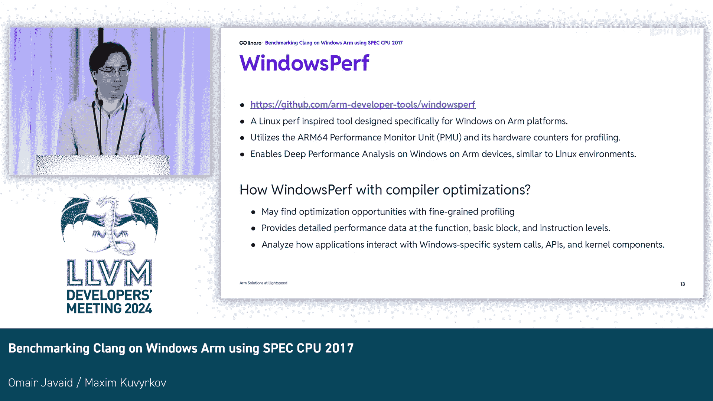

# 【2024-LLVM开发者大会-•-中英】-p39-P39-Benchmarking-Clang-on-Windows-on-Arm---Building-and-Running-SPEC-2017--BV18eNfepENu_p39-

Hi， everyone。 My name is Maxim， and O'meer was supposed to make this talk。

 I'll try to impersonate him the best I can。So this is about running spec P 2017 or generally any benchmark on Windows onar。

 Windows on arm is Microsoft Windows running on arm 64 hardware。

 These laptops are now in general availability， and they are。Provide quite。

 quite good platforms if you need windows and you also want great bacterial in。

The first few slides are about general spec information。

 So I will go quickly through them if you are interested in setting up。

The same experiment running spec on Windows。 Do refer to the presentation slides。

 It has good details on what you need to do to run spec benchmarks on Windows。So。

 the test environment。Is a fairly recent laptop surfaceface Pro。 It has 32 gigs。

12 core runss latest Windows。And this。Presentation is performance comparison between two compilers。

 LD M 19 and Microsoft Visual Studio 2022。GCC means JW org is in the works for Windows onarm。

 and we hope to show you numbers at the next conference， comparing LVM versus Gcc。

We are comparing three configurations。Optimizations for size， optimization。

 for execution performance and optimize or other， not optimize for debug。Please， remember。This point。

 about 26 degrees Celsius。 it will be important a bit later。For a trend。Ben so a spec contains C。

 C plus plus and Forran benchmarks。哦。Community works on enabling flk new front end。

 And that was recently renamed to just Fang。 That's cleaner。And， but flk cannot still compile。

 I believe， one benchmark on Windows。 I believe it can compile all benchmarks on Windows。On Linux。

 sorry， on Linux， but W still fails on Windows。So let's go and look at some of the numbers。

These are C and C++ benchmarks。And。As you can see， the numbers。

Cang generally beats Microsoft Digitalsual Studio compiler。E。This is execution time。

 So execution time， whether you are optimizing for speed。For a size or for Dbug。

 generally between 5 and 15% faster than Microsoft compiler。

We see similar results for the floating point performance， as well。呃。

When we are looking at multi threaded performance。We sometimes see even bigger gap up to 40 and 60%。

 in some cases。It would be very interesting to dig down。

 which we will and analyze what gives such a big advantage to claim。My。Gs。

 and this is just a guess is that maybe LVM is able to parallellyze across a couple of threads。

 the X 2，6，4 decoder and encodeder。There are a few outliers in this case。

 in the For channel benchmark， but keep in mind， flying。

Project in LBM has been in enablement mode for the last several years。

 And I believe no one really looked at performance yet。

So this is only expected to get better and hopefully quite quickly。For code sites。Turns out。Cang。

Builds MSCC， even and codeside。Oh。And quite impressively。20，30，40% improvements。Including on the。

Coode size。Optimizations as well。 So01 is actually optimized for size， O2 optimized for speed。

 And this is debug built。Finally， the debu file， P TB is Windows debu format。

 and P B files are also smaller。 There is a caveat here， we。

It's not as easy to compare the quality of Gibu confirmation。 So right， it can be smaller。

 but we don't necessarily know whether the quality of Giba confirmation is the same between MSDC and Kang。

Finally， Windows Perf， this is a plug for how to actually investigate and look at performance for Windows on arm。

 Windows andar has a tool called Windows Perf， which is inspired and designed to be similar to Linux Perf。

Where you can run。When you can gather performance counters across the whole system or a single process and then analyze it later。

呃。It's available at Github。 And I believe it it is release now。

That's all。 Thank you。 And if you take anything from this presentation， it should be two things。

First。哦。Windows  on R is。Cang for Windows onar is production quality。Oh。

The community and Mike McLarro has put a lot of effort into making sure that Kang and LVM is supported very well for you to sort on arm。

 and if you want performance and if you want small sides。

 do seriously consider for using Kang when building applications for windows。And the second takeaway。

26 degrees。A roomom temperature。Keep it's difficult to do reliable benchmarking correctly。

 So if you do benchmarking as part of your job， you do have a legitimate case for expenssing a beer fridge for your home office。

Ca that's where you stick your laptop or your machine and you do the benchmarking。Thank you。

