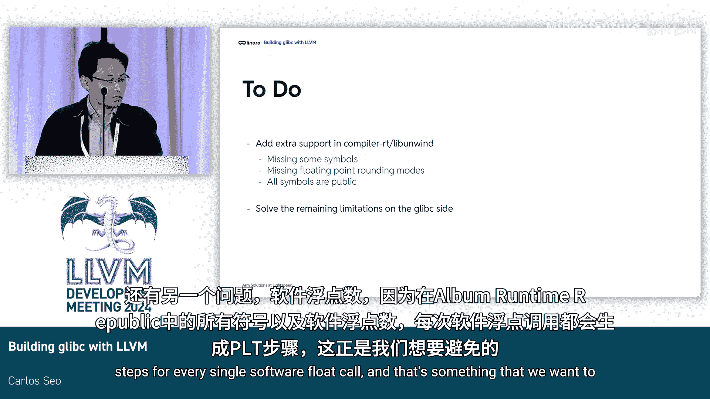

# 【2024-LLVM开发者大会-•-中英】-p40-P40-Building-glibc-with-LLVM--BV18eNfepENu_p40-

Okay， hello， I'm Caros Seo from Leardo， and today I'll be talking about how to build the Nu Library of the LO M tool chain。

So wait a minute。Okay， so this is an internal proof concept of the narrow and you may be wondering why we decided to do it。

 So the first thing was we wanted to allow GpsC to VP of different compiler7 things that we needed we wanted to improve the GpsC code code by using the clang set of compiler warnings。

We also wanted to improve a plank by addingging features that were initially developed for GSC。

 and we also wanted to verify any performance difference in Gipsy between the two compilers。

 and since GiibpsCs dependency for many of the Linux packages we wanted to open the possibility in the future to build full Linux G with LOVM。

So。呃。The challenge of doing this。Are huge， like because first， the Gipsy uses a new C standard。

 So it relies on。This is the extensions for a lot of things。

 it also assumes that the default assemblymbler and link come from be neutrals。

 so that generate another layer of dependencies。Some of these go extensions were already discussed in the community and will never be implemented by L O VM。

And there are some other extensions like 128 B floating points that are not fully compatible between the compilers。

 so。What。So what what were doing now what we we have been doing now。

 we removed it all the new extensions that we know that L M will never implement。

 We have adapted the build so that GBC can use LL G and we reflected the code in some points to remove these hard dependencies between GC and bin neutrals。

呃。And this POC is available at the official G rep Poer at Sourceware under Adir Vosonnels branch。

 who is our colgue， who did most of the work on the BBC side。

And all of the work that we maped that should be done with about a third of the work in Gse to lot the build for X 86。

64 and AR 64。We did about two thirds of the work needed to build all the dash cases in the GBC dash switch and this work was done using LOM aching and the GCC 11 runtime so by the time LOM aching released all the patches that we needed to out Dis award were upstreaming writing LOVM。

这子。And since this is P O C， there are some limitations， so。Thegui Feng sports， not complete。

Gmail portion A 64 is not really working because of ABI difference between compilers。

 There are several codegen issues in the test suites in the math test suites。

 mostly for long double and flow 120H。And we currently don't have any support for the L L O VM runtime。

 So you can use the L O VM LiCC wrapper to get around this， but there are a lot of buds， so。

It's not really working at all。And with that。Theres a lot of things that need should be done， so。

Besides all the work the work that needs to be done on the GlibBC S， on the LOM side。

 we need to try a lot of access approach and compile our living wines so。

GlibpsC relies the GCC for a lot of things like Pe cancellation and waging software floating points and these things are very different between the Gcc runtime and low runtime and so we need to add some business symbols that GipsC uses for pediatric cancelslation。

 we need to add extra routing modes for floating points because currently lot supports one routing modes。

And there's another problem in software floatinging points because all of the symbols in the November runtime Republic and for software flowage points。

 that we would generate a PLG steps for every single soft flow call and that's something that we went through a voyage。

And so this is pretty much all I had for today or for statuss on this project。

So this and RP POC can be used experimentally。 Like I said。

 it's available on the source square repositor。 so we can download it and build it。

 Lely check it's also working with the current L VM。

 So you can can use the top of the tree to to build that。And if you are interested in this project。

 please do stay in contacting us。 We are looking for people to work with us on this porch。

 So that's all that I have。 Well， thank you。