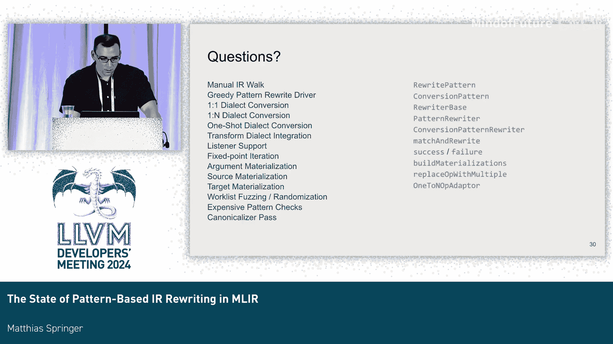

# 【2024-LLVM开发者大会-•-中英】-p41-P41-The-State-of-Pattern-Based-IR-Rewriting-in-MLIR--BV18eNfepENu_p41-

Hello everyone， so I'm going to talk about the two pattern writers that we have in MLR。

 specifically the greedy pattern rewr and the dialect conversion。

 some of the things that have changed recently， some of the lessons that I learned over the last years。

 we also discussed many of those over this course and disord and finally some plans for some of the reraings that are currently in progress with respect to a dialect conversion。

So just to give you a quick overview of the IRtroversal mechanisms that we have in MLIR。

 if I'm missing one， please let me know the kind of simplest one that you can do is an IR walk。

 which is a kind of visitor- based API and basically we get a callback for every operation or every block or every region and then you can do something inside of that Lada function。

Then there a we have the greedy Pat rewrite driver， which is a pattern based engine。

 which applies pattern until nothing changes anymore。 So basically until a fixed point is reached。

Similar to that， theres the dial conversion， which is also a pattern based re。

 It's slightly different。 There is no fixed point iteration。

 We only look at illegal ops and a we always traverse it from from top to bottom。

And one thing that I also want to mention， we have the transform dialect。

 which I think also falls into into this graph here， where you can match IR via handles。

 and then the transform up will determine what should be done with the IR。 So in my opinion。

 if you look here from left to right， the systems increase in complexity and also in terms of runtime overhead。

 especially the dialect conversion is one that has been shown to be quite expensive。

So just to put them， So what I'm going to talk about in this talk is the greedy pattern re and the dialect conversion。

So if you put them side by side and compare them， so degree pattern rewr entry point is this apply patterns and fold greedily。

 you've probably seen it for dialect conversion， it's apply full or partial conversion。

 they own come with their respective pattern classes and rewr classes。

The greedy pattern rer tries to apply patterns to all ops。 It also tries to fold and erase that ops。

 The dial conversion only applies to illegal ops that were marked as illegal as according to the conversion target。

 It also tries to fold operations， although that's actually unsafe。For the greedy pattern rewriter。

 there is no guaranteed order of traversal and there is also no guarantee how often you you visit an operation because if something has changed。

 the rewriter or the driver may go back and let' say， okay， let's give this another shot。

 Let's take a look at the op again， maybe some pattern can match so you really don't know how expensive this mechanism is。

The dial conversion， it only looks at ops once， and it only looks at illegal ops。

 and it always looks at that top to bottom。So you have a。A kind of guarantee。

 Or you have some idea of how expensive this mechanism will be。Finally。

 the dial conversion has a rollback mechanism which can like basically undo changes。

 That's something that the greedy Paton rewrite cannot do。

So just a brief overview of what has happened in the last years and what's new。

 so one thing that we added is listener support so you can listen to changes that were made by the greeditty Pat rewrite driver。

 this was's needed to integrate the greeditty Pat rewriteri into the transformed dialect。

 so there's this new operation transformed or apply patterns which allows you to run a greeditty pattern rewrite from a transformed dialect script。

There is these there are these expensive pattern checks。

 There's a new kind of debugging API or extra debugging checks。

 which helps you find problems with your rewrite patterns。

 I'm going to show an example for that later。A few additional things for region simplification have been added。

 Also， the entry points have been kind of unified。 So everything takes a greed rewrite config。

 And there have been a few of smaller changes that I haven't enlisted here。

So on the dialect conversion site， we also added listener support。

 although we don't support it in every case， for example， when an operation was moved。

 the listener callback will not tell you what the original location of the operation was。

 That's something that we don't support at the moment。

It's also integrated into the transform dialect。 The data conversion also has these source argument and target materializations that you may be familiar with。

 so these are now optional。 I'm going to show an example for that also later we added support for new API specifically move up before move up after there are still a few things that are not supported again I will show an example later and there have been many internal bug fixes and additional checks that have been added to basically harden the infrastructure a little bit。

So what I want to talk about next is a few of the best practices or like API rules that have also been discussed a lot over discourse。

 especially。So maybe the first question is which one should you use the greed Pat rewr or the dialect conversion and what I would say is if you don't in most cases you can probably get away with just an operation walk。

 basically this visitor API this will always be the most efficient solution because theres no work list。

 no driver overhead So if you can get away with that。

 use step one So you should probably you may want to use a agree Pat rewrite if you actually need a fixed point iteration So if you actually need to look at operations multiple times you need to do something until nothing changes anymore or if you want to compose patterns and maybe this set of patterns is kind of openend some of them coming from this one component。

 others are coming from this other component So this rewrite pattern set infrastructure provides a very nice way to combine these things and run it together。

For the dialect conversion， it's really useful when you have type changes。

 meaning replace and operation with values that have a different type。

 So the infrastructure will take care of inserting the necessary costs and so on。

 So that's when you would want to use a dialectg conversion。

Here is one kind of API rule that I have seen violated a few times in upstream MLIR and also in downstream projects。

 So I'm talking about the match and rewrite messageed here。 So in a rewrite pattern。

 you should return success if and only if the IR was modified。

So there are few things that can go wrong if you don't do that。 So， for example。

 let's say you return success， but you didn't modify D IR。 So then you're telling the rewriter， okay。

 this pattern matched。 It was applied。 Something has changed， and that tells the the driver。 Okay。

 let's do another iteration。 Let's take a look at the IR again。 But actually， nothing has changed。

 So the pattern will match again。 and this can trigger an infinite loop。And similarly。

 if you return failure， but you modify DIR， you tell the rewriter that， well。

 this pattern did not match， but actually you change DIR。

 and now it's in a kind of inconsistent state。 So maybe you already started rewriting and then you abort it。

 you said return failure。 The next pattern comes in and it sees some half 50% applied pattern application here。

 So that' that's another problem。For a conversion pattern， we are a bit more lenient。 So here。

 the rule is you return success if the the。If if if the pattern was successful。

 meaning it was either erased or it was converted to an operation modified in place so that it became legal youre actually allowed to return failure and the dial conversion will automatically roll back all changes。

 So it's a bit more lenience。 but for this last point。

 that's actually something I'm trying to remove to improve the efficiency of the driver。

 So I'm going to talk about this a little bit later。

Here's another kind of best practice for rewrite patterns。

 The IR should verify after pattern application。 This is not a strict MLIR rule。

 So MLIR only requires you to have valid IR after every pass。 but in practice， this is very useful。

 especially if you have kind of public rewrite patterns。

 meaning patterns that are exposed via these populate something， something patterns functions。

 because here you really don't know which patterns are running together with your pattern。

 And if you see invalid IR， it's really unclear how do you build a composable system when you don't know what you can expect at the beginning of a pattern application。

So this is not always possible。 So， for example， if one case where this is not not very useful is if you rewrite functions。

 function ops and call ops， typically you have two separate two separate patterns for that。

 And in between of those， well， the IR is invalid because the signature has been changed。

 but the call up has not been changed。 So this is not always possible。

Another rule this is a hard API rule。 All IR modifications must go through the rewr。 for example。

 you should not erase D IR with just op do arrays。 You have to go through the rewr and the reason for that is that the dial conversion and the greedy pattern rewr attaches a listener to basically get notified over what has changed And when you just erase the op then it may still be on the work list and the driver tries to schedule or run a pattern for this operation。

 but actually you're running it on a dangling pointer now and the driver crashes。

 So always make sure to go through the rewrite for all kind of IR modifications。

So to catch these kind of things we have a new CM flag called MLIRs enable expensive parent API checks。

 so what that will look for it will look for cases where you modified DIR but return failure。

 so this kind of stuff it will also check if theIR verifies after every parent application。嗯。Yeah。

 and we also make sure that you go through the rewr， although we don't quite detect all cases。

 but we detect most of them， so this pattern is if you use this kind of flag。

 also make sure to run with the address sanitizer because if some of these rules violates it。

 we actually crash， we actually abort the program execution and sometimes the error messages are sometimes more easier to read。

 especially if a crash could be caused by the fact that we access a dangling pointer and if you run with the address sanitizer you see where this object was deleted。

Here' is another rule that was kind of long discussed over discourse。

 so do not rely on the canonicalizerer path for correctness and by correctness here I mean mostly making progress during the lowering。

So one problem with these with the canonizer or one well the canonizer is an optimization pass so it is really it should be seen as optional。

 In fact， internally the canonicalizer pass runs a greeny pattern rewrite and it has a kind of cutoff so if we do a lot of work at some point we just stop we just stop okay we're done here we don't want to spend infinite time during or we don't want to spend too much time during the pass So we just stop what that means is that you cannot be sure that the resulting IR is actually in canonical form only half of it may be in canonical form or so you really don't know so what that means is all your pass pipelines they should also work without the canonicalizer pass。

Another issue that you want to keep in mind is the canonizer Pass runs with all canonization patterns。

 There are a lot of them。 so this could be an efficiency problem。

 Also other people may be adding new patterns and now you're seeing changes in your IR。

 So that's just something to keep in mind。There's also another flag that we added。

 another Cmic flag that we added MLR greedy rewrite randomr seed。 So as I said earlier。

 the greedy pattern rewrite does not give you any guarantee about the order in which ops are being processed。

 So this this Cmic flag gives you a way to harden your your passes a little bit by manually randomizing them。

 And then you can see， oh， does it still work or do I hit some edge case where。I don't know。

 my pattern doesn't work anymore because ops are being processed in a different way。

So here's an interesting rule for dialect conversion pattern。

 So there are certain things you're not allowed to do in a dialg conversion。

 And it's actually not exactly clear what is allowed at the moment and what is what is unsafe。

 But one thing that you should not do is for example， traversing IR。

 So if you have the problem with the dialectg conversion is that some of the changes that it performs are not directly materialized。

 but they are kind of materialized in a delayed fashion。 For example， you delete an operation。

 it's not actually delete it。 we just market for erasure， but it's still there。

 Another example is you replace an op with with another with other S A values。

 we don't actually change the use the op opera yet。 So if you look at the I。

 you still see the old IR。 And only at the very end。

 when we are sure that the dialg conversion is will succeed。

 that's when we perform these kind of changes。 So if you have codes that inspects the I。

 you may inspect old I。 So that's why it's generally not safe to look at。😊。

Operations different from the operation that you matched in a conversion pattern。

 and it doesn't really matter if you look backwards or if you look ahead or if you look forward。

 you can construct similar examples here。Also， beware of unsupported API。 for example。

 do not try to attach a listener or maybe even get a listener during from the rewriter in a rewrite pattern or dialect conversion pattern。

 because the driver will attach its own listener。 So if you overwrite that listener。

 you break the driver。Also， the dialg conversion has some functions that are not supported on the rewriter。

 for example， replace all users with， so that will mess with the internal state of the dialg conversion。

You， you can call it， unfortunately through the public via the superclass rewrite a base。

So if you need this， this function， probably， you can get probably the replace up or apply signature conversion are good enough for you。

But yeah， just keep in mind， replies all users with is not supported at the moment。

 it's something that I'm working on。Here's also an interesting one。

 Do not try to use a rewrite pattern in a dialect conversion。 So if you look at the class structure。

 everything inherits from pattern， rerite conversion pattern inherits from rewrite pattern。

 It looks like the API is composable。 Every conversion pattern is also a rewrite pattern。

 But that's not quite true because a rewrite pattern may use replace all uses with。

 or it may tra I R。 So all of this is not safe during a dialect conversion。 That's why generally。

 you should not mix those two。 So unfortunately， we have a few violations of that in。

 in upstream M I R。In these cases， it's actually safe。

 What these parents are doing because they're not using this kind of API。 But keep in mind。

 it's generally unsafe to mix those two。It also goes the other way around to not use a conversion pattern in a greedy pattern rewrite。

 that one is a bit simpler。 actually， the conversion pattern will actually try to up to downcast the rewr to a conversion pattern rewr and that will probably fail and the program will just crash。

 So either way you cannot mix those too。 you cannot use a rewrite pattern in a dial conversion and you cannot use a dial conversion pattern in a greedy pattern rewrite。

There's also a new flag that we add called build materializations equals false。

 So if you've ever seen one of these error messages。

 there have been quite a few reports or questions on discourse。

 give this flag a try so what that will do is we disable all materializations and instead we will insert unrealized conversion costs and this could be a quite useful debugging tool because the thing will just run through you take a look at the AR you take a look at all the unrealized conversion costs and you can reason about the IR and see why are we missing。

 why do we have a typeness match here， what happened。

Here just a few quick tips that or things that I found useful as I was learning about the dialectg conversion。

 a lot of things are optional， type converters are optional with the recent changes argument source target my serializations optional apply signature conversion is optional so you can do most of this stuff with inline block before and replace users of our block argument so if you're trying to learn about the dialg conversion forget about all these three things So look at the dialect conversion in isolation and then you already took out a lot of complexity。

The conversion target is mandatory because step one specifies which ops are illegal。

 and if you don't have that， then well， you don't process any ops。Okay， finally。

 I want to talk about few future plans that I have for the dialect conversion。

One of it is to add one to end support to the dial conversion。

 So the dial conversion already has some pre limited support for that for block arguments。

 So specifically the applied signature conversion API supports it。

 but we do not support it for replace op。 So what I want to add is a new function called basically replaced op with multiple where each result is replaced with the value range and one one example where this could be useful。

 Think about a memory， which is one SSA value and is expands into multiple things which make up the member of descriptor。

All of this， by the way， is discussed in this RFC， so feel free to talk to me or comment on the RF。

So what that also means we need a new entry point to conversion pattern。

 basically one that takes an adapter that takes an array of or a list of value ranges。

 so we need basically a second entry point for this。I have a prototype that does that。

 and it also works with the op adapter， which is the auto generated C+ plus glass。

So once we have that we can remove argument materializations。

 so we only have source and target materializations then these are already optional。

 but now we only have two optional materializations。

 the argument materialization can be gone and just as a reminder。

 the argument materialization was kind of a workaround in the dialg conversion to convert those multiple SSA values back into a single SSA value because we had these limitations in the dialect conversion where not in all places we supported multiple replacement values。

And that then finally allows us to delete the one to end dialect conversion which you may be familiar with。

 it's in this one to end type conversion do H， which is this is a kind of separate dialect conversion infrastructure which lift side by side to the main dialect conversion so we won't need this anymore。

So after that， there's another RF out on discourse right now about the One shot dialect conversion。

 So the idea here is to provide a faster and more efficient dialect conversion driver。

 that does not have rollbacks。 So as I mentioned earlier。

 in a dialect conversion driver in a conversion pattern。 you can start modifying the AR。

 and then you can basically say return failure， which means we can't make progress in this pattern。

 and we roll back all the changes。 So this is actually quite expensive because we need to keep track of everything that has happened during the pattern。

 And maybe you remember media and Jeff's keynotes during Euro LVM。

 And we saw that dialect conversion is actually quite expensive。

 So I think a pattern application takes around 5000 nanoseconds per op while a greedy pattern rewrite only took 160 nanoseconds per opt during this particular benchmark。

 So this is a quite speak load on this takes a quite heavy toll on the compilation time。

Another issue with this current approach to the dialect conversion is that it's quite hard to understand and hard to debug。

 So， for example， if you run with the minus debug flag， you see a mixture of new IR and old IR。

 Some SSA values are marked as kind of like invalid。

 So it's quite hard to understand what's going on。 So all of this should no longer be a problem。Also。

 this will allow us to combine rewrite patterns and conversion patterns together。

 so this should be possible in the new approach， and we can also support methods such as replace all users with because basically we always materialize all changes immediately。

 no extra bookkeeping is necessary anymore。Yeah， this brings me to the end of my talk。

 and I'm happy to answer any questions。😊。

Yeah。Yeah， so one thing that we feel like is kind of like missing from the greeditty patterning writer is something a bit simpler。

It's something a bit simpler where we just we want the work list。

 we want to apply patterns and add things back to the work list but we don't want to fold and we don't want the other complicated things of greedy patterning writer we just you know something do like with an initial work list and then we want to have a simple way to add things back to the work list and apply the patterns and so the one thing is like can we have an option to not have folding I know there is an RFC going around。

Yeah， personally， I think that that's a good idea。 Maybe we can we could disable folding or have like a flag to in the greedy pattern concrete object to disable folding。

 The pattern also， the pattern driver also does some form of CEing。's it's CE constants。

 That's something we could also deactivate。 it would be very easy to implement。

 So if feel' free to to send PR。 Yeah， Yeah， and the other thing is like， you know。

 we use the notify modify in place to kind of like add things back to the work list。

 Do you think there should be more straightforward API to kind of like you know explicitly say just add this all back to the worklist。

😊，So。I'm not sure if we should expose these kind of internals of the pattern driver。

 So I would be interested to see why you think that is necessary and why in what case do you want to add it back So when we know that we change something and now all the users all the users of that or all the opera now should be added back to the work list so so now they can be processed so we don't do that at the moment。

 we do that would not all modified on all the users and opera Yeah so maybe another way to fix it will be to add an additional condition into the conversion driver okay if if the result add all users to the work list。

 I think yes that will be another way to do it exactly but then all opera everything that is affected touches I guess we need some trade of in。

For。嗯嗯。Yeah， yeah， its interesting idea。 I don't ever。 Yeah， I guess this we have to discuss on。

 on this。Thank you。So like with the I guess luck how you're describing describing like how the conversionver pattern or right patterns kind of lazy with this kind of you know kind of work list not work but like items that will be applied and you don't don't see a million module sometimes when debugging stuff like know' dash debug with ML opt and that helps me generally but sometimes I like to know to be like just dump the module and let me see what it's like what does look like currently and can scrap you want to see everything basically that's going to be applied like is there a way to kind of have this。

Almost like like a eager mode versus just also like lazy mode。

 like by default have this lazy mode where you know， you go reri dots replace up。

 that's going laly apply it。 But can we have like an eager mode where it's everything happens immediately without easily possible to add or no。

 you mean for the dial conversion specifically or yeah， So so yeah。

 that that's what that's what I'm trying to do with the one shot style conversion to basically apply everything immediately。

 I see And yeah， that's that's that's the goal。 I see， okay。😊。

There is also analysis mode to answering that question。Yeah， yeah， Ana mode is basically you you。

 you apply a dialect conversion， then you roll everything back。

 I I'm not sure if it' is quite what you had in mind， but take a look。 Yeah， Yeah。

 I follow up on the question before that is， do you think it is reasonable to keep extending the configuration of the existing writers should be rather encourage people to build more rer or drivers。

In addition to these ones。But didn。So kind of rewrite， what kind of drivers did you have in minds？

I mean， these folks wanted something that analysis in front。

 somebody else was telling me they want a fixed point with a conversion target。

Yeah so and one of us you know， how about you try building your own driver because your needs are pretty specific and it might and not been easier just build your own reusing the same patterns。

 which as you said it was dangerous but making sure you can reuse them in the new driver instead of I'm trying to think what's the limit of how big is the configuration of the dialogueg conversion for example。

 should be， which's like every flag that we add add complexity exactly So I think we could provide some building blocks like the work lists and because those drivers have some kind of mechanism like that and。

Yep。So as far as the misuse of As goes， is there any effort to fix those at the C++ level。

 say rename success failure there something more descriptive change inheritance hierarchy explicit accessors for things that you would need to modify the stuff that shouldn't be modified So for the dialect conversion things that you're not supposed for example replace all users uses with which you're not supposed to use in a dialect conversion that will be fixed once we move to the one shot dialect conversion because then the problem there was that we don't adjust the internal state of the dialect conversion so these issues will be fixed with the return failure return success the more I think about this the way I phrased this return failure if and only if the IR has changed so we have if you go through the rewr we always know when the IR has changed so actually you wouldn't even need a return value at。

Oh了。But that will be a pretty big change because all patterns are currently written with the logical result return value。

一。Let's thank the speaker。 Unfortunately， that all the time we have you can ask your question of line and let's thank Matthew once again。

😊。