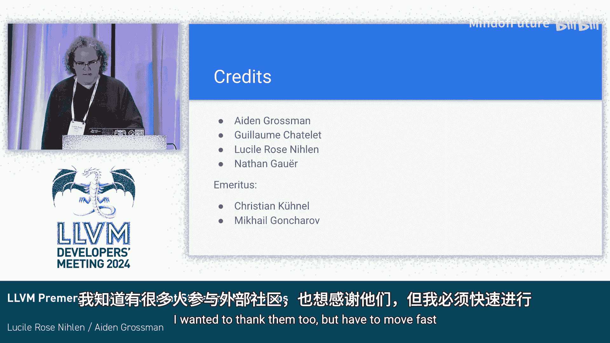

# 【2024-LLVM开发者大会-•-中英】-p42-P42-LLVM-Premerge-Testing---Current-State-and-Next-Steps--BV18eNfepENu_p42-

I'm here to talk about LVM premerge testing， also Aden Grosman is going to join me to explain some of the new stuff that's going on。

So at Google， I've been at Google for 14 years and this joke never stops being funny at Google。

 which is that there's always a choice between two systems at Google。

 the one that is deprecated and the one that isn't ready yet。So。

And I think the reason this joke stays such a reliable workhorse is that it's just like way too often true。

For internal systems， I mean this is one of the challenge is right of operating at a big scale and having to run everything while you're also trying to rebuild it and replace it and refresh it is that you're constantly kind of trying to like rebuild the boat while you're sailing on it so the boat is both deprecated and not ready yet at all times and it's very much the case for the pre-subm infrastructure where the pre- mergege infrastructure just to clarify I use those terms pretty interchangeably in this talk because we call it pre-submit internally and then we often call it pre- mergege externally so let's talk a little bit about the deprecated thing。

which is the current pre mergege infrastructure and just to review。

 so let's say you've uploaded a PR to GitHub to change some part of L ofVM。

 you get a lot of details here but the one that I'm kind of want to draw attention to is this build kitite slash GitHub pull requests you know I just picked a build at random on GitHub by the way that it isn't representative of anything and you'll see that there's this little details box。

And you you don't have to。 you can just be an open consumer。

 You don't need any special permissions to look at this。 But if you click on that。

 that's going to take you to build kitite。 And in build kitite here， you'll see a couple of things。

 It took me a minute to figure out how to read this， this web page。

 So you'll see that there's a Linux。There's a Linux build that's queued。

 that's that little clock there。 and then you'll have a Windows build that is that's just currently executing here。

 It's been running for 15 minutes， the whole process and then has been running。

 and what happened if we're looking down here I'm going zoom in a little bit。

 what happened is that it waited for nine seconds and ran in 15 seconds this script that's actually checked into the LVM repository so you can go look at doci s generate build pipeline preerge It's a shell script and it basically tries to just looking at the paths of the files that you've changed in your PR。

 it's trying to determine what tests might be appropriate if any to run as part of the pre mergege right so's a build script's a if you're testing prege the thing you learn quickly to do is to like bypass the script and just always run the pre mergege so that you can see what's going on but that's where that script is you can check it out at your leisure runs quickly obviously and then we have a situation here where it it determined。

In this case it needed to test on both Linux and Windows and it needed to test pretty much everything。

 clang， clang LD， clang tools， extra compiler RT， LVM， check all， checkLang， etc cea。

 so this is a pretty big build job that we've ordered here and you'll see that it waited for nine seconds meaning it basically didn't wait at all。

 and then it ran in 23 minutes on the Windows machine。

And it's still waiting after 36 minutes for a Linux machine。

 So I took this sort of during the peak development cycle。

 you'll find if if you look at preerge testing， it's pretty strongly diurnal around sort of West Coast working hours。

 you know， professional working hours Monday through Friday， you know， sort of9 Pacific to5 Pacific。

 really， for being honest， more like 11 Pacific to 7 Pacific， you know。

 the typical programmer productivity window。 So if you recall earlier in the year， there was some。

Real concerns about Windows queuing delays actually becoming， you know。

 pretty unworkable during peak。 You know， we're talking like sometimes the queue wouldn't totally clear during the day。

 So we're talking multiple hour queue times for Windows jobs。

 And so we threw a bunch of computers at the Windows system to try to put out the fire。

 And so now I almost never see any queuing delays at all on Windows。

 but Windows queuing delays are still， we added in an additional machine and they're still still not great。

 And so they're still grumbling from folks about that。

And then if you go and look and this you can't do， this is from the Kubernetes instance。

 So the way this works is right you upload a build a PR to Github that sends a web hook over to build kitite。

 it's the little rub Goldberg machine right now build kitite then runs that script and fires off builds to Google Cloud Kubernetes instance that's running both on Windows and and Linux。

 and then these are the machines， the Linux machines。

 and you can see that they're pretty much pegged except for it' just instantaneously when I took this one I think was probably between builds or there's actually a section of the build where that's not very parallel。

 I think probably running the lit tests where like the utilization drops and you can kind of see that cycle if you squint here。

 you'll see the machine stayed there it is for a while and they kind of drop off and then they get very busy again。

 So I mean， these machines are running just pretty much flat out as much as they using as much bandwidth as the LVM test will use of。

Computer pretty much continuously during those peak times。And there's a number of problems。

 you know with the current infrastructure and I didn't spend a lot of time making this slide。

 I just kind of top of line and you know we could probably spend a whole half hour just gathering other problems from the community about the presement infrastructure。

 but there's no auto scaling。So the machines are on all the time。

 which you know this kind of makes talking about capacity planning extra hard because know if you're paying to keep these machines running over the weekend。

You know when they're not really being used and then they're being used flat out you kind of have to average those two things into a certain amount of machine capacity for fixed spend right and so that means that ourqueuing delays are worse than they probably could be if we were only turning on computers when we needed them right and then we could be a little more efficient with that。

There's no analytics， So everything that I just told you is all like eyeball statistics like I do and I look at the last 14 days on cloud and nobody else can look at that stuff right now because it's locked down or we talk about oh。

 what's the average queuing delay， well I think we can qualitatively say。

 well they're getting worse or they're getting better， but you can't really quantitatively say it。

 you can go to build kitite and if you have the right permissions。

 you can look at what the machines are doing right now。

 how long the jobs have been waiting that they're currently working on but beyond that。You know。

 so you know， it's kind of a。You know， sense of of how the infrastructure is working。

 And and also because there's no analytics， there's no alerting。 So， you know。

 I get discord notifications from people who are like， hey， you know。

 do you notice that this thing has been busted for two days， you know and。No。

 this is also how I continue to discover parts of LVM's infrastructure that are hosted by Google is somebody's like。

 you know how， you know， I'm really upset this machine that I rely on has been down for two weeks。

 And I'm like， I've never even heard of that。 And I like talk to my colleagues and I'm like。

 are you aware that we're hosting this thing and they're like no， and then I have to go find it and。

So and then there's stability grimlands， you know， I think somebody there was an escalation recently to reboot one of the Windows machines。

 it was just failing a bunch of jobs。 So Eden hopped on and did that very graciously。

 but but you know it's requiring a lot of manual intervention right constantly and then I know there's been a lot of discussion。

 this isn't necessarily a problem， but I would say it's a requirement。

 which is like you know with the move of LVM to GiHub。

The build kitite step is filling a little superfluous。

 right like could we could invoke these builds directly from GiHub that might make the user feedback in GitHub a little bit better too and a little bit more timely and it just increases the reliability of the system right because information doesn't have to pass through this middle system to end up you。

 sort of where it needs to go in the Google cloud instances。

And then you know then there's a bunch of usability and inclusion problems in the sense that this isn't really a communityd project right now。

 there are certain parts of this where you have to be a Googler to work on it。

 the documentation is unclear， a lot of it's out of date。

 it's in a separate repository know and it's fairly opaque about how to use it I would say so together like that's kind of why things are in my opinion the way they are right now。

And but we've been slowly trying to make improvements here。 So that's the current system。

 I'm going to bring A up on the stage to talk about the not ready yet system。

 which is actually hopefully ready really soon。Yeah。

 so I've the past couple months we've been working on。

The new system where essentially we're instead of using build kitite。

 we're looking at using Github actions directly， so using Gitthub actions and then running those jobs in a self-hoed runner cluster So essentially taking the a Kubernetes cluster just like build kitite runs on except instead of running a bunch of build kitite agents we run a Github selfhoed runner instance that ends up running everything。

 So the newflow essentially looks like this where a user will create or update a PR the Gitthub workflow starts and then jobs that gets spa due to that end up dispatching to the selfhoed runners So Github so Gitthub arc。

 which is the actions runner controller that runs on the cluster will spin up runner pods So one for each workflow that we're gonna end up running So Winux and Windows right now and then those runner pods when they get deployed to the cluster they'll either schedule on a node that's already there or can also if there's no nodes available and we we're still within our quota we can actually add new nodes so it autoscales up and down。

Which is a pretty nice property is the current system doesn't do that。So for the Linux workflows。

 the job gets scheduled on a Linux node by the Kubernetes cluster and then within Linux we do this we set GiHub up to the workflow actually to spawn a container job which adds a little bit of complication but the big key with that is it enables building containers within the cluster using a tool like Kikco and then it also now enables anyone within the community to change the actual environment that the build is performed on so right now if you take the Linux build kitite agents。

 they run a specific container image that can't be adjusted by anyone outside of Google and someone has to build that done using Google CloudBuild right now。

So using this new setup， anyone can change the container image and anyone can just update it building it on the cluster itself。

 which makes it a lot easier for the community to hack on it on the window side the job just gets scheduled and then we built it within the same pod we would like to do the same setup as we do with Linux but GiHub does not actually support being able to。

Do the spawning GiHub doesn't have support for running any containers within Windows workflows。

 which precludes us from。Doing what we want to do there and then the GiHub infrastructure there handles reporting all the status you get all of your logs as you'd expect。

 they end up being in a nicer format than build kitite if you set it up correctly like you get individual steps rather than just this monolithic multimegabyte log that you then have to parse through if there's any problems。

And then depending upon if you merge， then we do potentially post commitmit testing what we're currently thinking of doing is running the postcommit testing on the same exact infrastructure so doing it through Github actions on the selfposted runners which provides a couple of advantages mainly it's the same exact setup there's been a bunch of problems recently where one of the buildbots that tests the precommit configuration will be broken and the pre commitmit won't be broken or the precommit will be broken and the post commitm build bot testing that configuration won't be broken。

 So it's a lot of maintenance effort to try and keep those in sync that we'd rather avoid and it also doesn't test any infrastructure problems So if there's like some infrastructure problem where all the builds are failing on the checkout because something got miscongured that probably won't necessarily be caught on the postcommit testing and we also want to make sure we're testing the infrastructure if we want to do something like only block on。

Or only worn on pre commitmit tests that fail if mainine isn't broken or something like that。

 And then if you update then we just go through the normal flow yet So a couple of takeaways from this slide is one this image I know it's a bit of an eye chart it's actually taken from a document a design document where we're documenting the design that Aideden and I are iterating on that we'll be sharing with the community shortly so you don't have to worry if this image is too far away or not entirely accessible it's just an excerpt from our actual documentation I feel so proud to say that we're providing a system to LVM that is documented so really excited about that and filling like a really good filling like for once something went right So that's awesome And then the other thing is that this configuration that Aden is describing is the Github is taken from the Github recommendeded sort of way to do self-posted runners and so there is already existing document as provided by。

GHub about the best practices that we're following here。

 So there shouldn't be too many surprises and already existing documentation， which again。

 warms my heart a little bit。Yeah， and then the other thing that we've worked on setting up is getting actual analytics set up so we have the Grfana instance running in the cloud that's set up this is an example dashboard that we built mostly just as a proof of concept like like these are some metrics that we think are probably going to be useful like runtime and queue times and then success rate like moving average success rates which we think will be useful。

 but I mean Grfana enables us to easily hack around every just tack on the dashboard and change everything because all the data is there so it just allows you to query it and put it into whatever format you want quite easily。

So for the analytics details so we're using a Grfana public instance hosted on the Grfana site。

 we might be able to get some more features if we self-ho but Grfana is a GPL and we want to make sure we're in full compliance with the license terms there so we it's easier for us to make sure we're in compliance with that if we're using their hosted version of it so right now it's an early prototype that needs refinement but as you can see from the last slide everything does work and we can pull all the data in that we need to and then we ended up choosing Grfana because it it has good documentation it's pretty much an industry standard at this point and it has a broad usage so we're looking at tracking things like queuing delays on Linux and Windows runtime so that we can which will correlate with queuing delays to make sure that jobs are actually taking a reasonable amount of time job success rate so we can。

Create metrics like if 95% of the jobs fail， then it's probably an infrastructure problem rather than problems with 95% of people's code and then a server utilization just to make sure we're using resources appropriately and help with capacity planning。

And then the question marks are there to invite you to imagine other analytics that might be useful and suggest them to me or to Aden or to anyone else involved in the infrastructure project。

Yep， and then。Yeah so next steps thanks very much so and to give credit where it's do Aden built much of this so you know it's pretty awesome for somebody who just kind of introduced himself to me at the Euro all of Em De meeting this year and like hey。

 I want to help out and I'm an intern working on an unrelated thing on a different team at Google but can I help and I was like sure but they'll get in trouble and you know and then here we are with new stuff that's like actually working and well documented and stuff that I'm just very pleased with that so thanks very much。

In terms of next steps we want to finish the first implementation of the analytics's I want there to be enough there that like it's worth having a conversation about you know it's like if you put out something too early I find oftentimes the feedback you get is mostly about the known flaws as opposed to the unknown flaws right and so if we put it out with only a few known flaws then I think we get higher quality feedback back and then also finishing the documentation so just iterating on that and making sure that that's actually usable。

The plan to launch this infrastructure is to do a shadow launch phase towards the end of the year。

 I actually because we don't have analytics， I don't have I have nothing but intuition and like people's recall about this。

 some people I would say the bedding is like 5050 right now。

 Some people think that there is a holiday slowdown at all you know because the workingts know don't contribute code as much because they're on holiday break。

 Some people think that the people that you know don't maybe hack on LVM during their day job or maybe they hack on LVM during their day job and at night have more free time you and are with family and don't want early and want to be with family or whatever And so they're like you know what。

 I could like engage with this person you know who is in my house right now and thinks that they should be in my house or I could go upstairs and hack on LVM so like。

We're a little bit curious if there is a holiday slowdown or not。

 But the thought was during a holiday slowdown， we could do a shadow launch where both sets of infrastructure are running。

 So right now the infrastructure that we've built is running on a fork of LVM that we're just using to test the things are correctly configured。

 But then we would want to commit the new stuff and and turn it on and have both infrastructure running。

 But the reason I want to do during a slowdown is because that's going to double our machine resource usage。

 And so hopefully we can take some of the sting out of that by you by not having the machines used is heavily。

 So I'm a little bit curious kind of wish we had analytics from last year to understand commit rate。

 I guess I could go look at just the get the raw get shot increments per day to try to understand if there is a slowdown or not I probably will do that thinking out loud。

 And then know kind of once we're satisfied that the new thing know the're not ready yet thing is now actually mostly ready we'll turn off the deprecated thing。

😊，And that'll be your new system。 So look for more details as they're finalized。

 and then we were thinking towards the end of the year of the slowdown of doing the actual launch timing。

Future plans。I think that a couple of times， even just while I've been involved with LVM infrastructure。

 which is little under a year now， there's been this sort of discussion that people have engaged with where they're saying。

 look like。Should we test this thing or not， I know there was like a big discussion around like should some of the flang tests or fl changes that rely on parts of clang。

 should should that fire off and presubmit， you or you know the queue& delays got really bad on windows and so people were temporarily disabling the windows pres submitubmit and and there were feelings about that because when we turned it back on then we would find a bunch of breakage and so I think that there's this community discussion that I think is worth having about like okay。

 well， you know given fixed costs that like a Google the expense that Google can bear or is willing to commit to this。

You know， the other knobs that we can turn are queue delays。

 What do we cover and pre submitubmit and， you know。

 and like how do we divide the resources between Windows and Linux， you know， okay。

 so I'm out of time。 But I think bringing data to that is really， you know。

 gonna drive the conversation and gonna be a really important way to have a stronger。

 more informed conversation about that。 And then we want to open the door to more community involvement。

 And lastly， with alerting and other things having clear escalation pathways。

 I think would really help。 So it isn't so informal where you're just pain somebody on discord and saying like。

 hey it's broken。 know， but like we should already know it's broken because our alerting told us right like that would be really helpful。

 So quicklist of credits here and we't go through it。 but thank you for your involvement。

 I only put the Googlers here。 I know there's a lot of people that have been involved know。

 outside of the community。 And I wanted to think them too。 But have to move fast。 And then yeah。

 time for questions。

I'm just curious if it would make any sense to plug in the breadth of all the buildbots that exist into this so for a consistent look and feel and and maybe analytics as well Yeah so that's one of the reasons that the analytics platform it's like sort of deliberately open source here is that we would love to have other contributions to it。

 and I definitely feel like know I'm not the queen of L theM presubmit。

 I'm just talking about Google's part in it and what we feel like we can sustainably contribute and so I would love it like for instance。

 I would love it if if we pres submitmit checked on Apple too like the other platform but there's no option to I have to use Google cloud I'm I would not survive sending an AWS build and my manager for approval So you know so that's not infrastructure I'm ready to I'm able to provide at Google right but this is definitely I would love to have other participants plug into this。

And not just be solely responsible for this pretty important piece that I think that we're providing right now。

Great work。 Does your design allow for addition of added targets。Yeah， so I mean。

 it's essentially just hook into GitHub。 So the part there would be implementing new workflows on the Github side。

 and then other people would be able to just register。

Additional selfhoed runners on their infrastructure that would then be able to execute those jobs。

 So yeah， if you wanted to set something up on Mac or something on like A 64 Linux。

 you would just add self-hoed runners to the repository and then you would be able to do that。

 So yeahs like the cloud infrastructure that we're hosting it would be pretty much specific to X86 and Windows and Linux and maybe A64 Linux if we ended up wanting to go there。

 but yeah， other people could add additional targets。

 there is a caveat that you can't add anything to esoteric because you need to be able to run the Github runner on it and that is based on donet because that's how Microsoft built it So the platform support is somewhat limited。

 but most nonsup esoteric platforms will support it。

 So I think that in the far future I envision a set of like community agreed upon standards for like what you could add to pre submitmit probably around like reliability and latency know saying like your pres submitmit body。

You know takes less than half hour to complete it is 95% reliable The only reason I don't advance those now is that I don't think our own system meets those criteria。

 so I would essentially be saying you know the community gets know pre submitubmit and that doesn't work so and we also have no analytics so we have no way of knowing but having built both of those things I would love to have that kind of discussion and be able to invite other people in yeah。

😊，Okay， great， beat you to the punch。Thank the speakers again。 Oh， you had a question。

Go for it last question name Hey， so how much faster is he going me know like because I know the 36 pity like I know the icons easy like more like six minutes or you know what I mean like what。

😊，You know， for a change that is fairly isolated where is dominated by so we haven't tested it under production loads Yeah。

 right because we don't have budget to spin up to infrastructures。

 so can't say I'm hoping I don't think the bills will be any faster。

 but I'm hoping to get the cuY delays down。Yeah。He hi。

 so most of the system on Pri right now assumes that like it runs always on LPR mostly， right。

 there is some path filter possible but。You mentioned that at some point。

 we will reach Russells limits and we have to make trade offs。

 One of those trade offs is the ability to opt in testing。 It's like， well。

 especially when NR is reverted for breaking it on our power PCbo or something like that。

 that's where the connection to buildbo that was mentioned earlier could be convenient。

 which is I would want just to rever a my request on this configuration that I don't have access to locally and I know I broke a buildbo。

 But if I cannot reproduce and I'm not sure I will fix it， like。I think a couple of things one。

 I think that your take that some things don't need to be pre submittedm or only need to be pre submitted and some things is。

A discussion that should be had by the community about I'm down I'm'm saying we don't have the rust system。

 yeah So I think that that's another knob we can play with。

 but I don't I don't as Google feel comfortable playing with that。

 Like I want that to be a public conversation。 But I fully agree。 that's anob we can play with。

 And you know， like Chromium， which is my model of sort of really great like pres submitmit infrastructure has these tribots that that meet that use case。

 I'm a developer。 I'm working on Windows， but I want to test something on an esoteric platform know。

 I can fire off a trybot。 I would love to see that pretty expensive。

 So know maybe there's some middle ground we can find Anyway， thank you very much。

 thanks speakers again。😊。