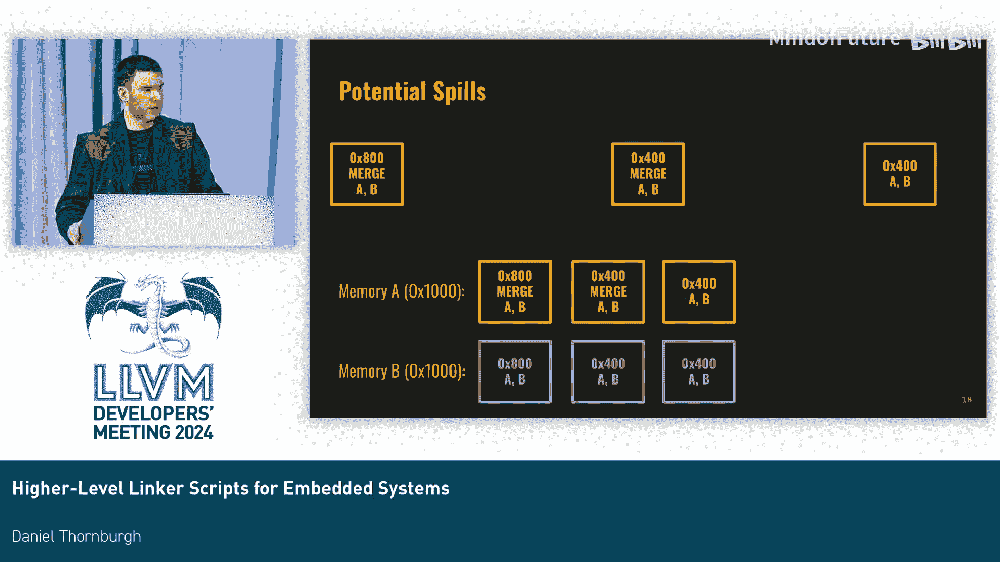

# 【2024-LLVM开发者大会-•-中英】-p43-P43-Higher-Level-Linker-Scripts-for-Embedded-Systems--BV18eNfepENu_p43-

Last little while， I've been working on the relationship between the LLD linker and embedded systems。

 So more specifically Lier scripts main mechanism that embedded developers use to configure the layouts of code and data in the address space of an embedded system the way that that's actually done is kind of low level。

 And by that， I mean users have to exert a lot of control over the process relative to their actual constraints or desires。

 So I've been working on introducing higher level mechanisms that allow you to say a little bit more。

 I don't care exactly how this gets done， take care of it for me。

 which actually brings some really considerable advantages in terms of usability of LLD for embedded systems。

 So I'll give a little background on embedded systems。

 that word means a lot of things to a lot of people。

 So I'll kind of narrow down that scope to kind of the microcontrollary domain。

 So if you're not intimately familiar with that domain and what it's like。あ。

These tend to be the systems that are among humanities most sensitive to one or more of the following cost。

 power or latency， and by latency， I mean how quickly the hardware and software can react to events coming in say over digital input lines or interrupts if you have extreme constraints on one of these。

 then generally general purpose application processors cannot be made to address those concerns past a particular point。

 it's also the case that general purpose applications generally don't have the ability to meet these constraints。

 so you end up with a domain where you're running very special purpose hardware and very special purposepo code to get something to actually be cheap enough。

 use low enough power or react fast enough for whatever your design needs。😡。

So these concerns place really specific constraints on the design of hardware。 I'm not exactly a wle。

 So everything that I say here， grain of salt。 I'm doubly adjacent。

 So I do have a die shot though of a raspberry pi 2040 that blessed little microcontroller and this has a little boxes drawn around all of the components on it。

 and this really is like these transistors are for this thing。

 So the two big blobby things on the outside。 those are ra and they're huge if you see to the left of the rightmost S Ram。

 Prox0 and proc1。 those are the two arm cortex M0 cores。

 and you could fit them inside one of these Ram blobs like once twice like maybe three times。

 So you know assuming all of the hardware， the connect scaled which it doesn't of course。

 but assuming it did， you could have like an eight core microcontroller。

 if you were willing to take half as much ram but they don't that's not typical so。

The reason that it's this way is that static RAM SRAM is really the only technology we have from making RAM that uses low enough power and has low enough latency to work in these domains。

 but unfortunately it fails on that third criteria cost it takes about four transistors per bit on the low end and that's a really。

 really expensive way to use transistors when you have like 256000 bys times8 however many bits that is it takes a lot of transistors relative to almost everything you do but you still end up needing some。

 so it's expensive and people kind of do whatever they can to avoid needing large amounts of it so there's some direct implications to that one of the reasons that these systems tend not to have MMUs is because efficient use of them in MMU means that you have to constantly cache in and out the page table page table scales with main Ram so typically isn't necessarily room to have it all present if you end up with large amounts of RAM。

For the most part on these systems， you end up with everything being physical addresses。

 you don't have this layer that is doing translation because the content addressible memory that you need to do that well。

 it doesn't fit。It's also the case that it's common to use cheap off die memory to replace this expensive SRAM that tends to live on the die and one of the reasons to do that that you can make memory that lives outside of one of these microcontrollers on some external bus cheaper is that you can give it docs that allow it to be made in a more efficient way you can just use like a dynamic Ram if you can in some cases。

 say afford the power usage that that takes， those are much much cheaper you could use read only memory those again。

 tend to be cheaper， you could use a really slow one on a much cheaper process。

 maybe you don't power it all the time， maybe it's not available when you boot up and you have to set it up。

 maybe there's limited buses that you talk through there's a lot of constraints in how this memory actually works and because these systems don't tend to have MMUs and operating systems that can do memory remapping on the fly the cost of dealing with this more or less。

falls to the linker， the linker reloates code it says this is the address that this thing will live at。

 replaces all of the symbolic addresses with real like actual references to these addresses in instructions and so that's the end of where anything could deal with this all of this logic has to happen in the linker somehow。

So these things are all really bespoke these constraints。

 So developers have to actually tell the linker about them and how to deal with them。

 The main mechanism that they used to do so is language called a linker script tons of embedded linkers exists。

 they all have different mechanisms for this。 This is Ganu LDs LD in LVM copied this for the most part and here's a simple example。

 So say we have a fastRAm， a slow ra you can say those are two memory regions here where they start in memory。

 here's how long they are and then you can say I want you to place everything in every file that is data。

 I want you to put it in the fastRAm， and then everything else that is data I'll put it in the slow Ramm。

 Now I just slide this isn't actually what this linker script says and I'll get back to that in a second So I'm going to go forward imagining that this is what this linker script says So if it actually said that Here's how this might work you have some data sections come in say an 800 to 400 byte one assign the first one to the first。

That's fine。 FastRAm has， room for it。 You might try to assign the second one too。 and you'd be like。

 no， no， no， no， we don't have enough Ramm there。 it doesn't fit。

 So you kind of spill it to the next place that it could go and you'd take the hit because it's you you need everything to fit。

 this isn't also specific to data code needs to work the same way。

If you actually tried to do this and go to LD or LD as is。

 what would happen instead is that the linker would throw an error and fail。

And the reason is this linker script is not really exactly a constraint system。

 it is a very well specified， for the most part， people who actually work in the linker would not agree with that it's very well specified。

The semantics of this are such that these wild cards。

 sections get put wherever they match first and reading these from top to bottom。

 you really can in your head kind of determine ahead of time where everything is going to go。

 The implementation has no latitude to place things with any other semantics。

 So that means all of these， the programmer is saying will go into FastRAm。

 And then when the linker can't actually fit it there。

 it has no recourse but to fail it's not allowed to do anything different by the semantics that these scripts have been given。

So the way that people typically have dealt with this is by playing sort of Tetriris with the codebase。

 you don't necessarily have to use a wild card。 You can say this file or this static archive。

 It sections are going to get put here So you can go in and a really fine grain of detail and put things in different places。

 optimizing yourself for performance or even if you just need things to fit。

 you still have to do this。 if you have a couple of Rams。

 And so we've seen people doing this continuously as their code and data changes sizes。

 they readjust this， typically these fits are really tight。

 So you have to go in with a pretty fine tooth comb and pick out things to make sure that you call out enough things but not too many things in one section and then put everything else with a wild card into the second section。

 And this is kind of awful。 maybe just from my point of view but we've also heard that from people that we've worked with that in my opinion。

 this is exactly the kind of reason that we made computers in the first place。

To not have to do this kind of paperwork。 It's not a meaningful or interesting task。

 and it's one of those kinds of things that seems really solvable by a machine to make things a little bit worse。

 this kind of manual assignment relies on file names making it through and this is the property that makes linker scripts not work with LT as Peter mentioned in his talk LT deletes files for the most part it takes all of the input files slams them all together as one object and then it tends to come out to the linker is something like do LT do O And while there may be ways to address this。

 they're kind of invasive into the linker and at least at present。

 nobody in either Ganu land or Lvmland has really ironed out exactly how a solution for this or gotten that working So at least today this is kind of the thing that blocks LTO。

But when we went looking， this actually happened when we were looking for solutions for LTO。

 found a weird flag in Gu LD that no one had ever heard of on our team。 I asked around did Google。

 Nobody appeared to know that this flag existed like the top result for it was in the good LD manual and like maybe a single stack overflow asking like if it worked So it's called enable nonconticiguous regions。

 which is a weird name for what it does。 It makes things work like the first slide。

 It actually does enable the spilling mechanism， and it changed wild cards to mean not this goes in the first place that it matches。

 but that every match is a possible place that it could go。

 and the linker will spill from one to the next to the next as things go over size。 and that's great。

 So this is in Goodo LD。 we ported it to LLD。😊，Things spilled to later places if they won't fit。

 And this actually by itself kind of unboxs LTO in quite a few cases。

 if you don't have to specify file names。 if you can get away with just wildcard。

 then you can use this kind of automatic spilling and placement to LTO everything together and then have the linker fill out sections where they fit。

 You don't get as much control and that's something I think we'd like to address。

 but it kind of works。 the main downside of this is that it globally changes what linker scripts mean。

 And so if you were relying on this kind of first match fall through behavior。

 then it might not be possible to port a script to use this flag and having flags that globally change language behavior in semantics or kind of wony in the first place。

 So another thing that we did is come up with collectively a new syntax called section classes which preserves the original way that wildcard work。

 So you can now bind a bunch of input sections using a wild card to a name in this case I'm giving it the name。

Data and that becomes a class of sections that you can refer to later。 And once you do that。

 those sections like normal are removed from the pool。 In this case， the first match is the class。

 and then they're not allowed to match any other wildcard。 But once you've matched them to a class。

 you can use them in the same context that you would use other wildcard to say these are all of the places that this class can go。

 So you can say that you know first the data can go into the fastRA。

 and then the data can go into the slow Ramm。 And the main advantage of this is that it gives you all of the power of the previous slide。

 but you can incrementally add this to an existing linker scripts。 for the moment。

 it's LD only but new LD folks seemed reasonably know comfortable with it when we discussed it。

 So it's something that might end up in both linkers eventually。

 Sos that's the thing that's the project that's what we did。It wasn't very simple。 It sounds simple。

 Everything in LD has oodles and oodles of unintended complexity。

 and that's kind of one of the things I wanted to talk about。

 That complexity is stuff that users had to deal with。

 but now we're bringing it into the linker and the reason I titled this higher levelve linker scripts is because I think that's a good move for embedded to start to build kind of more decisiony and more compilry elements into the linker。

 that's something that can reduce toil in embedded systems where these kinds of layouts are very timecon to produce。

 So I'll run through a little example of how the spilling logic works at a high level。

 and then some of the complexities with it， and then we'll dive even deeper afterwards。

 So say we have two memory regions， both 1000 like from the last example。

 I'm going to rename them A and B。 and we got three sections， one that can go into a and then B。

 one that can only go in A and another one that could go in either A or B。😊。

We might start assigning these and you know like before we discovered that there's an overflow。

 but unlike before， the initial way that I had imagined that this work is you'd just go left to right and then once you got to an overflow you just start moving things to the next place that they could fit but the section that caused the overflow isn't one that you can actually move。

 you could end up discovering that there are late sections So you need to backtrack and spill things until you could possibly clear this you'd need to spill at least say 0 x 200 bytes to the next region and then you might be able to continue on and get a valid assignment So we actually did do this。

 there's a fixed point algorithm that operates in the linker that deals with the potential for decisions that are made in address assignments to increase or decrease the size of things which need to feed back into those same set of decisions and this is a case like that it's difficult to。

Gues ahead of time the exact impact is spilling something so we spill some things kind of last first and then run that loop again。

 it's added to this fixed point loop to give it another chance to see did that actually resolve the conflict and allow things to fit and this continues some fixed number of times as before until we either determine that this wasn't sufficient or fail the link。

So even this didn't， I'm not gonna to say broke everything。

 but here is a list of all of the existing features in linker scripts and the linker that this interacted with in interesting ways So a lot here actually features that where there wasn't exactly an obvious semantics for this and the size of this list at least to me was a little bit surprising like we actually had to go through these one at a time and try to figure out something sensible for them to mean and there's kind of a reason for this。

 So even a feature like this can introduce what I'm going to call a horrible circular dependency into the logic of the linker。

 So it affects this decision of which input sections go into which output sections like where user code goes into the binary and that happens really early in LD and tons and tons of decisions require that information。

 like where is this thing going to end up。 Well what's the alignment of that thing then like what are the program headers gonna be There's tons of decisions you need to make and then all of those。

are needed to assign the final addresses。 but the final addresses are the things that are going to cause spilling。

 which are going to change this mapping of input to output assignments。

 So if we wanted to have this perfect as if semantics where it's as if everything was in its final place from the very beginning。

 we'd have to run essentially the entire linker in a big loop to fixed point。

 And that's basically a nonstarter for performance architectural reasons we didn't do it what we did instead was sort of record all of the places that something could end up as potential spills。

 and we treat those as actual items， sections that the linker operates over。

 and it prepares those locations， those sections to potentially receive the real section when we finally assign addresses。

 then when we get to address assignment based on this。

 we can make that decision with a knowledge that wherever this thing ends up。

 it would be safe for it to go there and then erase all of the places where things。

Didn't end up actually going。 So I'll show another example of this before with a little modification。

 I'm going to say now that everything can go everywhere。

 And the first two sections say they have strings in them and the linker can merge them together。

 That's an example of one of these things that the linker can do with your sections in the middle。嗯。

So we start out by putting things in in this first the first place they can go and then making copies of them。

 potential spills in the next place that they can go。

 and then we can kind of just do the linker logic so we could merge those two sections together and make a new section。

And say this 0 x 400。 It doesn't do anything anymore。

 It's gone now because the section that might have spilled into it doesn't exist anymore。

 There's tons of things where sections are inserted deleted。

 We kind of leave the spills alone and allow this whole process to fall out as it may。

 And the result of this is that when we get to address assignment。

 we can teleport sections to the place that they're going to end up being。

 And the whole rest of the semantics of the linker has a sort of consistent semantics where things。

You， the concerns that depend on addresses all depend on the final location and the things that don't have a semantics where everything is kind of placed everywhere。

 which is I admittedly not ideal， but this is kind of worse as better sort of approach to dealing with this。

 and it ended up allowing a feature as complicated is this to be implemented in LD with relatively little code and in a way that's pretty easy to maintain。

So。That also is more or less how it works if you go and read the code then it'd be with this hopefully fairly easy to suss this out one of the things that we'd like to look at is a kind of priority ordering so。

This algorithm doesn't really depend on what order sections are considered in and what order regions are assigned to。

 so if you were to say order memory regions by best first and order sections by decreasing importance。

 then the algorithm that is already there will kind of do a first fit greedy placement to optimize performance and that's really interesting。

😡，One of the things that we might be able to do is to incorporate some kind of profiling information into section metadata。

 use something like propeller to group sections into these atomic groups that could be placed well together。

 and then encode priorities using profile guided optimization into those sections。

 and then have this spilling happen in an order such that those get placed in a way that optimizes performance。

 minimizes thunks， the other concerns that linkers tend to care about or embedded developers do。

So that's pretty much the whole spiel， I've got links to all of the RFCs and documentation that we ended up with as artifacts of this work。

 and I'd thank you all for listening and ask if there's any questions。👏Thank you。Questions。

Does this happen， post garbage collection or three garbage collection？Well， kind of both。

 like I mentioned， so I'll go back to here Wait， no， no， no， no。Wait， yeah， yeah， yeah。 okay。

 So input output section membership。 that determination happens before the garbage collector。

 The garbage collector runs afterwards and cleans up sections。

 but that just causes like with merging， the potential spills of those sections to become in ert or benign。

 they're kind of just left around。 And then when you get to address assignment they're cleaned up。

 So an assignment done before garbage collection。 No address assignment is typically like the very last stage of LD So the class that you have created a new keyword that you have created happens during address assignment when it gets through up。

I'm not sure what you mean so basically like you have if you go to the previous slide yeah so class of data stairs say star of data and then if you do it before garbage collection。

 if you do input section assignment before garbage collection。

 you data fast Ram basically like you' will have you have class data that matches there and whatever it fits right like for example。

 the lens does not fit。1000，0 x，1000 by8。For the fast Ram， it will automatically go to。

The next section would just get a slow ramp。But if the assignment of import or protection mapping happens before garbage No no right so that was one of the points that I made is that you could imagine a syntactic mapping。

 what we're changing the mapping to instead of this is where it will go。

 these are all the places it could go so all of garbage collection and the rest of processing happens on all of the places that things could go but the actual decision making happens almost at the very end of the link so the things that are garbage collected the artifacts are now things like potential placements of sections we don't actually do CG or GC on these like potential spill sections that we've created。

 we do them on the originals but if a section is garbage collected。

 then it potential spill sections that we insert they get summarily just like scrubbed out so everything disappears。

啊。Isn't this hard to maintain literally like No， it was like 100 lines of code No no no the linker script itself for customers to maintain I mean。

 we haven't particularly found that。 Like we actually were able to delete tons and tons of code for the linker scripts for the embedded projects that we tried this on like compared to the current maintenance overhead of manually placing everything everywhere like the examples that we found just were trying to pack stuff。

 And like。We haven't really had any requests to make changes to it or problems with it so far。

Can you speak to the complexity of like your algorithm and like does it matter in this context Oh like yeah time complexity？

I don't know it's。Prob linear。It's like many things in the linker。

 like it's a thing that runss a fixed point and like if you never。

 ever see it and we've never seen it use more than two iterations in a practical case。

 like there may be a way to torture it， but。Then then we'll go in and do something more clever like that that seems to be the the marching orders and something like LLD。

 like don't torture your linker。 Like you can doss a linker if you want， probably。My question is。

 how does this interact with things that may change the size of sections without changing the number of sections like linkor relaxation on race5 yes。

 thankfully this was a major concern in how we did this。

 So all of those things happen in the exact same fixed point loop that this filling happens in So that's a really good point that I forgot to talk about in this。

 sizes of these things may be changing due to differences in placement that changes the relocations how far they are that may require the generation of additional thks LD tends not to clean up thks。

 but it could relaxations may I think they actually do happen afresh each time don't quote me on that though so it's a big soup of fixed point relaxation and we maintain forward progress by making sure that sections can only ever go forward in the list they can never go backwards or regress so。

It kind of just falls out actually it doesn't necessarily fall out in a fixed number of iterations。

 but it is the case that the linker will just bail if it takes more than like 10 tries。

 So all of this is kind of best effort and that's sort of intentional like you are by using this making a statement I think it'll probably be fine and there actually is kind of a lot of power to that like even register allocation in a modern optimizing compiler is best effort it's really easy to write some inline assembly that will break LvM's greedy register allocator。

 but it's so fine for so many people that people actually do think that it's perfect even though it's not。

嗯。Well， thanks Daniel for great talk。