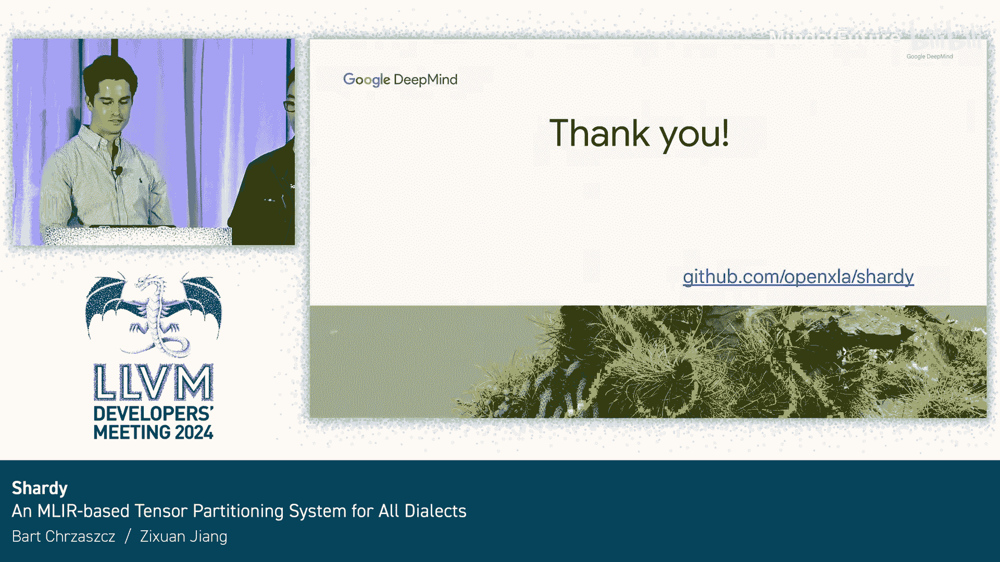

# 【2024-LLVM开发者大会-•-中英】-p46-P46-Shardy---An-MLIR-based-Tensor-Partitioning-System-for-All-Dialects--BV18eNfepENu_p46-

H， yeah， so Shaarddi， it's a new open source MLR based propagation and partitioning system that we've been developing over last year within Google and Google Deep Minds。

😊，But first， I wanted to go over some background information for those who are familiar with scaling large tensor programs。

Like the geneative AI models like Gemini， ChattBT and others that generate text， images。

 Aud and video are extremely large。 And don how big and how many matrix multiplications there are inside them。

 These companies have to deploy the models across thousands of devices。

But how does this deployment work if the model can't even fit on a single device。

But for a bit more context， we need to understand how the accelerators are set up。

 there's some differences between Google's TUs and NviDdiaiouss GPUs。

 but simply put they have various different fast internship connections that lets these accelators communicate with each other。

However， that's just how the physical systems are set up。

 like when researchers distribute their models across the chips。

 they operate on what we call a logical mesh that abstracts away details of the underlying hardware topology。

You， of course， need to account for the various connection speeds that can exist in large systems。

 since not all connection speeds are the exact same。To common distribution。

 or from now I call sharding strategies is batch and tensor parallelism batch parallelism has you split up your samples across multiple chips to calculate the predictions in parallelil。

 while tensor parallelism has you split the parameter tensors of your model across devices and compute partial activations before communicating them together。

For example， if we are doing batch parallelism， then each row of devices gets a unique slice of samples。

 and for tensor parallelism， each column gets a unique slice of the parameter tensor。

You can think of each row as having the entire model just split across the three devices and each column computing its subset of activations across all of the samples。

Let's quickly see how a program is written on the 4 by2 mesh for Tensor parallelism。

 We're going to look at a super small program where we just do two matrix publications。

 and here I'm going to just show the very final program after propagation of partitioning Each device will see So we're going to use a strategy which lets us calculate the two mapms in parallel before were forced to take the summation across all host is the contracted dimension on that second mapm here。

 the percent1 being sharded to do so。 we need to shard dimensions of Ps 64 and parameterm1 and pram2 you see highlighted here。

😊，Now， after like propagation partitioning， you can see that all reduce being added to the contracted dimension of the second mapm being sharded。

 So it's kind of pretty neat。 But we have systems which do this all for us。

 So we don't need to modify every single operation in the graph and add collects our cells。

 So let's take a look at some of them。😊，Mill them we we can focus on the charting propagation parts。

 not the partitioning or that SBMD of fire part。 I thing that all reduces here。 Yeah。

 just the propagation part。So first we have GSPMD， which is the first in these sets of systems。

 is an attribute based propagation system， which doesn't have access names and propagates ops in a predefined order。

It also has a pretty extensive sharding conflict resolution strategy built into it。

We then have party hour， which instead of propagating sharding attributes。

 rewrites the program into what we call tiling loops。it also uses named aes on the mesh。

 has a data structure that tells the system how an arbitrary app can be sharded。

 but doesn't have a conflict resolution strategy， since asks users to define sharding strategies as separate propagation passes。

And finally， we have the mesh dialect， which is upstreaming its M AR。

 is a combination of ops and attributes for propag。 It doesn't use access names。

 only access sizes on their mesh and has users implement an interface to tell the system how to propagate through an op。

😊，And finally， we were introducing Sarddi， which borrows a lot of ideas from GSPMD and Part R。

 we use a mesh with names we propagate shardings like GSPMD。

 we use a mesh with access names like PartR， we have both off based and user or round based propagation like GSBMD and PartR and finally we also have an interface we telling us how to shard like that the mesh dialect but looks more closely to what PartR has with the data structure than the mesh dialect and we'll get to what looks like exactly soon。

Yeah， let me introduce the new sh representation。 and we also define a set of running APIs for the easier。

 for the ease of user annotations。As an overview， the sharding is in the attribute for of an operation。

 which describes how the results of the operations are partitioned for is usually bound to to the match。

 In this example， this sharding is bound to this mesh。

 and the first dimension is partitioned along W first and then along x。

 The second dimension doesn't sharded along any axis， which means this dimension is fully replicated。

 and the the x is Y and z are not used in this sharding。

 which means they are imply replicated in this sharding in this in this for this tensor。Also。

 we define the source and target of the sharding propagation。 First of all。

 we define the explicit explicit explicit replicate axis。

 which cannot be used to further partition tensors。 And on the other on contrary。

 the in place replicate axis can be further used to partition tenors。

 which are the axis to be to be propagated in propagation stage。😊，For the target part。

 for on the target side， we define the if dimension is open or closed。

 The open dimensions can be further be can be further charted using the using axis， where the close。

 the close dimensions cannot be further charted。 and the source is the source can only be the in rep axis and the target can only be the open dimensions。

We also provide the user the priorities for the users。

This this priorities can be used to determine the propagation order。

 which providing the more user control and better debaability for the users。 For example。

 it's easier for users to implement a different level of prop。

 different level of hierarchy propagation with with different priorities。 For example。

 it's easier to implement batch at at highest priority。 And then with the micro sharding。

 followed by the zero shards。And this priority can be attached to the charting annotations。

 as shown on the right example， which just attached P 0 to the specific charting annotations。

 which demonstrate this chartarding has the highest priority to be propagated。Also。

 we define the sharding rules， which visualize and simplifies the propagation algorithm。

 This sharding rule demonstrate the relationship between the dimensions between the dimensions across different tensors。

 For example， for as taking a dot as an example， It sharding rules is just its annotation inom in essence for we just you can we can define using these annotation to define the batch dimensions。

 noncontract dimensions and contract dimensions easily and its easier to visualize as showing the in next section how we demonstrate how we propagate the shards along this along factors。

And this strategy rules just provides a visualization of this。Sarding relationship。

 And we propagate shards between with three directions。

 The first one is the backward four directions， which is propagating from the opera to the one to the results。

 Also， we supported the backward propagation and set and sideways， propagation。

 which is between different opera and between different results。Next section。

 we discuss how we pro shardings in this new with thiss and new new APIs。This。

 this graph is an overview of how we propagate shardings。 Its in essence。

 we propagate shards along the factors to do that。 We have three key steps。

 The first one is the projection from the dimension sharding to the factor sharding。

 And we propagate shardings along the factors。 And then we project back to the dimension sharding space。

 And as we discussed as we mentioned it in the slide in the slides before。

 the dimension sharding and fact sharding。 their relationship is。

 is is bounded by this sharding rule。 Let's taking the example let's taking an example with the dot in this dot general。

 it it suggest very standard very simplified version。

 it has two noncontract dimensions and one contract dimensions。 and。😊。

The first step to handle this propagation is the we project。

 we project the shardings from the dimension space to the factor space。 And to do that。

 we have this sharding rules， which is equivalent to the Iom notation。 It's just I K， KJ。

 And we project to the result。 It just correspond to two non contracttracted dimensions。😊，And the we。

 for each factor， for each factors， we also have the size。

 which is the correspond to the original dimension size。To with these sharding rules， we can just。

 we can project the dimension charts from the dimension space to the factor space。

 which in this in this example， is quite example quite simple that we have three factors。

 And since we have we only have the sharding axis in LH S。

 we can just fill this table with the corresponding sales。Not that several。

 several tenss doesn't contain all the all factors。 For example。

 the LH S doesn't contain the RH S non counter dimensions。

 which means factor J is missing in the LH S。Now we go。

 we proceed with a second step is propagate shardings between along these factors。First of all。

 we can just propagate shardings along the factor I。 since there is no conflict。

 We will just propagate sharding axis batch directly along this， along this column。 Similarlyly。

 we can propagate tensor axis along the column along the factor K。Yeah。

 the third step we project chargings， project vector chargings back to the dimension space to form the original tensor charging。

And to， since the relationship between the fact charting dimension is formed by these sharding rules。

 we with。We can further， We can direct it par back to the dimension space in the， in that in the。

 in this example， the RH S will got the tensor along the factor K and the and the result will get the batch axis along the factor I。

😊，Yeah， the example above doesn't contain any conflict resolutions resolution requirements says there is no there is no conflicts in these tables。

 We do not have the repeated repeating access along each columns or repeating axis along each row。

 So we we further develop a a full hierarchy to resolve this resolve this conflicts。

 on the top level， which is the user priority propagation。

 users can define the priorities for specificnotations。

 and we have handle this highest priority handle handle the sharding with highest priority at first。

 and then gradually handle the shardings with lower priorities with that party users can easily implement the bache part and zero shing annotation hierarchy。

 And in the second layer is the operation party propagation。

 which is a heuristic method board from Jeff we we will handle specific。😊，Pass through。

 pass through pass through operation at first and then gradually handle several complicated operations。

 For example， we are always propagate the element wise operation at first and handle that dot will be dot will be had will have a lower priority than the element wise operations。

😊，And third level is we， we develop a kinds of different aggressive。

 different strategies to to resolve the conflicts in a single priority。 For example。

 when we have the conflicts， of course， different factors factors or we have conflicts along a single column。

 we cannot propagate the batch axis along a single column easily。

 we we can discuss more details after in the Q or offline。 And the。

 the bottom layer is the basic propagation， which is apply the specific strategy and propagate sharding in this along factors in factor in the fact chart space。

😊，We also would like to emphasize that all these， all these passes are following the same interface。

 and we extend the the basic propagation to the highest level。

 such that all these propagation strategies following the same， following the same interface。

 and they are just the direct， they are。😊，The high， the high。

 the outer layer just is the derived classes of the base layers， of the， of the bottom layers。

Yes now I'll talk about a little bit about wanting to be Shadi to be dialect agnostic。

 And cover a long term goal is to kind of make Shari a kind of standalone component able to work with any MLlar dialect。

 At the moment， we depend on stabilize slow， but we are making progress towards lifting that through various abstractions and interfaces。

 I'll get through here。The first one are sharding rules， and as thissha already discuss。

 this attribute encodes how we can propagate through a specific operation。

 and as long as an operation implements this interface。

 sharding will be able to propagate through it。The next one are region based stops see these companies like Y loops。

 KOp， etc， and the more complicated that we need to make sure we can propagate into and out of them and have our sharding rules aren't enough for this since they only describe the correspondence between operains and results but region ops don't have such a relationship so we've defined a shable dataflow op interface where you defined various methods to tell us what value on the opera plus block a barrier and region termmininator plus op result barrier owns the shardings and I'll skip the details of this for offline discussions of the various methods and how they're used but overall the point is we have a way to handle any arbitrary region based op。

Yeah， and then we have constant splitting。 So like most tensor programs in MR that we see。

 we have one instance of a constant as is reused by whatever op that needs that value。

 This makes sense when the constant need is the same。 However， when sharding a program。

 we want each use to have the constant it specifically needs and not be affected by how other ops use that constants And what I mean is we want to allow each use of a constant to have a different sharded constant if they request one。

 Like just because parts of a program are using some constant value shouldn't mean they are sharded the same。

 For example， on the right， if the ad is charted， why should the divide is track in different parts of the computation also be shard the same way as a constant。

It really doesn't make sense。 when we call this a false dependency since every constants are cheap。

 and there is a real dependency of ops that use that same constants。As such。

 we ask users to tell us what is their constant op and also what ops are constant like。

 such as Iiota and what ops are foldable。To recall。

 GMD has the self op based propagation where they propagate elementwise ops first and then ops like MaM。

 and this needs to be configurable end user since we don't know about their dialects。

 we don't know about their ops and as such we just need the user to specify them for us so ask them to pass a list of ops in order they want started to propagate them in。

And that's like everything that's needed to make shaardri propagation work。

 more work could be needed for the SspM defification or the partitioning bass。

 I think that' is the collectives。 but that's our focus next year。And now debugging。

 So what we want to focus on as the main benefit of sard over other systems is improve debugability and interpretability。

We've just about finished working on the core propagation algorithm。

 so we started looking at creating debugging tools for users to understand what propagation did。

 And here we will talk and describe just one of them that we've been working on。

So for some background， there's a tool called Model Explorers as open source by Google back in May and lets you visualize different graph types including MLLR and does so extremely fast and some of you may have already seen this talk during the MLLR workshop this past Tuesday。

😊，And yeah， since propagation deals with these giant graphs。

 who want to use it to help understand where their shardings come from， as to recall。

 the end user annotates their graph with a few sharding attributes on their function inputs。

 their outputs， and some intermediates， and shardy propagates them all around the graph。

So for example， here， shows like an MLR graph after propagation。 and looking at that multiply up。

 can we really determine where axis A and B kind of come from， not really。

So what we like to do is store extra information during the ML Riveror pattern that this propagation and save metadata on top of the graph lets us visualize the trace of where each axis came from。

 So here we see axis A through the jobt general and the add and finally input0 and axis B came from the graph output。

And the way we do so is using the MLR action Tracing framework。

 we create an action when we are about to update the startings of an ops opera results which figures out the op local trace information。

 and then we have a handler which saves this for the entire program。 and after propagation is done。

 we'll save these for model Explorer to understand。Yeah。

 the final section we discuss about how we experience cha today。 At this stage， at this stage。

 Char is now depends on the stable H O。 So the users can specify and stable H O module as input with the partial cha annotations。

 you can use users can specify the partial annotations using the APIs。

 we discuss we discuss above or using the specific。The specific API is to demonstrate how we。

 how users like to partition several ops。 And in the we will apply the propation pipeline toate to propagate shards to the whole graph。

 You can use the， you can easier you either use the S P or use the C plus C plus plus pass on the on the modules with partialations。

 Finally， the， the result will be the module with， with the charts all over the graph。😊，For example。

 now you can experience sharding directly in the in the jacks in the jackx。

 you can just using the enable this flag using the sharding sharding parter。

 and with original jack sharding related APIs。 For example。

 the jacks name sharding jackx mesh jack sharding constraint and so on。

 And we will just lower to sharding representation directly。 For example。

 we lower the name sharding to the sharding sharding。 We lower the jackx mesh to the sharding mesh。

 We lower the shard。 we lower the jack sharding constraint to the shard shing contrain directly。

 And we can just apply the propagation pipeline directly on the the on the module with partial shardings。

😊，Further， well just apply the partitioner。 We partition provided by the X A and other X A passes to。

 to obtain the machine code on different hardware back handss。Yeah， here is several。

 here are several future plan field directions we'd like to explore。 First of all。

 we would like to support。 Wed like to implement and devise this parter in the Shaarddi using the original sdi dialect。

 and which will be the our major focus next year。😊。

We would like to support extend our support to other MO frameworks， especially for the Pytorch。

 currently Charlie depends on the using the basel to build the whole system。

 and C make will be the support for the C make is on the way。 Finally。

 we would like to make the cha fully dial dialect agnostic and make make it deched to to make it detached to the to the current H O。

😊，Yeah。Yeah， so that's Chardi。 Yeah， we hope you've gained some new insights on how engineers are using pilots scale。

 they're kind AI models across 1 thousand00 devices。

 a bit more about some fun tools in MLR like action tracing and model Explorer and finally we hope you give Chardi a try。

 Thank you。😊。

