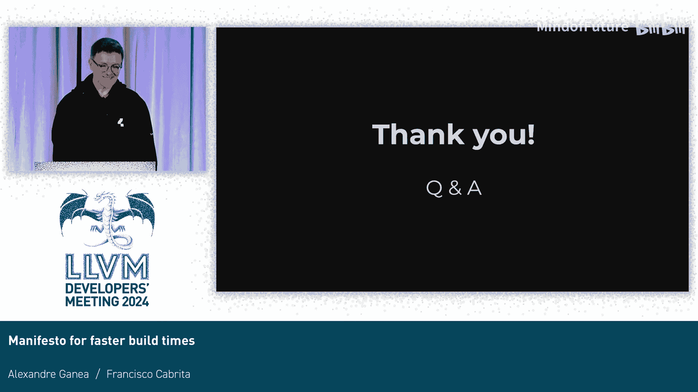

# 【2024-LLVM开发者大会-•-中英】-p47-P47-Manifesto-for-faster-build-times--BV18eNfepENu_p47-

So LM is great for language conformance and code optimization。

 This presentation is about why and how we must do the same witness to build times。

 We're going to do that through a practical example。😊。

Then describe the problem space with Alex and finally rule out the plan。

So our case today is going to be game development， C++ game development， AA and AAA。Why。

 because it's a great place， It's a great domain to understand the link between creativity and iteration time。

😊，So what is the user experience of game development。Well， if you're lucky。And mind you。

 you're building the game so you can't just rely on data that you're going to change。

 That's going to happen once you know exactly what the game is going to be。

 then you can build an architecture that are driven。 but meanwhile， you need to change some code。

And if you're lucky， you get some solutions like life Plus Plus that's gonna build and patch your change。

 Then you can play the game and debug and do that again and again。

A very short iteration loop of 5 seconds。Most likely it's going to resemble that where you're going to have to from time to time build your target。

 launch the editor， compile Shis， and mind you compiling Shis is kind of a nightmarener in game development。

 especially since the industry has shifted massively to tile based different shedding。

 so it means that you can have。Not a lot of shades。

 but then they're gonna create like 2002000 shades that we call them shadow millions。

 They are code de。 And that can take a while， even just changing a line of code in a shadear。

Then you're going to load your level， then you're going to play in editor。

 then you're going to have to move to the location and go to the context where it can test you change。

And then you're ready to divbug and go for another loop。

 That's a long 15 minutes when you' are iterating on a small piece of piece of code。

But has we on a longer path。There's a longer path when there's interlocks between data and code。

 and you need。To realuate everything。 And that's the nightmare that happens。

Way more often than you might think。And that can take hours where you're gonna prevalate and you're gonna build the old game。

 and you're gonna build the editor。 and you're gonna unit test。

 and you're gonna cook maps simple maps first so that then your boat can， can。

 can wander around the world and， and auto test for regressions in frameate memory or things like that。

 Then you're gonna cook all the map。 Then you're gonna package your game。

 Then you're gonna sign a notification， etc cetera， etctera。 It's gonna take a while。😊。

Two to eight hours。Why is that a problem， That's a problem。

 Because we are doing gameplay programming and iteration time is key in gameplay programming。

 So here is a quick example。 I have a camera that follows my character。Slides against a wall。

 But as soon as there's no wall， then the camera adruply。Comes back to its position。

 And that's pretty ugly。We want to fix that。 So at first you're like， okay。

 I'm gonna just damp my camera。 I'm going to dump my camera， you add a little piece of code。

 here and there， you do some change。 then you realize， oh， no， wait。

 I don't want to damn the camera all the time because otherwise it's going create a perceived input laency that we don't want。

 we want to damn the camera only when this fail trace between the character and the camera。

Collides with a wall， so you do that。 and then you realize， no。

 my assumption is wrong because the fifth trace colliding。

 not colliding with the wall is not enough for me to switch to this damping mode。

Because there might be another wall behind the wall。 So。

 and you still want the nice damping of the camera。 So you do an exchange。

 And then you're quite happy。 But then you realize that on some platforms。

 the frame rate is not the same。 And the camera does not be of the same because your damping function is not frame rate independent。

 So you implement some exponential decay， etc cetera， etc ce。 until you reach very。

Good result where the camera slowly and smoothly gets。Back to his natural position。

 And that's the result that you were looking for。 And obviously。

 you thought that it was going to take only10 iteration。Or maybe 30。

 And it took that time sp because that's the rule of term in the game industry and probably you know the industry。

And you end up with 100 iteration。Why is it critical for you to iterate so often， that's not a bug。

 that's a feature of any creative process。It is critical because， well。

 because we are humans and as humans， we have a mental model of the world that we try to update as frequently as possible。

In for like survival reasons， obviously， So you have a mental model of the world。

 the world as its own reality， you predict something， you try。Your senses perceive the change。

 and then you update your mental model。 That's how it works for everything， every interaction。

 and when it works really fast。Then you can use what we call propoceptions where the tools you're using become an extension of your own body。

 and then you can enter this flow state where。Things move as if they were part of your own body and that's the fundamental difference between craftsmanship and engineering when you can enter this back and foot loop in less than an half a second。

Then you can start to really be creative。Even expressive。And improve the game field。

 And if you do that enough， you become even an artist of any topic that you're tackling。For us。

 it's about solving problems。 It's about staying focus。

On trying to bring the better ear for the example of gameplay programming。

 best game field for the player。But it， it means staying focus。

 and that cannot happen if compiling takes forever。

And it's not just the only adult that you're going to encounter because there's a lot of ripple effects。

 for instance， obviously iteration time will influence time and time is money and money and time。

 losing money and time creates frustrations and frustrations create a lot of lack of motivation。

 obviously。And， and et cea。 And all that， all that echoes itself。

 But I would say that's not even the worst。 The worst is for the end user here， our player。

 because they won't get the quality。 There's no way in a world where you're gonna iterate。

1 iteration loop will take hours。 There's no world where you're gonna to iterate 100 time on a camera。

 What will likely happen is that you're going。Drop the ball and just call it good enough as soon as a problem is fixed。

 but the game field won't be there。嗯。So that's the biggest cost。

I'm going to give the mic to Alex so we can dig a little bit more on the issues。

So we're gonna see some specific issues that can be addressed by L VM。诶。

So I'm gonna ask you some questions if you want to answer。

 Why do you think this performance is different for these two users。 So essentially。

 we have a game that's been built by two。Different users， same， same hardware， same game， same code。

 One of them has good computationil times。 The other one， not so good。So what happens。

What do you think happens here？Mini filter variables。 So Windows has this。

Great concept that essentially has drivers that in between the use of space and the actual driver device driver。

 So they this mini drivers live in counter space and it can do anything they want。

 so it could be compression could be encryption， security stack， anything， anything like this。

 So in this case， the user had some driver that has had contention。😊，Another example。Same。

 some kind of stuff here。 I'm compiling Kang。嗯。With T2。 So what do you think is different。

 Whats what has changed before and after。So here's the C allocator。

 Another problem that we is very common on Windows。 essentially the the the the C allocator。

 the hip allloator is lockful。 So as soon as you hit as you。

 as soon as you have many curves in in the machine， well， you have this kind of issue again。

 So again， this kind of issues are really hard to spot， because you see some effect there， but。Until。

 you actually capture a trace， you don't know really what happens。

Another example of this here I've spuned a VM in the crowd。

 so I'm combining LVM just wanting check all， you can see that on Linux takes like one minute on Windows takes like over almost 10 minutes。

So it's another example of other things that can happen on Windowsow。 In this， in this case， is the。

The， the the starting and shutting down of the processes。

 which is very slow in windows because of many reasons we can go on details。But essentially。

 it's contention。 which， we see a lot of contention on windows， so。I've been saying that for years。

 I think Windows is great。 It's a great O。 Yeah， there is a lot of， it's cohesive。

 It has a good history of backward compatibility， but it has these issues that the user should fix if you want a good performance。

 So the end goal， the end。😊，Problem of this is that gives a inconsistent experience。Of course。

 machines。Something different here。嗯。We have a un engine game。We build it。

So when we build that game in non unity build， which essentially is compiling each translation unit on its own。

 all this generates about 270 Gytes of data。Then when you link it， it goes down to two GB。

 So that's a lot of churn， a lot of data that was generated。If we build the same game in unity mode。

 meaning that we aggregate the translation units together， the size is smaller。

 the build times is also smaller。But it's the same issue in the end。

 It's the fact that we have so much data， which ends up being discarded in the end。So again。

 this is a problem。Time and energy that it spent somewhere。Another thing。

Why is it that source file always looks new every time that you invoke the compiler。

So I think this is， this is how it always worked。 like goes back to past maybe 50 years ago。

But the reality today is the that the code is actually a casual graph in， in a project。

 So there are just， it's just small changes that you make across the lifetime of that code。

But the compiler only， only considers the current snapshot。 Actually。

 the the inputs that you give it。 It doesn't even。Know what the project is。So。

Would be really nice if it knew all this permutation， this hyperspace of changes。

Another thing that iss also hard， I think。It， it goes with what I said before is the fact that the tool chain is。

 does cannot live on its own。 It needs other tooling like the bridge system， like Sime Ninja。

It also needs some kind of bid acceleration because the code is really， really big today。

 and you cannot possibly compile everything on your machine。 You can。 but it's， it's slow。And also。

 there are some cases where small studios cannot cannot cannot afford like big machines to compile these kind of engines。

They have been some experiments with inter internalizing this。These things， like。

 I think one of the most promising one is the Aleium gas， which I think is very。

 really a good avenue forward。So next， I'd like to go to some。Suggestions。

 a plan that I think we should do。I'm taking a few assumptions here。

Would be very nice if this plan works for just the golden path。 We don't have to spot。

All the cases that L supports。So we， we can prove that it works for this。Goldman part we'll see for。

 for the rest after。 So essentially， I'm， I'm saying Windows。

 La projects like wind engine or chromium， deterministic， everything。

 Nothing changes between the build， during the build。Mo that languages， etctera。

So I think the first thing we should do is in process computation。

This I'll go in more detail after the second one is the multi threaded in process compilation。

 Also the build D that has been discussed in the past。

 I think there is a post from read from about like，2013 about that。So it's an old idea again。

And I think all this， this three thing could unlock harder。Other topics。

 other things that we can do after to really improve the the build times。So， the first。First。

 the first step the imp process building。The goal here is， to be able to compile these files。

In a single process， not mut， but in inside the single process。

 So that means running the tools one after each other in the LLVM driver。In this case。

 we're using the tool context for sting the state。And we ensure that there is no leaks between running each tool。

 So there's a few things to change。 for plan， for example， it， it enables disable free。

 the dis free flag for every compilation right now。 Also。

 the integrated T1 doesn't work if you have more than one job。And if we disable disable free。

 we need something like LED in test， which essentially runs the same taste twice in the same process。

 just to validate that we are freeing everything。So all this is already spot in an LD。

 LD already can run several link links， one after each other in the same process。

So we have to do the same thing for clk。The second part of the is the multi trading， I think。

 would be good for performance reasons。So the big problem there is the global state。

There was nothing new there， but I think many of you are aware of that。

So we have to choose also which managed static should be too local or process process wide， etc。And。

At that point， perhaps like a tool thread pool for the single process。嗯。

This is already in a branch there at the bottom。 and the same applies for the previous slide。

 And so I， I forgot to， to say it。 But at the bottom there there is a link。With the actual。

Testings which already cover all this。嗯。And the， the third step would be the building。

 which can be done in parallel with the other steps。

 which essentially is a long long running service， like a big like candy。

And there we can launch either another process， which is the in process。Executor essentially。

 or a pool of processes。And we have to find a way to actually communicate with existing build systems so that could be a communication protocol like LSP。

 extending LSP for example or something different。So once we have all this。

 I think we can do some other nifty things like caching， all sorts of caching。

In compilation on demand debug information。 Again， we generate a lot of debug information。

 Most of those 200 GB before is debug information。嗯。Incmental optimization as well would be very。

 really cool。 We already have a case right now with life pre that works。

 essentially if you're running release bids and you have life connected to the process。

 it can de optimizeize the file and patch the one time。 and then you can debug it。

 So it's really nice， but it's a。😊，It's external to aviium it a bit brufor。So。Let's join forces。

I think， I think the a community always has been at the forefront of innovation。

 So I think we should take a lead on on build time。 They don't not wait for。

For these things to change elsewhere。

Thank you。Any questions， please。Yes。Hi， so out of curiosity， I actually wonder。

 would you happen to know what happened to this program repository project。

 Because I remember this a few years back， there were a bunch of LLVM conference thoughts。

 and then the project was kind of cancelled at some point。 If I recall correctly。

 Would you happen to know what's the what was the reason for that。😊，Yeah。

 I think the aium cast would just overall like， be better than what was the one in the end。

So I think the first step is to just land the1 Ca and then we'll revisit the the program Ripo。 right。

 makes sense。 it didn't。Give that much improvement in the end。 That's， I would say， the main。Goal。

 and some of the things had to be reone。Yeah。Any other questions？I remember at some point。

 there were proposed compiler changes to try to make unity bills work better。

 Did that ever go anywhere as that， I vaguely remember some discussion about like modules， risks。

 unity bills。 I was kind of curiouss what the current status of all of that was。嗯。

I don't take a unity file as as good as， I mean， I would like to get rid of them in the end。

And just use the regular build pipeline and have these kind of things been done in the compiler。

 like the caching， like I was suggesting and preamble like headers and stuff like that。 I mean。

 it shouldn't be the user that should be doing that， I think。And it's the same thing in。

 The West does the same kind of thing with the the cogengen units。Because of the same problems。Yeah。

 so essentially everything that I said here is the same when you compile a big code I code base。

 you have the same issues。Thanks。Okay， well， let's thank the speaker。👏Thank you。

