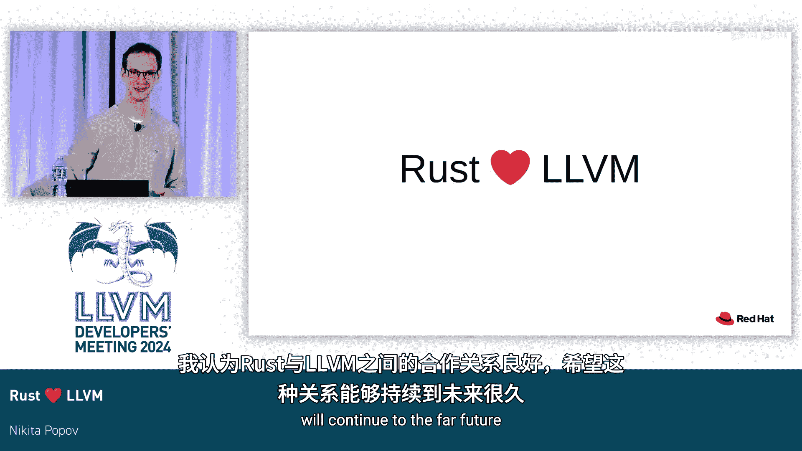

# 【2024-LLVM开发者大会-•-中英】-p48-P48-2024-LLVM-Developers-Meeting---Rust-❤️-LLVM--BV18eNfepENu_p48-

Good morning， everyone。I am going to talk a bit about Ro and LVM and how the two projects work together。

So let me start with a question to the audience。 who here。Is using rust or has used rust in the past？

Wow， that's quite a lot of people。Well， I hope that those of you who are not using rust have at least heard about it。

And maybe have some general idea what the language is about。

If I had to describe it in just a handful of words。

I'd say it's a memory safe systems programming language， so it combines two very important aspects。

It's safe， so we don't have。Use after free all of bonds excesses， undefined behavior。

 segmentation faults， stuff like that。And there are lots of other safe languages。

 So Java is a safe language。 Python is a safe language。

What makes rust somewhat unique is that it is both safe and fast in a specific sense。

So Ru does not have a runtime or garbage collector， and as such。

 it can be used for very low level tasks， like implementing an operating system。And indeed。

 Rust is currently making some inroads into the linings kernel for that reason。

One of the big reasons we care about this is that we know that the vast majority of critical security issues is caused by memory safety issues。

So if we use a memory safe language， we can avoid all of those security bugs at the root。

This is actually all I'm going to say on the topic because I'm not here to sell young rust。😊。

I don't want to convince you that we have to rewrite LVM in rust or something like that。

Maybe you should that。I want to talk about how rust is itself， yeah。

And when we have these two aspects safe and fast， the safe part is handled by the rust language and the rust compiler。

 So this is a mix of compile time checks。 This is the lifetime system and the famous Boroughcheer。

And runtime checks， like a bones checks， for example。

While the fast aspect is pretty much entirely delegated to LVM。

Rust is a pretty hard language to optimize， let's say。It's built on， you know， not just towers。

 but skyscrapers of zero cost distractions。 zero cost。 They are not zero cost for the compiler。

And rustize on LVM to， you know， chew through all that and produce very efficient code in the end。

That much for than introduction。 So let me start at the very highest level at like a governance or people level。

The rest project is split into teams， and two of the key teams are the compiler and the language team。

 And below the compiler team， we have the LVM working group， which is responsible for， well。

 everything related to LVM。And the LVM working Group works with the upstream LLVM project on one site。

And mostly the operational semantics team on the other side。

 because rust semantics are based on top of LVM semantics。And making them line up， Yeah。

 there is some friction in that area。This is also where I'll add the personal notes。

 So why am I giving this talk。I am the team lead of the LVM working group on the Ru site。

And since quite recently， also the lead maintainer of the upstream of V M project。And。Well。

 I have to admit。I don't actually write all that much rust code。

My involvement on the rust side is mostly doing LVM upgrades and answering people's questions。

 but I do a fair amount of work in the upstream LVM project addressing issues that affect rust。

And generally representing robust interests in the community。Finally。

 I want to mention I work at the little company you see in the corner there， Red Ha。Specifically。

 the platform tools team， which is responsible for shipping various tool chain technologies like you know。

 LVM。Rust， and。Less important stuff like GC minis。Yeah， for feddoa and for Rat Enterprise Linux。So。

Rust is generally pretty aggressive about jumping on new LVM versions。

 We generally try to support the current LVM development branch。

And this is mainly thanks to our friends at Google。

 who maintain an integration build pot that combines a current rust main with LVM main。

 and they make sure this continues building and working。

The official rust binaries tend to use the last released LVM version。 So that's LVM 19 right now。

And then we support one or two older releases for use by Linux distributions。

What I want to emphasize here。Is that when I say LVM， I do mean。Unmodified upstream LVM。

So we have our own LVM fork， but we basically just use it for backboard management。

 We don't want to have any rust specific patches on our site。

 We want all the rust support to be in the upstream LVM project。 That's important to us。With that。

Jumping down one level。 How do we go from rust code to LVM。 It's very simple。

 So we start with rust code on the left。 Then we lower to something called MI R。

 which is the mid level and immediate representation。And then we convert to LVM I R。 And let's。

 well LVM do is magic。The errors here are kind of load bearinging。

 so the process of how we go from rust to MIR is very involved。

I can only really pretend to somewhat understand it。But it's also not relevant for this talk。

 so I'll just completely ignore it。What I do want to say is that nowadays。

 L ofVM is no longer the only supported backend。It's the default backend and I don't expect that to ever change。

 but there are some alternatives， one of them is CraneLi。

 which is a compiler from the Webassembly ecosystem。

And that one is good to produce unoptimized builds more quickly。Because， well。

 LVM is great at many things， but I don't think anyone has ever accused us of being particularly fast。

On the other side， we have the GCC backend， which is mainly good for targeting architectures that L VM simply doesn't support。

And the backend system is extensible。So there are more backhands than these like for example。

 there is one targeting the dotnet CLR， but these are the three important ones。

And the last thing worth noting is that nowadays， Rus no longer exclusively relies on L VM optimizations。

 It also has。A small handful of its own optimizations on the MI IR level。 And why that is。

 I'll mention in a bit more detail later。So that was the high level overview。

For the rest of the talk， I want to talk about challenges。Challenges of using LVM in rust。

Because I think generally the challenges are the interesting part， and they also highlight you know。

 areas that could use improvement。And I would split these up into three areas， which is correctness。

 performance and compilation time。These are in order of importance， so at least for rust。

 correctness is more important than performance is more important than compilation time。However。

Correctness and performance are already in a pretty good state right now。

While compilation time is probably the， the one thing that all rest developers consistently complain about。

So even if it's not the most important， it is probably the most pressing issue。So。

 let me start there。There are。A lot of reasons why we rust is slow to compile。One of them is。

 I would say， more of a social than a technical problem。Because Ros has its's own package manager。

 cargo。And it's very easy to add， you know， that one extra dependency。Which then， you know。

 pulls in 20 other dependencies， and all that code has to be compiled。That has its advantages。

 but it's definitely a problem when it comes to build times。

But what I actually want to talk about here are the more， I would say， technical aspects。

And the first one there is that in C and C plus plus， the compilation unit is a single file。

So if you have a large project with many files， compilation is basically an emrassingly parallel problem。

 so you can easily fully saturate your know 200 core built server by just compiling all the files in parallel。

In rust， this is not so easy because in rust， the compilation is a cr。

 and the cr consists of many files and generally can include a lot of code。

So if we just compile it in the obvious way， we take the crate， we convert it into an LVM IR module。

 then we get a picture like this。The reason is that LVM does not support internal parallelism。

I think the， the new or well， not already， not so new。

 but the new LVM Pass manager has been designed with potential future polarization in mind。But。

I don't think any actual work in that direction has happened yet。II'm not sure it ever will。

Would be great， of course。 But in the meantime， what Ras does instead is to artificially split up crates into cogen units。

😊，And then optimize those code generation units in parallel。 Only problem is if we do that。

 we lose optimizations。So we recover those mostly by combining with Filio。

And then we get a picture like this。So we optimize all the CGUs code generation units in parallel。

Then there is a small bit of sequential analysis performed by a thin LTO。And then again， afterwards。

 we do the postling optimization in parallel。So the end result is。

The optimization quality is a bit worse than the monolithic compile。And we do more work overall。

 but the pization benefits are still worth it。In most cases。The other compilation time issue is。

Exactly the same one in rust as and C plus plus， which is that generics just produce a huge amount of code。

So rust generics and C plus plus templates are not the same thing， but at least in one aspect。

 they work the same way。Which is if you have a generic function。

And you use it with three different types， we will actually create three copies of that function。

So if L VM comes along and optimizes those， it will have to apply the same optimizations to each copy of that function。

And the way we can improve this is to instead do some optimizations。At the polymorphic level。

 before we go to the individual copies， anything we optimize at the polymorphic level is time we save at the monomorphic level。

And this is exactly what Russ does with the M I R optimizations。Of course。

 there are some other reasons as well to do optimizations directly in rust。 for example。

 well sometimes it's just easier to implement a rust specific optimization in rust。

But compilation time is really the main motivator， at least right now。Well。

 the final reason why rust is slow to compile。Is that LVM is just slow。And。

There is nothing we can do about that。 apart from making LVM faster。

So the kind of wake up call for this was the LVM 10 upgrade in rust。

 where we had lots of regressions in the 10 to 150% range。Which is huge。

And this was the release where LVM enabled the use of memory SS A， which is the reason why。

We had these regressions。At the time， there was not really anything we could do about that because。

 you know， this is six month of development work in LVM。 and you can't just， you know。

 fix it in one day afterwards。But this was the motivation for me to start tracking compilation times on the LVM side so that we don't see the result of six months of work。

 but instead see the impact of every single commit that goes into LVM。

And since I have been tracking compilation times in LVM。

The general trend has very much been downwards。There are always ups and downs。

 but the overall trend is downwards。So I know you can see here something。

Over2 three years down to 20%， in some cases。I would also highlight the L VM 19 upgrade here。

 which was particularly nice。 So we saw lots of improvements in the 10 to 15% range for that upgrade。

 which is always something I love to see。😊，I like the green numbers a lot more than the red numbers。

Generally， this is。An area that can always use more work。

 and I think that compile engineers in general don't put enough focus。On improving compil time。

 even though this is the area where you probably get more。Yeah， I mean。

 there is still a lot more low hanging fruit than when it comes to improving runtime performance。But。

 of course， runtime performance is also。Very important aspect。 So let me talk about that next。

I think that。In theory。Iiometric。Or is it idiomatic？W。In geomatic。Okay， idiomatic rust code。😊。

Should be faster than idiometric C+ plus code。There are many reasons for that。

 One of them is that the rust language just provides much stronger guarantees。

 in particular regarding pointer aliaing， which are very useful for optimization。Of course。

 we all know that theory and practice are not always the same thing。And at present。

 I don't think that Ru's performance promise is like fully realized in practice。

There are a few reasons。 One of them is that there are some specific optimization problems。

Big one is Bo check examinationmination。 So to ensure memory safety。

Part of that we can do at comp time， but part of it we have to do with runtime checks。

And in most cases， these runtime checks can be optimized away。But it does not happen reliably。

And especially like from the programmer perspective。

 it's very hard to predict when a bounce checks will get optimized away and when it won't get optimize away。

What LVM is currently really good at is optimizing boss checks that have a like constant upper bound and a straight line code。

What L V M is not good at is optimizing bounce checks inside loops。

Which is also kind of the most important case because those checks get executed a lot。

 and they also block other optimizations like recization， for example。

So this is definitely one of the key areas where like LVM optimization capabilities can improve。

The other area worth mentioning is Me copy elimination because in C++。

 this is not such a big issue because the language has an R viewO， the name P value optimization。

 which allows us to avoid many copies at the language level。And rest， this does not exist。

 So we emit a huge amount of me copies and rely on L VM to optimize。Often away。

This is really an area where LVM has improved a lot in recent years。

 but there is definitely still room for improvement。Especially for cell object copies。And then。Well。

 there are。Other even more specific issues？Which。Well， I guess I can't talk about it。

So rust has two types of ranges， which is exclusive ranges where the upper bound is part of the loop。

And inclusive ranges， sorry， where it's not part of a loop and inclusive ranges where it is。

And the exclusive ranges optimize much， much better than the inclusive ones。

 even though like from a program perspective， they look like basically the same thing。

And the reason is that the inclusive range is they have a conditional increment in the loop。

And L VM can't really deal with that。 So if we want to solve that problem， we likely have to do some。

Fairly rough specific optimization in Algium。But anyway。

 I think the more interesting aspect is the more general problem。

That we have all of these very strong guarantees in the Ru language。

And we want to teach LVM about them。 So LVM can use them for optimization purposes。

The way this is done is through number of different mechanisms， like instruction flags， attributes。

 metadata assumptions。And rust does use all of those。 and quite successfully。

 it does't enable many optimization。One of the problems in this area is that things like。

Meteradata and attributes can get easily lost through the optimization process。So， like， for example。

 if you have， I know a function of some parameter attributes。 The function gets inline。

 then the attributes usually just get lost。The reverse problem exists for assumptions because assumptions like LVM will try very hard to preserve those assumptions。

Even if they are no longer useful， so they don't get lost enough。

And this is like generally a very hard problem， a very hard trade off to make。

And I don't think that L of V M has quite hit the like optimal point of that trade off yet。Of course。

We like to start with， we don't really have enough attributes in L VM to tell it about all the semantics that rust guarantees。

Harvor， more and more of these attributes get added over time。 And I have a couple of examples here。

So first one is allocator attributes， which allow us to teach L V M about just custom allocation functions so that you know。

Doesn't support just meequin free， but also rusts， variants of these functions。

Rangnge attributes allow us to tell that the input range of function parameters is limited。

That unwind and writeriable are used to improve men copy illumination。And get on pointer。

 no instant rep tells all VM that area indexes can be negative。And。

A common thread I would like to highlight here is that while all of these things may be motivated by robust needs。

They always also benefit C plus plus optimization and optimization of other languages。

I don't think we ever really had a case where we added some know attributes for rust。

 and they did not also help other users of LVM at the same time。Yeah， so this is。Like an area where。

There is always more work to do， so there are more attributes that can be added to teach all about more ros。

 especially when it comes to things like。Cpturing guarantees and move semantics。Okay， with that。

 let me move on to the last topic， last but certainly not least。

Because correctness is like if there is one thing that Ru really cares about， it's correctness， know。

 safety， reliability， soness。The I think important thing to highlight here is that ultimately。

 rust semantics have to be based on LVM semantics somehow。

So whatever semantics we choose for rust have to be supported by LVM and not just supported。

 but supported with good optimization quality。And kind of a risk factor in this area is that L VM has a decent。

Chunk of semantics that are either not specified or entirely undecided。

Classical example is provenance。 We know in LVM， we have provenance， but。That's all we know。

 So none of the details have been pinned down。And， of course， it is pretty hard to specify。

 like firm rust semantics if the underlying L VM semantics are。Unknown。Second， similarly。

 rust can only be as correct as LVM is， and LVM has a decent number of known miscomilations。

 So where LVM generates incorrect code。I should say， as a disclaimer here。

 these cases are generally where both a problem is very hard to fix。

And very unlikely to affect anyone in practice。So I would say these are like theoretical miscomilations。

Which is also why they don't really rise to the top of the priority list on the LVM side。But yeah。

 so the rust developers， they are peculiar and they don't really like any miscomils。

 even if they are largely theoretical。😊，I didn't want to give a wrong impression here。

 This is not an LVM specific problem。Rust definitely has its own share of semantics that are currently unspecified and undecided。

 Rus has its own share of soundness bugs。So this is something that has to be addressed in both projects to get something that is。

 you know， sound overall。And I'd like to give a couple of historical examples， where。

Rust correctness has been significantly affected by issues on the LVM side。

One of them is that in CNC plus plus infinite loops。That don't contain inside effects， like。

 for example， network IO。They are undefined behavior。 So this is the forward progress guarantee。

And historically， LVM adopted those same C plus plus semantics。

 which is a problem for rust picks and rust and finite groupss are well defined digest just。Lke。

 forever。And what ended up happening here is that L VM semantics were changed。

 So now infinite loops are well defined by default。Or default。Whatever。And instead。

 you can specify and attribute the most progress attribute to opt in to the C plus plus forward progress guarantee。

 So we get the best of both worlds。 Ru gets its well defined infinite loops。

 and CNNC plus plus can retain or even increase the forward progress based optimizations。😊。

The second example is， I mentioned that rust has very strong aliasing guarantees。

Or rather not aliaing guarantees。And this can be represented in LVM using the no alias attribute。

 which is a preexisting attribute。Because the same semantics also exist in C。

 using the restrict qualifier。The difference is just。In C， restrict is very rarely used。

 while in rust， basically everything is restrict。So when Rus tried to enable the use of no alias。

 it ran into a long string of。Optimization bugs。Which did get resolved over time。 And nowadays。

 this works reliably。So for these two examples， the first one is a case where we just had an actual semantics mismatch where LVM semantics were just very closely bound to see semantics。

 And it was impossible to support the rust semantics efficiently。And in the second case。

 it's more of a pure correctness problem where like the average C code just wasn't able to exercise the LVM optimizer sufficiently。

Now， for contemporary issues， I just want to give two examples with a lot of recency bias。

 I would say， just because I have been sharing about these a lot recently。

The first one is related to the call API。Which is how you pass values to functions and return them。

Like， for example， like she pass it via registers or via a stack or something like that。

And the core problem for the call A is that the rules for it are very complicated。And Tiger specific。

And LVMIR just does not have enough information by itself to correctly choose the call AI。So instead。

A large part of the call A handling has to be implemented in the front end。

This means that it's implemented by Kang。 It's implemented by rust。

 and it's implemented by every single other compiler that supports the C foreign function interface。

And this is like very tricky code。It's also very hard to test。

 And you are just pretty much guaranteed to have， you know， one or maybe 10 different bucks in there。

This is not a great state to be in because at least for me personally。

 a large part of the LVM Pro or premise is that it abstracts weigh all these architecture specific details。

And the call API is the one place where it really does not。Now， the。

 the second issue with the call API is unrelated to the first。

 And it's the fact that LVM mixes up which instructions are you allowed to use。

And how do they affect the call AI， So if you tell all V M enable the A V X target feature。

That tells LVM that inside the function， we can generate AVX instructions。

But it also tells L VM that， okay， you can actually use A V X registers to pass values across calls。

And anytime you change the call AI means that。Coode using one set of target features may not be compatible with codes using different set of target features。

So it， it becomes unclear when these two pieces of code are safe to combine。Of course。

 LVM has hundreds of target features， a good chunk of them modify the API。

 and none of that is documented。The last issue I want to mention is that if you go off the beaten path。

 if you do something that is maybe not common in C code。

The most recent example is Rus is currently trying to expose 16 and 128 B floating point numbers。

And what you observe here is that basically， L VM's middleland is very solid。And the you know。

 like very mainstream backends， like X 86 arm， they also work perfectly fine。

But if you go beyond that， you see。Various bugs everywhere。 So， you know， crashes， miscompilulations。

 everything。And I think part of the root course is that LVM's backend or at least the selection deck backend。

 I don't know， maybe this is better with global ISL。 I'm not really familiar。But it。

Often seems to do the wrong thing by default。So you have to implement some kind of hook or set an option or call a function to get the correct behavior。

 but if you don't do that， you just get the wrong behavior by default and you get it silently。

And this is also kind of compounded by LVM's testing strategy。

 which is very much based on unit tests。So we don't have， for example， some kind of。know。

 central testing that just checks the 16 bit floating point types work correctly across all targets that LVM supports。

If we did that， those issues would be like immediately noticed while currently they are not。Okay。

So I've been， I guess I've been kind of complaining for the last few minutes。

 so let me close again on this wonderful slide。😊，As I said at the start。

 I think that L of M has been absolutely integral to robust success。And at the same time。

 I think that the rust driven changes in LVM have benefited the project and other users of the project。

Think that Russ and L V M have a very good working relationship。And I hope that it will continue。

 you know， the to the far future。

With that。Thank you。 And if you have any questions， I would be happy to answer them。

Is that timer with the Q&A or was my talk so short？H。Yeah， just。 so think for the talk。

 It's interesting。 But why does us not have a rhetoric value name optimization。

What was the reason for us to not have return value name， N， O， Yeah， LB N O。In our view， yeah。

 that's a good question， I'm actually not entirely sure。

So there were various attempts to solve that problem on the rust site， in part， an MR optimization。

And actually， this is one of the areas that ran up into the up to the undecided semantics in rust。

Where it was not clear whether it's actually valid to perform， to eliminate certain copies。

Whether that could affect the correctness of unsafe rust code。But yeah， to be honest。

 I'm not entirely sure why rust does not have that or if it may have it in the future。I see。

 AndM cannot optimize it to if you call an unknown function， like a function in a different library。

 for example。LVM can usually optimize those things using the cost slot optimization。

But there are some limitations because that optimization has a lot of preconditions。In particular。

 for example， that the pointard can't be captured。And some of those preconditions can't always be proven。

 So yes， if it's like a completely external function that we don't know anything about， then yeah。

 we may not be able to optimize it。Okay， thank you。So as the community manager for LLVM。

 what do you think is the best path forward for fixing our undefined undecided and undespecified semantics LLVM？

Yeah， that's a tricky question。Someone has to work on it。The problem is just that。Yeah， I mean。

 we have a few of those issues。😊，And the big one is Prodence。

And the other big one is poison semantics。So in particular。

 poison semantics when it comes to interaction of memory。And in each of those cases。

 it's very hard to really address the issue because there are lots of interrelated parts。So。

Like it's not， you know， you can't just write down the semantics you need。

 you actually need to do a lot of changes to the optimizer and also introduce new LVMIR features to still retain old optimizations。

I think one of the big drivers here has been the aive to project， so the proof checker。

Which has like there is nothing better than an actual proof checker to nail down your semantics and make sure they're actually consistent。

嗯。And that did help nail down a lot of unspecified L VM semantics。

 But the remaining part is the stuff that just no one wants to work on。呃。

So I don't think there is a solution here apart from working。Thank you。Hey。

 do you know what cases where there have been contention between proal languages like Ru versus C++ where both are benefiting from contradictory optimizations or contradictory IR features？

Sorry， I didn't catch that。 Like if you are claiming that most of the things that trust is driving in LLVM is benefiting other programminging languages。

Compilation of other programming languages。 Are there contradictions also there that something in L BM like some kind of optimization is good for C plus plus。

 but not that good for us。Oh， okay， I mean， I would say there are lots of cases where some optimizations are mostly beneficial to C plus plus or mostly beneficial to rust。

 but I'm not aware of any cases where。An optimization would be good for a C plus， but bad for rust。

 I don't think I've seen something like that。So they， they。

 they affect different languages differently。 But I don't think。

 but they are generally always positive， not sometimes positive， sometimes negative。

 Was that your question or。Not only optimization， but other kind of feature， like some attributes。

 which you feel would be good for us， but like it creates some the kind of problems in the programming languages like。

Or some other IR feature。嗯。Okay， I think I still don't get the grant。

I think the claim that rest driven LLVM changes are always good。

 I don't know if I'm sure about that claim。 Okay， okay， okay。Yeah。

 there are probably some things that wouldn't be。I could imagine that， for example。

 if we had an attribute for rust to move semantics。

 that this would be pretty much only good for rust。And no。

 I think maybe even that's not true because it would probably also apply to like by value passing and C or something like I can't come up with an example for that。

Just off the car。I see， thanks。So you mentioned supporting Flo 16 and Float 128 in rust。

 Have you run into any issues with like compiler R T missing built ins for like casting or like basic operations。

 That's something we've run into with like Lipsy。 Yes。

 I think at least on the rust side that gets mostly solved because rust has its own reimplementation of compiler R T。

 It's called compiler built in。So even if compile RRT does not provide something。

 we can still provide it on the rust side and work around it that way。 But yes。

 that general problem definitely also exists。 and also we have differences between what Li Gcc and what compiler RRT supports。

So just providing your own builtin is the easy way around that。Sounds good， thank you。

Where do you think the areas with the most low hanging fruit in terms of improvement compile times in LVM are？

I think it's probably that we run a lot of optimization passes many times。In particular， things like。

 for example， incom。And all of those executions are useful in some specific case。

But not in most cases。So I think we do a fair amount of like redundant work because our optimization pipeline is very rigid。

 so it's basically always the same。And if we could make it more， somewhat more dynamic。

 that would probably help a lot。And the other area， I would say， is maybe the。Like in GVN。

 the memory dependence analysis， that's one of the。Yeah。

 big hotspots that probably has a good bit of room for optimization。

So if the attributes are getting lost because they are not first class citizens。

Shouldn't we use that information and make it first class citizen and augmenting the Aium IR。I mean。

 like I would say in theory， yes， but in practice it's not so simple because if you do something。

 like if you explicitly represent something in the instruction stream。

 which is what we do with assumptions。We run into the problem that it negatively affects other optimizations because now you have this assumption in there and it adds like extra dependencies or like both in terms of uses and in terms of memory modeling。

And。Blocks other optimizations。 That's the reason why we don't really recommend widespread use of assumptions。

So like， you I think it's it's。So you do want them to be explicit and you want all the passes to be aware of the fact that yes。

 those assumptions are in there。 Yes， definitely in theory， yes， but in practice。

 if we did that right now， terrible things would happen。

But maybe if we can improve the system enough， that would be possible to just always， you know。

 like convert attributes into explicit assumptions when they would otherwise get lost。Yes。

 Andasi is not the only language that needs those others。Contracts as well， yes， definitely。

Thank you。Thanks for the great presentation that covers pretty much everything under the sun。嗯。

So I'm talking from the perspective of shading languages where code duplication is a pretty severe problem。

And based on your experience， implementing generics。

Until what point in the compilation pipeline would we have to maintain the semantic。

And when it can be deduced to the actual types and。Lower to the appropriate target。Well， I mean。

 at least as soon as we hit the L VM I R level， we definitely have to replace with specific type speakers。

 L V M just。Doesn't have a notion of generics。 I don't know if it's possible to represent generic code in MLIR。

That that's where I actually am coming from because I wanted to know of。

Some of the implementations can be repurposed for some other use case completely outside of us。Yeah。

 so I I would guess that on the MLI R level， one could do something like that， but at least for。

 from Rus's perspective。I would expect that Ru is going to invest more in its all optimization pipeline。

 like at the MIR level。But yeah， for other languages， probably。Something ML AR base could help。

Thank you。And， of course， the other thing that can help is to just。

From the star generate less copies。So rust has an experimental polymorphization option where it tries to reduce the amount of generated copies。

Where there is no real substantial difference， like where。For example。

 we only use the size of the type。 And if the size is always the same。

 we don't actually need a separate copy。But。That's kind of a completely separate approach。

Thanks for the talk I have a question about C++ Inter so a lot of languages。

 more nascent languages like to differentiate themselves and especially differentiate themselves from rustt in terms of how might they interact with legacy code such as C++ and today a lot of people working in rust you have this optional dependency on Lib Klang via Bgen and I'm curious in your experience in the Livium working group or in the broader Ru community。

 have there been discussions about having hard dependencies on Kang in Ru C in doing Inter at the IR level。

I don't think I have ever seen that kind of discussion， at least in recent times。

 So I would say just no。Yeah。I think the preference is to keep that separate， if we can。

My question was related to what you mentioned， the lack of information for provenance in a little VMIR。

Do you have an idea on how much performance loss you have in rust because of that lack of support in allovia？

Yeah， I don't have any specific numbers， but I do know there are。Issues with， yeah。

 basically two conservative problems related assumptions or I would say pointer capture related assumptions。

 just kind of related。Just one example， often if you have some kind of， you know， rust code。

 which is compiles great in isolation。 but then you add a debug statement。

 even a conditional one that's never executed。 and suddenly the code becomes super slow。

And the reason is just that there is。Pointer capture when printing the value。

And L VM is very conservative about this， Even though Ru could guarantee that this is this pointer capture only cover only captures the read provenance of the pointer。

And not the right problems。So to answer your question， I don't really have any numbers。

 but I do think that it that there are real optimization issues in that area that we can improve。

In one of your slides you explained that Ru has a GCC backend in addition to the LLVM backend for exotic targets。

 I think you called it， I was hoping you would say a bit more why that is why the trouble。

 is this something that AllLVM could not support historically or because it's outside of the the reach of LOVM for those I would say maybe exotic targets was not the right word it' not that。

The support for those targets can't be implemented in LVM is's just that LVM does not implement them。

So there are some architectures which are supported in GCC right now and not in LVM。

 So for those you would lose the GCC backend。 And also， I guess in the embedded space。

 it's quite common for people to provide only a GCC tool chain。But not an LVM tool chain。

 So we would like to still be able to target those architectures。I guess we are really over time。

 Thank you so much。 Let's thank our keynote speaker。

