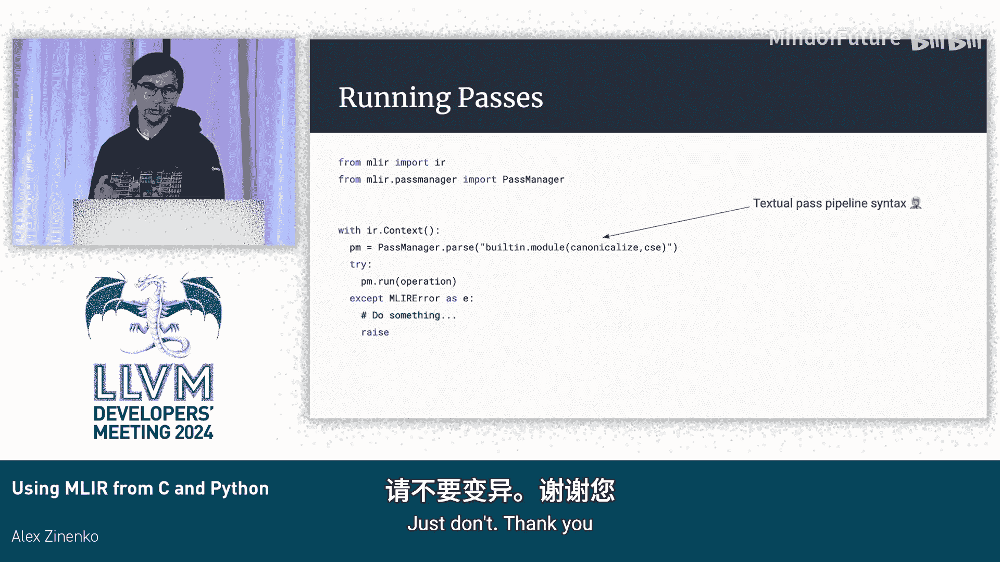

# 【2024-LLVM开发者大会-•-中英】-p49-P49-Using-MLIR-from-C-and-Python--BV18eNfepENu_p49-

Hello everyone， I'm Alex。 I'm here to talk about how one would use MLR from languages that are not C++ it'st C+ but there are other languages or so I've been told and people sometimes want to use them and we thought about those in MLAR and we decided to build first a CAP there also some better promise of sta and what the C+ API gives you and then we exercised this API building Pythson bindingonics because apparently all of ML is been written in Python and were all being paid by ML these days so it sounded like a good thing to do So I'm here to present this this is more like it's a tutorial more of a lecture I guess I failed my calling as a teacher and became a10 engineer instead So theres a lot of code and text on slides but that's what a tutorial is don't hesitate if you have questions in the middle their are mics they might be on if they're not on。

Just wave with me and we will wait for them to be on。 And if you have a question in the middle。

 you can ask in the middle。 you can ask in the end。And yeah， there's a lot of API calls and stuff。

 you might ask me a question how do I do X and I might not be able to give you the correct answer out of my brain because you know it's an API with a thousand of calls or something。

 but I'm sure I can point you to the right direction。Okay， let's get started the short。

Agenda of this， we are going to talk about API， like design of the specific API we have and the basics of how it works。

 We are going to look at how do you traverse IRs that already exists。

 We are going to look at how you would create IR objects such as operations attributes and types。

Well see how the heck you are going to build this thing because build systems are hard and finally we are going to see how you would actually want to transform that they are by running a pass or writing a new pass。

And we are going to do this in C to start with and then rinse and repeat and do exactly the same and exactly the same order Pythson。

And to start put the fan CI design goals， but basically there are very simple design goal。

 CI is like C is a language that almost any other language can interoperate with。

So having a C API something and just comes naturally we want to have one single interface and we MLIR developers primarily writing C++ also kind of O C and we can understand if there is a problem with C code and well I cannot understand there's a problem with your Ca code or Julia code or whatever other language。

So it's a single point of interface that we can all understand and fix and other bindings are。

Possible on top of this C interface。 there is something that I put as a weak stability guarantee。

 ML IR， like the rest of all VM does not have any API stability guarantee whatsoever。

We try to be conscious about breakage in CAAP。So whenever possible。

 we are not going to break the API， and then C makes it easier because there's no function overloading。

 no classes， no inheritance， just names。So whenever possible。

 it tries to be stable and we actively push back against like， oh。

 let's just add an opera an argument to this function。 If you won't add another function。

 like with x or like extended or a config or something。

 but it's not a guarantee it's not tied to versions， but it's pretty stable。

 I had some projects written like three years ago， and they didn't think I。Youd have to change them。

 and I didn't。And the other it's not a goal that's more a side effect of the other goals。

 it's biasing towards simplicity and being minimal and minimally usable I do not actually expect people to write。

Cs using Malayar using C use they want to。 They are better off writing。

 their own API shame around these APIs to actually use it in in a more C like。喂。

So one boring thing to start with， but it's actually useful when you want to discover is naming conventions。

 And well it's MLR servicing is prefixed with MLR。 It's just MLR。

 not L VMMLR nothing justR typess are capitalized。 So if you see something starts with the capital M MLR operation。

 MLR attribute， it's a type。If it's not capitalized。

 it's a function and there is nothing else in C plus possible， there's variables and variables。

 you name them with one are。And there is a bigger part of naming convention。

 And we use that convention to communicate additional semantics about what the function does。

 in particular， about the。Msd functions and sum probation about ownership。

 So if you have a functions that in C plus plus would have been a class member function or a method in Java。

That function will have a name that starts with the object that it operates on。

 so aLAR operation create， it creates an operation， aLR operation get opera。

 its first argument will always be an operation， so it's a function that relates to an operation。

Some of them also have action words that are meaningful， so for example。

 something that says create in the name， it will create a new object and give ownership to the color。

 it means that the color is in charge of then freeing this object by calling a function that has destroy in this name。

 typically you would have MLR operation create MLR operation destroy。And as I said。

 if you have other flavors of this， you'll have MLIR create function bypasing or MLR function parse。

 create something like that。 and it will always have the create and creates a signifier that this actually allocates and gives the allocated object to you in its。

Your burden to delocate that， and because at C， it's really important that you actually do that。

When something is owned by another object that you do not have to delegatecate。

 it will have a get suffix， so when we have types and attributes and other context owned objects in MLAR。

 you typically have an MLAR attribute get like here。

 it will actually allocate sometimes an attribute in the context。

 but because it's a context that owns it and it is a context that will have to delocate it。

 it's called get， you get it， you use it， you don't have to do anything else with it。Zener。

 let's move to the type model and we were trying to be kind of simplistic with it and then C does not really have a very developed type system。

 so we kind of state with the same minimalistic approach so we only expose top levell object in MLAR in normalA is accessible and I forget to mention but I assume whoever listens to this kind knows what MLAR is more or less and how it's structured if you don't will ask me a question。

 but it's not an MLAR beginner tutorial。So we have this top level object， operations。

 attribute types and others， and the only exposes we do not expose any of the subclasses。

 so if you have an integer type or a float type， or if you have a function operation or aned operation。

 you will not find an equivalent of Z directly in C。

 they will always use the superclass so if you have an add operation it will be MLR operation。

 if you have an integer type it will be MLR type。In function names in Naming convention。

 you will see that， so you might see an MLAR flow type gett bitbits or MLR flow type gett floating point semantics that is an indication to you the user of API that this function while it does take an object of MLAR type type is a first argument it actually expects it to be a specific subclass in C++ sense and if you give it something else it'll just assert。

So that expectation is encoded in the Naming convention and it's up to the call to verify if they're not sure that their type is or their operation is of the right type。

So none of these inheritance trees are materialized and all of these things are essentially type constructs。

 so insides will be a pointer and the operation is already a pointer。

 attributes and types are actually pointers hidden inside a C++ class。

 so it will be just that pointer and it's cheap to pass around。

 you should never ever have a pointer to ML layerR attribute unless it's a list or any of these objects。

And since all of these are nullable。All of these objects might be no pointers。

 so before use something you might need to check if you are not sure about of the provenance if it is nu or not。

 because if it's known you just pass it it will again assert like I said minimalism and well it's C is sharp。

 it's dangerous， lots of undefined behavior so you know let's embrace it。Okay。

 so with that knowledge we can try to look at how one would traverse a piece of AR that somebody else created。

 it's the first basic task you would do with any MLR based tool and as a reminder。

 MLIR has this recursive structure， whether it starts with a tople operations such as a module and that operation has regions attached and each region is a list of blocks and each block is a list of operations and each operation has regions and so on and so forth it's recursive。

So when we want to traverse that while we first we start as an operation we what to inside。

 we may want to look inside regions first we need to know are there any regions and for that we can just ask the API how many regions are there and then we can get a region based on its position here you can see inptT at some point we made the decision that you know we're in 2024 right now let's assume at least C99 so we use Inpoint or T。

 we use bulls， we use like at least C99 we don't go beyond that and we might want to assume C11 soon because you let's be honest it's a very old standard。

And that's just the basic thing that we have we can get the region same way we can。

 well almost the same way we can get a block in the region here it gets a bit more interesting because well blocks and blocks in a region and operations in a block are actually linked lists of blocks and operations respectively。

 so you can get the first region。It was the first blocks or in origin。And then given a block。

 you can get the next block in the same region。And going back to the naming convention。

 because it's kind of important here， because that fact， the second factor operates on a block。

 It's called MLIR block。 Get next in region and not MLIR region get something because it doesn't even take a region。

And that's kind of an easy mneonic to remember how to- like you know， you open your editor。

 have autocomplelette work， you type MLLR block， and you have a autocomplete of all the things you can do with blocks。

And we have the same in this operation so it tries to be consistent， so get first block。

 get first operation， get next in region， get next in block， give you next in block。

 and keep in mind it's a linked list， we could have exposed an API where it gives you an ends operation in the block。

 but well we actually did that inson， but it's kind of expensive。

 so we decided not to expose it and just throw this at you saying。

 well this is a linked list you should know it's expensive。

 it's expensive operation if you're writing C you might care about performance。I think。Okay。

 let's look at a simple example， as usual with similar error we start by creating a context。😊。

Or if you're given an object that has been created already。

 it will have a context and you will have like MLA operation get context to extract it from there。

And here I put some example where I parse it， I didn't put the I actually parse。

 I'm just going to assume it's a module dysfunction in it。And it creates， as you can see。

 it says MLR operation creates， so it means it creates a new operation and it returns this operation to you and your in charge of destroying it。

It takes the context， everything in MLR wants the context。

 it takes the string representation of the AR， and also takes the file name。

File name is not always reasonable， but they're just how the C plus plus parser is structured。

 It assumes you're kind of parsing from a file if you don't just put a minus saying like。

It's only there for diagnostics， so whenever it prints just in files this online that the problem was this if you put like SDD on minus doesn't care。

What else you see here is this MLIR string ref created from C stringing and there are a bunch of functions that handles these LVM auxiliary data structures like string refs and you know if you worked with C has strings。

 there was a paper saying you know the C string being designed the way designed with an ultra termminator is a billion dollar mistake。

In the industry and it's super expensive， we do ST land and it's linear in the lens of string like and string ref wants to fix that by saying you know how about the stores the pointer and the size。

So here's converting one from another so you have to create string graphs。

 you can almost never pass a conchar， you almost always need string graph and it's also not owning so when you see a string graph same as N C+ plus it's a reference to a string so when you see a string graph you do not own it you do not pass ownership if you create it from a C string from a literal here while it will just。

Have the point literal and the size， and we'll do the SN under the hood。

If you create it from a C+ plus string， well， it will just point to the same data so string graph。

 same as C++， obviously it's not only。Okay， and then let's say if we have this module。

 thats module be in operation， we get the first region quality body using the get first region function。

We can similarly get the first block of the region。

 and let's say I want to do something about public functions。

 like I just want to list public functions or public objects in this module。 So for that。

 I will create two string refs。 Again， both are not owned。

And one is calling MLAR symbol table get visibility attribute name that's a mouse。

 but the way to deconstruct it MLR is well， it's a namespace it's MLR symbol table in this case。

 in this case is the name of the class in C++ you have symbol table class。

 that's how you operate with guess what symbol tables。

And it has an attribute name that all symbols should have。

 we don't know what it is but I know it's Sim underscore name， but I don't want to hardcode it。

And then I want visibility to be public。 So I create a second string saying， well。

 I'm going to look for something that has public visibility。And to look for it。

 I'm just going to go and iterate over all the operations we have in's the list。

 you can write a simple for looping going from the first operation to the next。And inside。

 you can go and query， hey operation， give me the attribute with the name contained in this visibility。

 So what's the visibility of this。And it's an attribute。

 it's an object I want the value so I can get MLAR string attribute get value。

 and heres another example where MLAR attribute itself is a top level of class， we only use that。

And I do MLR string attribute get value which says this function expects a string attribute what did I forget here well I forgot to actually check that the attribute returnrent is a string attribute。

 I kind assume the IRS valid and the verifier has run and because the require verified that if the attribute exists it's a string attribute I don't have to do it myself here。

And basically， normally you would have to check before you do so and then it just string references so we can do with simple comparison and say if there are equals。

 then we have found the function has public visibility and we can do something， for example。

 print its name。This is a very minimalistic example of what basically anything that you would want to write with IR traversal will look like this。

 It's a lot of boilp it's verbose， but it's kind of simple like it's something you wake me up at the middle of a night and ask me to write it。

 I don't even have to wake up I'll just go and write it。Okay， we know how to traverse IR。

 How about doing something more useful and creating it？

I briefly touched on the ownership model before let's make it more explicit。

 so there is an ownership model that we can derive from how the MLR IR and C++ operates and well by default we say there is no ownership transfer unless specified otherwise。

And the ways to specify it is encoded in the naming convention， so as I said before。

 if there is create， it means the call will own the object that's returned。

If the function contains the keyword or the word take。

 it means that the function will take ownership from the color and transfer to the coli。

 and then the col will take care of it。 It does not specify how exactly it might associate it with the container put it in IR structure。

 but you are no longer in charge of the object's a lifetime。And。Yeah。

 there is MLAR something owned type。That expects the thing to be passed into it to be owned by the color。

And then finally， there is the get that returns sing typically context on basically returns the thing that does not do ownership transfer。

And that's pretty much all there is， so MLAR itself， you have an operation。

 has it owns Reg's own blocks， so as a user you only own the top level operation。

And the context So again， a simple example starts by creating a context you own the context you see it because you call the C and then to create an operation you first create yet another an auxiliary object it called operation state and operation state it's basically a tract containing everything is there is to know about an operation before creating this operation in particular it contains the operation name here it's a builtin module and the location here is the location is unknown please don't do that I just wanted something in shorthand slides that please use correct location and you can like file line column location there's a few location a stream location there's plenty of those you can combine you can even add your own I just wanted a short slide。

Then you you create a you are about to create an operation with region because you know modules have regions。

 so how about you create a region while you go and say MLIR region create that creates a new region for now is detached you the color on it。

And for a module it's kind enough， but there are more things in the state。

 but for now you're just saying it's a module at an unknown location has one region。

 this region is created its empty and what we do here is we add an owned region to the state and this does the ownership transfer it says the color owns the region and it gives the transfer gives the ownership of this transfer to the colee and as many of these things it takes actually a list so we have to create an array out of nowhere and just pass this side of this array and the list of regions to it。

This thing transferred ownership， there's nothing else we can do about it。

 And then when we we under done this state， we can do MLR operation create。

 and that will actually create an operation finally。 After all the things。

 And now this operation object owns regions that you just created and you owns operation。😊。

And then when you're done this this， don't forget that you need to destroy the objects you created because see memory。

 you need to avoid leaks。So creating operations is rather straightforward if you had written MLRC++ before you have seen the Op state class it's the same but exposed in C where you need to add opera results attributes regions。

 properties successors that's all race and they all kind of have a similar API so it takes a pointer to the state state is this helper class so you can pass it then you have to pass it by pointer here and it tu takes a list of things and the list of things systematically in all of CI we' are trying to be very consistent it's a size as in pointer type and a pointer to a flat list of the things you're passing in。

And what's good about operations is it works out of the box for any dialect。

 you don't have to do anything about it， you know you have your own dialect like custom Alexex dialect。

 do customal Op， all you need to change is pass the name of the function and then you have to just gives the list of operations in the same way the operation expects them same with result types same as regions basically you can do it immediately for any dialect。

 including the dialects that do not exist if your context allows unregistered dialect you can create operations from a dialects that does not exist and happily run with them。

The problem with that is it does not do anything else。 It merely creates an operation。

 It does not run the build function， basically is the constructor of the operation that might be。

 I don't know infering result types or。Taking a string and creating a string attribute out of it。

 you have to do all of that yourself and it's kind of annoying。

 And if somebody have ideas but if somebody else has ideas how to fix that they're most welcome and most importantly。

 it does not verify so it creates an operation and the operation just exists if you want to check that the operation that was created is valid by the verifier condition you actually need to run the verifier on that operation that is intentional because sometimes you want to create operations that are not valid when you create them and then amend them so that they become valid so verification is separated in CPpiI as it is in C++。

For types， and I'm going to refer to types and attributes interchangeally because they're really。

 really the same thing underneath。We are not so lucky。

 there is no generic format for types we can just pass a string for the an integer type。

 we actually need to do more work and we need to define additional functions。

So for all the builtin types and many of the abstract dialect types， you already have C。

 So I just took one of them。 I happened to have the transform dialect open in a tab。

 So I took that but basically it works for any other thing。 So for that。

 you need to define functions。 and you need to define。The what it's called the registration。

Of the dialect， if it's the first time the dialect is exposed。

 so let's look at that if you want to bind it like if you want to provide CP for your dialect。

 that's how you do it。So you know it's C so you write a header you write a C file and you compile and you're good and since it's all by default compile on C++ mode。

 just put your ifF C plus plus X and C and then the first thing you do is you declares this dialect registration This is a macro that will provide hooks for registering dialects with the MLR context if youve worked with C++ you know that you have to register things before you use them same here。

 will'll have example later on。And then in the source files。

 there is a counterpart where in the declaration in the hydro filele you have a declare dialg registration there you have a def dialg registration。

 it takes the name as a dialect the unstrengized prefix of the dialect and C+++。

That's basically looks that happened to documentation， it's pretty stable。呃。

And then after that is done for the dialect， you can move on to defining functions because it sees there's only functions for the types you have and there are。

Three well， there are two things that are mandatory and the third thing that makes it anyhow useful so the two things that are mandatory are the E is a Sam function and it here it'sR type E a transform operation type and the second one is MLR transform or MLLR type name get type A。

This， must be defined for any type you expose because we have autogene codes that relies on this to do type checking and to dispatch based on type。

 So type Is are important and it's the thing that identifies type in the MLLR context and then just checking that MLLR type object is of a specific subclass。

 It's a pretty fundamental thing you want to do。And then Tpe Gt creates a type。

 So that's what makes it somewhat useful because we can actually create instances of this type and use it somewhere。

 And then one important thing， sorry on on the left part is this MLRC API exported that if you worked on Windows。

 it's decal specg D export， but it's basically what makes it visible。In a library。

 And then when we disable everything， this is still visible。Implementation of that is really， really。

 really straightforward to just delegate to the C+ plus code。

 so is a Sam what you call LVM is a Sam get type I you call get type ID and get something you just call a type name。

 get like you would normally do in C++ code and what's。

Interesting here is we have these additional functions calledrap and Unwrap。

And we define them for all the upstream relevant upstream objects。

 And these let you go from C to C plus plus and back。

 So if you have an MLR column colon type from C plus plus。

 You can wrap it and you get an MLR type from C。 you can unwrap it and get to MLR column colon type back。

 that's how basically that's one word you put there and you call a C plus plus function。

 That's all you need to do in CAP。And then if you have something more interesting you can define more functions so you can define。

 for example， a function that gets a parameter of the type for a parameterized step。

Then you need to link this in for C， it's not hard we have CMake macros to create a public C API library。

 I just wanted to put on the slide because if you look upstream。

 it's just at MLR upstream public C library that you shouldn't use in the downstream but some people try and it doesn't work for them。

 part it's just basic CMake。We can do the same as interfaces and basically any other IR object I just highlighted interfaces because interfaces are subclasses of operations and types usually。

And for this， again we need typey ID because interfaces have typey ID and we can have a check instead of saving is some interface we have the implements interface because it just reads better。

 but that's pretty much it and for regular interfaces we can take an object the interface of which we are implementing and for static interfaces。

 we take an identifier that lets us understand what class it is。

 so for operations it would be a string with a name and for attributes and types it would be a type ID。

And that's pretty much it now let's do something more useful with it。

 so let's try to mutate this in a pass pipeline。So， you know， if you know how to run a pass pipeline。

 it's kind of the same。 So you create a pass manager。 again， it's pretty consistent。

 So you have a pass manager to create a pass manager on a specific operation。

There is this weirdness in MLAR between a pass manager and op pass manager。 I'll spare use that。

 but basically sometimes it expects one surprise another。 there is a way to go from one to another。

 And then you can， for example， parse the pass pipeline here I'm doing kcast and CSE and you know。

 just if it's a failure in parsing you will do it。And somebody might like I sort of expect a question here。

 but how about registration because you know if you haven't registered your pass。

 you cannot use it in a textual pipeline， and that's where we have these， for example。

 we have these functions MLR registered transform something and something。

But most importantly is these things are defined in Tgen。

 so we define pass names and descriptions in tablegen and we have to generate these before we can use them in a pass。

 so in addition to generating the C+ plus includes this pass declarations。

 we also have to generate the C includes and implementations for those registrations and actually call them before creating the context so it's known and obviously before running the pass pipeline。

Okay， you can create external passes， I don't actually have time to explain how that works。

 but it's basically a C++ structure that looks very similar to how you would write a pass in C++。

 but in C with functional pull interest instead of virtual functions， that's it。Okay。

 now that you're all overloaded with see， let's look how to do exactly the same from Python。

 Sorry for being repetitive。 but actually having learned that about C。

 you'll see how much Python is nicer and all the effort you'd have to do。

 if you have to write your Pyson bindings from C。 And if you do write your Python bindings that are likely been based on the C API。

So let's go back to the whiteboard and see what the design is。

Main design point we wanted to have is you know。How people use Pythson。

 they want to just go say people install MLAR， open their editor or their call or whatever it is they're using and type import MLAR and expect things to work。

And try to be as no python friendly and pyonic as possible。

 So yeah just do import MLAR and downstreams might want to re-export it。

 So E has its own saying so it has Eri dot IR instead of MLAR if I'm not mistaken looking at Eri people here Yes so that's exactly the model we wanted to follow it's built on CI。

We wanted it to be generic， but to be honest the real reason was F exceptions。

 When you have pi behind， it wants exceptions and LVM builds without exceptions and well C does not have exceptions。

 So it's not a problem。 So going through C kind of removes that problem and initially removes all the nasty A problems。

 I've been told C plus+ does not have a stable API。 C kind of does。 So helpful。

 but yeah it was really exceptions。 And well now people build other binding it's kind of nice。

It's okay to use some head only C plus plus and we use pi bindingine 11 or put like nanobin。

 anyone is rest volunteer to pour this to nanobins because it's like 10 times more performance than piines。

 Please do。And all the explicit registration things are still visible in Python because， you know。

 if you read the Python， whatever the callsy。Pep8， it says one of the points is explicit better than implicit。

 we adopted that for registration。One big thing I put it on this title slide is we tried it really hard。

 many people， people smarters than I am， try to make it work with multiple dot SO libraries from multiple projects。

 it has never worked so don't waste time just link everything in one huge one big library loaded from Python I know it said if you can solve it。

Please， by all means， please solve it for us。 But we haven't managed so far。

 And it's been like four years， probably to find a way to have like a separate lib mallayar。

 a separate lipar dialect， a separate lip ir dialect。

 separate lip modular dialects and have it all work together in Python。

 We can discuss a specific problem after the talk。 It's not a problem of all the tutorial。 So please。

 please， please don't try multiple libraries。 It will fail。 It' will hurt。

 It might work the first time the second time it will fail this certain time。Okay traversing the IR。

 we've seen how to do it in C look in Python while Python is much better in conciseness。

 So as a reminder again， it' you know this recursive structure with operations， regions blocks。

 and it's reflected in Python except that because we can be more flexible。

 we now have an IR operations that has regions， regions are exposed as regions property。

 it's iterable you can put it in a loop， you can have it in a generator expression， you can put it。

 you convert it into a list。Anything you can do with normal intervalablene Python， same four blocks。

 same for operations。Blocks and operations are actually intexable with an integer。

 But as you remember， it goes to C。 And in C， it will go a linear traversal every time。

 So when you do blocks in iterable， it will be actually。Good， it will just take next。

 but if you just take the fourth element and the fifth element separately。

 it will reverse the linkist every time， but well it is Python who cares about performance in Python。

So yeah， these are iterables I sell that and attributes are a dictionary。

 well it's like a dictionary， it implements a protocol， so you can access attributes by name。

 you can access attributes by a symbol that's like not a string。

 but otherwise it's pretty much as if you have written it from scratch using Python data structures。

We dropped the MLR prex in Python， don't tell me I'm inconsistence and just。

made more sense in Python whenever possible we use properties instead of functions。

 basically the condition is if it cannot fail， like if this property never asserts。

 it will be a property， otherwise it's a functions。 what can return an object and matter it on none。

We try to use container like objects， so iterables， dictionaries。

 sometimes actual containers like pupils。And objects that are noable in C are optional in Python type。

 So it might be none， and you might sometimes get a nuun。

 So when you try to get an attribute by name and the response such attribute。

 you might get an ant So it's not an assert。 And in other cases， we are trying。

 you cannot intercept C asserts。 But in many places。

 we are actually Python asserts on top so you can catch those or handle it in the Python bay。

And then Python has this packaging structure， so we package the core components。

 so like the core IR data structures in MLR dot IR package。

 and then each dialect goes into a subpack inside dialect， so we have Mara dialect do linearel。

 MLR dial dot array， and so on and。Basically reflecting the top level structure of the MLR tree。嗯。

Again， all of those might be linked to the same big dynamic library。 It。

 it's irrelevant to the Python structuring。Okay let's look at a simple example of IR traversal。

 we start with creating context and here you might say what the heck is it and that is a Python context manager。

 this is a thing that kind of ensures you have a lifetime that's not function because otherwise variables in Python have function lifetime。

And it creates a new context called it CX， and everything inside that this statement will operate on that context。

 it will be destroyed at the end。And inside that， well you can go and parse the module and how do you parse the module。

 yeah IR dot module， it where the module leaves dot parse， we in Python， we decided to expose module。

 I don't remember why。It keep be an operation， but we have a module versus acquisitionquisite。

 And in C， we do not have a separate module as far as I know， But O， there are some module par。

Then we can traverse it by saying give me the first region， give me the first block。

 and you know for each operation in that block。Let's get the visibility attribute。

 Let's check if it's not none because if it's none。

 there is no visibility and that's the assume it's private。

 So I just continue and if the visibility attribute has a value that' shrink public。

 while you can do something， in my case， I just wanted to print all the public functions。

 for example。So that is very similar to what we had， it's more concise because it's Pythson。

 but in other sense， it just basically iterates through the IR structure， the ways is structured。

One thing that I put here。Yes， question。 Alex， one question about lifetimes create this joy。

 I think on the seaside。You showed that there were， you know。

 it wasn't only the context that had its destroy function。 It was also， I think。

 like operation and something else， right。呃。First question， for see。

 do we actually have to call destroy on these things that belong to a module or is it enough to call destroy on the whole context？

You should destroy the object you own so if if like。Typically。

 you would destroy the module that will recursly destroy everything contains。

 and then you destroy the context。What if I destroy only the context， You leak the operation， okay。

And here with Python， you have the with statement for the context， right？Yes。

 so what is going be destroyed at the end。 So in the end， like Python is garbage collected。So here。

 the Vs， when you exit the V statement will actually go and destroy the context。But after that， the。

 the GC will clean up the。 It， it may or may like when it comes， it will。

But you don't know when it comes。 so basically， you should not leak any that's actually a good point。

 You should not leak any context on objects outside of this space because you can。 in Python。

 you can assign an access it and might crash because you're accessing outside of a lifetime。

 It might work because you put a safety mechanism in place that we want to remove。 I'll get to that。

 And module is garbage collected。 So here it is parse， it will create a module。

 And then when it goes out of scope， function scope of this case。

 eventually it'll be garbage collected。Yeah great question， thank you。

 and yeah don't hesitate to ask questions。And what's good about this context management saying is we don't have to pass the context explicitly。

 We actually designed the API to have a separate magic level。 We take a defaulting object。

 that defaults to none。 And when it's none， it goes and takes whatever is the context in the current stack of context we create。

 But basically， what I'm saying here is。Inside this with expression。

 you don't ever need to pass the context explicitly。And same for locations later on。 So how we。

 we looked at how do we traverse IR， How do we create the IR that we want to traverse。

 And it's kind of the main use case of Python。 I think it was on this slide that I'm not sure I mentioned that。

 but the basic。Objective of Python bindings is to traverse IR and to create A。

 It is specifically not designed to mutate IR。 We are not trying to write passes in Python。 We could。

 It's really painful right now， but it was on designed for it。And then creating AR is like kind okay。

 I have my jackx or Pythtorch， and they want to go to MLAR。

 it's written in Python so it's kind of makes sense to connect through Python。Okay， ownership model。

 getting right to that。There are objects that are oh that's why we have module。

 so context and modules are owned by the quaver' owned by Python， they're known to Python。

 they are managed by Python， and then there is an notion of a detached operation if you just create an operation and do not insert it anywhere。

Then it's detached， it's also owned and managed by Python。

 Theyll be destroyed when the corresponding or the last reference to it is going out of scope。

And then there are these keep live rules and they don't fully remember them all。

 so I had to look them up， but okay if you have an object that's owned by the context。

Apparently from my lookup。Contraicting what I said before， sorry。

 is it is going to keep the context alive。So it has a back reference to the context object。

 And then if you do leak a reference outside of a v to something， the context will keep alive。

 So Python doesn't crash。 There was a discussion， by the way， to remove that。

 So it might work this way right now， but please don't rely on it。

 Don't do anything outside of context。 Basically， your main function in Python should be this context call something else。

 And then just assume context is there。And then operations keep alive as their ancestors。

 so if you have a reference to something deep， deep， deep in a tree。

 you don't actually need to keep the reference to the top level module we can get to that and you'll keep the entire tree connected alive by holding one reference to any operation or any well actually any operation。

 not region not block regionsions or blocks are just pointers they are not owned in Python。Okay。

 an important word here， if you call something a function called it erases an operation。

In C plus plus calls dot erase， it is invisible to Pyon。 Python will consider this operational life。

And when you try to access that。The good scenario， it will just crash because you access the memory that was freed。

 The bad scenario is it was reallocated， same address to a different operation。

 And you wouldn't know。 And I spent months of my life debugging those。

 So that's really important to not call any code that erases stuff unless it's in a past or another isolated way。

Okay， so let's look at a simple example， again， we start with a context。

 I don't need the context object just to this IR context。

 and I also do location because I want to create operations at a given location。

I create a module well that module is at unknown location。

 it has two defaulted arguments that are a location and context that we just take from these context managers。

 but you could in theory pass them。And then I create yet another context manager called insertion point。

And insertion point will let me insert operations into a specific location。

 much like N+ path they have a builder insertion point。Except that here is a context manager。

 it means anything you create inside will go to that insert location。

And then if you want to create an operation， well you do IR operation create。

 same as we saw in C or give it a name or give it a number of regions you give it the attributes。

 attributes or dictionary， you know regular pricing。

 except that you're not in C and that kind of looks no ugly。And in Python。

 we went the other way around and said， how about we actually have classes for every operation。

 So here I'm creating a function。 So I have a function package and a fun op in it and has a constructor。

 And this is a proper construct that replaces the ugly IR operation create and dial to provide custom constructs when they need to。

 How do they do so while they do so by defining a。Clas in Python in a special place you can see on the slide。

 and it has an in function， so it's a Pthon construct that will take whatever arguments you want。

 does whatever it wants with as long as it forwards them to the autogene construct。Here question。

 what is the auto generated constructor while we are actually generating all of these classes from ODS so from Table Gen by using this command。

And we import code binding functionality。 So when you define your own class。

 you're actually overriding the default class that exists。

 you inherit from that and this magic syntax says， well now the funk op class is this new class。

 but rename my old class to something else， it's Pythson you can do crazy things this was done by Max。

 Thanks Max， but it's also crazy。It works， you try that works very well， and you define constructor。

 it must pass the location and insertion point that maybe none and means take the default。

And then delegate to to the constructor。So what's auto generated is that plus some other things。

 So you have properties。 you might have other functions inferred from ODS or in your overriding class。

 you can add more。 So if you want to add a properties that is not a property in ODS sense you can。

 It's a Python class。 you can add whatever you want there。

So on custom builders because you have to call it in the end really stupidly follow the argument list in ODS so it's on the left and on the right。

 these are the same the only question is how do you map type so in yes a quick question on the previous slide there was this replace equals true and I was always wondering what it does and I tried to leave it away and then it seems like it still works。

Maybe。I don't have an answer to that， sorry。😊，所以呃。Same order of things is。

 how does it do about types。 So it uses a mechanism called Well， I amateur has a name。

 but it uses a map that。Maps from the name you use in tablegen， oh yes。To。

 the construct function in Python。 So every time you use something in table gen on the right。

 you have symbol name attribute。When you pass something in。

 it will go look up a constructor in a map called Ubuiler and pass whatever operance you pass to it into that。

 and that happens on constructor calls， it happens on function calls。

 basically everything that generated。Will have this automatic mapping using that function。

 And since it it is actually a dictionary somewhere inside M AR pricingcing bindings。

 you can go and change it， or you can go and edit for your custom types。

Okay I spoke to fast so bindings for like if you want to edit for custom types， you need to define。

 again with operations it's easier automatically with types。

 it's not but we have more operations than types so it suffers for types。

 again improvements are most welcome but basically what you need to do is to bindings。

For the type in Python by calling the CAPpi that you have likely written before for the same type and you do so by using this thing called MLR type subclass it's a slightly creative use of pi bind if you read the docs there is a long explanation of why and if you go and find history on the pi bindingine3pas long discussion with stella trying to convince pi bindingine to do things we think is right I'm not sure we succeeded but we use it it works so what you do here is you define a subclass of for example Op type you have to give it two things first is a function and the type id function that I said ver mandatory in C and now you know why so Python works。

AndThen you can define a get method that creates an instance of this type or attribute。

 and you can define all the other methods is basically how you would go around defining a class in piines normally。

So yes， it requires typey ID customers or support， yes that's an important point。

 I think you can insideite Piine we be provided enough automatic magic casting that if you just pass a CAAP instance。

 it will just work。So it will do the conversion from the Python equivalent to the C API equivalent under the hood。

So this needs to go into CMake。 again， pretty vanilla C make。

 We have this declare MLR Python extension macros that we can use。 And it's just C make。 Yes。

 question。 I was wondering， candy's。Bings for types and attributes be auto generated。

 like saying we do for the operations。Maybe we they I suppose they could if there are ODs defined。

 but wet do not have a facility for that。 so just not implement。Okay， and I am almost at my time。

 so like I said， the class hierarchy is present in Python unlike C。

 and for operations you need to be explicit when you go from the generic operation by saying dot of view to get a concrete class and you need to say dot operation to get back to the generic class。

They're all inheriting from something， but the warning here is。Inst。

 is instance will not work for operations unless you do op。It's a big gotcha for me。

 I still get caught by this， but that's basically how you do it。And as I said。

 we do not want to have IR mutated from Python。 You could。So we are well I also have time。

 So I'm not going to show you how you mutate IR from Python。 You can run passes。

 You can construct the pass pipeline the way you would normally construct a pass pipeline from a string。

 I have a face memoji because， you know， why is it a string。 and maybe we can fix it。 I welcome。

 but basically， I know， it's perfect that I'm slightly out of time here because， you know。

 don't mutate IR from Python。 Just don't。 Thank you。😊。

Thank you， Alex， as usual should， really awesome we。5ive more minutes， really for more questions。

Yeah， so and why you don't want us to mutate I from Python ownership。 Basically。

 is this entire story of Python owning some things and cling it up automatically means that if you modify them And C plus plus Python doesn't know about it。

 And we do not have a way to tell Python that something was erased or modified or created it leaks all the ways。

 So it's just hard to remove something from Python。

 You can create it and you can see Yes you cannot delete you can and basically mutating I in the Mar typically requires erasing the auto profession creating U1 slightly different。

 If we do not really mutate in place。I have another question。 Yeah， the in a C binding。

 there was take and owned Yes operation。 What's the difference Again。

 there is take is you take the ownership like use the color。

 take the ownership from the Qli and pass on is the other way around。

 So take is like own version of get。 yeah。Thank。So you discussed a bit about how like the naming conventions like the Cpis and I was curious about the naming convention we should kind of use for and see and both in the Python for kind of overloads since you can't do overloads in them。

 So if you have like a getter， let's say on management builders for some attributes or type Yeah what's the recommendation there for how you name those getters Well in C。

 you don't have a solution， you just come up with names， I hope just not get one， get two。

Or get overload， one， get overload two in Python you actually have sort of overload with type based dispatch。

Yes， so we usually do that when we can and we are pretty beted and there was a long discussion how you name opera for that。

 but we do like Python overloads and dispatches based on argument types as thanks。Any more questions？

We want to see more slides， I have more slides， I want to do then。

We have two more lists for more questions， please or happy to if there are no questions。

Maybe you can show some of the slides。 Oh yeah sorry。 This isn't much of a question。

 but is there like a boilerplate version of how to hook all the Python stuff up with like an ML IR dialect and links it's a it would have been a good thing to have。

 I'm afraid we do not have one So if you are going to do a new dialect Think about contributing it。

 Okay otherwise the best thing I can do， go find a small dialect upstream that exposes like five operations and just copy that。

Any more questions？We have one more minute， anybody。You guys are more efficient than I。Okay。

 let's thank Alex once again。文son。