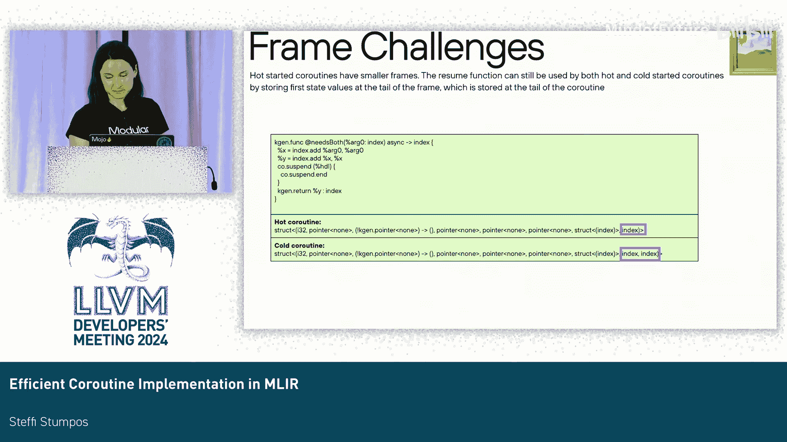

# 【2024-LLVM开发者大会-•-中英】-p50-P50-Efficient-Coroutine-Implementation-in-MLIR--BV18eNfepENu_p50-

All right， let's talk about Coine implementation in MLIR。I've split it into three parts。

 so first want to define the problem and give a little background on asynchronous programming。

 then we'll explore LLVM's solution to Coroutine。And why it didn't work for us， and finally。

 we'll look at what we had to do to design coreine lowering in MLAR。Okay， so first part。

 we're going start with a really familiar problem of trying to do some compute and ask for user input。

 so given some user input we're going to kick off some kernels and wait for them to be done and we're going to do some other work which is simulated with just printing to the terminal here this first sta is synchronous so we're just the first task gather user input。

 then we're going to kick off some kernel computation by writing the command buffers and then we're going spend a bunch of cycles。

 just checking status registers finally it'll be done so then we're going to write some more commands and then we're going to spend some more cycles。

 just checking the status registers and then finally it'll be done and we'll simulate some other work。

But this is obviously really bad because we just spend a lot of time spinning when we'd like to not block the main application we'd like to interleave the task something more like this so this is we'll check the status it's not done we'll do some other work we'll go back and check it we'll do some other work so what do we have to do to accomplish this well I had to introduce some states I had to turn my function into a state machine and then I had to write struck to store all the intermediate state so there's a lot of work to transform this into something that's interleevable and it's too much boilerplay it's tedious to maintain but luckily compilers are really good at tasks like this and in 2012 C sharpharp popularized the asy weight pattern and it's since become the industry standards so a lot of languages including Python Cotlin rust C+ plus Swt and now Mojo have adopted the pattern as well。

And as you can see from the labeling， a lot of these languages use LLVM is their backend for coverertine implementation。

 so why not use that for Mojo Well let's take a look at it。

 we'll assess it here and see if it works for us。So there's actually three different lowerings in LOVM。

 there's a switched resume lowering which has one resume。

And one ramp function and a destroy function。 And also apparently a cleanup function。

 I'm not really sure what that one does， but。And there's a context for each resume there's resume。

 So frame is stored in the context。 The return continuation is similar。

 except it returns the function pointer to the next resume function。

 So there's a resume function for every suspension point。

 The front end also has to specify the size of the fixed buffer that you send to each resume point。

 We don't really want to the front end to define that we also don't want to resume function for each suspension point。

 This is much less commonly used lowering。 So it's not really tested Well tested by usage。

 So we didn't look into that one。 The async lowering is used by Swt。

 That is similar to return continuation in that it has multiple resume functions one for each suspension point。

 but it is also closer to switch resume in that the frame is stored in a context that's past each resume function。

 So let's start with switch resume is not going to work for us。 This is C。Plus uses。

 so back to our little toy example， I've changed it， so it's using C++ API here。

 so now we no longer have our custom。Coroutine， where we have this task。

 which actually is also used or defined， but it's wrapped around a coroutine handle that the compiler generates。

 So at least we don't have to explicitly specify all the intermediate state。

 So we've saved some work。 and we're not calling that same function that we turned into a state machine。

 we have a resume function now。 So a little bit better。 the main differences come in the kernel code。

 So now we don't have to have our state machine。 we can use keywords like cowa co yield。

 which are co yieldd is like suspend， but I'm not done yet。 just right to the return。

 but keep going coreturn will market is done and co weight spawns a child cortine。

 So it's a little cleaner looks nice。 but what we really care about is what's going down underneath the hood because obviously we're not C plus plus we're not gonna to share the front end So what does the frame look like。

 What is what's getting generated。 So to analyze that， I've simplified our example。

So it's not really illustrating the utility anymore。

 but at least we can look at things a little bit more simply。 So we've got one suspension point。

And we only have one value that crosses that。This is the task that I mentioned earlier so that's where that cortine handle is a handle to the compiler generated frame so what does that frame look like Ive looked at the IR that's generated from this code and then there's our frame so let's step through it a little bit so we got a pointer to the resume function pointer to the destroy function that's fine we've got the promise type which is I32 in this case。

 and then we've got these other values which are the most interesting the two first 32 bit integers are the frame and the last is the state but why is it storing two 32 bit integers if there's only one value used across suspension points。

嗯。So let's look at the ramp and resume to see why actually our。Operation was cloned， which is。

Sometimes O。 I mean， sometimes an operation is cheaper than the load store into the frame。

 But in this case， we we are doing this twice， and we also have two loads in two stores， so。

That doesn't really make sense， but it does mean that it's only storing the values it needs for the resume because the input is used in that second one。

 So this doesn't really tell so much， but lets let's not run the optimizations。

 Maybe something is interfering with it。 So I ran in00 and oh， now we're just storing everything。

 So we have。The inputs， we have the intermediate value。 We have the final value。

 which is the only one that we care about。 So that didn't really help。

 We also have a value for each suspension point that indicates whether or not to suspend。

 This might be specific to C plus plus。 but in any case。

 we don't really want to store this extra information in the frame。

 We'll use other mechanisms to eliminate suspension point。 if it's necessary。嗯。

So what about the frame， What， What are we， Where are we allocating that， I mean。

 nothing escapes here。 So maybe we can just put it on the stack， but actually。

 we're putting on the heap anyway， so。That's not great。 let's give a little scorecard here。

 so the memory footprint。All values are were stored on the frame。

 So we don't really want loadedated frame sizes and unsary store ops。How is the coreine allocated。

 Well， it appears that the he allocation was not alighted when。

 when it should have been the I R footprint， not too bad。 We have one ramp，1 resume。

 but we don't need a destroy or a cleanup function In Mojo， we have aap destruction。

 so we can get along with just a ramp and resume。And where they had started or cold started。

 we'll get into definitions of those later， but we did see that the first state of the。

Resume function was moved into the ramp， so give it a partial score。 it was okay， but all in all。

 maybe not what we're looking for。But not all hope is lost because we we have this other lower And we can look into。

 and it's used by Swift， which is pretty popular。 So it you know， probably works pretty well。

So let's translate our example to Swift here。And I was a bit surprised to see so many integers stored in such a simple function here。

 So I added just like another intermediate value that shouldn't be stored in the frame， but it was。

So this is not great for frame size。 Let's look at the IR footprint。

 So how many functions are we generating， We have one for every。Res or every suspension point。

 So we have the ramp。 And then， in this case， to， to resume functions， which。

It is not ideal because having too many functions in the IR can slow down some of the other passes that run on a function grain。

And it's also difficult to reason about。 so we'd rather not do that as a historical note。

 we did try and do that， but we observe inactive values being stored in the frame。

 We observe allocations not getting optimized away。

 We also had issues paralyzing LOVM because the coro past dependent on multiple functions living the same module。

So we decided to step away from it。WeOur goals moving away from it were we wanted finer grain control over the size of the frame。

 We wanted to control the number of functions generated。

 and we wanted to control the order of the lowerings so we could optimize allocations。All right。

 so we're back to the drawing board， how do we design asyncth chlorine that achieves these goals？

And this brings us to part three， which is the MLAR Cortine implementation。

So the first thing we're going to do is we're going to define a dialect。

 we're not going to lower these functions until pretty late in the pipeline。

 so we want a succinct way to represent them beforehand。

that next thing is we know we eventually have to lower them。

 so when do we lower them and to do that we need to identify the optimizations we want to support and if they depend on their passes and when those passes are happening。

 once we identify where they happen， then we can define the actual transformation because we've identified the input。

So here's the dialect that we designed， I've divided it into two categories so kind of have two things that we're generating。

 we have the functions then we have the frame， I'm going to focus on the abstractions of the function and kind of not go into the Tl operations。

 the T operations are for accessing elements that are stored in that generated frame。

 and they're really important for writing like runtime libraries or supporting air handling。

 but that's outside the scope of this talk so I'm going to focus on codeD and Vooc which is a call to the yet to be generated grant function。

 codeda suspen which represents suspension point in a function。Coode out of weight。

 which is an implicit suspension point that also represents setting some。

Fields in the spawned child cortine， so if I have a codeout away。

 I want to set the call back to the parent cortine so instead of writing all that out every time we have a succinct way to represent it and then KoD destroy。

 which is generally not embedded in the language that's going to be emitted by other passes that are responsible for handling lifetimes。

Okay， next talk about the order of the lowerings。 So what optimizations do we want to support Well we want to support both hot and cold coorines。

 Again， we'll get to what that means in a moment。 We want to promote heat allocated coortines to this stack。

 and it's also important to consider what the IR looks like when we lower this because we don't want to have to add any thing to the IR in order to make it behave correctly。

 So specifically control flow should be unstructured when we lower the resume function to a state machine。

Okay， so I keep talking about these hot and cold started coors。 What does that mean， Well， generally。

 a coertine is lowered into a ramp in a resume function。 You can。

Put the first state of the resume function into the ramp function。 That makes it a hotstar cortine。

 And so what that means is that when you invoke a cortine， you are not only creating it。

 you are executing it。 In contrast， a coldstar cortine。

 The ramp only allocates the memory and configures the covertine and then returns it。

 It doesn't start it at all。 We really want to hot start whenever we can。

 because it means smaller frame sizes and one less function called to complete the cortine。

 but we can't always do that。 And on the right， sorry， Yeah， it's on the right。

 That's not eligible to be hotstar because we create it， but then we want to let's say。

 like spawn a thread and tell the thread to go run it。 So we don't want to start it yet。

So how do we generate hot versus cold Cors？ Well， they have different ramp functions。

 so we need to know ahead of time which ones are going to need which ramp function。

 So we're going introduce a new representation for that。 I'm calling it hot invogue here。

And we want to transform the pattern on the left and the pattern on the right。

 So if we are immediately calling the resume function of a cotine we just created， that's a hot invo。

 So we can。Easily implement that with a canonicalization pattern。Okay。

 so as we identify these transformations， let's like start keeping track of them。

 So we have our lowering plan。 I didn't really go into how the parser emits a weight invo is kind of outside the scope。

 but we'll just assume that we have that。 The next thing is the transformation we just mentioned the canonicalization。

 So now let's talk about when we lower away the rest of the。Coode dialect ups。

So we mentioned that we want to all to heat allocate coorines How would we plan to do that Well we can only all the allocation if it doesn't escape and it always escapes the ramp function。

 so we have to inline the ramp function first so we know that we have to lower them before inlining and then we will use a heap to stack promotion pass to promote those allocations to the stack。

But we're not done yet。Remember how I mentioned control flow can be a little tricky in some form。

 So at the stage where we have the lowering of the atinc function。

 the control flow looks something like in the green box there， where it's nested。

 This means that like control flow is defined relative to operations and not like。Function scope。

 which makes it really hard to express that we want to like continue execution。嗯。

Inside an op that we have no way of referencing at the function scope。

 or we can just wait till control flow is lowered where we can then just easily say， hey。

 year state one， jump to block seven。So the reason we don't push everything to the end is because we rely on structured control flow for the memory promotion。

 so now it' the easiest way to do both is to just split it into two steps。嗯。

We will lower the functions。 We'll inline， we'll perform heap to stack。 we'll lower control flow。

 and then we'll transform the resume function to a state machine。Okay。

 so we've defined the ordering of the app， now is focusing on the how。

 how do we perform this transformation？The state machine transformation is pretty simple。

 and I already showed the example of the canonicalization。

 so let's focus in on the lower ASync functions pass。Here's a general outline of what's going on。

I'll break it down into like four steps， pre processces， we perform the frame calculation。

 we generate the ramp and resume， and then we lower all those frame ops toer get element pointer ops into the frame that we just generated。

So we'll start with lowering implicit suspension points。

 So here's the reason we have COA because this is what Co OA actually represents。

 So there's kind of a lot going on here， but we essentially set the call back to the parent and extract the results from the coertine and then destroy the co routineine。

The next step is calculating the frame， this is kind of a tricky step。

One of the things that's tricky with this is that control flow that I mentioned is on is structured at this stage。

 So kind of have to pretend that it's unstructured by creating virtual blocks represented by the。

By operations， so kind of like drawing boundaries around our code here。

And then what this algorithm attempts to compute is what values to store in the frame。

 So if there's a path from the definition to a usage that passes a suspension point。

 it needs to live on the frame。It can be kind of tricky because you can't just take all unique paths。

 So for example， in this path， if you just took the unique paths and stopped at cycles。

 you wouldn't notice that X needs to live on the frame。So some interesting challenges。

Another interesting challenge is that sometimes cheap operations are better it's better to clone them than to put them on the frame。

 So for example， if I have a pointer arithmetic， we shouldn't store another value that we're already storing in the frame。

 we should probably just clone that offset。嗯。Finally， stack allocations。

 they have to be replaced with frame allocations， and they can't。

 We can't rely on SSA use stuff chains because。They can't be modeled that way。

 so we use these lifetime markers to identify if stack allocations need to be stored on the frame。

Another challenge is that we might have a cortine that needs both a hot and a cold ramp。

 but we only ideally we'd only have one resume function because again。

 we want to reduce our IR footprint。So。To do this， we just store all any state that's specific from the initial state to sub to the first state at the tail of the frame。

 And that way， we can just cast it to the larger size in the first state。

 which is only reachable from a cold started Cortine。

Finally， we can generate the functions now that we have our frame。

And this is just an example of what that might look like。

 so we have a cold start core routine here and it turns into a rampant resume。

 and we can see that the suspension points are still intact。So I went over some material in the so。

 but there's still a lot more remaining that's outside the scope。

 I didn't cover lifetimes of values in the frame。 I mentioned that。Moja as ASAP destruction。

 thank you。There's how do we do air handling storing those values in the frame， debugging callbacks。

ItMust be marked as must tail and if there's no suspension points。

 we shouldn't pay the price of asynchronous call。 Another interesting question is just from a front end standpoint like why do we have to mark functions with async？

So that's all I have for today， thank you。Thank you， Stey。 we can take a couple of questions。

 a bit over time， but yeah， go ahead。So， so the entire pipeline is done before L VM passes。I'm sorry。

 The， the entire lowering of the co routineine M IR dialect is happened has happened before the L O VM passes。

 Yes， correct。 Okay， have a separate question。 When you say stack promotion， is it always the stack。

 though， Could it be the color co routine frame。When you do the stack promotion。

That is to move the whole coreine frame。No， I mean。

 if you have a co calling another cur routine and cogue Cur happens to be inlineable。I mean。

 the brand function happens to be in lineable。 Does it become promotion to the color co routine frame。

 We should inline all the brand functions ahead of time。 So if there's a child one。

 that would be in line also。Maybe I don't understand your question。 Okay。

 maybe you can take this offline， Okay， sorry。Do you know where the LVM asyn curve routines store those extra values and could you have adapted that？

Approach to be used in merger as well。I didn't debug why there were extra values in the frame。

Thank you。 Thank you。Out of curiosity， how do you approach making the proteinsots debaggable from the user and user perspective？

We have not addressed that yet， bring。Do you know how the quarantine implementation compares to rust since rust also uses LLVM。

 but as far as I'm aware they don't use the same mechanism as C plus plus as well and they happen to not even do any heatalloc in the first place that they need to be lighted。

 I'll just to differer from your approach and what like the tradeos I'm actually I'm not familiar with rust implementation。

 I did notice that they didn't use or at least I don't think they use the same backend as LLVM so I'm just not familiar enough with it to compare。

Okay， thank you。Hi， thanks for the talk。 So do you have any statistics in terms of your implementation versus C plus+ one。

 And I I assume in a I mean， like in terms of how many hiploc have you removed or。No。

 the feature is brand new。 So it hasn't really been well tested yet。

 So maybe next year maybe next year。 Thank you。We have time for a couple more questions。まco。If not。

 let's thank the speaker once again。

