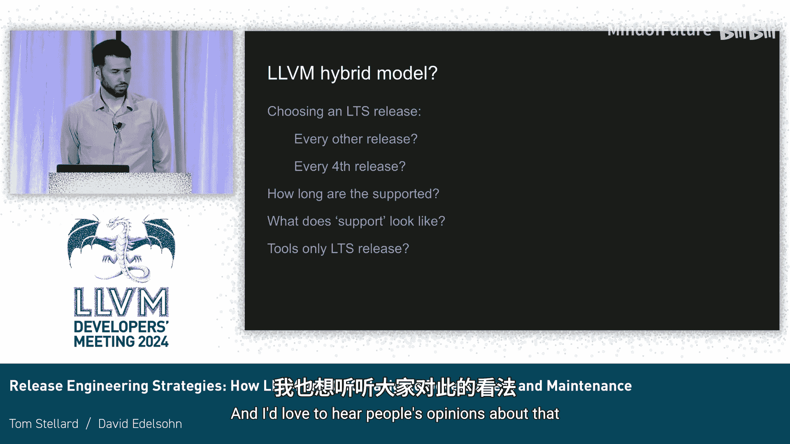

# 【2024-LLVM开发者大会-•-中英】-p51-P51-Release-Engineering-Strategies---How-LLVM-and-GCC-Navigate-Development-and..--BV18eNfepENu_p51-

Welcome everybody。 I'm David Edelson here with Tom Stard。

 give you a little bit of background about myself。 I'm a member of the GCC Committee。

 Steering committee，' been involved with GCC for decades。

 I was part of the group that actually created E GCS。

 the Fork of GCC and then remerged that back together with GCC。

 where the E GCS group became the official maintainers for GCC。 So this talk is about。Some of the。

 the history of that and how GCC is developed for its release。

 engineering and development process and comparing and contrasting that with the way that L O VM performs its development and release and to learn from that and understand the way that GC and L O VM are consumed。

 create in different ways and consumed in different ways and ways to be able to maybe adapt and learn best practices from each other。

完nder。Everybody else Tom Sard， so I'm one of the release managers for the project， I work at Red Hat。

Great， so the outline is talk I'm going to give a little bit of information about the background of GCC。

 the GCC development process and Tom will talk about LOVM and the LOVM development process and then talk a little bit about the insights and the differences between the two of them。

 So first of all， history GCC Dr to go into all the details， but it is compiler for the new project。

 for many years was the system compiler for BSD that that switched over to LOVM still the system compiler for Linux and the major Linux distributor still used GCC as the system compiler a little bit of history of the development and the important things are that after the EGCS remerger with GCC。

 there was a release called GCC 295， which was the first release where the E GCS community was in charge of the GCC releases and one of the things that happened is after that。

😊，Gcc2。95 release Red Hat actually created another release of Gcc that they were using internally that was called Gcc 296 R H。

 which was similar to， but not exactly the same as Gcc 2。95 and actually caused a lot of issues。

 I mean， it was open source source was available but not quite the same as the distributions that others were using。

 And that was a important learning experience for Red Ha and for the GCC community to never do that again。

 And so what happened is with the Gcc3 release， which was shortly after that with major new features in the compiler。

 and then the new development process， which was very much driven by the needs of Red Ha and Su say to some extent。

 So this development process was as Red hat and Su say were the very important contributors to the GCC development itself。

 were very instrument。In the design of this release process to benefit them and their leads as major Linux distributors。

 So the development model for GCC is a structure of a steering committee。

 which is not is somewhat involved with the leadership of but not defining the strategic goals。

 It's very much community driven， We have a group that Gcc appoints the maintainers and the release managers。

 we now have a release managers from Redha and Suse that are core maintainers。

 they are also what we call global reviewers。 Then there are maintainers of the individual ports of Gcc。

 which are the targets and there are maintainers for various features or combinations of features。

 the compiler and general contributors to this GC， just to get as sort of a snapshot Gcc in 2023 had about over 6600 commits by about 389 different developer。

They consider at large。 This is the libraries， Li standard C plus plus， this isn't G Li C。

 This is just the compiler。 But Fort trans， C plus plus C， front ends。

 backends targets and the runtime。And so the main， one of the main characteristics of GCC is focusing in on stability and on backward compatibility and that GCC trunk development should always be stable。

 That doesn't always happen。 But the goal is for people to be committing patches that are reviewed and approved upstream and that it should be stable and not breaking various targets。

It has a very predictable development process with open development and a yearly cadence of seven months of development with any new features going in。

 then a two months that are focusing on on bug fixes and then three months that are focused on regressions to be able to ensure that we have a stable release getting through criteria that the community and the steering committee co developed with primary platform。

 Second platforms。 and so these tests are both the GCC test suite。

 which is doesn't have unit testing or very little unit testing。 thats it's still in progress。

 but a very， very very extensive source code base of C tests that have been developed over the 30 years of the project。

 many of these from back in the days when Cnus was a major。

SDK for compilers and bringing in tests for CNC plus plus and Fortranran that continues to evolve。

 testing all different components from the sea level。

 SNF tests also for the release that many of the Linux distros against Su say and Red Ha will actually run and test the building an entire distro with the compiler GCC doesn't have a C I system itself。

 which is a limitation So there is a issue with getting rapid feedback。

 There is this test suite that is user driven and user contributed。

 but there is no good way to tell if a patch actually breaks。On a particular platform。

 if it's not being tested by the user， somebody doesn't bring it up。

 there is a reversion policy that is implemented the emission more。

 and so that's partly why there is a focus on the later of requiring multiple monthss to actually get the stability to purge out various regressions that were introduced during the development process。

The release model is basically a maintenance for three years so that there is a unified maintenance upstream in the primary GCC repository that all bug fixes to later releases have to be upstream in the current trunk。

 in other words you can't fix something in one of the releases that isn't fixed first upstream and trunk and then propagated down to any continued to be maintained releases。

And the release branches。 And so the releases are also at a regular cadence of three months。

 six months， a year and two years in the of official， what call FSF GCC releases。

 and then the Linux distros do continue to maintain the releases upstream in a cooperative manner。

 There aren't official releases， but often su say and Redhat if they will find a problem for some of if they are considering a long- termm release for their Linux distro will continue to put those bug fixes upstream and propagated into the various release branches。

 but again， no official releases。 and the Linux distros basically choose which GCC releases for their own cadence。

 they will use and that will often get more extensive testing of GCC for that particular Linux release。

So。head over the time to talk about LVM Sure okay yeah so let's start first with the contribution process for LVM so historically our process has been a little bit less structured with GCC we had codeown but their roles were somewhat unclear and there wasn't really a welldefined decision making process for the project but fortunately this has changed over the last few years as we've adopted a more formal decision- making progress a few years ago and just recently we approved a new governance model that will include elected area teams for the different subprojects and as well as project council to help facilitate the technical decision- making for the whole project and so this is really needed change for us because we have a very high rate of change and a lot of individual contributors so when you compare with GCC we have about five times as many commits per month and about five times as many unique authors per month so getting this a little bit more formalized I think will be good long。

For us， despite all this rapid change though， theres a very strong emphasis in the Alveian project on keeping a stable main branch。

 so this is achieved by having sort of a revert first and discuss later policy for breaking changes as well as a large cluster of build bots that do continuous post commitit testing。

We do also benefit a lot as a project from downstream users that pull and test the main branch regularly。

 and they're able to run a little bit more extensive tests than we can do inBuildbot。

And so one part of our development model that is very different from GCC is that we continue to do feature work in the main branch while we stabilize code for the next release in the release branch。

 so part of the reason we do this is that many downstream users。

 they aren't really interested in our release branches and really only care about what's in Ma so if we were to freeze the main branch for a period of time like GC does。

 we would end up with a lot of very unhappy users。So we also have a very predictable release cycle that lasts for six months。

 so after we branch the next release from meine we spend about one month of time stabilizing the branch leading up to the very first x。

1。0 release， and then after that we do about three months of bug fixing with one release every two weeks during that period。

Now we do actually have a proposal to extend our bug fix release timeframe from three months to five months for this current LVM 19 cycle and so what that would mean is that effectively we would always have at least one supported release of LVM that is getting bug fix so currently there's like a two monthth gap between when we stop supporting like the old release and before we do the next release so with this new proposal that gap would be closed and we'd have something that we'd always have a release that was supported by the community with bug fixes。

And then over the past， I would say seven or so years。

 our release process has really transformed a lot with the main goal of making the releases as low cost as possible。

 so we went from doing everything pretty much manually all the backports， all the testing。

 all the issue tracking to now we have mostly automated backboarding process we have a status tracking project on GitHub and even CI testing for the release branch and being on GitHub is really enable us to do a lot of great things in this area know we used to only be able to do one bug fix release for every major version but now we're doing six and with this new proposal that I mentioned we could be doing 10 or more。

So in my role at Red Hat， I lead the team that packages Aium for Red Hat Enterprise Linux and also for foror Linux。

I would say that the biggest challenge we have is that there are really two different deliverables in our builds。

 so we have the tools like K， Plan， claim D， etc ceter， and then we also have the libraries。

And in Fiora， for example， we have 31 different packages that depend on either the clang or the Elium libraries。

 So if we ever try to push a new version of Lium or cling into the distribution。

 all those packages that depend on the libraries will stop working。

 You won't even be able to install them anymore。So this not only prevents us from pushing new versions of the libraries。

 but it also prevents us if we want to push new versions of just the tools too。

 because they both come from the same package。 And GC doesn't really have this problem。

 So you can push a new version of GCC into the distro。

 and all the previously built packages will just keep working。

And the reason that we have this issue with LVM is because the C++ libraries that we've shipped in our project。

 they don't really have a stable API or API between the major releases。

Applications always need to be rebuilt when theres a new version of LVM， and in many cases。

 those applications will require source changes just to keep up with the latest changes in the API。

So what we do to work around this， we end up providing multiple parallel installable versions of LVM。

 so for example right now you can install LVM 19 in Fiora 18 and a couple other older versions as well。

 this isn't really ideal from us for a support version I don't really like having to support multiple versions at once。

 but it's something that's a necessity for us in order to keep some of the packages working that really need those older versions。

Okay。So wanted to now talk a little bit about the differences between how these versions and GCC and LOVM are targeted。

 that the Linux distributions and the vendor compilers are very much focused on sort longterm system horizons and the Linux distributions are used in a way where it's a shared system often and as I mentioned。

 GCC， the can do tool chain and the Linux distro is co evolvedvolved that way。

 I L VM has been around for very long time， but in some ways。

 it's not that it co evolvedvolved for containers。 But in many ways。

 the way that LOVM works from my perspective is sort of better targeted or is easily consumed by something like containers like microservices where。

One builds an application， a single purpose container and one does A B testing rolls it out。

 if it doesn't work， rolls it back。 but one is able to have this continuous delivery。

 continuous updating of the application with the tool chain。

 the tool chain doesn't necessarily need to have a long termm support because you're continually rolling a new application。

 whereas GCC being evolved for Linux and Uniix and that sort of history。

 where it's the shared system， you have shared dependencies and a multipurpose。

 multiprogramming system， So there's that different consumption model。 and that these compilers。

 again， Gcc definitely evolved coevolved for that purpose LVM evolved for that。

 but LVM is more easily usable in this container purpose。 So a little bit of comparison。

 what I think are the strengths is that GCC as you both mentioned has a lot of stability for better for worse that it has this longterm support。

 multiple years。That again， for the official releases and then the Linux distros themselves provide even more stability and support for。

 I think Braille7 was still Gcc 48 release I mean so you have very which is decade ago so long periods of time where not that there's a lot of changes but that it is officially supported by those disros and provides that very stable environment AB that's the base system AB for all the applications to use and as Tom mentioned similar to L ofVM。

 there were these Gcc toolet I think was in Red hatt where one could install newer versions of GCC in parallel but the system compiled in the base level for the Linux kernel builds was that very stable version and also the GCC is able to compile an entire Linux distro which is not an easy fee I think there's still some gaps with the ability of clang to。

To be able to build correctly， I mean I mean， just be able to build all of the various applications。

 So that's a purpose that GCC is still relied on by these Linux diss。 I mean。

 the weakness is that obviously exactly as Tom mentioned。

 this development style does inhibit with the phrases。

 I mean does inhibit the development innovation pace and the ability for people to contribute and get their changes in very rapidly。

 and it is somewhat rigid development process。 Yeah， I'm not going speak so much for L of theM。

 but one can see that it has a lot of benefits with innovation。

 flexibility a very modular design and so a lot of benefits obviously served it very well with this incredible development but the lack of longterm support and as we mentioned。

 the AB and API stability itself if you're using L of theM downstream and other projects that each L ofVM release is not guaranteeing its internal interfaces。

 external phases to be the same。Which causes churn and causes difficulty with updating。

So the impact on adoption is this long term support， stability， AI， backward compatibility。

The lack of there are many， many vendor compilers now， I mean， the arm compiler。

 LVM technology based on LVM technology， IBM's open Excelel compiler based on LVM technology。

 And they're all using So they're all providing Apple。 I mean， clients based on LVM。

 But they're all implementing this longterm support independently and dealing with the issues of how to backport and when did cherrry pick this。

 And so this is creating a lot of duplication that all these teams are doing this independently as opposed to GCC。

 which has a coordinated single environment。 So the unified maintenance ensures consistency across all the distributions。

 all the users of GCC。 So the system compiler that Red Hat and Susan Canll have invested heavily in this tool chain and defined it that way。

 So the question is how to make LVM more effective as an alternative system compiler。

How can it in turn provide this long term support without stifling innovation。Sure， thanks。

All right so just quickly like some challenges that I think we have that make LTS release more difficult for us is I don't really think we're set up to have any more than two releases in flight at the same time and I think some of it comes down to the developer bandwidth for backports and fixes because every fix re merge your release branch gets reviewed by a con owner or someone else who's familiar with the code。

 So it's hard enough to find enough people to do that to get stuff in the main but if we have to rereview stuff over and over again for the different branches。

 I think that's going to create a lot of work and also because in our project as I said。

 not everyone really cares about the release branch like it's understandable that people may not have the motivation to help out so I think that's a little bit of a challenge for us if we're looking towards an LTS release I think the other problem is just schedule alignment I think this is already an issue today even though we have relatively frequent releases at least compared to an LTS schedule it just some people want to use the release branch but it doesn't align with their internal schedule。

So they just end up pulling from Maine anyway， so I think with LTS。

 this problem just gets worse because we have less。

 and we have an LTS release every three years and it just makes it that much harder to align。

And also I think just as a practical consideration the project gets about 40。

000 commits per year so if you have an LTS branch that is like a year removed from Maine backboarding changes can start to get really really difficult and you can imagine how that would look like two or three years out so I think we have some challenges that make it a little bit more difficult for us but if we did decide to do an LTS release you know I think there's some things we'd have to decide first like how often we want to do it how long is it going to be supported。

 what is it actually mean to support the release what kind of bugs your fix etc ce so I think it's definitely something that's worth having a conversation about and I'd love to hear people's opinions about that we'll take questions them in and we also have a roundtable coming up tomorrow how was the next slide okay that we can discuss discuss this further so。

With that， let's open up for questions。Regarding the LT S release。

 do you have a guess of how many hold time engineers it would take。

To maintain an LTS release for L of VM。Well， it depends on what you mean by maintain。

You knowThat could take a number know that could look a number of different ways。 I it， you。

 are we going to try and backport every bug fixed that lands in Maine into the LTS release。

 Are we just going to respond to user。Querries， I think it's probably very difficult to put an estimate on it because it's potentially a very large scoped problem。

 I think。Yes， and that's why I'm asking about the guess。 Is it 5，10 or 50 people or more。诶。

I don't know。 That's a great question。 I really don't know， because like I said。

 think I think there's too many， just too many。Factors。

 and it depends on what you want to get out of it。 I think I'm asking because there is a genuine interest in LVM LTs for more than one company。

 and the managers are asking how many people。Well， if the manager are asking， then the answer is 50。

😀Yeah。😊，Other questions？next slide so tomorrow 215。

 if you want to come to a roundtable we have scheduled to this conversation， so thanks very much。

It's 9 speaker。