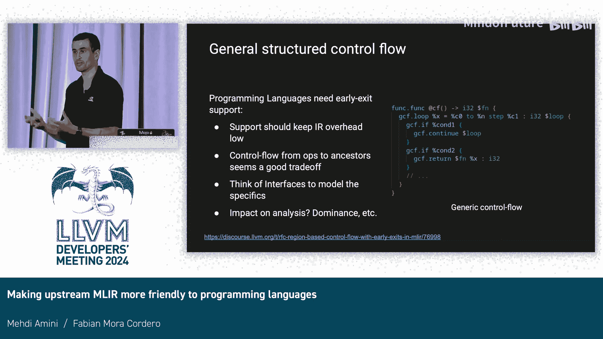

# 【2024-LLVM开发者大会-•-中英】-p52-P52-Making-upstream-MLIR-more-friendly-to-programming-languages...--BV18eNfepENu_p52-

Good evening。 Good afternoon。 And thanks for coming to the talk。

 We're be talking about how can we start making ML more friendly to programming and languages。😊。

So first， we' are going to start with briefing motivationtuation。Does the timer works？

Does the time it works？Okay。Okay， there you go。 Thanks， so。

M OR has seen a lot of success with MLl compilers， Jaca， Eri， Jacao X L A。

 and they have driven a lot of performance。 So that has been reflected upstreamring。

 So that means that。😊，You get， for example， tosa or Manrov instead of having more traditional things that you would find in a generic programmal language。

However， now we've seen that we're starting to get more traditional fronts。

 We have that flang has been in development for a while。

 and it's getting closer to production like recently， they got your name from F New to Fang and。

Then we on the other side， we also have plan AR that it got originally approved for upstreaming。

And basically， what is important here。 and on the picture is that they hold these representation。

 C IR and FIR， and they try to lower it to LBM。 So there's like a pretty straightforward path。And。

In terms of what we need to expect as a community is or what we want， is that in the future。

 we also get。Other programmingal languages come into MLR， that being Julia Ross and many others。

And this。Thing where you have like all these generic prenal languages coming to MLR。

Can be a burden into downstream compilers， because。

There's not that much support for for representing traditional programmingal languages。

 So this ends up leading to a lot of word application。 So， for example。

 you have that many dialects will be implementing the same log operation。

 the same eve operation or even the same load operation just because they deemeded that was necessary for their purposes because。

Their semantic equivalent was not available in Austria ML I R。

 which in turn leads to also duplicating things like control flow， flattening and other passes。

 So the idea is， how can we。Alleviate this situation。

So now we have some limitations about upstring ML IR to be more concrete。

 So there's like pretty basic ones that reflect that M IR for a long time has been。

Has seen a lot of contributions from the MLl compiler community。And this means that， for example。

 things like trucks， a lo has， loads of stores are not really representable in high level dialects。

 which means， for example， on the figure。 if you have like an stroke operation。

 It's not like you can go like to M A T or LBM or Spcurby because there's this high level representation。

 Instead， it means that。If you want thatstruct operation。

 then you get a decide if you are gonna go to LBM or M mid C or Sp B directly。Which， in the end。

This causes many compilers to start recreating these lowerings。 And in many cases。

 these are pretty straightforward。And the other thing that happens in MR in is that there's no early exit control flow。

 And in terms of traditional programmingmal languages， you usually get like your breaks。

 your continuous， your go to。And。The burden of this is that。Then if you want to have those。

 you have to re implement infrastructure for， again， flatten name control flow or。

Incrementing the data flow infrastructure to work on these kinds of representations。

 because if you try to do them right now， they are just not truly supported。Now。

We wanted to alleviate some of these situations。 So this is like a first step on this process。

 And this is a proposal on modizing the LBM pointer ops。And， basically。

The main idea in the pointer dialect is that we can extract the pointer operations from LBM and put them in their own dialect。

 And in many cases， we can have like this dual representation that acts in a higher level。 So。

 for example， in the figure what we have is that the pointer operations are acting even on tensors。

 which which is something that currently you cannot do if you were working， for example。

 with LBM pointers because LBM would complaining that that is not a type supported by LBM。

 So the idea is to also make them target independent so that it can go to a mid C。

 And this pointer dialect has already gone through the R X C and has begin begun offstreaming。

And in terms of what it does， let's begin like。With the lowering impacts of how pointer would look。

 And in this case， what we want is， for example， being able to go to manr to pointer and then to emit mid C or to sphere be。

 which would increase the support for these dials that in many cases。Like， they。

They get overlooked because Al BM takes， in some cases， priority。And。

The biggest difference that we are starting to do here is that these pointer operations are not going to be lower to the Al and Dek。

 Instead， they are gonna go straight to AlM I R。And being translated there。

So there's not going to be duplication between operations， between pointer and LVM。

And one of the nice things is that if we start to abstract these pointer operations into a higher level。

 we can get many new features。 For example， we can introduce restrictions operations in this case。

 we can have like constant address spaces。 So， for example。

 if you try to do a pointer store in a with only memory space。 Then you'll get a verification error。

 And this can also be used to work on things like Alis analysis because。😊。

If a memory space is constant， then。We can assume that it's not gonna be conflicting with anyone else。

In terms of how it was the to make it extensible and to make it friendly to downstream users。

 we decided to create a。Attribute interface that include some of the semantics and abstract them into this interface。

 So in this interface， you get， for example， things like is valided load。

 which will return whether a certain type is supported by the address space。

 And this is how we can get， for example， say，Constant address spaces in terms of the memory model。

The memory model is pretty much inspired by the LBM inns that， for example。

 you have the same Greek memory semantics。😊，And。One of the nice things is that this leads us to have to clean some of the things offeringing。

 So， for example， we can have。Casting operations from and to mamth。like。

And the idea of doing that is that it also allows us to， for example。

 turn the bearPoer convention into a pass， which stabilizes the AI in turn right now。

 because if you ever use it。The aobeber pointer convention does not work well if you have aesthetic static sizes on the membrane and dynamic sizes。

 because it also goes through dialect conversion， and then it becomes tricky。

And one of the important things that we need to say。

 because we need to measure it is what are the performance impacts of saying we modize the point of operations from an L VM。

And。In terms of performance， we tested out in some synthetic tests。 And in most of the cases。

 we saw that the impact was less than 3%。Also， this can be can act as a complete replacement of LBM pointers。

 of LBM pointer operations。 And in terms， for example， of the implementation。

 This means that you can just switch from one to another。

 in the beginning and don't notice a difference。 So， for example， on my implementation of the patch。

 you have that flk never sees major like disruptions on the code。 So， and that is also important。😊。

Alright， so thanks， Fabian， so Fabian showed you the pointer dialect， which you know。

 is maybe the first instantiation of a pattern where we extract something from the LLVM dialect to generalize it to work on high level types。

 And this is something we can do thanks to types interface or attribute interface。

 But the same pattern exists on other aspects of of the LLVM dialect。

 What we've seen in some compilers that we implement。

 or that at least I'm walking on downstream is that there are a bunch of operation and dialect that are pretty so close to L VM semantics that they can be directly translated to L VM IR。

 I like yesF dialect。 if you have just an if or anF4。

 it's straightforward to translate it directly to blocks in L VM IR。

 the RF dialect when not operating on tensils is。1 to one to all the LL VM Atic operation。

 And the point of dialect only when operating on L VM types as well as Fabbiian just showed you。

 is something that can be directly translated。 And this is pretty important for Js because of the compile time involved。

 like we save dialect conversions。In the process。 And so this is something we came。

 we had to go through downstream where we started to have a compiler targeting directly the L VM dialect instead of using the RF dialect。

 just for the sake of compile time。 We are saving the conversion。 Now。

 the problem we had was that a lot of canononicizer and other things only exist on RF dialect。

 And so now we had to move back。 And so we implemented we added RF in our compiler。

 But we regressed our compile time。 So we had this deployment。

 So now we are adding direct translation from RF to L VM to compensate all that。

So there is this unfortunate duplication at this point。 And so the modularization that we， we。

 we could propose for the LM dialects would be to say， like， let's not duplicate operations。

 but let's reuse as much as possible， so。嗯。So we could like。

 stop using L having even existing an L VM dot ad when it's exactly one to one to the R dot ad for the L VM types。

So something else that we can start doing is that reusing those abstractions for high o level types and start building abstractions that are target independent and retgetable。

嗯。So the problem with this is that the Lian dialect is no longer you know。

 one to1 mappinging to L VMIR。 It's a collection of dialect that represents the L VMIR in in M IR。

 So that's a tradeoff to， to make， right， It， it simplifies like we don't duplicate documentation。

 We don't duplicate a bunch of things， but we have to deal with a collection of dialect that collectively represents L VM IR in in M IR。

And this is， this is basically some of the trade offs on which we're trying to solve。嗯。So yeah。

 so basically， this is， you know， what I was saying about R dot add I and L of M dot a over time。

 you know， R originally was。At the loose semantic in terms of how it was defined。

 But as people have been starting building production compiler， they wanted better define semantic。

 and I wanted to have the control using RFith to target all the LLVM semantic。

 And so we end wind up by you know， converging de facto。

 the Arith dialect with the LLVM dialect in terms of adding all the same flags and all the same semantics。

So this is really reducing some random n And in terms of compile time impact that I was talking about。

 we have this translation。 We built， you know， proof of concept of the and synthetic synthetic tests for this translation。

 And so the conversion to L L VM that we measure here is starting from the R dialect。

 having to do the dialect conversion and the translation。 So that's gonna be the last row。 we。

 we get 1。5 speed up by equallyli by。Translating directly from RFith， instead of。

I think this extra dialect conversion， that is just one， to one， basically。

So there is really real benefits in practice to do that。Alright， so beyond。

 beyond this modization of of the dialect， the allviian dialect。

 there is like how do we expose those。嗯。Some operation to higher level types and how we abstract A BI and things like that。

 So there are like things like structure or arrays where those could be fairly simple dialects， not。

Don't need a lot of operations， but that could， you know， unify the way we manipulate。

Structures and other aggregates types。And allow people to inject to their own types and inject their lowering and still。

 you know。I access to all of this。So this is just an example of what it could look like。

 We haven't built those style electrodes。 We've just been brainstorming what would be the front end needs and how we could unify those。

And so the question is， like， are we going through towards a collection of。

Dialects for programming language。嗯。How far do we need to go， How far can we， you know。

Build reusable things that are actually useful for the kind of language Fabian was thinking of at the beginning。

 like。Here we show an up scopepe exit， for example， we show a try catch。

 So this an exception abstraction， for example。And so it's not clear how far we can generalize those kind of thing and make them universally useful。

And so it's mostly， you know brainstorming at this point and request for comments from the community and and trying to see what are the needs and what could be useful。

The， the one that I know is useful and that many people。

 even in the last two days have been requesting is， you know。

 this kind of construct where within a loop and within a nested。

 if you want to break out of a loop or continue or return from the unclosing function。

 This is something that。Is not legal in ML IR。 You can get away with it in your own compiler if you don't reuse too much of upstream components。

 like Mo， for example， rely a lot on those kind of thing。

 But there is no first class report bought in ML IR and that would break the data flow analysis that would break a bunch of components upstream that that tries to understand post domination properties between operation because we。

 we make assumptions about this not being possible。So this is the last bullet here。

 which is really the impact on analysis， dominance， etc ce。

 But there are a bunch of people working on it。 So it's gonna it's coming。

 We don't have a date for it。 We don't have a final design。

 but hopefully by the next U LVM conference， we should have dis implemented。

 that's that's really what I expect。嗯。So finally， the target AI abstraction is a pretty big thing。

 As you know， L L VM is A BI specific， meaning the front ends have to know about the target A BI。

 And as to encode all those decisions before emitting L L VM IR。 So in in the L IR it's the same。

 If you use the L LVM dialect， you have to make all those decisions。And that makes interacting。

 with see。A bit complicated。 And that's why if you've been ever been using memo F and try to write a C run time for memo in ML AR。

 there is like。A complicated A B I that M I L tries to。

 to implement just for the sake of not having to know about the difference between the various targets。

嗯。And so clang， clang itself， the front end， encode all the knowledge about the tinyium M C plus plus calling convention for。

 for every targets that that they report。 And there is something to be done here about extracting this front clang and making it。

 you know， independent of the， the， the clang C。Type system and making it available to other front end。

 including MLAR。 And that would allow to build things in MLAR。

 where people could express their type system in terms of the C type system and get for free for X 86 of。

 whatever the lowerring to LL VM calling conventions and and other AI aspects。

 layouts and and and everything。L ofM originally was trying to be an IR that is。

Data layout independence。 And that's a goal that was abandoned more than 10 years ago。

But in M I R now we want。 were moving towards building kind of this property， right。

 And I R where above yellowium dialect and above yellow dialect。

 we should be able to express things in a， in a very。AI independent things。 And yeah。

 So that's the end。 We hope that it opens up I Ds。 We are looking for more ideas that that would be needed for programming language and M I R。

 So we are looking for。Thank you for attending。Questions。So I have two questions。

 So for the region based controlflow RF， would you happen to know what are the main blockers currently。

 I remember there was a proposal to adopt the RFF dialect that was used in module。

So the the problem is not a dialect thing。 It's really the core of MLIR， right its first。

 we have to have that long graph to allow this， right， Then we have to decide how do you model those。

 those new operation， like when you when you see this continue inside the if。

 How do you know which operation that' the continue map to。

 we need some sort of a label to express that， right。

 Are we gonna support this by adding a new field on the class operation， really。

 the core of MLIR to build a new edge in the in the in this or are we gonna use a。

Like the symbol interface， more a name based things。 How do transformation。

 are supposed to update it， right， if you want to unroll this loop。

 how do you find all the continue there or all the break you know， those kind of thing。

 So we have to solve some infrastructure questions the semantics， basically。

I suppose but parts like， for example， relaxing the rule that each terminator has to be a blockchain inator。

 I suppose there are parts that may be less controversial， perhaps。Yeah right。Yeah it's。

 it's the kind of thing we have to solve And the second part is in the ideas。

 So I'm thinking beyond the structures and array， I wonder if the design would be that won make sense。

 but also to be representing the data collections。 And I'm specifically thinking of the design from the CGO paper this year representing the data collections in an SSA form。

 which allows to teach the compilers about the whole variety of data collections like has tables or maps or trees。

I haven't seen this paper。 I don't know if you C 2024 No， I haven't seen that paper either I I'm。

 I definitely look this up。 Yeah。 Thank you for the point of。 Thank you。So I。At the CF dialect level。

 I guess you can have this。Continues and and return。 I don't know return， but。But I。

 I guess you want to have this at the S C F。Level， right， because the Cf level is right， you know。

It's。Much closer to our of him。Sorry， I didn't quite get。 So I mean。So at the Cf dialect level。

Could we have all this the continue And because that's just like， you know。Yeah， I mean。

 if you have if you don't have region， you don't have nest， you don't have any nesting。

 you have a flat CFG， Yeah then everything is branches。 Yeah， so there's nothing to add there。

 I guess。The program is only for structured controlflow。But we want this at the SCF level so。

What about the next level， like a find， you can't have this。 So I guess。You， comes in at this。

 It can be， you know， the long I R， the long I R， I think probably needs those kind of thing。

 in any kind of programming language where like modulejo is this， you know。

 and so anything that is even above as you have， if they don't use this。Is this， but yeah。

 those are for SCF kind of Yeah Okay， thanks， thanks。Other questions。All right。

 well let's thank the speakers again。