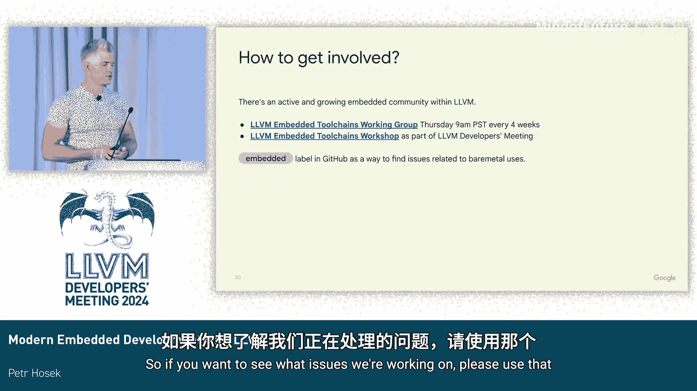

# 【2024-LLVM开发者大会-•-中英】-p53-P53-Modern-Embedded-Development-with-LLVM--BV18eNfepENu_p53-

Today， I'll be talking about our experience doing embedded development with LVM。 Now。

 this is not the first time we were talking about this topic。 Last year。

 my colleague Braabho was actually here talking about our experience moving an existing product in that case。

 it was the first generation of Pixelbots Pro over from the legacy new tool chain to our own in-house LVM tool chain。

 Now in that work we've mostly focused on tools like the compiler using Kang and a link using LD。

 we didn't really do anything for runtime libraries， but we've made a lot of progress since then。

And earlier this year we've actually announced a second generation of Pixelbuts Pro。

 these not only use Kang and LD， they also use runtime libraries like the LBM Lipsy and compiler T Epsy++ in addition we've also made a lot of progress on Pixel Watch where we use Kang tool chain for the ambient Comp workloads running on some of the low power islands。

So in this talk I would like to do a bit of a deep dive and talk about our experience using LVM runtimes for embedded So what has been our experience like what we've noticed we looking around different products in this space being done at Google is that most projects use tool chains that are provided by their silicon vendors Unfortunately that these tool chains are very often outdated that are very rarely updated and because silicon vendors use these tool chains to build platform libraries that come with their SDK they can often inverently force these tool chains under their customers and all these tool chains come with their own CNC+pa libraries。

 every one of them might have the different API or A and just aligning all of them can be pretty challenging it gets even more tricky when you start mixing different architectures we actually see more and more products combining cores with different ISs like arm and riskk5 is pretty common。

We also see developers doing development on different hosts， Linux Mac Windows。

 and so if you really need to come up with a set of tool chains that work across all of these it's can be a really daunting task and what we've seen generally are two ways of dealing with this one is just find a set of tool chains that work together and basically keep them the same for the whole lifetime of the product。

But we believe there is a different way of doing this and it's the one that we've been actually doing at Google for a long time for our production workloads and for purchase like Chrome and Android。

 which is living ahead， meaning you always try and compile everything for source。

 you always follow tip of tree and you update regularly to avoid things like diamond dependencies and merge conflicts and we believe that livehead is actually a great model that could also work for embedded and so that's what we're trying to do we aim to provide an open source。

 crosscompiling clang whole chain for bare metal， which doesn don't have any legacy components。

 we use tools like clang and L we use Li see Liy+pa compile Rt as our ontime libraries and we do all development directly in upstream。

 we don't carry on downstream patches we closely follow tip of tree which let us adopt new features is they keep coming like into clang into all these libraries basically immediately up land and it also let us provide。

A lot of feedback， immediate back to the LBM community。Now。

 one thing that is important about Li head is automation and testing。

 you really want to know if something breaks in LVM。

 like what broke you want to be able to provided feedback as soon as possible so the change can be reverted or addressed。

Now， if you've ever done embedded development， you'll probably know that。

Do bare metal can be pretty challenging。 There is lots of specialized hardware。

 it it is really tricky and that is especially challenging when you start dealing with LVM and so we believe to make this sustainable we need a great platform one that is publicly available it is cheap。

 it is a great documentation ideally it should be open source which we can use as a proxy for all of the internal products that are not easily accessible by LVM developers and we believe that Raspberry Pi PCO might be great fit here。

 this is a line of popular microconttrol products from Raspberry Pi there are actually two generations the first one。

 PCO1 was announced in 2020 and just couple of months ago Pi Foundation actually announced a second generation the PCO2 which combines arm and risk5 course Now one issue here is that。

SDK， which is what you would use to build code running on these boards。

 does not support A of 3 Kang toolcha at least it didn't until a couple of weeks ago Earl this year we've actually partner up with Raspberry Pi Foundation and Pium and Google and we work together to make Pco SDDK。

 the first Pereral project that we are aware of that can be built straight up with the open source Kang andalium toolcha using compiler RRT Aium LipsC and Lipsy++。

So how does it work？😡，Well。We'll start out just by cloning Pco SDK straight from GiHub。

Then we'll just use CMake we'll configure the right compiler the platform and we'll point the build at a tool chain we want to use Now you may ask。

 okay， where do I get a toolch from Well if you've been at LVM dev meeting last year I actually gave a tutorial on the LVM build and CMake and so I guess it's time to review how much you remember from that do So let's go on and build ourselves a toolcha We're actually going to write our own cache file that's just a way to like persist your settings and feed them into the CMake built in a more maintainable way now I know this looks like just a lot of like gibberish but if you see through all all the Cm like the In they're hopefully should be fairly fairly clear。

 like what we are doing is we are selecting which targets we want to support it's on risk5 we select which projects and which one times we want to build then we configure a couple of our default So we don don't always have to specify those on the come and we select。

WhichTool and which components we want to include in our tool chain。Next。

 we need to set targets for our compiler builtins。 This is gonna be the two architectures supported by Pco2。

 we set a couple of other options。 most importantly。

 is the CMake the C flags that are down at the bottom and then we're going to do the same thing also for runtime libraries。

 that is slipy and Liy+ and that's basically at this point。

 we can fetch LVM source history from Github。 we can fire up CMakeake point in our cache file and build ourselves toolchain that is usable with PcosDk and that's it。

 Now if you don't want to go back and like we type everything out on those slides。

 I've actually upload this file to Github so you can check it out later if you want to and try it out for yourself。

When it comes to individual runtime， what has been our experience for compilerRT。

 we've seen to be mostly a great drop in re replacement for the GCC。

 we haven't really encountered any issues on the corners there are some differences。

 especially when it comes to more exotic types like float 16 or 128 but in POSsDK we haven't really run into any of those One limitations that were aware of is that LVM right now is not aware of the compiler runtime that is being used and cannot really take advantage of routines that are specific to compilerRT but this is more of a mis optimization but still is something it would be nice to like address in the future。

On the Li side， Liy side has been in development for the last couple of years and we believe it is finally becoming ready for broader adoption。

 especially in the baremet world， it is a great permissive license C lab implementation it can be scaled from warehouse to tiny board like a PCO now to make it usable for POsDK we have to implement bunch of missing functionality like higher math functions。

 malllog implementation， basic IO support， there are still some parts of LipsC that are missing like startup code。

 semihosting i offering all of these are aspects that we're actively looking into and we hope to implement over the coming months。

In addition， we've also started working on the low level embedding API。

The way to think about it it's a little bit like Pos or a system called layer but for embedded。

 basically it's a set of symbols that LVM LipsC expects any platform to provide because we don't want to hacode knowledge of all these individual platforms like Bco SDDK or free arttos and other arttoes into Lipsy instead we want this to live on the platform side right now we only have a handful of functions to do things like standard input standard output termination。

 but we expect this interface to grow over time， especially as we add things like fretting support。

On the Liy++ side Lipsy+ Author has a lot of options that lets you disable unnecessary functionality。

 and we use those， but we've also found out that we probably need more configuration points to better support embedded environments because there are still places where Liy++ uses functionally like dynamic memory allocation Tls or float。

 and this may be undesirable on many baremo platforms。

 we also had to introduce support for building Lipsy++ with Lips C， which wasn't there before。

 So if I go back to my original example， in addition to what I ahead。

 we also need to set a couple more options to disable functional right now。

 it's unsupported or undesirable。 most notably are things like localization。

 Unicode Wicrater support。 Now this is temporary like this is something that's me actively work on eippsy and we hope that over time all this will get implemented So many of these won't be needed in the future。

All in all， I think becoming tool chain， building a tool chain is becoming easier Now up until recently it wasn't actually possible to build a fully functioning bare metal tool chain within alViumpro dogi at all。

 but with that being said there is still a lot of room for improvement like what you see before in that CMakeh file there is still a lot of boiler play that I think we can probably reduce and eliminate overtime but things are know pretty okay granttime built already has basic multilip support and Molip is really important on baremet because of the great variability of hardware but the existing Molip support is fairly limited it is really inefficient it requires a lot of Cm implicationss than really extend build times there is also no support for re new Yamlbased configuration format but beyond that I'm actually not even sure if like in the long term we should be using Molips。

 I think we really should explore the idea of actually building。

Sometimes on demand from source using the right flags。

 it's something that we've been experimenting with internally in our Pickweed project and we do have a minimal working prototype。

 but right now it's very built system specific and over time we would like to see if this is something that we can generalize and support directly in in clientang an LLVM。

What we've also seen is that performance still has some gaps。

ALo lot of baremet projects are sensitive to binary size and memory usage making them fit is often exercise in cargo coding What we've seen is GCC generally tends to better balance size and performance at theOS level with Kanggo Z we would often get smaller bin but that can actually come at the cost of worse performance which is not always desirable we can maybe recover some of that in the future with other tools like ML in liner but I think there is more we can do Also what we found out is stack allocation in LVM has a lot of gaps which can result in inefficient stack usage and this is also frequently causing problems on the baremet there is a lot we can do actually have a tracking book on the slide which has a lot more details。

Here's just an example from one of our projects like all the flags that we would set just to make everything fit under under our budget and while this works。

 it is not very maintainable like we really don't want to be copying these flags from project to project。

 I hope that over time we can come up with something that's better than this。

Debugging can be also challenging one of the things that we've noticed is that right now LBM and LDB doesn't support all of the dwarf CI constructs this can be problem。

 especially when you are dealing with Hewritten assembly in places like intra handlers if you're to support unwinding which we actually occasionally money into when doing embedded development LDB support for also has some gaps。

 for example， there is 532 support is currently mostly absent its something that we would like to improve。

But assuming all of these issues get addressed and I believe they will over the coming months。

 I think that LVM is a great fit for embedded。 and I believe there is a lot of things in LVM that embedded developers could benefit from。

 but I think LVM developers also need to aware of constraints that these systems have。

 So let's take a look at some of those。 First one is support for heterogeneous memory。

 This is super common and embedded embedded systems use tools like like attributes and linkerscripts to place symbols on specific memory that specific addresses。

 but right now these are not compatible with LT and PGO。 LT is a fantastic tool。

 we've been doing some early experiments in embedded space。

 We've seen binary size reduction of more than 20% but LT today is not compatible with Liscript。

 and there's a problem because these are really common in bare。 similarly。

 PGO can provide great performance improvements often more than 20。😊。

But it doesn't really take into account aspects like number replacement。

 which again is is a requirement。 We would also like to take a look at posting optimization tools like propeller or bold in the future。

 It's still an open area of research。Next， sanitizers。

 sanitizers are fantastic tools for finding bugs， but using them on un embeddeded systems is really challenging due to the memory memory constraints。

 we actually use successful UBS in some of our development for finding things like missileal and accesses。

 But what we also notice is that while UBS has several runtime implantations that can that are tailored to different environments。

 none of them is the right fit for bare math plan well probably need another one。 AsM。😊。

Doesn't really work right now mostly because instrumentation is just too high is too high。

 and we really need to find a way to reduce it to make it suitable。

 There are other sanitizers right now。 I'm not really sure if those are ever going to be feasible on embedded simply due to high overhead。

 but it's something that we are still looking into。

 and sort of more general theme is that all of sanitizer around times were originally developed for Posss and later port it to platforms like Windows。

 and they often make assumptions about the underlying platform kind of looking like Posss。

 but that's not really the case on embedded。 and that makes porting really difficult。

 And I think there is more work needed or just cleaning up the implementation to make them more portable。

And finally， source code coverage， this is a very useful tool that can help like track how you're doing on testing。

 but what we know from experience is that the existing proon time has a lot lot of issues。

 code quality issues that complicate porting and more work is needed there there are opportunities for also reducing instrumentation of it of core coverage features like singlebyte calendars。

 conditional counter updates or such an encounters。

 all of these are things that we're actually working on。

 there is active community of developers trying to improve source code coverage and making more use of one baremet。

So to summarize， I think that LVM is a great fit for embedded LVM is a cross compiler。

 which means that a single tool chain can be used for all the different targets。

 all the different hostse you don't need multiple tool chains we simplifies maintenance and we are trying to make it easier to build a co tool chain within a single LVM built LVM now offers modular permiss license and C++ library implementations and we are trying to make those really usable on baremet were also actively thinking about continuous testing our longter goal is to have a bot in LVM CI that actually be using raspberry by Pco and doing continuous testing to make sure we don't regress for example。

 super for baremet in libraries like Lipsy and LipsC++ and then finally there's a lot of great tools and features that could really help embedded developers。

Ts like profiling can LTO and sanitizing and coverage。

 and we really want to bring all of those to bare metal。

If any of these aspects are of interest to you， please do get involved。

 there is multiple ways of doing that。 we have an active and growing community which meets every four weeks。

 it's on Thursdays 9amm Pacific Time over Zoom everybody is welcome to join we also have amed change workshop we actually had a second instance of the workshop just yesterday and hopefully it wasn't the last one。

 hopefully we'll have another one next year and then finally we also have an embedded label and GitHub that we used to track issues that are related to embedded usage so if you want to see what issues we were working on please use that and with all that I would like to thank you for attention and I'm ready to take your questions。

Thank you， Pro， questions， please。嗯。Yes， I was just curious if if I have like an X a6 machine and I want to build a tool chain for like both risk and arm。

 I it possible for me to build not just the compiler， but all the runtime and everything。

 like just using like a standard Cm configuration。 or do we I have to do like multiple steps。 No。

 yeah， it's possible。 That's exactly what we do like at Google。

 we have a tool chain that currently like in a single build builds runtime for Linux Mac Windows arm 32 risk 532 it's probably proboal track it's like 16 platforms in total。

 So it's definitely possible。 Now it is with a single top level Cm invocation internally under the hood like the Cm would spin up subbuilt to build those individual like runtime libraries produce individual targets。

 So there is a little bit of overhead。 and this is something that we're actually working on。

 but it definitely works。 And it is like being actively used and tested。E Peter。

 have you thought about like the rust iment use cases。

 we hear the keynote speaker like also mentioned about the fact that they had to like use the GCC for some of these targets like what are your thoughts on that space？

呃。Well， that's an interesting question。 I haven't really actually looked at。

The embedded support in rust。 So I don't know if I can give you like a great answer。

 Basically everything that already works in LVM should like work for for rust。

 So you know we already have support for arm and risk 5。

 which are like most architectures used in embedded。

 but as far as like other aspects like runtime libraries。

 which our experience are like some of the trickiest parts。 I don't really have a great great answer。

 I think one thing that we definitely need to look into is using LVM Li C in rust or supporting that on the rust side。

 which hopefully we'll get to like soon。 but I would imagine there's probably more。

Thanks for the talk。 you mentioned that none of the Ubi sound like roadtimes fit your use case。

 I was wondering if like the trapping UB sound like build mode like was suitable for bed metalca in that case。

 like there's no runtime ats all it's just like， you just emit a trap structure when things go bad。

 So yeah， great question。 So it really depends on what is your use case。 Like in our experience。

 the trap runtime is great like for like production。

 like when it traps like you know something is wrong。 But during development。

 you typically want like more， more feedback， you want to know like exactly what went wrong。

 you ideally want like you know some point there is like which part of the course code this happened in。

 And you only really get those with the full runtime。And so like from our perspective。

 what we would really like is something that combines the overhead of the trapping runtime。

 which is really like the most we can fit on a Bermoa device with the full diagnostics that you get from the full runtime and we actually figured this is possible like one area that we are looking into is reusing the verbo strap that has been like recently introduced into LVM so we can actually do it with the assistance from a debugger。

 So in the code， you would only have a trap but you would then use dwarf and in combination with something like an LDB to then from that trap and from the dwarf formation to reconstruct the full diagnostics which we think might be a good fit for for these devices。

Cool， I had a second question as well， because you。

 you mentioned that you like to live on top of head。 I think。

 I think that makes a lot of sense for like like continuously testing。

 But I was wondering if you actually shipped like using like head because that seems like it might be quite risky。

 No， we do't， yeah。Okay， well， I'm I'm glad that。I mean， yes， I mean。

 there are always pros and cons like but we've we've been like like we've been doing this。

 not just for embedded。 we've been doing this for like internal Google production。

 We've been doing this for projects like Chrome， Android， fusia。

 and I don't think there's any reason why it shouldn't work for embedded。

 And if there are any reasons like B， you know， not such a great testing。

 that's something we should improve。Who makes all sense， not thanks。Thanks， Peter， for the talk。

 is there any plan for adding support for debugging tools for embedded when you build embedded images to compare and then build tools versus other tool chains。

Can you be more specific like what kind of tools like like are you thinking， anything like Bey。

 say like LDB or just like binary L like， for example， image layer issues or。Yeah， that's。

 that's something that like we， we continuously to keep in thinking about because like。

 we have people coming to us and asking us for better tools。 Like， like。

 we see a lot of developers have been like using tools like blo B phase。 But those have。

Isue like they they they。They work in some cases。 They don't often work in other cases。

 I know this is like like something that people keep asking about。

 and we've been thinking about it right now is mostly just an issue of like not having enough resources to build something better。

 second question is。If I may I ask， Yeah， So on the instead of devices。

 can we use Q E M U for testing。Yes， but at least in our experience， like the support for like。

These like bare metal platforms in KMU is fairly limited。

 so we did not really have a great experience doing that。

 but that might change and improve over time as PMMU improves。系诶。But the limitations you mentioned。

 do they affect all the targets equally more specifically is V 32 worse than I'm 32 in any way or is anything museum for V 32 that is super。

 Yeah， there are there are like some aspects in RV 32 that in our experience。

 like there are more gaps。 But I think this is mostly just the backend being younger。 So。

 for example， like machine outliner。 Like in the arm like machine backend arm backend machine outliner。

 there is lot of heuristics for like like dealing with lots of like complex construct。

 The one in the backend is really like super basic， It doesn't really do much。

 this something very tracking。 Hopefully this will get improved over time。

 there's probably more places like that。Thank you， but。We will start our next talk， in5 minutes。

