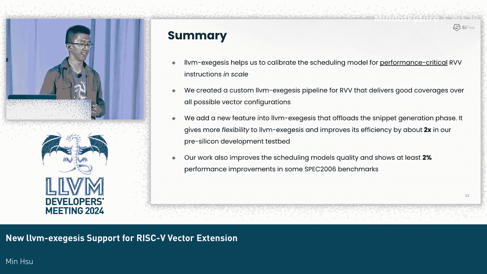

# 【2024-LLVM开发者大会-•-中英】-p54-P54-New-llvm-exegesis-Support-for-RISC-V-Vector-Extension--BV18eNfepENu_p54-

By the end of this talk， I will show you how important extraegesis to risk 5 in terms of performance tuning modeling and especially scheduling model。

 And I will also show you the challenge of adding risk 5 vector support or RVV into extraesis and how we solve it。

 And finally， we identify some bottleneck when we're trying to add the support and on the efficiency of extraesis。

 And I will show you how we scaling up extraesis capability so that it can be more efficient and especially more profitable on pre silicon development。

 which is pretty common for risk5 chips development nowadays。😊，Alright。

 so what is actually Jesusesis。 Actually Jesusesis is a tools that help us to tune the scheduling models。

 Alvian scheduling model is a huge database that contains information like instruction latency occupancy。

 which is related to throughs and what hardware resource it uses。

 It is a really diversifiedify and versatile database used by many components， of course。

 the instruction scheduler， some optimization like machine combiners or even some analysis tools like Al and M A。

 which give you the estimate cycle count of assembly snippets。😊，So before extraesis。

 if we want to improve the scheduling model in Alvan is a real time consuming test。 First。

 we need to re the entire database， Basically， and we compare with the ground truths。

 and this ground truth can either come in from publicly available informations like you know。

 software optimization guide or if like us this how vendor， we just ask our colleagues。

 But the point is， even for us， we have the most accurate information。

 We found that the process of comparison or even just re the whole database is extremely slow。

 and it simply doesn't scale up。😊，Exegees solve this problem by automating most of this process。

 First of all， it will generate a snippets， which is just like a micro benchmarkchmarks。

 and it will generate for each instruction of code。

 and it will send the snippet into hardware execution and measure the performance。 After that。

 it would compare with the scheduling model。 also automatically and provide feedback to the developers on what are the inconsistency between the actual hardware and the scheduling models。

 What we all what the we developer need to do is to just make the modification。

 So it is more efficient and less time consuming and scale up really well。😊。

So let's see an example of this。 So for each up code instruction up code。

 Exegesis will generate something like this。 This is some sort of metadata describing the benchmark we're going to measure。

 including the instruction of code and what register output is gonna measure。

 And this is the snippet that will be used for measurement。 So it's pretty simple。

 It is the same instruction repeat for， let's say 10000 times And here I want to highlight that we can not only measure one kind of hardware information or one kind of performance information here we're measuring the latency。

 which means that when we're creating this snippet。

 we have to wire the output of the previous instruction into the inputs of the laser instruction so that we can create serial execution so that we can measure latency。

 Andesis create this kind of snippet for us。😊，In addition to latency。

 we can also create a snippet just to measure the inverse through， which is just， well。

 inverse of the of this instructions。 So in this case， we need to。

We need to create a parallels parallel instruction， namely。

 the output register of the previous instruction can now overlap with the input of the laser instruction so that every instruction will run in parallel so we can actually measure the throughputs。

And here is one one example that exs report to us of the inconsistency between the actual hardware measurement and what we have in the scheduling model。

 Let's see the bottom box in the bottom here， the blue box is the current scheduling data we have in the scheduling model。

 So it shows latency of three and inverserup of one。 But after the measurement。

 we found that for this instruction， Cp， which is the population count instruction we measure you know。

 two cycle of latency。 So it shows one cycle gap。 So after knowing this information。

 we can go into our scheduling model and and made some modification。

 so that it will be three a cycle for latency。😊，So now we have a basic understanding of what exegesis is。

 Let's talk about the connection of it with wrist5。 So in Alvian scheduling model。

 the smallest units， we attach those laency information or super information。

 It's not a single instruction。 It's a thing called scheduling class。

 And the number of scheduling class in risk5 is way more than every other target in Alvan。

 So we have two times more scheduling class than X 86。

 which means if today we're going to manually tune scheduling model for risk5。

 we're going to spend much more time。 And that's what is so important to use exegesis。😊。

And we found that among these scheduling classes， actually。

 most of them are regarding vector instructions。 And it just so happened that in 2024。

 the vector instruction performance is critical to average application performance。Earer this year。

 folks from Sin core， they have started a really early efforts to upstream risk5 support for Al and Xs。

 and their works covers mostly on schedule instruction。 And in this talk。

 we're going to present our works on supporting risk5 vector instruction for exesis so that we can provide a much more precise scheduling model for vector instruction。

 which is， of course， critical for average application performance。😊。

So that's before we dive into the detail。 there are some unique properties I want to cover on risk 5 vector RVV。

 So here are two really simple vector ad instruction here。 They looks exactly the same。

 But here's a catch。😊，For each RVV instruction， we can actually attach different configuration。

 and this might change during long term。So by saying configuration V type。

 which means we can actually change the element type。

 We can change the register grouping or even the number of elements you want to process。

 These all can change during run run time。 For example， if we use these two V V I instruction。

 we can toggle and change these configuration for these two instruction。😊，So the same instruction。

 although it looks the same， they might have completely different performance characteristics if we change the configuration。

 For instance， for the first V add instruction， we use V V I to say E 32 M2。

 That means we use 32 bit as element size and M2 means we process you know。

2 vector instruction at a time。 So as opposed， the second instruction will have E 64 M4 configuration。

 So this makes these two V add instruction， although it looks the completed it looks the same。

 it actually have completely different performance characteristics。😊。

So to account this kind of implic like configuration bur into RVV spec。

 what Lv cogen and pipeline solved that is to have pseudo instruction and using pseudo instruction to make these V type explicit。

 explicit as offerings。 So for instance， for the V know， the number element you're going to process。

 we put the V as the one with green under and this is for the element size。 and this， well。

 for for Elmo is slightly different for Elmo， we actually split theco into differentelmo。

 So for instance， V have a differentco instruction of code。

 namely different pseudo instruction for differentelmo。

 And because we have a different pseudo instruction for differentelmo。

 we also have different scheduling classes for differentelmo。

 and the rational behind this is that we found usually differentelmo will have completely different performance。

😊，istics， so it's easier to just split the scheduling classes by Elmo。Okay。

 so now let's talk about the RVV support in exesis。 So previously。

 we say that L BN used pseudo instruction to make this implicit V type configuration explicit。

 And it actually makes us a lot easier when we're generating snippets。

 So because now if we want to see the performance characteristics of different configuration。

 we simply need to enumerate different offering values。

 So by saying different offering value like you know。

 different elements size even we all different run demos or something on this pseudo instruction offerings。

 And here it's important that we enumerate all possible or all legal instruction， because later on。

 I will introduce that it actually takes an effort to generate legal know vector instructions。😊。

And after that， after we have the set， one of the advantages of using pseudo instruction is we can actually reuse existing machine pads to do some massage or to。

 to do some cleanup。 For instance， we use the insert V V I pass to insert the V V I instruction and some other stuff to set up that's say run mode。

😊，We also have some custom post processing machine pass to do some virtual register cleanup because we cannot have virtual register We。

 but it generated in earlier pipeline。So previously。

 I say that its actually takes some effort to generate a legal in illegal RVV instruction。

 because in R spec， which is quite complicated。 There is actually some limitation on， for instance。

 we can only use some。 the elements size， you know， some as E W on fractional Elmo。

 Also some the vector instruction dislow overlap register group and not to mention the vector crypto spec has its own set of rules。

😊，Regarding E GW， which is like a group in size or something。In addition。

 there's also another special stuff， not exactly illegal instruction， but in RVB pseudo instruction。

 we have an implicit password through， which is something to do with tell and mask。 But the point is。

 without any actual effort， actuallyesis will actually thought that the pass throughs to be an input。

 while it is not an input。 So when it is creating serial snippets。

 which you need to wire the output into the inputs， it will accidentally you know。

 wire it in the wrong way。 so that we cannot create serial snippet。

 And we also need to take care of that。 So here。😊，It's the whole picture from top to bottom first。

 we feed in the pseudo instruction。 We generate a snippet。 We do some filter in the green box。

 and we we reuse the existing machine function path and do some processing。 And finally。

 have the final snippets per per S E S E W perelmo and per V type configuration。

 This is our custom generation and the whole exesis pipeline。😊，Now。

 let's see some case studies on what we use this tool to， what inconsistent we found using this tool。

Here is two instruction。 we slide up B slide down。 is like sliding the vector element up and down here in the database。

 we say that they are using the same scheduling classes。

 That means they have the same performance characteristics。

 They have the same they have the same laency they have the same throughputs But after we measure we found that first is obviously the laency and the is wrong and by way off like a cycle versus12 cycles。

 But another importcing， we found that is actually not sharing the same performance characteristics。

 like the slide up has its own cycles and slide down has its own cycle。

 So we found that we we use this tool to that we probably should split that into two different scheduling classes。

 So this is a example that we not only correct the numbers， the data in the scheduling model。

 We also it also help us to split the scheduling scheduling class。

 and all these changes has been materialized。😊，To two pagess。

 the first one was split of scheduling classes， and the latest latency number has been merged in our latest P470 scheduling models。

😊，Now， we know how we how useful it to this tool。 There's another challenges。

 This is the high level workflow of al and exercises。 So it will generate the benchmark。

 do assemble and do the measurement。 The problem is， once it start from the left hand side。

 It will not start until it finish the measurement。😊，So here's a problem。 In our RVV cases。

 we found that we would generate significantly high number of snippets by 32 K or even over100 K different snippets。

😊，So it is slow。 It is slow to generate it。 It is also slow to， you measure of the snippets。

 And this， this problem is exacegerated by the fact that we want。

 we need to run this tool on pres development environment， which is we're talking about FGA。

 like R TO simulators。 And in some cases， it is 20 times slower is so slow that we you're like living next to a black hole where the time just flows differently between inside FPG and outside。

😊，So our solution is to split that into two parts。 We do the。

 the snippet generations on normal work works， which is super fast。

 We serialize the benchmark and throw onto FG。 Well， it sounds really， really good。

 The problem is on the serialized benchmark。😊，I naively。

 we kind of like serialize every single object file。

 but the size of this object file will grow significantly into even the 5 GB。 And we're， again。

 talking about FBG。 And so this simply doesn't scale。 Again， the size doesn't scale。

 We have limited resource on FG。😊，So our solution is to compress the benchmark。

 And now you my wander。 So like compressing nowadays。

 even web page you got compressed like what is the， you know。

 what is the novelties we compress and store in the base 64 string。 What is the novelties。😊。

So here's a cache。 Most of the modern compression algorithms and favor repeated patterns in like。

 you know close proximity， meaning that if you have more similar pattern that put next to each other。

 the better the compression rates。 And we just found that we have a benchmark that has 10000 instruction nearly identical instruction placed side by side。

 which mean we have impressive compression rates。😊。

Here's the number On the right hand side of the tables。 We have 99% of space saving。

 That means we only use  one% of the space to store every single benchmark。

 And on the right hand side， it's more impressive because it shows that our solution scale。

 Our solution doesn't care how much instruction Yeah ahead per per benchmark。 The size barely change。

😊，And combined with all this improvement， we found that all of the overall improvement on the exesis improved by nearly two times on both latency and industry cases。

😊，And we also found that this improve our scheduling model。

 So we perform well on the performance of the application。

 And I have to note that although usually scheduling model improvement will improve in order core。

 But we also sell the improvement here on our order core， which is P470s， around 2%。😊，So， of course。

 there is some limitation。 First of all， we haven't really covered the member instructions and also some the。

 you know， instruction， is laency varies by the input values。 And the third one is we require Linux。

 While sometimes we also want to do that on baremat。 And finally， it's more like a future plan。

 I want to open the dialogue dialogue is， you know， we want to upstream our works。 But currently。

 were kind of blocked by the synta core of PR。 So feedback are welcome。😊。

So to some of the some of my talk in this talk， we shows that we use alve and exerciseesis to calibrate the scheduling model for vector instruction in scale。

😊，We create our custom know RV sppy generation and filter in pipeline that will enumerate every single possible vector configuration。

 And we also have improved the general capability of exercises so that it's efficiency both the space and the performance efficiency improved by nearly two per two times。

😊。

And last by not， we also improve the application performance through more precise scheduling models。

😊，And with that said， I'm happy to take questions。 Thank you， everyone。😊，Any questions？

 Thanks for the great presentation。Hi， a couple of questions。 Yeah。

 How long does it take to run all the the benchmark marks on the。Yeah。

 so I think after the improvement。 So before improvement， I will say 12 hours is FG。

 And so after improvement let's say 65，6 hours to run the whole process。

 So to answer to give more details in the cases， which we generate 10 k benchmarks。

 the generation process on a normal computer takes about 7 minutes。 But rest of the time。

6 hours spent on FG。 I think that's the that's the number。

 Yeah and is data available online what all the data that you you gathered through is it Yes。

 so well， the P 471， we just you upstream that I'm glad to tell you that the p6，70。

 which is another of the performance core it's updated scheduling model will also be upstream soon。

 thank you。😊，Any other questions。Just out of curiosity。

 Is it always a sequence of the same instruction repeated multiple times or is is there an ability to evaluate。

 you know。The， the latency when it， when a different functional unit is。

Using the result or something like that。Yeah， so。You're talking about different。

 How do we know which processor resource it's using， or by same functional unit。

 you may like the processor resource， right。Yeah， oh。

 so it actually depends on the capability of your hardware performance counter。

 because I know that X A6， which has gigantic number of hardware probe， it what tells you， you know。

 let's say interger50 execute how many， you know， up codes with that， you can actually knows。

 you know， which functional units or you know， which function units is is used。

 But other than that's，😊，Right now， not many risk chips have those capabilities。

 those hardware performance counters。 So it might be limited。 but if you have that counter。

 I believe ex userss can make good use of it， good use of it and tell you the results。 So yes。Yep。

Do you worry， like on X 86， when you zar through registers。

 there isn't really a dependency coming in。 And so it's faster。 Do you have。

 And I noticed also you're passing both。Maybe it was just an example。

 but you were passing 0 to both the input registers on one of your slides。

 Do you try writing this with like different values coming in and different。 Yeah。

 so that is a really good question， because most of the instruction at is actually6。

 maybe or at this for risk5。 Most of the instruction doesn't really have different purpose characteristic on the value。

 That's why， you know， we fill in0。 But some those do like we are gathered not this one。

 we are gather V we and division。No， also in X division is like single bit is。 So， yeah。

 for this instruction， it does matter。 And X G do provide infrastructure to， you know。

 randomize different values。 So you can do that。 It just for most of instruction。

 we don't do that for now。 yeah， thank you。Okay。Thank you， Mingsh。 Thank you。

