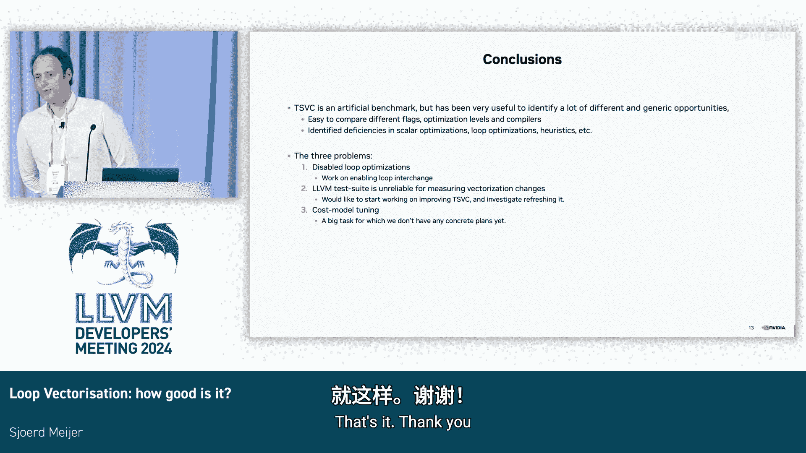

# 【2024-LLVM开发者大会-•-中英】-p55-P55-Loop-Vectorisation---a-quantitative-approach-to-identify-evaluate-opportunit--BV18eNfepENu_p55-

This presentation is about loop factorization， there has been previous talks about loop factorization in previous editions of the Deaf conference。

 there has been talks about fee plan， its integrations， status updates。

 there have been talks about factorization for specific backend or different patterns。

Yeah so the question is why do we need another talk on loop vectorizer well we want to take a slightly different approach we basically want to know how good it is the official title is a quantitative approach to find and identify loop opportunities so that's what this talk is about and this is work that I'm doing with my colleagues Madur and Sebastian who are also attending and in the audience。

嗯。So first， why are we doing this， our motivation， our target is an AR 64 CPU and it has a new CD extension。

 SVE2， which is a short for scalable vector extension。It is not really important。

 so I won't go into details here because most of our findings and conclusions are mostly targetgnostics and very generic。

So the only thing that is kind of important here that for this machine it's a big CPU that efficient utilization of the machine for efficient utilization。

 Sdicogen is important， so that led us to the question okay。

 how well is the loop vectorizer performing？Now to answer that question。

 we took two benchmarks and tried to quantifyntify this and come up with an answer。

 we took T3C2 and Raja Perth， two benchmarks。And what we did is we benchmark this。

 these two benchmarks with different compilers and different options。

 like different optimization levels， so 03，0 fast and disabling vectorizers。And in this way。

 we were finding。嗯。We are finding。Outli us， and we are finding opportunities and questions。

So the next step is then okay， then we want to identify the root causes and create a plan for addressing this。

 So that's what this talk and work is about。I mentioned two benchmarkmarks in this presentation I will be only talking about TSVC in the interest of time and TSVC is short for test suite for vectorizing compilers it's part of the LVM test suite。

 so if you run the LVM test suite then you'll be running TSVC it it's basically one file with 152 small functions kernels so it's kind of loopbased functions and try to stress test different patterns that a vectorizer could handle。

嗯。So this is kind of the problem statement， we took TSVC and run this and compared this。

 and this is a comparison with GCC 13， and this was at the time a recent Alviium trunk version。

So what you see here on the left hand side， these are all the cases here where GCC is faster。

 so here you have cases where GCC is 2 x faster， 3 x faster， 4x。

 and there's one that is of the scale faster。We have cases that are similar sorry yeah same or similar performance。

 different things could be going on here， they could both TCC and Kang could vectorize it or they could both be scalar。

 or one could be scalar and vector。Could potentially be interesting cases。

 but we have not looked at it。 And here we have cases where Kang is faster。

 Now we were interested in making improvements， so we only focused on kind of the left hand side here。

 So these regressions， we classified them as the interesting cases。So with this data。

 we then created a kind of a short list， a list of outliers， top outliers。

 so this again is Kang versus GCC 13， so we took all the cases that were at least one and a half times worse with Kang。

And if we look at this， the top outlier is a 16x regression and the reason is that Klang is not doing loop interchange which can enable vectorization。

 this is available in GCC and it's not in Kang， which results in a 16x regression。

 GCC knows another trick it can do outer loop vectorization and that results in a 4x regression。

 there is kind of inefficient cogeneration vector cogeneration for control flow。

And that results in a 3 x regression。We're not interlaving enough。

 So interleaving is essentially unrolling of the vector body。

We are not doing that sometimes SOP vectorization is more profitable。

 so we have a case where the SOP vectorizer was not performing well enough and that was a two and a half x regression。

L peeling， kind of another enabling optimization。 We are not doing that。

 GCC is doing that a little bit better。Then maybe surprisingly we found also some scale optimizations。

 some test cases are not really meant for vectorization。

 so here you see what's my cursor here we see a predictive combininging that is also an sorry there's also an optimization in GCC and we're missing that then we have some kind of basic cogen unnecessary signine extensions getting in the way of things。

Again， we have a case of outer loop vectorization， which is good for 2 x regression。

 the SOP vectorizer， and all sorts of issues related to cost model where we should vectorize or we shouldn't。

 and that results in one and half x regressions。So that was our list。

 If we try to cluster this a little bit， then we see a class of problems related to loop optimizations。

So we're not interchanging， we are not doing out loop factorization。

 one way to achieve that would be enabling on Ro and gem followed by SOP factorization。

 we're not doing that。Lop peeling needed。 We told a few tricks。The loop vectorizer itself。

That's mainly tuning in terms of more interleaving and epipilo factorization。

 Apilo factorization is available in， in。In Kang， it's effectively disabled because of a very high threshold。

 which is being addressed by。By apple。And then all sorts of cost modeling issues， cost modeling。

 whereas for some cases we shouldn't vectorize because it's not profitable。

 or we have also the possibility to go fix with or scalable effectization。

 all these kind of decision making， and then maybe surprisingly we also found some scal optimizations like predictive cominging。

Now， comparing with with。With another compiler is easy to do。

 it does not tell us what the best thing is that we can do。

So we then did a manual exercise where we basically looked at source code and made manual modifications to the source code。

 and in this exercise we restricted ourselves to two loop optimizations。

 look distribute and interchange， and we tried to modify the source code and see what the best thing that we could do。

Now， we found。That we can vectorize more。 So in this table here。

 the both cases are things that we could now vectorize， which we couldn't vectorize before。

 And the other cases， see higher gains。 So the first row is， if we enable look distribute。

 we can get a。Nearly 36 x improvements。For some cases。

 when we combine mine loop distribute and interchange， we get a 22 x improvement。And so on and。

And the two bottom rows， when we combine loop， distribute and interchange。

 we can enable more vectorization for different cases。They were manual exercises。

 but theres really no reason why this could not be done by the compiler and with the transformations。

 So this is basically saying that we leave a lot of performance on the table。And really， a lot。

We already did some work， so this is kind of our work that we did during the summer。

 so when we started here there were 37 cases where Kang was worse。

We started working on this and after some of our pictures landed。

 we brought that down to 26 and finally to 24。The number of cases where Kang was better was going up from 90 to 24 I think here is。

It's just a blip in the buckets。And the number of cases where the performance is same was going up from 96 to 102 and 106。

 so all these kinds， all these signs showing that we are making improvements， these improvements。

Basically fall into kind of two buckets。All these the improvements that we made here resulted in 2X improvements。

 and they were the improvements related to cosmo L， heuristics andcogen。And。

What we want to do next is kind of to enable the performance improvements that will go beyond 2 x improvements。

Now， I wanted to give you a quick impression of the kind of things that would give us two X improvements。

There is a lot of kind of tuning that can be done in sub sorry subtart do CPP。

 There's all kinds of parameters that can be tuned。

 The first one that I mentioned is max inter leaf factor。And。

Which controls the unrolling of the of the vector body。

 Unrolling that could result in better utilization of the。Both dis pipe。The default is low， it's two。

 but kind of a good rule of thumb is that the default should be equal to the number of vector pipes that you have。

 So that's something that we increased。 and again， I'm just showing you because it is something that you could easily check for for your target。

 There is kind of another thresholds to control the generation of scatter instructions。

 we tuned that so that actually for some of the cases they would not be generated because that's faster。

Some changes to the loop factorizer to be a bit more specific， the。U。The cost model。

 the way the cost model works is that it evaluates different alternatives for different vectorization factors。

 it assigns the cost， and then it picks the lowest one。The question is。

 what do you do if the if the minimum， sorry， if if there are variance with the same performance。

So we introduced this hook that you。Where you can then steer if the cost model is undecided what to do。

 and that resulted in a very big improvements for us。If you interleave more。

Then the next thing that becomes really important is epipilo vectorization。

Because if the iteration count of the loop is low， it could be the case that you will not enter the vector body anymore。

 but just the epilo loop。And in that case， factorization of the。To tell the。Is important。

 So we did some work there to。To enable that。We did some work for loop peeling to。

So that that will then also trigger more factorization。 And as I mentioned， we have all sorts of。

Different patches to。In the cost model that then allows more factorization。During this exercise。

 we identified three problems。This is the first one。 I'll talk about the others in a minute。

 I already mentioned that we had a lot of cosmoing patches。And。

It's's kind of the first problem that we identified。 The Cos model。

 The way it works is by basically recognizing I snippets and assigning a cost to it。

Most of the patent are handwritten。 it's not really exped to a low level IR。

 So you don't know really what you're costmoding。But then the other problem is that we're doing this on IR。

 and it means we're not looking at any of the information that is available on the backend。

 like latencies， throughput and resource descriptions。We don't have access to that。 Nowadays。

 what this is。Because these are mostly hand。Written patterns， there's always a case missing。

 So for new CPUs or tuning， it is kind of an endless tuning exercise。

 and it's lacking quite some precision because it works on IR。Now。

 for the other problems that we identified， we will have ours。 This is more like。

What is bothering us so I don't have a concrete ROC yet。

 but in an ideal world what we have instead is kind of a set of test cases where we map IR snippets to cogen。

 for this cogen we can extract metrics for example with MCA。

 and then we can populate a costtable database the benefit of that is that you can then update it。

 if the cogenion changes or for a new CPU you just generated that this kind of the idea that we would maybe in the future like to explore。

So now moving on to beyond 2 x improvements， what do we need to do。

 we kind of fix the basic cosion issues， what's next。Well， as I already mentioned in the beginning。

That's probably loop optimizations。 And there are quite a few of them。 So in LVM。

 there is interchange on role and GMm， Dis and fusion。 And from this list。

 we will mainly focus on interchange。And I will go into details。

 but loop interchange because it's kind of a general transformation。

 it's good for data cache improvements。And it enables factorizations if dependencies get in way。嗯。

And perhaps on row and Ge 2， as I already mentioned。

 to because it can enable it can achieve out to loop vectorization if it's combined with with S。

 O P vectorization。 So that makes that a very interesting。😊，诶。Transformation。

Now next problem is loop optimization。 so all these as I mentioned。

 all these loop optimizations are available， the problem is they're all off by default。

 So all of them on Ro gem interchange fusion， distribute， they're all off。

 So the question is why are they all off we can't we do this on in Alviium。Well。

 there is an element to that because。嗯。To do for the legality of these loop transformations。

 we need to do data dependence analysis。And that means that we are interested in finding the access patterns to the arrays。

 so in case if they are multidimensional arrays， we would like to recover these multidimensional array axis。

 problem is that most of this information is gone， it's flattened。

 so we need to recover this information， which is what the delinealization is doing。

That is made more difficult because of IR simplifications。So that is making that a more difficult。

But we think it is O enough to。Recognize and enable quite a few cases。

Now the other question you may have， okay this is all disabled by default， is it not important。

 is this only fun for benchmarks but not for real life code， Well。

 that's something that we can measure。And that is the reason why we would like to start with enabling loop Interchange because it's very generic。

 this is just a snippet from the LVM test suite where it triggers in a lot of cases。

 of course the question is what are the performance improvements I will get back to that in a second but loop Interchange because it's relatively simple and straightforward as a transformation。

And we would like to use this to get basically a foot in the door with loop optimizations in AlVM。

So what we need to do is we are aware of the problems raised against both components。

 so what we want to do is fix the problems in interchange， in dependence analysis。

 and collect compile time numbers and see what we see if we can get loop interchange enabled just before this staff conference we started a RC about that。

Now。The last part， the last problem that we have is evaluating all of this。 so vectorization。

 we make changes， how do we know if it's better or worse so kind of the last problem that we identified is the test suite there's kind of a famous research article that says why most published research findings are false。

I will probably go as far as saying that the same is true for the LVM test suite。

If you rely on the AlVium test suite。For vectorization， you are probably making the wrong decisions。

 The reason is， in the case of TVC。 all kernels are in the same function。

 if you make changes to one function， that may influence behavior of a function that is unchanged。

 And that's because of code layout issues that kind of things。 So there's a lot of noise。

 So we found basically that if there's a change of about 20，30% in a TVC kernel。

 it's probably not real， it's probably noise， at least in our cases。

 So if you just run the test suite 1 to three times and see a 20% improvement in some TVC kernels。

 it's probably not real。Other problems is the test feed is very old。

 I had a patch to document all the apps in the。Part as of the multi sorry， the multisource benchmark。

 And I tried to find the original sources of it。 most of them are not available。

 The apps run for a very short time。 I think most of them measure more IO than anything else， so。

That's quite problematic for evaluating this。 So what we want to do is first we want to modify TVC。

Place each kernel in its own function， to minimize noise。And we want to add different benchmarks。

 We think Rogerja Perf is good is a good one。 It's far， small， more representative。And。

We also started an RFC about this。So to conclude， T SVC is is an artificial benchmark。

 We appreciate it， but it has been extremely useful to find all sorts of generic cogen deficiencies。

😊，Its so it's very easy to compare flags and optimization levels。

 And all the things that we found in these artificial benchmarks are all generic cases。 And yeah。

 so I talked about the three problems。 All loop optimizations are disabled。

 We're going to work on fixing。Depenence analysis and hopefully get loop interchange enabled。

Hopefully soon。The LVM test suite is unreliable for us to measure performance。

 so we'd like to start working on adding more representative benchmarks to it and actually fix some of them。

And the one that we have on our wish list is the Cosmo。

 We think something needs to be done about that。 but that's for another time。Is it。 Thank you。

How often do you see a regressions when performance drops because something was vectorized。

 which was not supposed to be vectorized？Yes， often。

 And that's all the costs modeling work that you do。 So you hope then to tweak it and。

Fix that case and hoping that the rest doesn't break， yes。Yeah， very often。

N Hamov from University of Alberta， I'm very happy to see your work at this characterization and I'm happy that in the end you point how artificial TSVC is but I think that everybody has to realize how really nonrepresentative it is it was created by David Callahhan Ter six years ago as a collection of 100 loops from Fortra and the idea was that they should be different and difficult to vectorize this is not what you want from the benchmark right you want to be representative TSVC is not representative of anything。

But that snapshot from 1988 of loops that were very different from each other I fully agree。

 but the thing is the all things that we fix， we verified this also that we are doing the right things with other benchmarks so yeah but there's this point when you are measuring something is what is it that you're measuring is it representative That's the point that they want to make Yeah sure fair。

So on the point of disabled loop optimizations， I imagine they're disabled because of they cause correctness issues。

 so if we just re enable them。嗯。Have you found any。

 any correctness issues with more extensive testing。 So for loop interchange， for example。

 we are aware of four problems there in in the Github issues。

 therefore about 4 or five issues raised against loop interchange。 Two of them are simple asserts。

 One is slightly more serious。 So that's kind of the order of bugs that you think about。

 And that's not unusual。 And I think I also think that a lot of。

At least some of these loop optimizations are enabled in downstream compilers。

And what I want to say is they are used。So I think there's quite some interest， I think on the RFC。

 I think it shows that there's quite some interest in interest in getting this enabled。嗯。The really。

 the main thing is dependence analysis。 That is。Fretile。Hi， quick question。

 have you considered gathering this data from spec too。Yes， yes。 But spec is。Yes。

 there's one benchmark that is good for factorization， x264， the rest not so much from spec FP。

 the for term benchmarks are really interesting for factorization because they are very suitable for factorization。

 so I don't have the data， but yes， we look at that。Good work。

 You mentioned that you did loop interchange for vectorization。 Did you also do loop unrolling。

 Was there any。For recization。I think， look。Well， I was going to say loop on rolling is kind of part of the vectorization strategy。

I mentioned。Excuse me。 interleaving， which is some sort of unrolling。 And that in our case。

 we just wanted to crank up the heuristics a little bit。So， yes。Yeah， thank you for your talk。

 I have one question。 So you mentioned like the Mosat transformation was done manually。

 have you considered any sort of like clang ML front end like like clangayre or like ps to like do maybe some of these like loop transformation at MLO level and then lowerring it to LLVM and then maybe LLBM like recization can kick in very good question。

 Yes， we talk about this quite a lot。 Yes， it's very interesting because some of the objections hopefully make some of these transformations more easy。

 The question is cosmoing， I think So when you talk about vectorization。

 you also have to think you also have to start talking about。

Cost modeling and I don't think that is available on MLIR。

 so you have to kind of raise all of these analysis to the MLIR level two， I think。

But it it's a good point。Yeah。Again， thanks for the talk Just have two questions。

 What optimization level did you use， Was it02 or sorry， this was fast so fast Yeah。

 and when you talk about your examples for loop distribution， you said you。

You distribute it by hand this， but since we have Luke distribution in LLVM。

 how would it compare if you turned it on？I don't know it's the answer， but that's on our list too。

 we kind of our short list is Lupin， sorry， interchange。

Onroll and gem because it's one way to achieve outer loop factorization without implementing that in the loop vectorizer and yes。

 distribute is high on the list。诶。Yeah， yeah。啊。因为。I think。Was it Preston。

 who was working on dependence analysis like over a decade ago。

 and I don't believe it was ever used for anything because of some problems。

 Do you know what those problems are， And like， do you have an idea of how to fix them。And also。

 I suppose it's going back to the previous question before， like， you know。

 is it really the right thing to use for for these kind of things or do you think there might be something else we can use to get you that information？

Yeah， so the the problem with dependence analysis''s， let's say it's not broken。

 not fundamentally broken。 So we are in the process of improving it。Again。

 I think there are about two or three issues raised against dependence analysis。

 one of them is likely can result in miscomlins， and Sebastian in the audience is fixing that。So。

 it's not。It's there。 and it's， and it's stable。诶。It's fragile because we try to recover this type information。

 the array axis。 So fragile， in a sense， not that it's miscompiling。But it's missing cases。

So what wed like to do maybe that' something we are thinking of is trying to。

 maybe with some metadata or instrumentation， is to propagate some of the type information。

To IR so that we don't need to recover it。嗯。That's our current thinking。

Okay I think we already ran out of time。 I think a loop of vectorization is a very popular topic。

 Yeah， if you have any questions， you can talk with mayor offline。 Thank you。

 We will start our next presentation in three minutes。 Thank you。

