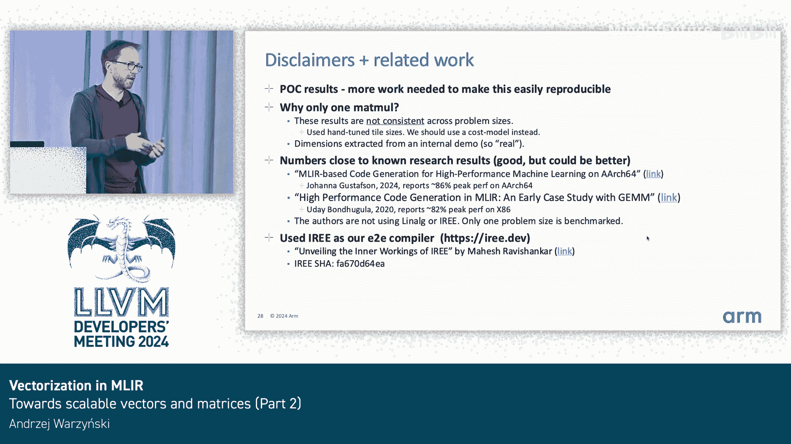

# 【2024-LLVM开发者大会-•-中英】-p56-P56-Vectorization-in-MLIR---Towards-Scalable-Vectors-and-Matrices-(Part-2)--BV18eNfepENu_p56-

Okay， thank you very much。 So yeah， this is presentation on vectorization MLl IR。 This is part2。

 So I'll start by quickly comparing this presentation to what we did last year。

 So last year we focus on the high level overview of the vectorization process。

 we also use mostly we used just a little ma as our example。

 And when it came to scalable vectors and S VN Sme extensions。

 that stuff was very much work in progress。 So this year。

 I want to go into finer implementation details。😊，Also cover examples other than lineard Mamal。

 when it comes to scalable vectors SM NS SV， there's actually been a lot of progress。

 So there's a lot to share。 I actually have some numbers at the end as well to show you performance numbers。

 Important， last year， we co to this year is just me on the stage。 But obviously。

 this is work of many astream contributors。 So thank you very much for that。😊。

Just to set the context， we work。 this is a vectorizer for the lineage dialect。

 lineage Ma is the most prominent example of an operation。 We operate。

 This presentation focuses on lineage on tensors and we cover both static and dynamic shapes。

This slide is actually something that the ego presented last year。

 It gives you a high level overview of the steps of vectorization。

 It's insanely helpful I always suggest， you know， referring to this because it gives you a very nice idea of how things are meant to be glued together。

 Today。 I'm only focusing on step 2。 but I'll be making references to other steps as well。

 Hopefully this is fairly selfexplanatory。😊，So the lineage vectorizer itself。 first question is。

 how do you use it， How do you drive it。 And that's pretty much everything。

 there's a C plus plus driver hook that you can use。 that's on the right hand side。

 the vectorized method， fairly self-explanatory。 When you look at the implementation of of this method you'll see calls to hooks like vectorized as li generic。

 That's actually key that's probably the most important method。

 So for those of you who not familiar with the lineage dialect。

 pretty much every operation in the dialect is a lineage generic and then not Mamal is just an alias。

 also known as like a named op。 So that's why this method is so important。

 We also have things like vectorized convolution。 because convolutions are a different special。

 but I should merge the two methods together。 We also have patterns like pretty much everything in the layerR is either operation or a pattern。

 So we have patterns for vectorization to help with other things as well。😊，Now， for prototyping。

 you would rather use the transform dialect operations that's on the left hand side。

 that's much easier to use and and helps you play with things a bit quicker。

 We have two operations that you can use。 We have vectorized。

 which simply caused the vectorized hook on the right hand side。

 So it's like almost one to one mapping。It's fairly low level。 You would mostly use it for testing。

 The other one vectorize children and apply patterns。 It'll also call the vectorized method。

 but also apply various patterns， including chemicalization。

 So the output you get from that is much nicer， easier to read more like an user friendly。

 You you can also apply to actually a bigger chunks of code like a function as opposed to the vectorize itself。

😊，And。So let's try to vector a linearage generic。 This is actually a matrix mounted location written as a generic。

😊，So when the vectorizer sees something like that， it'll look at the input and output arguments to linearage generic and it'll rewrite them as a vector transfer read and vector transfer right So vector dialect operations then itll go into the body of the line generic and vectorize each one operation at a time。

 So for R of myF， itll just rewrite that as a multiplication on vectors because we can do that RF dialect supports vectors for addition。

 it actually replaces that with vector multire because it can see that we are doing addition along the reduction dimension。

 there's no reduction RFF。 So we use the dedicated vector dialect operation for that。😊，It。

 the vectorizer can also deuce the sizes to use。 So you can see here we use vector。

 which are vectors， which are two dimensional。 Obviously， later。

 these are decompos to something smaller。 but the vectorizer's job is pretty much done。

Things are a bit trickier if you take the same example and replace static shapes with。

Dynamic shape that's on the righthand side。 at this point。

 the vectorizer doesn't really know what shapes to use。

 And you might be thinking this is not really my problem。 but going back to， you know。

 the overview of the vectorization， there's the first step which is tiyling。

 You will normally tile things so that fit nicely into your say vector registers。

 But these will often not much nicely not will not divide the problem size nicely。

 So you will end up with some size calculation within within the loops and that generates a success values and that generates dynamic shapes。

 So you have to， you do have to worry about these things。When you have dynamic shapes。

 you have to specify the vector sizes， when you specify the vector sizes。

 the vectorizer has to use masking because it has to be conservative。

 it needs to accommodate for the worst case scenario。And。

And this is an overview how masking works at the vector dialect level。

 There's diagram on the right hand side， which is a more like hardware I sub view just for reference。

 I' will focus on the left hand side， which is the vector dialect view。So。You start with a operation。

 which is not mask， for example， vector out product。 That's a fairly prominent example。

 If you want to mask it， you just wrap it in a vector mask operation and you also supply the mask itself。

 Now， this is fairly straightforward。 but it reveals what the issue is， you have to supply the mask。

 And in order to， to， to。To do that， you have to calculate the mask。

 And if you do it on every iteration and your most inner loop， you know， that's expensive。

 These things are not for free。 So you want to avoid that。 And if you actually analyze the loop。

 for example， for matrix multiplication， you will see that you only have to calculate the mask for the very last iteration。

 So， so。Ideally， you should avoid that。This is the technique that we use。 I like it a lot。

 That's loop peeling。 There's a link on this slide to a full example upstream。

 that wouldn't really fit on this slide。 But the idea is I think most of you will be familiar。

 you split your loop nest into the extract the main loop， the remainder loop。

 The idea being that the main loop always operates on full vector registers。

 and then you have the remainder for the rest。 Now。

 the idea was to get rid of dynamic shapes and the need for masks in this example。

 the dynamic shapes are still present because the loop peeling itself doesn't get rid of dynamic shapes。

 but it creates a form that's really easy to analyze。

 also know that in here that we have steps that are static shaped。

 So it's easy to analyze and rewrite it at least the main loop in a form with web static shapes。😊。

And。Now， I wanted to change。The gears a bit and talk about the vectorization of tensor extract。

 This is one of my favorite examples in the vectorizer。😊。

Tenssor extract is a very important operation。 It simply extracts reads a element from a tensor。

 So that's super common。 When we want to vectorize that。

 we need to decide what operation vector operation to use。

 and that boils down to understanding what access pattern we are dealing with。 Now。

 this is an illustration using a 2D matrix reading into one D vector。

 And you basically have these four scenarios。 I highlighted one of them is not yet implemented。 But。

😊，Important thing is we need to know whether this is contiguous load。 gutter load。 in particular。

 you know， gatherter load is always safe。 It's always correct。

 pretty much at least in the cases I' have seen， but it tends to be the slowest option。

 If you actually are dealing with continuousiguous load。

 you do want to recognize that and generate that instead。😊。

So this is the original example from two slides before。

 where I changed it a bit to highlight in which cases you have a contiguous load。

 in which case you have a gatherter load。 I'm not going go go over this。

 This is mostly for reference。 But I think you see what the idea is the vectorizer will basically analyze the indices that you use to access elements in a tensor and decide which access pattern it's it's really dealing with。

😊，And。But that's pretty much it what I had about to vectorize the generic stuff。Now。

 I want to jump and give you some updates on supporting scalable vector extension and scalable matrix extension in the context of the vector raizer。

I'll give a quick overview of S V and S&E， but very brief one I presented this last year。 so for S V。

 the key thing is that rather than saying my vectors are 1，28 B white。

 we say they are a multiple of 1，28 B。 And it can be multiple of 1，2，4，8 and so on。 On this slide。

 it's 52 bit。 So the multiplier is 4 We call this multiplier V scale。

 that's quite important from the point of view of L VM and cogen。

 so because I'll be referring to that later。😊，And this approach allows us vector length agnostic programming。

 and that's key that makes a lot of things very simple from like end user perspective。

 but it does bring unique challenges to colgen and compiler design。呃。SmeE builds on top of S V。

 It adds this square storage array that you can use as an accumulator in out product operations。

 And that's that's super key from our perspective， from the perspective of Fl knowledgege。

 because this makes SMme a matrix multiplication accelerator。 And this is what we want to。

 this is what we want。😊，And this square storage array is has scalable size in both dimensions。

 So that makes it a bit challenging。 And it's also split into these virtual tiles on this slide。

 There's four virtual tiles。 The number of virtual tiles depends on the underlying element type。

 And that's kind of similar to what you have with simply registers where you want to。

 you know ask a question。 How many elements does it hold。

 The answer depends on whether it's I8 I 32 So it's， it's kind of like that。So。

The new stuff for both S V and SE that's that's related to masking。

 So going back to the example with tiling。 And this is Mamal tile specifically for SM ME。

What's important in this example and different to the previous one is that because our vectors and the accumulator are scalable in all directions。

 that translates to steps in these loops being scalable being as to same values。

 That means that it's much harder for us or for this to escape dynamic shapes。

 So removing moving and dynamic shapes mean mean masks。

 and that makes the whole analysis and cogen a bit trickier。And。

And the previous example would normally translate。 So this is a bit lower level version after a few levels of lowering。

 you would normally end up with this a for loop， which has been peeled。

 So we know that we always operate on chunks of a vector register。 and we never go out of bounds。

 But we have to be conservative。 And we have something along the lines of extracting element from a vector。

 calculating mask based on the size， using the mask for some vector calculation and then storing things back to the output tensor and never finished mask。

 But if you read this example， you'll see the mask is always constant and it's not really needed。😊。

And the example should， really。Look like this。And we do achieve that。

 We have extended value balance analysis to understand what v scale is in scalable sizes。

 I'm not going to cover it myself。 There's a great presentation by Mattiaas from earlier this year。

 And also， there's a link to example that you can see in tree。 That's the technology that we use。

 It works very well for us。 So we actually are able to get rid of masks in， in many cases。😊。

So this optimization is actually important for both S V and SMmeE。

 This is something that's specific to SMme E。 So that's part of the lowering pipeline，30 low level。

 so。As I mentioned earlier， S And E has this square storage array。

 And when we tile things at higher level， we simply assume that we're going to use the whole thing。

 So we just use a whole big。Storyory， however， at the hardware level， we have virtual tiles。

 So we have to switch to something that matches what's at the hardware level。

 Thats so we need type the composition。 and that's。That's basically。This part。 So basically take。

 say you start with an outer product that accumulates the whole storage array。

 And we just decompose it into。four copies of similar operation but operating on smaller chunks of vectors and the storage array。

And。😊，This is another important part of the lowering pipeline。

 This is probably the most exciting one， and。😊，When we use SME and we use virtual tiles our interface that we deal with is our LVM IR intrinsics。

 These require for us to specify which tile to use。 There's like four tiles for I 32。

 And we have to say which one to use。 And we want to do it in a way that we use all of them。

 There's no contention。 There's no spelling and filling so that， you know， performance is good。

 Accur is there。 So we basically have implemented a。Virtual tile allocator。

Building on top of Liveness API that was already available in。In an MLAR。

 and you have an example here where this operates at the RME level at the controlflow dialect level because that's easier to analyze on the left hand side。

 you have example without T Is on the right hand side。 the T Is have been assigned as attributes。

But I also want to cover some， some performance numbers。

 And I should emphasize this exercise has been more like a bit of like a proof of concept trying to understand this is quite。

 you know， early on。 And we haven't really spent that much time trying to， to chase performance。

 And there are a few caveats which I list on these slides。And。

So I start by comparing by benchmarking matrix multiplication and convolution。

 important note last year， we didn't have scalable vectorization for convolutions。

 We already have this year。 we do have vectorization for De convolutions。

I will start by with mappodo。 So on the left hand side。

 we have my comparison of my naive C plus plus implementation versus Erie， which is our。

 which is the end to end M IR compiler that we use。 And also AL arm compute library。

 which is the performance library from Ar。 And as you can see， we reached for this example。

80% P performance， which is a really good result that we are happy with。😊，On the right hand side。

 I am comparing。 I want to compare。 I want to evaluate how good scalable vectorization is。

 and I do that by switching from vector switch are 128 B wide to vectors which are 5 bits wide。

 that translates to switching from S V E to streaming SV streaming Sv is basically Sv that's attached a SMmeE core and it's all implemented within one emulator and' just jumping from host CPU to SMmeE unit。

 So increasing the vector size from 128 to 5 in ideal world， I would see for speed up。

 but Ida low and know， there's other things that overhead 2。

6 is something that does make us happy because it proves that the compiler is doing the right thing。

 And this is mostly to the compiler。😊，嗯。Like I mentioned， there are caveats。

 I'm benchmarking only one map。 What I would like you to take from this is that I achieved 80% performance for a Ma。

 Please don't expect that， you know， we will download Erie， run it on a。😊，A 64 any other machine。

 L you get uniformly 80%。 That's not。 We not there yet。 There's more work to be done。

 but this is already very promising。I also want to evaluate SME Cogen specifically。 So for this。

 we actually built a application internally， which is a a custom convolional neural network pipeline。

 We wanted to see whether we can actually build something complex lower to SME。 So yes。

 we have succeeded。 So that's that's a really important milestone for us。😊，And we first。

 we evaluate it。 So when you look at the graphs on the right hand side， first。

 we evaluate on actual hardware， which is Neverse V1 chip。 and we compare simply Eri。

 So M AR cogen versus versus X impact， which is a library within the Android ecosystem。

 And we manage to get very close performance， which means that tells us that Eri is doing a really good job。

😊，Next thing I want to check is moved to an emulator with host CPU and SMmeE accelerator and first run things on the host CPU within the emulator。

 then switch to SMmeE。 And I should see an I speed up because I'm switching to using this square storage array。

 but also my vectors are getting wider。 So in this case， we see3 x speed up。 which proves that again。

 the compiler， the cogen is correct。 It does the right thing and performance scales So were very。

 very happy with this as well。😊，And that concludes my talk， Thank you。Hi。

 so you mentioned about the dynamic shapes and there are scenarios where you cannot absolutely guess it。

But in such scenarios， does it make sense to multi version your code and。At run time， you pick。

One particular version based on what the shape is in coming。Wait。So。

That's something we faced at Intel a lot of times in the Nirvana group。 Nrvana is no more。

 but that was one problem that we faced a lot of times in the machine learning models。

You can do that。 we haven't。 I think I would say， I feel we have the luxury of extremely good support for masking。

 So things just work。 The problem is the performance。 But then， you know。

 the way we approached it was to let's see。 I mean， these masks can be removed。 They should be。

 and and we did succeed with that。 So we happy with this solution。 But yes。

 you totally can I haven't tried it myself。😊，Within this flow， if that's your question， okay， yeah。

 thanks。Hi， I have two questions。 The first question is。

 what's the main reason for the difference in perf right now for handwritten kernels versus the once you are generating with the。

lowering through line knowledgech。So there's， there's multiple things。 Yeah， think。

I'm listing something here。 One thing is we don't have a cost model。

 So I was actually mentioned in the previous talk as well。 We missing cost model。

 So the tile sizes that I use， actually， for this example。

 I hunt tweak the tile sizes for this specific problem。 So I was able to push the performance to 80%。

 That's something that's missing。 We don't have cache level tiling。

 The other thing is these libraries have been know developed over the years。

 but by people who have very deep understanding of the underlying micro architectureit。

 we not doing anything specific to micro architecture itself， It's more generic。 So there is that。

But perhaps， you know， we， we need to accept。 My feeling is we need to accept that， you know。

 these libraries will be super fast and matching that will be hard。 But the question is。

 do we want to go as far as the library is that the goal。Thank you。 The second question is。

 you are doing。This DNAA kind of insertion where you're doing。

 I think can you go to the slide where you have three tiles with the IR。 Yeah， this one。

So are you using some sort of DMA to move this in the architecture or you have this pass which is title allocation pass。

Do you think about doing fusion before it using linealge fusions transformed by fusion ops。呃。Yeah。

 we do that。 We do that。 It's not very sophisticated yet。 But yes， I mean。

 there's a lot of generic stuff that just works， you know， when。

This is fairly low level where we have SMmeE ops。 So if you're asking about。

RMS semi dialect specific optimizations。I don't think we have。 I don't we don't have an specific。

 like these tile location。 There's a few clever things， but nothing too sophisticated。

 it's just like calulating likeness Rs and trying to make sure that you don't overlap。

 So we don't anything this level at high level。 Yes。

 just a follow thing like do you run into issues when you use things likelinol Gen and these transform directs with fusion like I don't see recent developments in those。

 So for example， if I try to fuse two kernels which have reduction operations in them。

 I see issues in them。 things like that， do you encounter them。And how do you deal with them。

 Do you have internal updates or。We use whatever we have access to Appstream to be honest。

 We haven't really spent that much time。 So this is bit high high level， to be perfectly honest。

 we spend most of the time focusing on functional correctness and getting， yeah。

 this is slightly high level。 So we haven't spent much time looking into that。 But yes。

 I'm aware as things that it's quite a few things that could be done or word better。 Yes，right。

 thank you。Hey， my question is about your last slides about the SME result。I just wonder， well。

 good good work。 I just wonder you use emulator for SME。

 but do you know that you can actually run SM ME on real hardware Apple M4 processor come with iPad poor。

 I mean， they released in early May or some， you know， I。

 I think that's a question I would divert Apple。I would like to say the the performance on the real silicon yes。

This is a custom design that's internal。 Obviously， there's little very like can share。 But yeah。

 that's， that's internal。 This is what we have for protoping experimenting。 I felt。It's not much。

 but I feel it's really interesting as well to share。 And shall we。 But I can't really， you know。

 I think Apple are the best to comment on their products。Yes。Hi， so two with question。

 One is about the cost model。 the otherwise is about the compilers beyond Erie。 So in the cost model。

 what do you think is like the lowest hanging fruit approach to have some kind of cost model。

 I it possible to for example， reduce the target machine information from theLVM backend。

 And the second one is compilers beyond Erie， if you would like to target this your MLIR based compiler。

 I it does it boil down to basically targeting linear to tensors。

 because that's the primary MLIR substrates or is there anything else worth knowing。

So for the cost model， you know， there's actually ongoing efforts。

To add target descriptor and this kind of mechanism to， to M I R。

 I think it's mostly our colleagues from Intel。 I think they are around as well。

 So it might be worth chatting with them。 So that's ongoing for。

 for like mainstream multiplication specifically。 Yeah， this is。I mean， it's not super complex。

 It's just nobody has spent time。 I mean， you just look at the problem size and then your cache sizes。

 you have number of registers and basically that you calculate the sizes。 you know。

 there's I also refer to a few papers well， one specifically in which they show what what the process can be so。

It is from what I can tell。 It's just the amount of somebody sitting down and and writing it。

 which just haven't had the time。 I mean， you know。

 getting lowering for SM M E specifically has been big enough challenge and destruction。

For your second question， yes， we use Eri， but yes。

 Eri builds on top of this lineage plus sensorsor abstraction。 You don't have to use E。

 We just happen to use it because it works very well for us。

 And there's a lot of things to get for free。 I mean， it's that easy task to build these pipelines。

 provide one time， there's a lot of other things。 So by， by using Eri。

 we have the luxury of being able to focus on other problems。

转范球。Let's take one last question。I'm glad that you have this slide here。

 If you are look at the UK work。😊，Then you have to look at our work that came after that。

 So the main point here is that you need to do packing。

 you need to do data packing and we have implemented data packing the MLLIR has not me upstream。

 but we have an artifact CGO 2023 and you get performance。

 you can get performance up to 95% of the best libraries Okay you don't get 100%。

The trick is that we did for IBM power 10。 So that's why a number of people don't know about it。

 Yeah， because not the most popular processor out there。 but we have done it。 So packing。

 there is support for packing an Eri。 Tensor there are there's sensorsor packed Tensor unpacked。

 So there， that's available。 I'm focusing on scalable vectors。 and that's work in progress。

 but that's， that's coming。 Yes， you have to combine pack with what you said about the size of your cache is in how you locate them。

That's the plan。 That's the long term plan。 The buds。Okay， thank you， Andre。

 for the great presentation。 We will have a lightning talk in two minutes。 Thank you。

