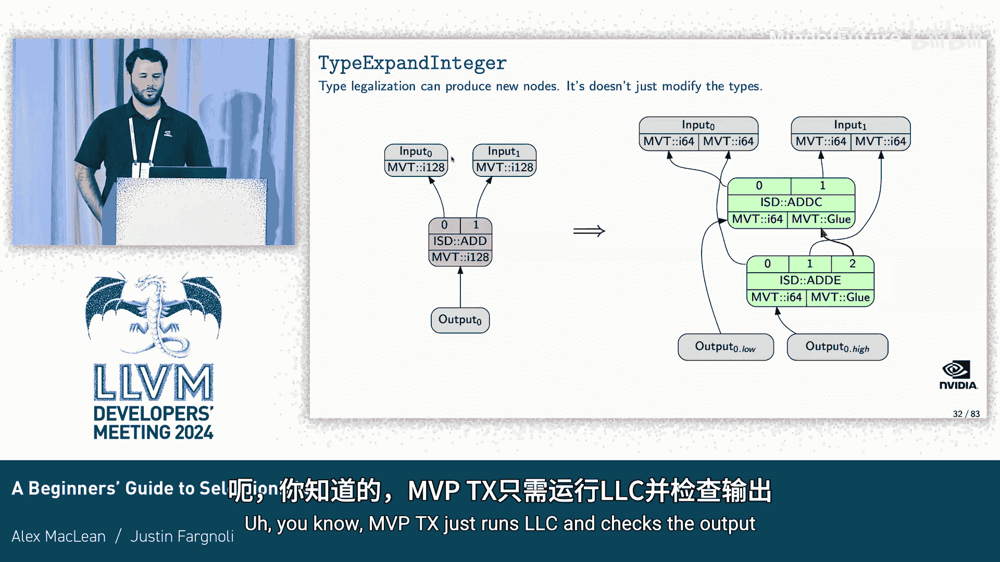

# 【2024-LLVM开发者大会-•-中英】-p57-P57-A-Beginners’-Guide-to-SelectionDAG--BV18eNfepENu_p57-

Hello， everyone and welcome to our talk， a beginginner's Guide to selection D。A year ago。

 I attended the conference and wanted to learn rather wanted to contribute to the project。

I started learning about NVP T X， and though it was kind of easy to learn about particular parts of the back end。

 putting together the big picture was really difficult。

And so the purpose of this talk is to help someone that wants to learn about selection D or contribute to a back end。

 get the full picture of what's going on so that they can feel comfortable and confident as they contribute to a back end and the selection D framework itself。

Now I'm going to hand it off to Alex to talk more about why selection deck。Hello， everyone。

 So as Justin said， we're gonna be giving a high level overview of selection D for those of you who don't know。

 selection D is a framework for instruction selection。

 So that's the process by which we take LVMR and turning it into instructions that can actually be run on a real machine。

 So there's two main reasons why we thought it would be worth talking about selection da today。

 The first is that it's really important。 Many targets use selection da for instruction selection。

 And the decisions made here can have a really big impact on the final code quality。

 So we can do well in optimizations we can do well in machine instruction optimizations。

 but there are a lot of important decisions we need to make in selection da。 And in addition。

 supporting any new target instructions or intrinsics requires selection D changes。

 The second reason it's worth talking about selection da is that it can be really confusing。

 It's sort of a weird thing because it's。It's a tool for instruction selection。

 which is really target specific， but it's a generic framework。

 This is accomplished compos wish with abstraction。Which is really powerful。

 but also can be really confusing。 So there's。It's just a lot of code and a lot of different files。

 and it can be hard to tell what exactly is going on。 We also use things like table Gen。

 which are really powerful， but also introduce more complexity。So who is this talk for。

 if we're going to assume throughout that you have some basic familiarity or comfort with LVM。

 maybe you've heard of selection Dag， maybe you've worked with it before。

 but you feel like you don't quite get it if this is true of you。

 you are the perfect audience for this。So what we're gonna to talk about today is first。

 we're just going review how selection D fits into the overall compilation flow。 Next。

 we're going look at the selection D data structure。 And after that。

 we're gonna look at each of the main phases of selection D。 At the end。

 we'll go through a quick example of working with a target。

 adding a feature to a target that uses selection deck。Before we get started， a couple quick caveats。

As you can probably tell by our youthful complexion， we're not the authors of this framework。

 nor are we experts in it we've also primarily worked with NVPTX。

 This talk is intended to be general， but our experience with what we've worked on is probably going to inform what we find interesting we both have around two experience two years of experience with LVM and NVPTX and we've learned a lot in that time and hopefully we can share some of that with you but we are not experts Another quick note is that there's an alternate framework for this called Global ISL that's not covered in this presentation。

 but just keep in mind that your target may not use selection D all the time。So with that。

 where does selection Dg fit into our compilation flow？Here's our standard compilation flow diagram。

 our front end parses the source code， generates LOVMIR， Opt optimizes it。

 and LOC spits out assembly。Selection Dag lives within LLC。In particular。

 it's between the LOVMIR phases， passes， and machine IR passes。

Let's look at what selection Dg is doing。Well， first。

 it's constructing the selection Dag data structure again。

 selection D is both a framework and a data structure。With our selection D。

 we legalize the types and operations to ensure that they're all supported by the target we're compiling for。

We then perform instruction selection to select the particular machine instructions that will run on the chip。

And schedule them to go from a dag of instructions to a linear sequence of machine I R。

In between construction and our legalization phases。

 we also perform people optimizations with DA Com。This is to eliminate any inefficiencies we could have introduced in our lowering in legalization。

With that， Alex to talk about the data structure。Alright。

 so selection Dg is a framework and it's also a data structure。

 some of you may have guessed it's a directed acyclic graph。

 and this is a way to represent the meaning of our program。

 So it's another form of IR similar to L of VMIR or machine IR one important thing to keep in mind about these Dgs is that each one represents a single basic box。

 So during our construction， we're going to break our program up into basic box we'll do all the phase of instruction selection on each dag and then we'll reassemble them at the end。

So before we can get into the selection D data structure。

 let's take a quick digression into types in the selection D。

 There are two types that is worth keeping in mind when talking about selection D。

 The first is machine value type。 This is a set of types that's the union of types supported by each architecture。

 so any given target won't support all of these， but any element in this set is supported by some architecture MVT includes integers。

 floats， vectors of both these types as well as some other things。

The other kind of type that is worth thinking about for selection D is the EVT。

 This is the extended value type， and this includes everything that's an MVT plus nonstandard sizeized integers and vectors that LVM IR supports。

 so it includes things like I3 or V100 that aren't natively supported on any target doesn't include all LVMIR types sostructs and arrays are not part of the set。

Alright， so now we're going to build the selection D for this little basic block。

 So we have this little piece of IR。 It's three instructions。

 We're going to take some value a defined find outside of the block。

 We're going to add a constant to it。 We're going take that result and multiply it by a constant。

 and then we're going to branch somewhere else。 So we're going to go through the next few slides and build up what does selection D look like for this block。

So the first thing that we need talk about is the S D node。

 These are the basic building blocks of all selection zags。 Every S D node has an op code。

 which defines what kind of node it is。 It also has potentially many other fields。

 So coming back to our example， we're going to define S D nodes for every instruction。

 So there's an ISD add mule and branch node。 And there are also going be nodes for the constant value。

 So there's a constant5 constant 3 and an ISD basic block for the address of the join。 So here。

 you know， with the constants in and the basic block。

 you can see an example of another field in a node。 These also have the value。

 So the three of the five in the join。😊，The next component of the selection da is the S value。

 This is sort of the output of an SD node。 It can be represented as an SD node that's producing output and an index into the list of outputs。

 So unlike L MIIR in the selection da， any given node can produce multiple outputs in this example so far。

 we're only seeing nodes with a single output。 but later we'll see somewhere there are multiple Each one of these S values has an associated EvT。

 So in our example， the add mole and the constants all have the MVT I 32 type。

 The branch in the basic block have MVT other type。The next component of the DAg is the SD use。

 and this is a way to represent the input to an SD node。

 It can be defined as an SD value and a node that's the user and an index into that nodes operam list。

 These are the edges of a graph。So you can see in our example。

 we've created a use from the mole to the ad。 One thing that's important to keep in mind with all the diagrams here is that the arrows are representing uses。

 not data flow。 So the arrow is going from the mole to the ad， even though really the。

The information is flowing from the out to the mall。So now， if we go back to S T nodes。

 we can say a couple other things that they have。 One is that every S T node has one or more result represented by an S value。

 They also can have zero or more opera brands represented by S uses。 So， for example。

 the constants don't have any opera brands。Alright， so as you can see。

 our graph is looking pretty complete。 It looks like we've captured a lot of the meaning of our original IR。

 but there's still a few things missing。 One of those is A and Z。

 So these are the values that are live across multiple blocks。

 and we need some way to represent these， the value Y， which is only defined within this block。

 it just kind of disappears。 but we do need a way to capture the information about A and Z。

 So when we're reassembling all these blocks at the end。

 we'll know how to stitch it all back together。So for this。

 we're going to create copy to and copy from register notess。

 This is a way to represent either a dependency on some value used in another block or say that we're going to take a value and other blocks may depend upon it。

 These are a little bit like load and store instructions。

 not in that they have anything to do with memory， but just that they take some value and an address and either read to it or write from。

 In this case， the address is an ISD register。So one other thing that we're gonna to need to add to this graph is。

 as you can see right now， I've pictured the branch below the mole。

 but the selection D doesn't have any inherent ordering。

 So there's no reason that the branch needs to be there。

 And when we're scheduling right now the way way it's shown there's there's no reason that the branch is not going to come be the first instruction in the block。

 Obviously we don't want this。 So we need a way to represent dependencies that aren't data dependencies。

 and we're going to do this with chains。 chainins are ST uses that don't represent actual data flow。

 They're not going to become a register。 they just represent a dependency。

 And the nice thing about them is there's no really special handling of them but when we're scheduling。

We need to do a topological sort， and those chains will just ensure that that topological sort knows about these dependencies。

 So in this case， we're going to create a chain value from the branch to the copy tube register。

 And this is saying that before we branch to some other basic block。

 we need to take the value computed by the mole and put it in this register。 Through the slides。

 branches are going to be represented。 or sorry throughoutout the slides。

 chains are going to be represented by this dashed blue arrow。

So a couple more things to complete our selection D。 One is the entry token。

 This is going be part of every selection da， and it represents the start of the block。 In this case。

 we're creating chains from the copy to and the copy from register to the entry token。

 And this is just a way to say that we don't want to do these things until we've entered the block。

 The other thing that every selection da is going to have is a route。 Usually。

 this is the Terminator instruction。 And certain transformations are going to start from this note。

So with that， we have completely built the selection da for this little basic block。All right。

 let's look at one more quick example before we move on。

 This is a basic block that stores a constant and then loads of value to be used in some other block。

 As you can see， the selection da for this very small example is already getting quite big。

 I've gradeed out a lot of the nodes that we've seen before that aren't really that interesting。

 Let's take a minute to talk a little bit about some of them。

 So the first is the load and the store node。 And as you'll notice。

 the zeroth opera end of these is a chain。 So the store is chained to the entry token。

 which just means that we don't want to do this store unless we enter this block。😊。

And the load is chained to the store。 And this ensures that if the pointers that are loaded to and stored from end up being the same value that in the final assembly。

 they're emitted in the correct order。嗯。You could also see that these。

 these load and store nodes are memory S D nodes。 So they have a lot of additional information that's represented by that second line there about what's going on in the alignment。

 stuff like that。One other node we should touch on here is the token factor。

 This is sort of a weird name， but really all it is is a way to take two chains and join them together。

 So this is a way for the branch to depend on two different things happening In this case。

 before we branch we need to store value and we need to make sure the value from the load is copied to a register。

 So it's not going to become any instruction。 it's just a convenience to allow a node to depend on multiple values。

All right， so now that we've talked about the selection D data structure。

 it's time to go through the phases of selection D。

And the first of which is building a selection deck。So during this phase。

 we're going to build a representation of each basic block in the function as a selection do。

 For the most part， this is going to be largely one to one。

 So we're not going to do a lot of lowering to target specific。Semantics， we're just going to。

 to take the。LV M IR values and produce the analogous selection da nodes。

 There are two main exceptions that we need to talk about， though。 One is structure types。

 Sostructs are not supported in selection D。 So these need to be lowered element wise。

 The second is there are some instructions which are。Excuse me。

 Our two target specific for a generic implementation。 And for those。

 every target is responsible for building their own target specific set of notes。So first。

 a little example withstructs in this block， we're going to loadstruct and just extractive value。

 And as you can see， this has been lowered element Y。 So now there are two loads。

 one for each element instruct。 and we're offsetting the second load with an ISD ad to ensure that it's you know it's loading the second element。

 There's also two nodes down below them that represent sort of thestructs。

 So the first is merge values， which is just another convenience node。

 It's just going to take the values that it's passed in as operas and passed them through as returns。

 So this is just a way to。Represent。Values defined by multiple different nodes as values defined by a single node。

 It also doesn't correspond to any instruction， and it will be optimized out。

 The other is a token factor。 And we've already touched on this。 In this case。

 it's just providing a way to represent a dependency on loading the entirestruct。

 Nothing depends on that in this case。 So there's no uses of it。 And it will also get optimized out。

 but in some cases， that could be useful。So target specific APIs， some， as I mentioned earlier。

 some IR features don't have a generic selection data representation and targets need to implement them themselves。

 so that is calling convention， so lower call， lower formal as and lower return。

 every target needs to implement these in TLI and look at the and produce some SD value that represents that instruction。

All right。So at this point， we've lowered our LO VMIR into the selection deck。

But now we need to ensure that all of the types and operations are supported by the target we're compiling for。

The first step of that is type legalization。Targetets only support a subset of the types that L O VMIR supports in the diagram。

 you can see that L O VMIR supports types like I24， V through I8 and I128。Whereas， in this example。

 PTX supports types like I32， I64， float and double。During type legalization。

 we need to lower the illegal types to legal types。But what does legal mean？If we go back a slide。

 you can see that we perform legalization before instruction selection。

When we say that a type or operation is legal， all we're saying is that our code and instruction selection can handle it。

So how do targets control this behavior？Selection D provides the Add register class function。

When a target calls this function and passes a particular MT。

 that communicates to selection D that that MT is legal for the target。Interestingly。

 given just the set of legal types， selection Dag can legalize all the unsupported types for us。

Behind the scenes， it's constructing a table that maps every type to an action that will legalize that type。

This table contains or rather the table on the slide contains the different legalization methods for the types in our program that selection data can use。

We're going to look at a couple of these in the next few slides。First， expanding an integer。

On the left， we have an I128。A type that for this hypothetical target is not supported。However。

 I 64 is。So selection Dg legalizes our I128 ad。To I 64 ad carries。

An important thing to note here is that even though we're in the type legalization phase。

 we aren't just touching the types。 We're also making modifications to our dag。Next。

 promoting an integer。On the left， we have an I 24 ad。

 I 24 isn't supported for this hypothetical target， whereas I 32 is。

So selection Dg will promote our I 24 ad to an I 32 ad。It will also modify our zero extent。

And turn it into an and that masks off any bits that could be set by performing our I 24 ad on an I 32。

Vctorors can optionally get some special handling。If a target would like to。

 they can implement or override the Gi preferred vector action function。

Seelection tab will call this and provide a type。When targets override this， they say， for this type。

 what legalization action should be performed to legalize that vector type。

When hexagon encounters a V 3， I8。It utilizes this method to override selection da's behavior and ask it to widen our V3I8 to a V4I8。

 even though it takes some more space。So I hope that gives a brief overview of how we take a dag of any type and turn it into a dag of types that our instruction selection code can handle。

But now we have our operations to handle。Seelection Dg supports over 400 Opcodes。For one。

 targets don't support all of these op codes， but additionally。

 they don't support any one op code for all legal types。

Our goal in this stage is to lower all operations that are supported by selection da to operations that are legal for the target。

How do targets control this？Seelection D provides the set operation action function。

Targetets call this function for a particular op code in MVT。

And communicate to selection D what legalization action should be performed for that op code in MVT。

An important side note， the semantics of the NVT parameter aren't well defined。

Sometimes it's the operaran type， sometimes it's the return type。 when in doubt。

 it's always safest to just read the code。Behind the scenes。

 selection Dgg is constructing a table that maps every op code in legal MVT to an action that will legalize that Op code and legal MVT。

Set operation action。Is how targets override the default values in this table that selection to excess。

Below， we have some of the legalization actions that targets can specify。Legal just says。

 you don't need to touch this。 Our instruction selection code can handle it， and it's all good。

In the next couple slides， we'll look at promote， expand and custom。In MVPTX， we support FP16 types。

 FP32 types， and FP 32 division。But not F P 16 division。

Our solution is to execute FP16 division on the larger FP32 type。

We do this by calling set Operation action for floating point Division， specifying FP16。

 and asking selection Dg to promote it for us。Here we can see the input and output dags of our set operation action call。

Our floating point division gets promoted to an F P 32。

 and selection Dg inserts the necessary extends and rounds to ensure we're properly respecting the semantics of our original dag。

Next， expand。MPS does not support the B swap operation on I32。

Bite swapamp is just reversing the bytes in a particular value。

Our solution here is to ask selection dag to emulate the bite swap operation with a dag of operations that are legal for the target。

We do this by calling set Op action for B swap I 32 and asking selection Dg to expand it。

An important side note。 expand does not specify how we emulate the operation。

 It's just requesting selection dag to put in another dag of legal nodes that properly emulate it。

Here's our before and after。 our bite swap gets transformed into a dag of ans shifts and orars that properly emulate the bite swap。

What if promotion and expansion aren't enough for our use case？

That's where custom legalization comes in。We can call set Op action for an Op code in MVT specify custom。

 and that tells selection D that we want to implement a custom blowing for that op code in MVT。

When selection D encounters that Op code in MVT， it will call the lower operation function。

And targets can override lower operation to implement their custom lowering。In NVPTX。

We could ask election Dag to expand the vector shuffle operation。But as a compiler engineer。

 we know that our PTX ISA that we're targeting supports the permute instruction。And the permute。

 the semantics of the permute map really well to the vector shuffle operation。

So I'm going to implement a custom lowering to take our vector shuffle and produce a permute。

Seelectionag couldn't do this for us because it doesn't know about these target specific nodes。

 It only knows about the nodes that are generic and supported by selection da in all targets。

Our next example is from X 86。Xit D6 chooses to implement a custom lowering for absolute value。

They lower it to the X86 specifics subtract and conditional move instruction。

Subtract returns a flag that indicates whether the input was positive or negative。

 and we can use that in our conditional move operation to determine whether to return our original input or the result of the subtract。

Okay， with that， we've legalized the types and operations in our DAG and we're now ready to perform instruction selection。

But before we do that， let's look at Dac combiner。DAC Comr is how we perform P poles on our selection deck。

But you might be asking， why are we doing， Why are we doing this in the first place。

 Haven't we already implemented all our people optimizations in L O V M I R。Well， for one。

 we want to clean up any inefficiencies we introduced while lowering into the selection da and legalizing it。

We also want to generate unique operations that are provided by our ISA that might be faster than the set of default operations that Flag gives us。

So first， let's talk about DA Comr。DAC Combiner performs peoples for all targets that use selection DAC。

It's essentially the ins combine for a selection Do。

Seelection Dag calls target lowering info to understand which optimizations are profitable for a particular target。

Below， we can see a coat snippet from Dg combiner。Before performing the D combine and returning the optimized code。

It calls T L I to check whether the the gated expression will actually be cheaper。If it is。

 we perform our operation and take our addd and Fneeg and produce a phoing points subtract。If not。

 we don't touch it。But what if the optimizations we get for free from Dg Com aren't enough。Well。

 we have custom data combines。We communicate to selection Dg that we want to implement a custom Dg combine by calling set targetrg Dg combine and passing an offcode。

When selection DAG sees that op code， it will call Perform DAg Com。

Targets override perform da of mine to implement their optimization。Our first example is from NVPTX。

On the left hand side， we have a multiply。This multiply requires 128 bits to store the opera。In PTX。

 we care a lot about register pressure。So we have the all wide instruction。

Mll wide can take in two I 32s and produce an I 64。So as compiler engineers。

 we implement a custom Dg combine that examines our I64 mall。

To determine if the inputs are using the high 32 bits。In this case。

 it's relatively simple to see that our0 extends mean that we aren't using those bits。

 And so we can successfully transform it into a mall wide by inserting truncates to make sure everything fits。

But you might be saying。We might have addressed a register pressure issue。

 but we've also introduced more instructions。 is this actually better？Well， luckily。

 similar to ins combined， da combined runs iteratively。

It will identify the redundant zero extended trunknccate and produce our dag on the right that both has fewer instructions than our original dag and less register pressure。

Our next example is about unsigned remainder。Unsign remainder is a very expensive operation in PTX。

So as a result， we prefer to implement a custom dag combine that lowers our dag on the left to a dag that utilizes multiply and subtract。

 the results of the division and a multiply and subtract to emulate our unsigned remainder operation。

The takeaway here is that even though we aren't generating a target specific node。

 we're utilizing information that as compiler engineers。

 we know about our target to make the best decision。Now， Alex will talk about instruction selection。

All right， so now that we have legalized and to some extent optimized our DAG。

 it's time for instruction selection。So during instruction selection。

 we're going to replace most of the generic SD nodes with machine nodes。

 and machine nodes are just like normal SD nodes except that their op code is a machine instruction op code。

 so they directly correspond to some machine instruction。Unfortunately。

 this is too target specific for generic implementation so for all the previous stages。

 we maybe be implemented some callbacks or we filled out a table and then selection Dag took it from there and did most of the work for us that's not the case for select so as you can see below this is the implementation of select that selection D provides there isn't one so each target is going to need to override this method and implement a lot of matching code to perform selection to convert all the generic nodes into target specific nodes。

And if that sounds like a lot of work， there is a solution。

 so T Gen allows us to succinctly specify these rewriting patterns。

 and then it will write all that nasty C++ code for us， and we just get to write some more simple。

 abstract definitions。 Targs can still implement this logic themselves for certain upcodes outside of T Gen as needed。

So how do we get table Gen to do this for us？ There are three main things that we're going to need to define for TG。

 The first is ST pattern operators， and this is a way to describe what we're looking for in the Dg。

 The second is instructions， these are the representations of machine instructions which we want to admit and then the last is patterns which map these two things together。

 We're going to look at all three of these for a really simple example which is lowering the ad instructions on NVPTX。

So first， let's look at matching the selection D here we need to define what we're looking for in the selection D。

So first thing what we're going to do is define a type profile。

This is just a description of what the type of our node is going to be。 So for the ad。

 we say it's going to produce one value and take two operas。

 We also say that the opera are all going to be the same type of integer。

 The next thing that we're going to define is an S node。

 And this is a subclass of S pattern operator。And here we're going to say what op code we're expecting it to have。

 So ID add， we're going to use the type profile from above。

 And we're also going to assign some additional properties。 So here， commutative and associative。

 And this just gives table gen more flexibility when it's generating the matching code for us。

 So if it sees that some。Some pattern matches on the dag。 If we commute the opgrs。

 it will automatically do that for us。Alright， so now that we've defined what we can look for in the selection D。

 we need to define a machine instruction that we're going to produce。

 Table Gen lets us populate machine instruction entries with a lot of useful information that can be used in many different places such as the assembly printer or the machine IR transformation passes。

 for selection da， there are really three key pieces of information that we need to care about。

 The first is the op code name for this instruction。 So in this case， that's add I 32 R。

 This is going to go into a big inum， and it's going to become the op code of our S node。

 The next thing that we care about is the outs and that is a definition of what's going to be produced by our node。

 The last thing that we're interested in is the ins。

 and this is just the definition of the inputs that this instruction takes。 You can see here。

 there's also an assembly string， which will be used by the assembly printer。 but for selection D。

 we don't care what that is。So now that we've defined this add SD pattern operator and we defined this add I32 RR instruction。

 we need to tell selection D how they correspond to each other。

 we're going to do that with a pattern。 So a pattern takes two opera。

 each of which is a Dg represented in this sort of S S expression language And it' first we're defining what we're looking for。

 and then we define what we're going to turn it into。

 So here we say we're looking for an ad that's producing some I 32 register and it's taking two I32 registers as input and for that we're going to produce this add I 32 RR instruction with those same inputs and output。

And with that， we've given TableG all the information it needs to perform the following transformation during instruction selection。

So now Table Gen knows to look for this ad of these types。

 and when it sees it it knows to convert it to this add PTX instruction with those same inputs。

So back to this select method， which we need to implement。Here here is how most targets do it。

 So the first thing that we can do is implement any custom logic we want。

 so we're going to be given a node and if we don't want to use tablegen for some reason。

 maybe this node is really complex and we just haven't figured out how to represent that transformation and tablegen or maybe for legacy reasons the code's just there we can implement that first then we'll call select code which will throw to the table Gen generated matcher and this is a big illegible switchcase that that will perform the tablegen-based transformations for us。

So a couple important notes about the selection dag algorithm。

 The first is that the dag is traversed in。Bottom up order。

 That means we're going to start with the instructions that are later in the graph and move towards the entry token。

 What this ensures is that an operator is always going to be selected before any of its operarans。

 And this allows us to match on a node and properties about its operarans。

 And we can guarantee that those operarans are also going to still be in the generic form。

 They won't be selected yet。One other thing to quickly touch on is how tableG prioritizes matches。

 So often there may be cases where multiple different patterns match on a given dag。

 and this can be because we have patterns for more complex cases and simpler cases。

 So the first thing that we're gonna to do is we' prefer the more complex match patterns。

 So if there's a match that's looking for a you know a really sort of large dag with lots of different operaran constraints。

 we'll prefer that over a more simple case。 When there's a tie there。

 we fall back to a lower emitted instruction count。

 which is a proxy for cost if that is also a tie will fall back to the match pattern size and finally we prefer later source code order。

So this， we could spend a whole whole hour just talking about table Gen。

 There's a lot that we haven't been able to get into just because of the time constraint， but。

For the most part， almost every selection that we want to do can be represented in table Gen pretty efficiently。

So next is instruction selection。Our input to instruction selection is a dag of machine notes。

Scheduling， sorry。And our output is a linear sequence of these machine notes。

We could just perform a simple topological sort。In the case of PT T X。

 the code we generate is is the input to another compiler that actually schedules the instructions that are run in the chip。

And as a result， for the NVPTX backend， we don't rely heavily on this。Since we don't work with it。

 we don't really know what we're talking about， we aren't going to tell you about it。Instead。

 check out this blog post and this developer meeting talk if you're interested in learning more。Now。

 for an example of working with selection Do。So。Our example is going to be about。

The PTX MA instruction。MaD takes in two values， multiplies them， and adds a third。

Our goal is to o the PTX man instruction via a people optimization。Why do we want to do this？ Well。

 our MA instruction will have lower latency than a multiply followed by an ad。

And it will could reduce register pressure。First， what don't we need to do。

MaD only supports existing legal types in NVPTX。So we don't need to touch type legalization。

Additionally， the nodes we want to match on， adds and multiplies are already legal for all the types that the PTX MA instruction supports。

 and so we don't need to worry about operation legalization。Once side note。

 we're just going to look at I 32 for this case to reduce the amount of text on the slide。

What do we need to do， Well， for one， we need to target specific da combined to generate our target specific S D node。

 N VP T X， I S D， IE。We then need instruction selection logic to lower our target specific SD node into a machine node。

So step one are D combined。We want to take our ad that takes in a multiply on the left and generate our imAT。

Our first step is to declare to selection D that we want to implement a custom da combine。

We do this by calling set target D Com and specifying add。

We then implement or override the perform D combined function。Additionally。

 we add a case for the ad op code to call our perform add combined function。

 The function we're actually going to perform the people in。In perform addd combined。

 we first do a couple checks and then actually implement the。

Our first check is that the opera end is one of the operas is a multiply。 if it isn't。

 it's not the pattern we're looking for and we don't want to touch it。

We also check that it's of the correct type。 If this is an I7 ad。

 we don't want to generate an I 7 IM。And finally， we check that our multiply only has one use to not extend its live range and increase register pressure。

Once those checks have all passed， we can then generate our target specific S D node。

We specify its op code， and V，P T， X， I S D IAT。It's type。Its first two inputs。

 which are the operas of the multiply。And the last， which is the other opera of the ad。

By returning this node that we've created。We ask selection da to replace the node that it's past us。

 the add node with the node that we've generated。It will also eliminate any dead nodes that this stack combined could have introduced。

So we've taken our ad and multiply and produced our iPadAdd。Now。

 we need to perform instruction selection and lower our IM target specific SD D node into a machine node。

So step one， we need to tell selection D what to look for。

The type of our IM node is defined above at the very top of the slide。One output， three inputs。

 all of which are ins。Our IA S D node has the NVPT X ISD IM Op code and the type that we define above。

The instruction we want to generate is a mad I 32 R， R， R。We create this machine instruction。

 our NVPT X instruction。Say it has one I32 output and 3 I32 inputs and specify the assembly string that this will result in。

With the SD node table Gen should look for， and the machine instruction it should generate。

 we can write a pattern that looks for the SD node and generates the machine node MA I32。

And with this， we've taken our Iad and produced our machine note， the Mad I 32。

So we implemented a Dg combined to take our L O VMIR that got lowered into selection dag。

Take our selection Dg mole and add S nodes to produce our target specific S node。

 lower that target specific S D node to a machine node。

Which then generates the assembly on the right， the mad dot low S 32。So some final notes。

We hope that all of this helps people in the audience。

 people watching on YouTube to feel more confident and comfortable working with selection Dag。

And we hope that people will start to contribute to backends and the framework itself。

To jumpstart this process， these are a few of the resources that Alex and I used as we were getting started。

Highly encourage you guys， to use them as well。There are also links throughout the slides to relevant sections of the code base。

嗯。And we also recommend learning the output of debug only equals I cell and these other things you can pass to it。

 This is a really useful thing to use when you're debugging selection D and trying to understand what's going on in each of the phases。

And a final thank you to Aksha Max Drew， Vlad， Kevin and Princeton， whose name is an onmicide。

And that's all， yeah， thank you for the time。Thank you， Alex and Justin， if you have any questions。

 make your way to the aisle or raise your hand， I'll pass you the mic。So just one final note。

 it was actually the wrong slide deck。 So this is the link to the slides。

 If you want to download it and check out the links and stuff， feel free to use that， yeah。Hi。

 this is a question born of deepest frustration。 How does one learn the details of the semantics of table gens match or pattern matching syntax。

 I have tried to do this maybe a dozen times over the last two years and have failed every time。

 So you seem to have been successful at this，😊，嗯。Is it written down anywhere is。

Not that we know of trial and error would be my how we learned it。

I'm sure we just haven't found the documentation and it's out there somewhere。

 but this is not something we。Yeah， thanks， sorry， don't have a better answer。Any more questions？

So these are D combined patterns or D combined code can that be written as patterns in selection in Tton？

For that combines。Can they be expressed as patterns？So the question was。

 can DAG combined patterns be defined in table Gen， and the answer is no， not that I know of。

Do you have the question。Thank you so much for this talk。 Tmendous resource。

 I'm so glad it's recorded。 Hi， mom。 It be useful to share with colleagues in the future。

 Just got a selection da joke for you。 Why does my editor crash every time I open X 86 selection dag。

😊，Dag to dag。I saw。Yeah， there's not much fun， I just。Craig and Simon， you're here too。

Thank you for the talk。 I'm just wondering， how do you compare the cogen quality with the global IL。

 Do you have any experience with that。We have no experience with us。对是。Thank you for the talk。Yeah。

 so that the D has a lot of combiners and all that。 I'm just making a comment。And it。

 it's a long effort for global IL to catch up。So there are there is something called a selection Act Comp dot TD。

 which basically allows you to import all the patterns。To the global IL world。

 So that's sort of a compatibility layer where you can do that。 And in terms of the performance。

 global IL is not there yet because it is not functional complete。

lot of things are going back to the selection deck the entire function machine function will get reset through the machine property and it will try to do the selection again so that's how the global I is still using the selection so I just wanted to pass that anymore Thank you Thank you for the talk Thank you。

Thank you for the talk On one of the slides you showed a custom lowering of vector shuffle to NVPTX permute instruction。

 and I believe you can also do that in table Gen so what determines the approach you take。Yeah。

 this is is an interesting point。 So in general， any。

 anything that's being done during operation legalization。

 we can also just pass those operations through and handle them in instruction selection。 So it's。

 it's sort of a matter of discretion where we want to handle them。 So in this case。

 it just ended up being a lot easier to implement that as a dag combined。 For example。

 you can see that there's this constant node that we're adding。

 which is like a packed representation of the the vector shuffle that we want to do。

 And it's just much easier to implement that as a dag combine as opposed to as in table gem。😊，てて。

I don't think there's。Yeah， so it would not even be possible in this case。

Thank you for the excellent talk。Are the side effects like the flags。Considered， like。

 input output or。Is it different logic。So side effects are represented as chains as far as I know。

 So yeah， that will， that will ensure that side effecting instructions are scheduled appropriately。

Does that answer your question。やい？Carry it。 and those actually get into the the。Logic。

 it's not just ordering。Also， part of the logic。Once it out。当。C there is。some targets。

 flags are explicit， X 86 has an I32 output for the flags for some targets it's done through a glue opera end。

 which historically was called flag and was renamed a glue at some point。

see your questionHow do you recommend testing the individual phases of selection D？I mean。I don't。

 I don't think we have anything unique to add here。 you know， MVP T X just。

Runs LLC and checks the output。嗯。Yeah， not something I thought about a lot。Do you have anything on。

If one is playing around with selection D and wants to look at Dgs。

 what in your experience is the best way to do that。

 like is it a graphical representation or like is there a textual way to look at this that's more convenient like how do you do it？

Like what Alex and I do when we're actually working with it is use the debug only equals I cell output justca it's fast。

 And we work on remote machines。 So generating a P N G that youre then have to。

Switch over and stuff is a bit complicated。嗯。And， and also。

 all these das that we've shown you are like one instruction for， for any real basic block。

 It's just。Unmanageably large。 So we use the textual output。 And that's what wed recommend。

Any more questions？All right， let's thanks to the speakers， Alex and Justin。

