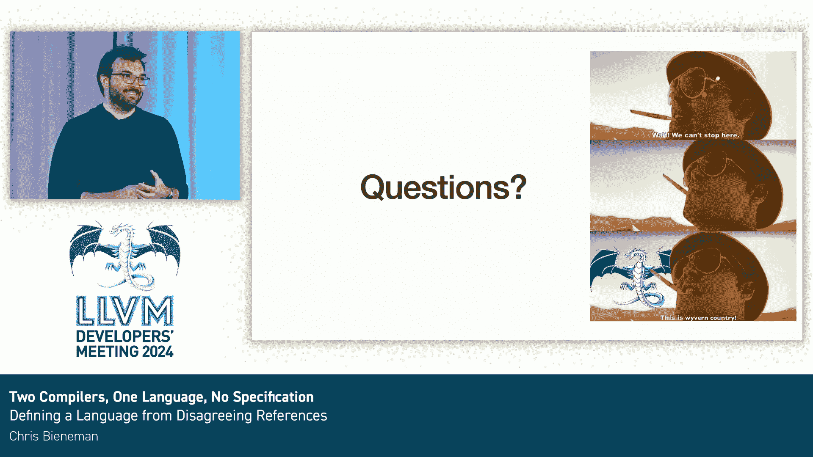

# 【2024-LLVM开发者大会-•-中英】-p58-P58-Two-Compilers,-One-Language,-No-Specification--BV18eNfepENu_p58-

Thank you everyone， I'm really excited to be here talking about HLSL。😊。

To kind of kick off and give a little bit of background on what it is that we're doing and why we're doing this start。

What the hell is HLSL。 So HLSL is a graphics programming language。

 It's primarily used for realtime rendering graphics， directx， video games。

 all that stuff that I don't know half of us probably love the important thing about it though。

 is it's been around for a while。 It's been in use since 2002。

 it evolved from Nvidia's C for graphics programming language that I assume most of us have probably never heard of and those of us who have heard of it probably wish we hadn't。

 but as HLSL has grown， it's become the primary language for GPU program ability on Windows and that's a really big market share and it's really important and it's used not just for graphics。

 but also for any GP GPU programming M applications。

 know anything that you want to you want to take advantage of the GPU away。In a nutshell。

 like HLSL today has two reference compilers。 The older reference compiler FXC is a totally bespoke proprietary compiler。

 It's out of active support， but it is still actually used because it is the only compiler that allows you to target to direct X 9 through 11 and people still care about direct X 11 for a lot of lower end devices。

 you know， Intel laptops with integrated GPUs type things。

That supports the HLSO language versions from kind of the 2002 era to about 2015 and then we have our second reference compiler DxC。

 which is a fork of LVM37 quick show hands Anyone here remember when LVM37 was new because that was a long time ago so that's a nine year old fork of LVM and it is not aging as well as we wish it probably had but that is the primary compiler for Direct X12 if you like your fancy Windows games。

 it's all coming out of LVM37 still today that supports our HLSO language versions for 2016 through 202x is our kind of in development language version I'll talk about that a little bit the only feature development going on in that reference compiler today is the 202X。

Language version and critical support features。The problem that we have that we're trying to solve here is that we really need a modern compiler。

 We have a large base of existing HLSL users and we don't want to bug for bug compatible compiler because we have bugs and we should fix them。

 But GPU code portability is a big problem。 And we don't have a written specification。

 And you might think， well， why do you need a written specification？

 There's lots of programming languages that don't have written specifications， right？ So。

Here's my argument。 If you are a C plus+ programmer and you look at this。

 this little blurba code here， you probably think you know what it does。 And。

 and there's one little bit of magic H L SL in there。 But you can probably think， oh， in out。

 maybe it's like a reference。😊，It's not and worse。D X C actually compiles this program differently if you target Vulcan versus direct X and you get different results。

 So we clearly have a gap。 And， and a standard really help us do that。The next obvious question is。

 well， why isn't HLSL just C or C++ and there's a couple different reasons for that the TLDR history and GPUs are weird and they really are GPUs had historically really weird mixes of capabilities but they also are inherently wildly varied architectures。

 there's no X 86 of GPUs， there's no I mean arm makes a GPU。

 but it's not the standard thing that you everyone ships and then they're fundamentally parallel and there's a whole bunch of considerations that make C++ and C really bad in it fundamentally parallel architecture。

At a base level， HLSL is pretty similar in a lot of ways like that sample I showed you earlier。

 like this HLSL， it looks like C++ code and it kind of works the way you expect C or C++ to work。

Until it doesn't and and some of this is implementation consistency in our compiler。

 some of it is the language is actually different。 But one of the things that that we've been doing is is like we're trying to really engage our users as we're talking about the changes that need to come to the HLSL tool chain to really get them to understand that there are things that we did that we maybe shouldn't have done。

 and we're going to change these。 and it's probably going break some code。

But we should understand why。 And so these little snippets of code here are from my my series of HLSL of horror。

 where I go through and I come up with these little samples of HLSL that you think you probably know what they do。

And they probably don't do what you think they do。This one kind of works the way you'd expect。

 This clearly is an ambiguous function call。 It shouldn't compile。This one also is ambiguous。

 it shouldn't compile。But why does this convertibbudo float。

And why does this one convert a pool to aflo。And given the other ones went to float。

 Why does this one actually go to a bull。 And， the answer really is that that we just have these inconsistencies that came through not having a spec。

 not having written down the rules and not having robust enough testing。 And so。

One of the things that we've done in Kang is we've actually taken all these builtin functions。

 And instead of having them all be special case in the compiler。

 we have an implicit header that's included。 They're just functions。

 Everything works the way functions should。 We get go to definition in clang D。

 We get all of these things。😊，But it's going to break existing code。 And this is why， you know。

 like I said， we're engaging the users。 We're talking to them about， hey， we did these weird things。

 And， and now it's time to， to do something a little bit better。Another big difference for H L SL is。

 because GPUs are parallel and because they're often used for graphics programming。

 there's lots and lots of vectors。 Everything's a vector。

 and it's not even just the things that you expect to be vectors that are vectors。

 but like if you have an int， it's actually a vector underneath the hood。

 And so to give a real quick summary of how this works。

 we have this ST programming model for HLSL where you write your source and it looks you know like the mutation of a single variable。

 but actually at the hardware level， there's for。Paraallllel threads executing at the same time。

 And they share a program counter。 So they're working through instruction by instruction together。

 And so the input array that you have here as a four element array， you actually have four。

4 element arrays。 You have four size values。 When you walk through this function and you hit control flow。

 There's a mask that decides， are you executing the control flow on this thread or not。

And you keep executing the control flow。 You keep getting stuck in this loop until all of the threads have finalized。

 and then you can move on and exit and return the function。

 This has some really interesting complications and hidden costs because each operation is happening N times。

 Each variable is n variables， where N is a power of two between 4 and 128。 And believe me。

 we do have 128 wide architectures， so。😊，This can be a lot。

 dynamicynamic control flow is always your worst case of whatever possible control flow you have。

 And so these considerations really shape the way that HLSL is used and the way that the language represents itself。

😡，One example that's kind of a favored piece of C that we all like to hate on is the usual arithmetic conversions。

 They're crazy useful because， you know， you want to be able to have a binary operator and say。

 you know int plus int gives you an int right？ But what about short plus short right And C。

 short plus short up converts to int then does the math， then down converts。

 And if you do that on a parallel architecture like a GPU。

 the number of conversions that you just did。😊，Holy cow， there's your performance gone。

 So in order to work around this， we kind of have this solution where we've taken what C does and we've shifted。

 you know， by removing the notion of promoting smaller types。

 but also we've had to add new conversions to handle vectors and other data types that just don't exist in C。

😡，We also have to have these， these implicit dimension conversions for a whole bunch of other operations。

 not just the usual arithmetic conversions， but also calling functions because we have things like operator overloading that are just function calls。

 And so we have a fourth sequence in the implicit conversion sequence that is a vector dimension conversion to extend a scalr to a vector or to truncate a vector or matrix down to a smaller size。

 This， of course。😊，Cascades into our language specification that we're working on writing。

 So on the table on the left here is the C plus plus 11 specification for implicit conversion sequences。

 The table on the right is HL SL。 So we went from three ranks to 9。😊，On the plus side。

 aligning with C plus plus and the way that C plus plus phrases these things gives us the ability to actually have a much simpler implementation than what we did in our reference compiler。

 Our reference compiler used a scoring system for argument dependent overload resolution。😊。

That scoring system had some downsides， like if you had 128 function parameters。

 which no one would ever write this code， please， right， right。

128 function parameters overflows the counter， and you can no longer resolve overloads unless they are exact match overloads obviously。

 having an approach that is more aligned with C plus plus more robustly designed has some big advantages for us。

It will also break code。 And so one of the things that we've prioritized as we're looking at ways that the language needs to evolve as we move into the new compiler is we don't want to bring the technical debt with us。

 It's better to have code that was valid in the old compiler fail with a good error message in the new compiler than code that was valid。

 do something different in the new compiler， which would be really bad。But， you know。

 we do have to balance that we need to get our users from the old compiler to the new compiler at some point in time。

 Otherwise we're going to be stuck supporting three compilers forever。 and oh， boy。

 do we not want to do that？嗯。Another really big difference with GPU languages is a lot of them didn't used to have pointers。

 and HLSL has not yet grown pointers。 This causes so many fun things。

 Part of the reason why they don't have pointers is because GPU store memory in different places and in different ways that have different semantics and representing all of that in a language that's based on C gets a little gnarly and a little weird but one of our big problems that comes out of this is if you have a function that has multiple return values how do you do it if you don't have a pointer and you don't have a reference。

 and the answer in HLSL is the in out or out keywords。

 which basically they're still by value past parameters。

 but they're created as temporaries in the local thread address so that they then can can have any address spacing problems。

This causes another problem， which is that because these are temporaries。You can cast。

When you call a function， you can cast an argument to a different type。 The function can。

Change the value of that argument， and。Hast it back and so。This is a whole ball of crazy。

 but it is part of HLSL's fundamental language that people are relying on。

 and so breaking this really wasn't an option for us as we move into。

One of the challenges that this really causes for us， though。

 is that I've never seen a language that does anything like this before。

 And so we didn't even have words to talk about what does this language do。

 What does this behavior mean。 And so this is where I start making things up。

 and making up words is a fun thing we should all do。 So casting expiring values is what I call them。

 They're kind of like X values in C plus plus， but they casts and they're weird and they go away。

 And then when they get destroyed， they write their value back through another cast。 So。

Hopefully the optimizer cleans all this up， but maybe not。

The way that we represent this in clang is through this new AS T node that it's actually。John McCall。

 I don't think he's in the room here， oh yeah， there there is。

He's awesome because he really helped me out with this a lot getting this working because what we wanted to do is leverage objective C's write back support for write back arguments to then be able to have something that executes after the call to write back into the argument values and we have an AST represented that represents the cast into an argument and the cast back to the value and and this is how we did it。

 it's super useful， It makes sure that all the casts are represented semiche comes in and does its thing and warns you on all the conversions and so this is a huge improvement for our users because previously all of these casts were not represented in the AST and so your implicit casts never got reported to users。

Another really fun difference in HLSL is we have these things called literal types。

 HLSL literal types kind of the origin of them was this idea that GPUs do a lot of things in weird precisions。

10 bit floating point values，16 bit floating point values and if you're doing math and you only have 10 Bs of precision。

 You might have some rounding errors that go really awry。 So the idea here was to have HLSL。

 you know， actually not have all these rounding errors。 And so in the compiler。

 we treat them as 64 bit types。 and then we hopefully clean it all up and give you a higher precision value at a smaller know size representation during compiler。

 The problem is。😊，That C++ doesn't have multi expressionpression type inference。

 And so when you're trying to infer the type that you should resolve this larger unsized type to。

 if you have an expression like a turnernary operator，We have no idea what to turn it into。

 And so we end up just generating a 64 B value and then letting the IR optimizer hopefully clean it up。

Thatt that doesn't always work。 and it causes problems。

 And so the solution that we've come up with for this is what we're calling HLSL 202 x。

 which is our in development language version。 We're not going to support literal types incang。

 We're going to do something that's more C like， more C plus plus like and we're going have a path where we're going to help users move to the new language version in the old compiler by implementing these features in the old compiler。

And then they'll move to the new compiler as a second change once the new compiler is ready。

Another really cool problem that we have is that HL SLs templates for built in types kind of predate having templates in the language。

 And so we have these constraints that are required on on templates。 but then we。😊。

Don't really have a way to express them in the language。

 like the fact that vectors need to be four or less elements。

What we've decided to do in clang is really genius because clang the support for C++ concept only exists in the parsing layer as being checked by versions。

 so we can generate concept AST nodes in the compiler programmatically and have concepts in a language that doesn't have concepts this is super useful for us and templates are super useful in GPU code because it all gets fully specialized。

 but this was a really neat idea that one of the ingen Site team came up with and it's been really cool to work with。

To kind of wrap up， though real quick here， like。If there's one thing that I hope everyone in this audience takes away from this talk。

 it is that if you are designing a programming language， document it。 please， please。

 please document it。 write a spec， write documentation， have really great docs because。

At some point in time， you will hit a point where you need to write your second compiler or your third compiler。

 and it is impossible to match a reference compiler in a new compiler without just copying the old code。

 if you don't have documentation that tells you how it's supposed to behave。😡。

We've taken this approach of trying to be creative about how we're achieving source compatibility without needing to match the behavior identically。

 which is really useful for us， because we can。Kind of fudge things a little bit。 And we're really。

 really like trying to think forward looking。 You know。

 concepts is probably a feature that's gonna be really useful to HLSL users。

 So leveraging it in our implementation today， it's nice。 It works well。

 It'll also give us a step into the future。 that'll be useful。 And then， you know。

 as this last point， I cannot stress this enough。😊，If you're making a programming language。

 your users are technical people。 And so engage with them， talk with them。

 Tell them what you're doing。 They will understand。 They will probably。

Enjoy it a whole lot more and hit you with a whole lot less bugs and complaints if you actually just engage and talk with the community。

That's kind of my， my big thing。 I don't know if anyone has some questions。 if we， we want to。

Thank you， Chris。If anyone has questions， make your way to the mic or raise your hand， I'll pass you。

So when you make breaking changes and people have to change the source code。

 do you have any way of like helping them automatically change your code。

 that is a great question Yes。What we've done in the past hasn't been as good as it should be in the future and we're really working on this being better about this When we rolled out HLSL 2021。

 we made some changes to the way binary operators for Booleing operators worked we disallowed vectors as the elements for booleing operators。

It was really easy to implement a clang fix it to say， hey， you know， this， this doesn't work。

 you probably meant this and actually have a fix it transform it。

 One of the other ones that I'm actually working on right now is HLSL has really weird initializer list support like really。

 really， really weird parsing for initializer lists and what we're gonna to have to do because that's going to be a really disruptive change。

 We're gonna implement the support for parsing the initializer lists。

 the way that the reference compilers do but we're actually going to generate a valid C plus plus initializer list。

 AST so that we can do a traversal of the Ast and dump it out back as a valid source representation these are like things that we're thinking a lot about is like can we build a rer。

 Can we build a refactoring tool， Can we expose something through Kang D that allows people to rewrite the code。

To fix its get us there。 Like clang has a lot of tooling that really makes that a lot better。

 Not all of that tooling works in our reference fork of Kang in part because it's very old and in part because we broke things。

 but it's definitely a really high high concern to help our users adapt to the changes we make。

 and the more we can help them， the more invasive changes we can make to the language。

 the more we can really drive the language forward。

I'm still trying to understand it like fun talk is all your challenges in like supporting your users。

 is it only on the Kang layer or do you have challenges in the LVM site as well？Yes， it's， it's。

 it's really complicated too because I mean， so one of the。

One of the fatal mistakes of our past that we're trying to rectify is that we made the mistake that a lot of GPU compilers have made over the years of shipping LVM bit code as our binary format。

 And so Directx's input is LVM 37 IR modules serialized as bit code。

 So we have all sorts of problems with getting modern LVM with untyped pointer IR to generate LVM37 typed pointer IR into LVM 37 B code that an LVM37。

Backend can then read to lower down to machine code。 It's a nightmare。 It's an absolute nightmare。

 It's， it's something we're gonna be stuck doing for a long time。

 But one of the other things that we have here is a bunch of our our language hasn't really evolved to be able to do all the analysis that we need to do at the language As T level。

 So we actually have a whole bunch of stuff in our in our reference compiler。

 We actually do all the validations way late in the back end。 It's like。

 if optimization doesn't clean this up， then we error。 And。

 and one of the things that we're looking at doing in Kang is actually bringing in some like。😊。

More rigorous legalization infrastructure so that we can try to legalize these things to bring compatibility and in at kind of these lower back end layers。

 Yeah， my first question was a bit of a leading question。 Like the question is like。

 should you be like relying on LVM at this stage， Does it feel like。

 I don't know if it's possible to like just rely on Kang， because of all the V C plus plus。

 And then I don't know， go to a different Ir， which is a little bit more cleaner and clean up the rest of your pipeline。

 It's just a thought。 But I think。So。GPUus， because of the way that they represent Sdi and parallelism。

 it's actually super useful to have structured control flow。

 So I would love to have a pipeline that was MLIR based where we had structured control flow preserved all the way through。

😊，That said， one of the things that is a big challenge for us is we need to optimize the programs coming out of the offline compiler really。

 really well。 so that when it hits a GPU driver， the GPU driver doesn't have to do as much work。

 And that's really important because I don't know how many of you are gamers。

 but if you've ever sat at a loading screen for a long time or you've like been playing a game and all of a sudden everything hangs for three seconds。

 that's because you're driver home and your drivers going off and recompiling a bunch of shaders and you're waiting for it。

 So we have to do a lot upfront， and that really means that we need a mature optimization infrastructure。

 And today that's AlVM。 There's nothing better。All， thanks， Chris。Let's thank Chris again， please。

