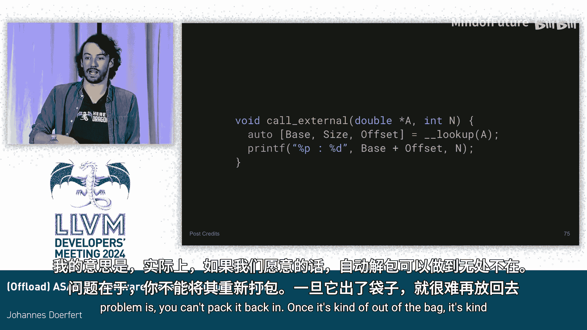

# 【2024-LLVM开发者大会-•-中英】-p59-P59-(Offload)-ASAN-via-Software-Managed-Virtual-Memory--BV18eNfepENu_p59-

Yeah， hi everyone， my name' is Johannes， We heard the title。

 so let's take a little look at at the sanitizers。Let's set the stage first of all。

 this is kind of a work in progress report， this is not you know finished， this is not cleaned up。

 so the numbers se report are a little like hand wavy。

 they give you ballparks and they give you ideas but don't you know pin me down on things and there's a lot of room for improvement。

Thanks to Aaron and Rahul who helped me collect some of those numbers， so kudos to them。Let's start。

So in my day job， I work with you know， simulations or web people that have simulations。

 and they modify their simulations to run things， they build them。

 they run them to get maximum signs output。And then these things start， generating maximum science。

 and then they crash。And that's pretty much， you know。

 this is the situation I see in front of me quite often。

 and that's kind of end of the end of the rope。 And then you're like， oh。down。

And then you start debugging， but debugging is hard and one thing you know for a lot of these errors。

 what you would like to have is a sanitizer right， because that kind of helps you narrow down what's going on。

 where is this coming from。So sanitizers， especially the address sanitizer。

 helps you track down bugs out of bounce bugs in stale pointers。

 it does so by an instrumentation pass and runtime。

 it uses shadow memory in red zones and we get to that and it has been a staple in LLVM for a long time the other thing that you know I kind of focus on our GPUs because where we are we care a lot about GPUs and a performance they gave us obviously a powerhouse for modern HPC I heard you can do AI with those things as well。

 and for now I'm assuming dedicated memory that is not a strict assumptions but that is kind of the harder case。

 so let's go with that。So。In a nutshell。 What is happening， We have， you know。

 code in an architecture。 And if you write correct code on its CPU or the GP。

 you're happy in life is great。 So not a problem whatsoever。 The problem is。

 when you write buggy code on the CPU， you know， you write buggy code。

 you're unhappy because it crashes， you use the sanitizer tells you， where the problem is。

 you fix it， you're happy。 So what do we do on the GP side。 I mean， yeah， as mentioned before。

 we should just use the As， right， And that's what people did。

 people quite literally port at the As onto the GP。 So I mean， it seems like a great idea。😊。

So there is a complication with that idea though so what happens is if you compile your code and run it。

 you get fast CPU code with like a good compiler and if you then run it。

 port it to the GP and you run it there， you get faster code that's the whole point of doing that on these massively parallel machines right so you improve you get faster results。

 you can run bigger things。The problem is if you compile and sanitize your code and then run it on the CPU。

 your code takes a hit， it's slower than it was before， but it turns out on the GPU。

 it's much slower。And that's actually a problem because if your problem only occurs for big runs its on so forth。

 or if you need a lot of memory， you cannot add a lot of overhead， either in memory or runtime。

 or it just becomes completely unpractical。 There is also the compile term angle。

 but let's not focus on that too much。Okay som I can tell you it's very slow but I actually have some data to back it up right so we looked at XBch which is a little proxy application for nuclear reactor science。

 I think they do things that are important。 We have like five and a half gigabytes of data that is moved to the GPU so it's like a nontrivial amount and it's a proxy application for the full openM Monte Carlo and nuclear reactor simulation code we'll see that in a second again The fun thing about it it comes with coudDa versions。

 Openmp offloading hip versions and others and it's like really easy to build so its it's a great way to do some testing。

😊，First thing we did is we took like a V100 system with the openmp uploadloading version in the Quda version。

 and we used the Nvidia compute sanitizer tool， which is not instrumentation based it runs on an executable after the fact it does more than address sanitizer。

 So so that as word of caution。 defaultult run times2 seconds and 04 and then with this compute sanitizer。

 we get like slowdowns of like 25 to like 130 x。 That's bad on a more modern architecture and a100 that is one order of magnitude less。

 which is better。 So we're looking at4 to 40 X slowdown again。

 this does more than address sanitizers。 So let's look at the address sanitizer that AMD ported onto onto their architecture onto their GPUs。

Again， the Open MPP offload version and the hip version， and we get a slowdown of basically 1011 x。

That's kind of our ballpark here。And if we look at our results。

We're looking at a slowdown of like two。So that's an improvement of five。 And in addition to that。

 we don't have the memory overhead。And I believe there is more possible， but let's get to that later。

So this is just this little proxy app one kernel， you know。

 you get like a single data point that tells you something， but maybe not all of it。

 so I run the full openM application and I looked at the kernel times across all of them。

 so blue is the base。Red is we sanitize everything but shared memory。

 like the fast underscore underscore shared stuff and yellow is we sanitize everything。

And what we see here is that all the kernels have like the overhead hovers around two across the board。

 which is good。It also tells us that。I mean， we also get some， some other like results。

 If we sanitize everything in that run， we had like a 2。3 x loaddown end to end。

What the science produced？If we remove the， like， if we don't sanitize shares variables。

 we get a little bit back。 if we only do heap and global variables， like， you know。

 your Ka malloc style thing， you only like get 80% overhead。 if the instrumentation alone。

 the way we do it right now。 And again， this can be optimized costs us 30% of those 80%。

 just saying and if we。We added some optimizations you can ask me I have backup slides for those that actually got us back from 2。

3 to 1。7% on end to end overhead。 So these are the ballparks we're talking。

 So now let's take a look why this is。First， how does A10 work。

 Let's assume this is our memory right， you have a double array in the top and you have a single long at the bottom。

And you have stuff in between， I don't care about。Now。

 what it does is every time it does in a location， it puts fixed sized red zones in front and before and after。

And。Every allocation， and then it has a shadow memory。

 which basically has the same layer as the original memory， but on a scale  one to 8。

So somewhere with an offset or the specific location。

 there's this shadow memory which just mimics the real memory with like one to8 mapping。

And then if you have an access， let's say A of I， what happens is what happens is if you know if you access inside of the RAA。

 everything is fine and that's kind of what will be reported， if you access kind of the red zone。

 what happens is you get an error which is great because at least you you know you did something wrong。

😊，The problem is if you happen to access inside of another array， another variable。

 or just in the middle of nowhere there is no red zone。

 you probably will get away with that access without it being reported。

 so that's also kind of a little iffy。So how this is worked basically before it does the instrumentation。

 before the access， you do a check， if that address is valid。

 what it does is it goes back to the shadow memory。

 it loads the value in the shadow memory and basically the values there tell you if the memory is okay if the memory is okay to be accessed so the green one obviously kind of works through in the yellow case。

 you know it comes back because it loads values out of that shadow memory that indicate red zone it reports an out of bound error and it can do certain things here and if you happen to hit another non-re zone in the shared memory your program just continues running so that's kind of unfortunate。

Now。Let's begincap。 CPUUs and GPUs are different。 That's kind of my main point on all of this。

 The environment in which you like do things is completely different。 One is very close。

 The other one is very open。 You have a lot of memory on the CPU and not so much memory on the GP and you have different kinds of memories on the GP that you explicitly program and you really care about Why on't the CPU people don't really explicitly program there They different memories。

AsN has a fixed overhead， it basically introduces a second access for each one that is in your program。

 more this。It has like at least 12% memory overhead if you have a lot of smaller allocations more。

 and it can have false negatives， and then if we actually run the numbers and run these things。

 we see like an order or two of magnitude in terms of in terms of decreased performance。Also。

 my main problem， honestly， was not the 10 x loaddown or the memory overhead。

 My main problem was that I don't have a version in open。

Stream version of an ASN that I could use in a GPU， that was my main issue。Anyhow。

 let's take a look at what we did。 First， think of， like， does our memory again as before。

 Think of a pointer。 What does a pointer actually do。

 A pointer kind of has some bits that kind of technically represent what object you're pointing into and some bits that give you the offset into that object。

I mean， this is simplified， but if you think about it， this is kind of what appointed us， right？

So and now the idea was why do we I mean， let's introduce a level of indirection。

 which because that always solves problems in computer science。

 So I introduce kind of my own little MMU in software every time I do an allocation I put an entry in there。

 I say this is the base pointer of the allocation and this is the size every time I delocate I basically put the size to minus1 or whatever and then I know point that allocation isn't valid anymore here we go。

So how does our pointer now look， our pointer now points into that MMU unit， it says I'm entry 15。

And then the offset， sorry。 And then through that M unit。

 you can find the object where it's supposed to be pointing to。

 And the offset just stays the way it is because you want to allow people to do point arithmetic。

 You want to allow people to do get element pointers and so on and so forth。

 which they can because the offset is exactly where it's supposed to be。 So they can just add5。

 That's okay。 That's all cool。😊，Now， if you have a little piece of code。

 let's say a loop that increments an array， each element in an array。

 what happens is first you do a look at， so think about it。

 a is this pointer here so it has an object ID and an offset inside of that allocation record。

 we can basically find a base point and a size， which means that we now have a base pointer size and offset。

Before the loop， we only have to do that look at when the base pointer is defined。

 which is generally， you know， often， not always， often at a place that is much better than what the access is。

And then inside of the inside where the axis is we do an actual check， again， you could hoist this。

 but let's not， let's say we do the check where the axis is and what you check here is is offset plus I smaller than zero and it's offset plus I smaller than size。

😊，That's it。 There's no memory access next to your real access。 That's kind of cool。Obviously。

 you have to actually rewrite all your ases because now。YouYou fiddled with the pointer。

 So A is not a real pointer anymore。 So you have to kind of deal with that。 but that's doable now。

Offset is where it is。 But what would happen if somebody overruns their pointer， their offset。

 you would basically have a broken object ID， and you would basically your Ascent instrumentation would crash。

 That's not great。 So we introduce a magic here to make sure you know if somebody overruns their offset。

 we can detect that。So again， on device every time we do an allocation。

 we put it into our record like getting something from the record at 16 bytes loads in a lockup。

 wed only need bit comparisons and bit operations and comparisons for each access to do the check and all of this is great for 64 bit heat pointers for which there is a few allocations but if you load on a device and you have shared memory and stack memory for which there are a lot of allocation thing each stack allocation exists per threads so 10000 times your number of stack allocation and those are 32 bit pointers。

 which is also kind of semi problem so that scheme is actually not as great。

 we did it initially and it works but it's not as great for stack pointers So what do we do instead first of all。

 we introduce an at space like what kind of pointer。

 where does it points to into our fake pointer and it always has to be at the same location because if you get a pointer and you don't know their origin。

 you need to check that firstst to kind of guessimate what this pointer is。😊，And then again。

 this whole thing is 64 B， right。It's all pointer size。What if we have a 32 bit pointer。

 Like if we start with have a 32 bit pointer， We first in our 64 bit saying。

 we still put the at space at the very beginning and we put the magic in offset at the very end。

 Again， this is embedded in a 64 bit。But then we take the size of the object and em it inside of the pointer。

Because we started out with a 32 bit pointer inside and we embedded into a 64 B pointer。

 We put the size in there， and then we put the real pointer in there。

 So now our entire metadata lives inside the pointer that we pass around and theres no like there is no nothing stored anywhere。

 It comes with the pointer。Okay。Now for each， I mean。

 now we do the registration only for he allocations。

 32 bit pointers are replaced of 64 bit pointers everywhere。Remember。

 this breaks down if somebody would store away a 32 bit pointer as a 32 bit pointer。

 but it turns out never everyone no button actually does that because it's actually hard to do。

 It's not possible， but it's kind of hard to do so people don't do it。

 it's no good reason to do it anyway。 so we could detect it or we can detect it so it's not that bad。

 at space check and then the 6 byte load potentially depending on what kind of pointer it is for the lookup the check is the same as it was before and for 32 bit pointers like shared memory and stack memory。

 we have no memory overhead。Okay， now I have some numbers here on what our current values are。

 You could。 You could switch them around， and you have more bits inside of the pointers that you could use if you really needed to。

 So this is more of a。😊，One configuration among many。Okay， so a few more things。Oh sorry， yeah。

 So the lookup now actually has to return the at space and the check has to know the at space because。

 you know， everything is at space dependent because the pointers look different。

 And if we already know statically that that the pointer has an a space， we don't have to do this。

 We can even verify that the user gave us the right address space and so on。Hi。

 how do you register these heat pointers？ I mean， effectively。

 you just overload the malllos and the kuda malllos of this world and just say， okay。

 do the actual thing and then you know， register it in my MMU table。 It's that simple。

 Theres no magic going on。Okay， how does this look if you get an out of bound access because these are nice pictures so you get you know it says。

 okay an access， a read a write， I mean nowadays it says read a write of a certain size。

 technically we can't have the PC here， the block and thread ID are actually what thread caused the issue then you get a device side stack trace from the GPU which is completely software managed just part of this because I wanted stack traces and I don't know Dof so I make my own。

It's not a good idea， but it makes nice pictures， so you get this software managed device side stackrays。

😊，Then you get information about the allocation， you get like where is it， like what was the name。

 what was the back trace of the allocation， so you get all of that thing about where it came from。

 which is pretty cool to you know like if the pointer you load is like from somewhere and you don't actually know where it came from and now you can pinpoint where that came from and at the very end similar to the address sanitizer that shows you like the shadow memory state I'll show you the pointer state for no particular reason。

Okay， we can do this with shared memory， not only global memory， but shared。

 and there's a twist to the whole thing。I talked about GPUs a lot。

 I talked about 32 bit shared memory pointers and so on and so forth。

But as part of my abstract already， and given the fact that I put offload in parenthesesis。

 you might have noticed nothing of this scheme is dependent on the GPU。I kind of used it there。

 and I needed it there。 But I didn't actually have， I mean， there was nothing about it。

 that was GPU specific。 So let's get rid of that。 Let's just say Asin by yourself the managed virtual memory。

 right， And in the abstract， I promised I'm giving some numbers。 So yesterday morning。

 I did some experiments。 So I have some numbers。took an naive matrix multiply。

1024 to the power of three， like you the input sizes of the matrices。

And I ran it on an AMD I processor because I just had that la around。And what happened。 So I ran。

This version， like a hacky， poured this from my GPU implementation to the host and just basically rip it out and just stitch it together versus the baseline and ASAN。

 like a regular Kang ASN。And what you get is this， I mean。

 my hackki stitch together solution was 6% faster on that example。Okay， I mean。

 that's kind of in the right ballpark， right， that's not bad， but the fun part was it had， I mean。

 effectively 0% memory overhead， like 0。0001 of the pages that actually were touched compared to the 30% of AAP。

And I thought that was kind of， kind of cute。 So that was cool。 And I believe there is again。

 lots of things that we can do and I believe there is lots of room for improvement。

 we have done two or three little optimizations， some others are currently being worked on。

 including hoisting things and so on and so forth。 but the point is we already got rid of the memory which was like a clutch in the original design always。

 and now if we can get rid of a few more of those aes and checks out of hot loops。

 we probably get our overhead in both dimensions down to a level that is really nice。😊，Okay。

 let's summarize this， we report。Various kind of errors。

 including if you allocate something that is too large for us to handle。

 because we have a natural limit。I mean， depending on your configuration of pointers。

 you you can't only handle this， you could fiddle with the bits， but there is a limit to it。

 we can tell you if you have a bad pointer， so if you overwride effectively if you break the magic bits。

Or some other things， we will just tell you that's a bad point if you did something with this thing or pulled it out of thin air。

 I don't know， but it's not good。Out of bounds， negative and positive offset bigger than the size cool。

 yes， we can do heap after free for everything that is in our MMU because we can update the size after the fact。

 so if we put the stack things in there， we could do it， heap we can do it。😊。

I have ideas on how to do use after free for the 32 bit embedded pointer， right things。

I believe that it's doable， but lets' we can discuss that later， and I'm not sure how useful that is。

And we can tell you if your code assumed the wrong address space。 So basically。

 your code had static annotations of certain at space。

 and you ended up with a different one because we kind of track it anyway。ok。

We have very little memory on the GPU。 So we should avoid memory overhead。

 We are generally memory bounds。 We should avoid additional aes， especially in loops。

 and we have different memories。 So we should have something for fast memory that works for fast memory。

 something for stack memory， that's good for stack memory。 And sorry， and for only for the heap。

 slow he memory。 we can do actually overheads。 not for everything else。 Okay， I'm out of time。

 Thank you。😊，Any questions？Okay， does it matter？Like as a developer。

 I can actually inspect the value of a pointer， right？

For you know if it's the hasushki or something but actually if I write like something like a jit。

 I can look at and do the tricks with it right it's not immediately obvious out this handle so okay so there's two things one people could just fiddle with the pointer they do in pointer to end and then they start you know doing all sorts of things with that thing which is generally fine。

If we if we call an external function， let's say we call a printf， right？

And we pass one of our pointer goods passed。 What do we do。

 We automatically put an unpack call in there， which is effectively a lookup， but without a check。

 And then we pass a real pointer out。 And you can also ask the system to get the real pointer for a fake pointer。

 So we do this to do external function calls， like printdef for something else。

 And you could do it manually if you're like， but yeah。

 So there is a chance we break things if people do that。

 especially if they you know do an inter pointer， we could could we could look up there too。 I mean。

 actually， we could do the unpack everywhere。 who wanted to。

 The problem is you can't pack it back in。 once it's kind of out of the bag。

 It's kind of out of the back。

Very very interesting works。 And thank you for presenting this。

 I want to point out that this It feels kind of reminds me of Intel MPX。There Intel MP X。

 It's a deprecated extension。 They also had this kind of。A table of bounds in memory。 My question is。

 how do you manage the lifetime of the entries in your bound table， Like， say， you delicate memory。

 Not all of your pointers are gone yet。kind of quarantine。 So at of right now。 So。

 so there's two things。 my M M U， my little table just exists for now。 I have the。

 I gave it a fixed size。 you can make it grow when you can make it a linked list or whatever。

 So it has a fixed size for now， and I never remove entries。 What I do is if you delocate a pointer。

 I update the size。And then I basically put the size onto invalid and then when you access it later and we do the lookup。

 we can be like， hey， this is a user after free because you just access something that has been yet already and then what happens if I run out of space in my big thing？

I mean， if that is a problem， we have to come up with ways to basically allocate new tables and link them together。

 but I would never get a real thing really， you can when we had the stack stuff。

 we actually added tags into the pointer and the allocation table such that you can reuse these these places。

 which you could do。 I mean， you can use a couple of bits to reuse the place and reuse the pointer and you then still know。

 even if you point to， you know， location 17 into your table。

 you can compare the tag of the of that thing and your pointer。

 and you still know if you actually meant this object or the object that was there a while ago。

 So it kind of that way， you can reuse these entries。 But so far， it's just no no need。Thank you。

Since youre looking at out of bounds access and all the stuff。

 it looks like Ubis can cover that you look at the Ubis as whiter and less memory overhead。

I have not compared it to UBSN。 I was not aware that UBS does bounce checks。I， I mean。

 if it does bounce chis， I don't also don't know how it does it。 But yeah。

 I have not compared it to UBS。Any more questions？Okay， let's thank you， Han again。

