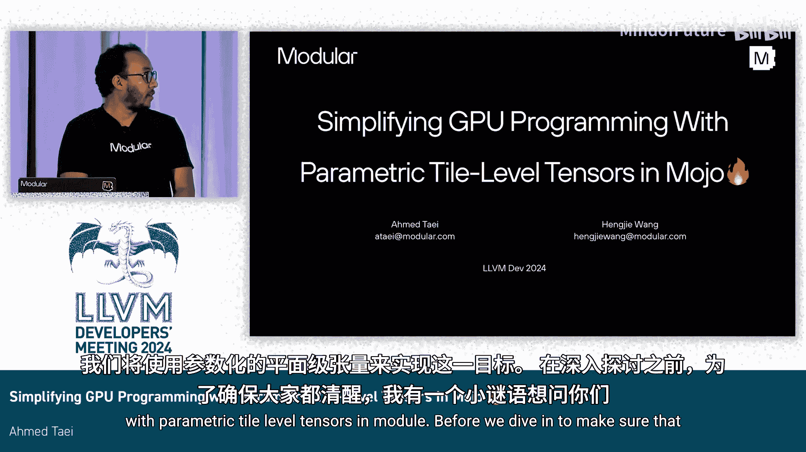
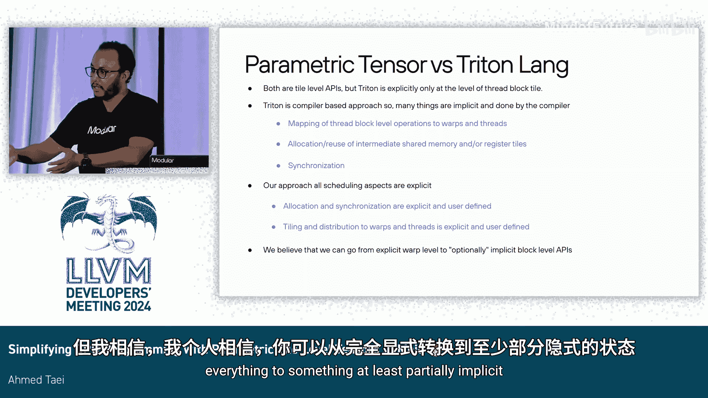

# 【2024-LLVM开发者大会-•-中英】-p60-P60-Simplifying-GPU-Programming-with-Parametric-Tile-Level-Tensors-In-Mojo--BV18eNfepENu_p60-

Hi everyone， I'm Ahamma Playa for modler today we'll talk about the work the kernelels team。

 An and I did to simplify GPU programming with parametric tile levels inor at tile level tensors and module。

Before we dive then to。Make sure that we're awake， I have a small riddle for you。

It goes as a following， a unified team of 32 working together for sure to go through in synchronized fashion。

 no threads left behind。Executing your matrix multiply with speed of mind。ho埋。

I will give you a few seconds to think about the answer。And。你。

Anw is a warb executing MMA single binding instruction。I hope some of you at least got this right。

So let's start with modern GPU architecture architecture， so GPUs are massively better machines。

For instance， for MBBR， 800 GPUs had the 128 streaming microprocessor。

 each of which had massive shared memory and register files。And this massive burism can。

Give you around。2048 burial threats to execute。And this patternism is coming from a heterogeneous set of processing units。

 So not all cores are executing the same instructions in your eyesO。 for instance， you have。

COta cores that the execute like load store floating point operations， branches。

 and you can get up to 40 tier of flops from those。

 and then you have a tensor core which as you can see can give you around 300 tier of flops and they're specializedizing in executing only one instruction cheese matrix multiply。

And the way the GPUs interact with the external system， he had the high bandwidth of chi memory。

And as we move in time towards the next generations， we have more parallelism。 For instance。

 in Haror in G H00， you had more S M。 you had 144。You add more in shared memory for registers than shared memory。

Of course your cores gets faster， so around 3x faster than previous generation for tinsor core for coda cores。

 and I think roughly around the same for tinsor cores。

 so you get around one beat of flop which is very fast。You also get。😊，More specialized accerators。

 you get the tensor memory accelerator to move data from DM to S Ram。

And you get a higher bandwidth for your external memory。So this all sounds like great news。However。

 performance is not portable。 So if you have your kernel reaching max B performance in the previous architecture。

 you need to do a lot of work for this kernel to get the beak in the New York picture。

And the reason is you have a new instruction set and you need to apply new trick。As a result。

Backends also， not just only kernels。Have to catch up very slow，GBUs are moving faster and。

The compiler is trying to catch up with the support in the backends。So how do program these GUs。

 GUs programmed with a single instruction， multiple threads programming model where all the threads are executing the same instruction in peril。

But what the hardware does， it groupss these threads into 32 consecutive threads called verbs。

 and then sttle them。 hopefully in the best case。 and all verbs are executing A verb is executing all the threads and barrelial。

That doesn't happens for many reasons in many cases。

 or there are also a subset of the instructions that define at the level of a verb where like Mamal than when we talked about in the or when you do reductions or warb shuffles。

 etcter。Most on new generations， widen。That verb， so you get an instruction that is executed。

 has to be defined to be executed by more than one word， like a warp group MMA in the case of Hoor。

So saying instruction multiple threads is great in exubcing betterism。😊，We all use it。

 we wrote kernels and they're fast， but the hardware doesn't really execute threads individually。It。

Group threads and verbs。 And then。That's on the hardware side。 you also get the programmer。

The person who writes a kernelel never cares about what each individual thread is going to do。

 always write their program where what a group of threads will do。

So if we looked at the dense kernels， as an example， these dense kernels， like matrix multiplication。

Dreuce into a data better operations on tiles， for instance。

 when you decomose your matrix multiply or any dense kernel of that flavor。

 it end up being an operation on a tile that is assigned to a thread block。In a specific way。

 and then within the thread block， you went to tile again and take this style and assign it to a verb。

And then now we have a wordb。You need to assign and organize the lanes or the threads inside this verb。

F your data。And when you go there， when you map your data to the compute hierarchy。

 you want to define operations on tiles like QA。Alllocate， load， copy， move things around。

So the mental model for the programme is always at this level of there is more than one thread。

 and there is typess of data that well move at。And also going back to the beginning of the talk where we saw the tensor core that gives you 300 Theof flops versus coa core gives you40 tiof flops。

The programmers want to use this。Specialized fixed function cores to accelerate their。

 their kernels and the instructions for these courses are defined in terms of the tile。

 So the instruction itself is expecting things to be。On the tide of data， as we're going to see here。

 for instance， in Amber， the MMA sync instruction does have many flavors for shapes and data types。

 the one we look at is the8 by8 by 16 by 8 by8。So you will have a work， which is 32 threads。

This instruction， in this case， will expect。Data to be laid out in a specific particular layout。

 for instance， for the right hand side。You will have a row major layout for。

The thread zero to access four elements。And that order。And。For Obra brandnd B。

 you get a column major layout for threads and it's going to access a two by one。Coon Victor。

And then for Uburn and C， you have an layout that's actually similar to Uburn and A。

 So as you can see， even the instruction itself is expecting data to be。

Represented in ties and subtles。So。In my opinion， and also what we find as were doing this is that sounds like an abstraction gap where the sameT is kind of low level details for what you as a。

Current of developer want to write。So it's just a way to express federalism。

But the way you want to express parallelilism doesn't necessarily mean you have to go down and write everything as what this thread should do。

 Otherwise， you're going to。Spend you most of your time， just。

Comuting indices and doing index arithmetic and index bookkeeping for how to decomose these things and the hierarchy。

So we would love to have a high level。Tide tensor， which just fits the problem naturally。

 where you can do operations in these tensor like you can。

 tile this tensor allocate it in a particular memory region。Cpy it around， do math on the tensor。And。

When you。Assign the sensorsor to the compute hierarchy。You can， once you have a verb。

 you can say like， okay， so I have a verb。 I can。Use this particular。Thread layout this work。

And when you do it this way， now your problem is。Prameterized， which is great。

 It's good news for you to kind of like hook your kernel with o tuning because now you have few decisions that you can change like what is my tile size what is my register tile size and so on。

😊，So you can like tune your kernel or even for experimentation if you're。Working in something。

 And you， you're tuning it。And that's not actually a new problem。

 I mean we software has always existed to bright libraries that provide highle abstractions that they don't have any cost and give you access to express your algorithm or your kernel in our case。

It was out。You have to worry about the implementation detail of how things will map to single structure model data。

But because it's a language， because it's a library， the challenge is always in the language。

 So you're bounded by how much the language can offer for you。And。More specifically in that problem。

 you're bounded by how much。Combined time transformation you can do or how much。

Powerful is a meta programming for this library， for that language when you write your library。

And going back to the point where we're talking about the compilers are always catching up。

So you don't have always be and support for the things you're doing like you're bringing a new like a new hardware or even the current hardware actually doesn't。

 then you're kind of like only left with one solution。

 which is if you want to access this new instruction like the new Tensor core thing。

 you have to write in line assembly。And you try to avoid that。So thanks to Mojo。

 it does have a much similarr。Meta programming approach， as you're gonna see in few slides。

 and also does have row access to ML I operations。 So you're not only left alone with in line assembly。

So our approach。To solve that problem， to fill in the abstraction gaps， to define a tensor type。That。

You can tile， distribute to the compute hierarchy。And。Had more powerful things。

 more powerful type transformation on it， like you can。Victorized it explicitly and so on。

And this tensor type is beimetized by a layout meta type。

 so you can specify how the data is stored and accessed in that tensor。And for these things to do。

 you don't really have to have a compiler or a DSL as long as your language is rich enough to do that meta programming。

So because meta programming is core in that approach。

 we're going to start with how meta programming looks like in module。

So let's look at this example where we have almost the same code in modulejo and C++ and。

Right in the right side， you have a module code for a tensor type that is bettermetized by a data type on rank。

And you have a C plus plus template that is bettermetized by a type and a me type。 So in module。

 we have parameters， which are。They're all meta typess。

 we want to have a type and meta type distinction between these two and these parameters are like templates。

 but they're not the ASD substitute kind of meta programminggram approach they are a compile time value that the module compiler will。

Materialize for you and give you a concrete。Like type attribute， value。

I won't get to the details of how the interpreter works。

 but there was a great talk by HJ Fl here if you're interested。

Another powerful thing in the meta programming at Iodu is you have the same language and for both programming and meta programming。

For instance， here in the Moji program， you have a function that compute the size or like the number of elements in this sensorsor and。

This function takes a list， which could be a he located object or whatever it is。

All you have to do is to say， Eliliaas and。Cold size with a list and that expression will get interpreted and evaluated at compile time。

 And you have a compile time list that is not evaluated or anything。 It's just。

An attribute list of integers。 But in the C plus plus， will at least in。

My opinion is a totally different language。 meta programming。 you have to。

 you know like learn all these， different set of language constructs to represent the same thing。

 And that's a barrier。 So for implementing library and makes things complicated if you will rely heavily in meta programming。

In module also meta types。 they don't have to be only user defined types。 You can have。诶。

Parametric closures， which are functions。Defined in。In a particular way and like for instance。

 you can have a multitageged MMA where you parameterize it in number stages and you best a function to implement things like fusion。

Which is useful for good generation。For compilers， when you do。You need your fusion。So。

We have a tensor that is barmetized by layout me typess。

And these meta typess are a layout for the data layout。Where you specify how the dense order is。

Is access and an element layout。 So when you promote your tensor。

Elements from being scalarrs to vectors， you transform the element layout。

And the layout is just a function that maps coordinate to coordinates。

 and that's how you can get the access for your elements。And。If you're familiar with Sclu。

 we use a very similar definition for what's a layout。

Heres just an example for what's the layout for row major and measures。

The reason why there is a double， not a list of integers is because we need to represent tile layouts as well。

 which if feels familiar with Erie， MMT 4D。Back layout out， this is similar。

 but a not flattened version。 It's a structured version。So let's look at the how do we transform？

This tensor type。 So we have an operation like a tile。

 where you get a tensor and you have a tile size parameter and coordinates。

 And then you get another tensor type where you evaluate the。The type by。

Dning this barmetric function， the tile layout。 and you do this layout transformations。

 So as vectorization， where you raise the scalar elements to be a vectors。

 And then you also update the vectorized elements。 or do you distribute a layout。 And in this case。

 the distribute is barmetricized by a thread layout。Which。It's what distribute does。

 It's tile and distribute。 It ties your data and then distribute threads according to this time。

So now you can define operations in the sensor like you can allocate memory。

 you can do data movement， copy tile from place to place， you can do math。

So let's look at how things come together to simplify how do you use insert course to get the max B performance。

So you can have a tensor construction， then you allocate tiles and shared memory。

 you allocate register tile， you have a reduction loop。Then you move data around to ex。

Synchronization explicitly， and then you reduce。And you use the。Tense core instruction。

 you load data to registers。Then you compute and accumulate。

So how the G U primmitives are implemented。Theyre MLI operations。

 and that's the thing that saved us from just writing NlineS simply。So when you put things together。

You have a Math mall that looks similar to the Math we saw before。

And that implementation did give us an performance that is almost on bar with cool B。

 if not faster in some cases， and just to be precise。

 these shapes are dynamic and there is no static shape specialization or anything。And。诶。Yeah。

 I think I。Almost out of time for how do we compare against straightton， but。Yeah， thank you。

 And I would love to have questions。What。Thanks a lot， if anybody has any questions， raise your hand。

 I'll see if I can see you or come up to one of the two microphones here。Out of curiosity。

 have you found some common level abstractions that would be also used perform form different kinds of heterogeneous hardware。

 So also think of say AM D GPS， for example， Or do you think that's also pretty much portable as it is right now。

Yes， so what we describe works for AMDGBUs as well because the only difference is the layout for the tensor core and the matrix core。

 and as far as I know they're actually similar in some cases。So yes， I able to adapt exactly。

 so you can swapwab MMA with the MD matrix score。Can you talk a little bit about the MLIR dialects that you lower to from Mojo。

 like at the top level and are they upstream？Right， so we lower to LLVM。

 IR dialect and N VVM for the GPU case。 So by the end of the day， things will be。Moure code。

 the end of the， the end thing is LV IR and and NVVM。

Is that there a top level dialect to are you direct？In the。AndOh。

So no top level has than theoids that used to implement module itself， so just the language。Hi。

 thanks。 Very amazing work。 I have a， I have a question about the layout。

 So for different kind of our computations like the element wise。

 we do not have some too much re use。 So， so there will be a linear or just like a water flow through the。

D Ram to the cache to the register and then go out。 Well for metrics multiplication。

 we need to tall in and block in from your guys mind。

 I there any other communication or reuse pattern that we need to to consider for the layout。

 you know， if we do if we are doing some meta programming。

 we need to maybe doing some derive or on the in on the inference on the layout how the layout is being computed or translate。

So let me freephrase the question just to make sure and say currently we have Tensor core。

 and Tensor core have the different types of matrix matrix computation and our layout will based on the matrix tensor core to build up the pattern and do you guys consider some other pattern for the layout beside the basic underlying tensor core。

Right， so。We both lay out as a way to describe how threads are organized right？

And then if you're doing something like you're copying data from DM to SM。

 you're moving data to shared memory， right then。We define a composition like layout is a function that you can compose with other functions。

 so you can define as swizz thing that permute your layout so you can access shared memory in a way that is not。

And it's not going to cause bank conflict。And even if the consumer is just avoid twice up right so I agree with you that sometimes like it's not just only tens or core that determine what is your layout is' more of like what operation And as long as these things are only defined by the operation itself。

 like you don't need to you know like walk。Multiple operations， then that library approach can。

make these layouts implicit。So you， you as a user don't always have to define layouts for everything。

 Okay， so you get tens of course， gives you layouts。 Ops can give you layout so on。 Okay。

 so some of this layout transformation will be mappinging to TMA or。To some。

 maybe some data layout or using the thread to do the data manipulation or shuffling in your lower。

So teamA will do its copy right and then we'll just give you data and that title。

 then when you read from this shared memory you specify the layout for how you read。

I did that answer a question or yeah， yeah， I think， I think answer。 Thanks。 Thank you。 Go。

 Thank you。All right， we have one time for one more short question Oh this is pretty short if you don't mind。

 could you put up the slide comparing it to Triton？II missed that。Yeah， which one。

Which slight slight compared to Triton the very last last。 Oh yeah， yeah， sorry。

 I was running out time。 So I have to squeeze this part。 Yeah。

 the same thing about that really quick。 If forgot like a minute。😊，Yeah。

 so Tritrain is a great compiler infrastructure where you can write your program at high level thread block thing。

 and then the compiler will do an amazing job of giving you a performance code。

With how much the compiler can do， and our approach is very different。It's a library。

 so you're still going to write a kernel and we're giving you control explicitly over all the scheduling decisions you want to do like you want allocate register tile and a synchronize everything because we were targeting performance first。

But I believe I personally believe that you can go from fully explicit。

I want to declare everything and I want to control everything to something at least partially implicit。

And。All right， that's the time we have， let's thank our speaker one more time。

