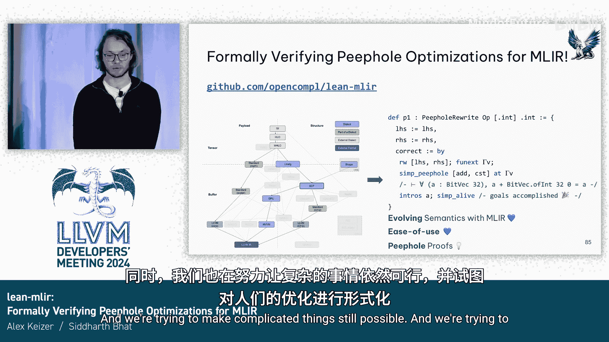

# 【2024-LLVM开发者大会-•-中英】-p61-P61-lean-mlir---A-Workbench-for-formally-verifying-Peephole-Optimizations-for-ML--BV18eNfepENu_p61-

Yeah， so hey everyone， I'm said。 and yeah， we'll，ll be speaking about Lena Mula， which is。

 as we said， a tool for formerly verifying people optimizations。So yeah， let's begin。

 I guess you know the first question on my task is hey， wait。

 what about alive right was the relationship of what you do to alive and you know good question for those of you who don't know what alive is。

 okay that's great。 you know you're one of today's lucky 10000 So let's consider these two programs called source and target So source is a program that takes an input and then divides it by this number 8 1。

92 which is2 to the 13 and then targets another program which takes a number and then shifts it right by 13 right So you know if this where a people optimization in a compiler then we'd like to know that this optimization is correct。

😊，So if one feeds these two snippets to a tool called， alive will then tell us， hey。

 the transformation seems to be correct， right， So essentially this is what alive does。

 It takes source and target program snippets and it checks that the semantics of the target program is equal to the semantics of the source program。

😊，Right， now let's imagine that we maybe mess up the optimization and we instead wrote an optimization that takes division by one and rewrites it to shifting by 13 right this is an illegal transformation So what is alive actually say in this scenario。

 So if you ask live alive says， hey， look， the transformation doesn't verify the value is mismatch And in particular。

 when when the input value is one。 the source program returns the output of one and the target program returns an output of 0 right So this is super useful And you know in fact。

 it's so useful that if we sort of go look at the LM commit log。

 we just habitually see references to alive whenever somebody fixes an optimization or introduces a new optimization right this is just sort of this is part of the everyday workflow of folks who work on its combine or these passes in general。

 right and there's a bunch of uses。😊，So now there's a natural question of okay。

 L is amazing but what about MLIR right because alive is an LVM based tool So maybe as a sort of as a use case。

 let's look at hair， which is a compiler IR for homomorphic encryption that's what the H and E stand for So if we sort of like go look at what IRs or like what building blocks a IIR needs one of the things it uses is a dialect called as the polynomial dialect。

 which represents elements in quotients of polynomial rings。

 whatever those are right like it's some IR abstraction。😊，Okay， so， you know。

 like to be able to understand what makes it challenging to build something like alive for this dialect。

 let's maybe take a closer look at how a works right and what it does under the hood。So more or less。

 here's what alive does。 So we feeded the source in the target program。

 Now what alive really does is it takes a source in target program and it compiles it to a different IR called as SMTlib So more or less SMTlib is like an extremely tightly specified programming language which only has sort of very basic primitive mathematical operations right So so this is so this is what alive does now once it performs this translation it then queries another tool called Z3 So Z3 is what's called as an SMT solver and essentially one can ask Z3 hey does the function called source equal the function called target for all inputs right so this is a question we we can ask Z3 and Z3 is basically a genie right like it's magic and they're going to get into how it works but in this particular case Z3 comes back and says hey。

 you know the transformation doesn't verify and it sort of explains why the values don't match So sort of taking a step back what alive really does is。

😊，I to find a good translation of LVM into ST Lib， a semantics preserving transformation， right。

 which is which is not to say that like this is easy or something。

 This is incredibly complicated because LVM semantics are incredibly complicated right For those of you who remember the poison UB。

 Yeah Yeah it's been a journey basically right to even figure out the semantics of LVM。 Yeah。

 So this is like amazing work where they where they sort of nail nail nail it down。😊，Okay， so。

 you know， we now sort of seem to have a general understanding of our L works。

 So let's try to apply the same recipe for hair right So we have this thing called polynomial dialect。

 And you know， right now， L only works on LVM。 So the recipe seems fairly easy right we change the LVM to MLR。

 And you know right now we don't have an for MLR。 but it seems fairly natural to just ask for people who are alive know likeo and June and John to just write alive MLR right I mean。

 it's easy right but but the thing is it's actually not easy。

 And essentially the reason it's not easy is because the objects that that the polynomial dialect uses aren't easily described by SMT Lib。

 And so one needs to find either clever encodings of these mathematical objects into SMTlib。

 but sort of more often than not as the complexity of the IR increases。

 there's really no way to actually encode it into SMTlib。 So in some sense， these kinds of automated。

😊，Its hit a barrier where there's no solver that can automatically solve for these things， right。

We instead pursue a line of research that once again。

 the alive folks themselves started where they were thinking of reimplementing a life inside a theorem prove called leanan right What's a theorem prove we'll get add in a bit。

 And so what we do is we essentially take the approach and we run with it where we say okay cool right so we sort of implement a tool that lets us describe the semantics of ML or dialects within a theorem prover and also provide automation whenever possible。

 So that's sort of all goal Okay but you know what is a theorem prove。

 So I'm going to go into a three minute data into what a theorem prover is right So first of all a theorem prove contains a programming language where you can define things in this case。

 for example， I define a function called maximum which does what you'd expect Now。

 you know you can evaluate it and it says max of 34 is4 as you'd expect Now the other thing that you can do in a theorem prove is to actually prove theorem right so you can say。

😊，Hey， look， the maximum function is in fact commutative。 Now， if I ask you to prove this on paper。

 you may come up with a proof like this various say Okay。

 I'm going to do a case analysis on the values of A and B if A is less than B than something if equals B than something and if A greater than B than something right like the natural proof you might write down。

 So the cool thing about a theem prover is that it can sort of take this English language proof and then sort of write it in a custom proof language and the job of a theorem prover is to essentially check this proof that you've written down and to make sure that that your proof is in fact correct right So so Lean says yes。

 if and only if max is commutative。😊，And your proof is， in fact， a valid one。

So now if we sort of go back to to the hair use case and we think about， you know。

 we want a reason about this I right？ So what do we do Well。

 it's fairly straightforward if you have a theorem prove like lean。

 really what we do is is we just encode the mathematical concepts that you need to talk about these things which we which we possess in lean And then you know。

 if we want to sort of prove re write， like x the two to the n plus a equals a which is legal because。

 you know， for reasons we just write the proof right， I mean。

 because we're in because we're in a theorem prover So sort of like stepping back let's try to understand like you know。

 the sort of the space of。😊，of these tools right So in some sense， we have on the one hand Z3。

 which is push button right It's like you just ask it a question and it presto tells you the answer whether your transformation is legal or not。

 However， you know because it's sort of so automated。

 you eventually hit some kind of wall wherein you can't describe things。 It's just too complex。

 On the other hand， lean is on the bottom right where it's super complete because can you can really encode any mathematical concept you want in it But but really the issue is that you know you don' you don't get as much automation right Now。

 generally， whenever somebody plots a graph that has no scale or access or whatever the top right corner is where you want to be and this is。

 of course， also the case in our graph wherein we want to say that leanr is in the top right where we have a bunch of automation and we're also complete right but you know what does this really mean like how do we achieve this So really the idea is that we use we use lean as a language to describe the semantics of lots of dialects。

😊，And and and you know， when you're dealing with a dialect like LVM。

 which actually supports whose semantics are simple enough that it can be solved by an SMT solver。

 we make use of leans verified solvers to actually build these proofs and in other cases where we have dialects like the polynomial dialect where the semantics are in fact too complicated for an SMT solver we just encode the mathematics right so that's what we do So so in some sense Lena mallay really lives in that green space that you see where depending on the dialect that you have and depending on how much automation lean has for the dialect you know it's going to be sort of either push button or or manual right but but really the goal is that you never get stuck when you're trying to reason about your dialect So now that I've done a bunch of marketing I'm going to hand it over to Alex to give you details right。

😊，Thank you very much。 Si for the sales pitch。 And let's get down to the nitty gritty。

 So the goals of MR， like the first thing when we we said to people that we want to formalize the menmantics of MLR。

 they said， you're crazy。 M IR doesn't have semanticss。😊，A collection of of syntax。

 And that's kind of a problem。 So we want to kind of build this framework as a way to start that discussion and to well actually build semantics and gain a shared understanding。

And we're specifically focusing on people verification。

 And they're like sort of the green rectangle that shit showed。

We want to see where dialects could be easily verified。

 We want to make it trivial by building automation as much as we can。

 But we also want to really lean into the possibilities that Lean gives us。

 And even the harder dialects use complex mathematical mathematical objects。

 we're still able to express， and were still able to prove things about them。

 given sufficient effort。😊，So let's go broadly over D life experience for MLIR。 First。

 we'll show you some examples for， which specifically talk about LVM optimizations。

 where we have built a lot of automation and it's kind of push button。😊。

Then we talk a bit about polynomial again， where we go into the complex mathematical objects involved。

 And finally， we go for the framework and kind of how you could define your own dialect。

So we start by defining all the sort of the left hand side and right inside side the two program snippets that we also give to。

 and we've built our own embedded DSL in lean， where we can use basically the synax that were all familiar with。

 we painstakingly went through the grammar that ML IR has。 In this case， the generic syntax。

 And we've translated that into lean's mechanisms for extensible syntax。

 And then we've gone even the extra mile and added like pretty versions of the DSL to even get those versions of the syntax。

 So we defined the left hand side。 We just say some program that computes X plus 0。😊。

And then the thing we want to optimize this do is just x， because adding0 is nothing。

So then to say that this is a people rewrite， Well， first， we define， okay。

 this is the pattern we're matchinging against。 we're rewriting to the left hand side and the right hand side。

 And then we need to produce a proof of correctness。And in L VM， like the proof of correctness。

 it basically always looks the same。 We first run our automation that eliminates all the SSA boiler plate。

 And this kind of takes the embedded DSL。 And it， it simplifies the sort of the correctness expression into the pure mathematical expression that we want to decide in this case。

 that expression is that if we have an integer with 332 B， then adding 0 to it。 Well。

 that does nothing。 It just gives the original integer back。😊。

And then we have a whole suite of of proof hammer style automation tactics。

 which in this case will completely automatically close the goal。

So suppose you want to play along at home。 Do you need to have lean installed and done at a library。

 No， we actually have a website set up where in your browser。

 you can just get a lean buffer and play with these things。

 So here is that same example with the actual source code。

 And we can see that it succeeded because at the right inside。 we get like the beautiful。

 no gold statement。😊，嗯。This playground works lives at Lenar do crossro dot E， S。

 Or if you have a copy of the slides and you click it， then it will take you to exactly this file。

Alright， so that's the happy path。 If the automation succeeds。 then， then it tells us。

 I found a proof。 and and leanan checks for that the proof is actually correct。

 But what happens if we made a mistake， here' is the same example that shitt showed you before。

 where we're trying to optimize division by constant 0 to right shifting by 13， which is， of course。

 wrong。😊，Well， in this case， because the widths are concrete。

 we're just trying to prove this optimization right correct for 32 B。

 we the automation actually uses a similar solver to what what alive does。

 and it will give us a counter example。But we can be， we can go beyond that。

 We can actually prove our optimization is correct for arbitrary widths。 So in this case。

This is an optimization that we've extracted from alive。 But we've generalized it。

 We've actually said this is not an optimization that works at some specific width。

 We're trying to prove it correct for all possible width。

 So suppose you have some unusual architecture where you have 512 B integers。 Well。

 if you rely on the software that's gonna be difficult。 But in this case。

 we've proven it for all of them。 So in particular， for 512。Again。

 here's a link to this exact file at the playground。So like I said。

 we've gone through a lot of test cases。 We， we've formalized a bunch of things from hackers' delight。

 We've formalized a bunch of live test cases， and we've also gone through L VM's inscomamine test suite。

 We've extracted a lot of optimizations from there and。😊。

We can see that beefy design that's kind of the concrete width automation can decide a relatively good bunch of them。

 but a life auto， which is kind of a combination of different tactics we have that for are generic widths。

😊，Itre actually very competitive。And with special thanks to， to Lina Ferau and to the Ma community。

 and particularly Heri and Kim， for building a lot of this。

 this automation that that we can then reuse for our purposes。😊，Alright， so that's L V M。

 That's the case where we can rely on automation。 So what about poly annomial， Well。

 lean is a particularly good， good system to work in for us because it has mathth Li。

 And math Li is the world's largest formal math repo。

 where a huge community of of mathematicians are trying to formalize at least all of undergrad mathematics。

 and beyond that， even。😊，And it has exactly sort of the complicated mathematical objects that we need to formalize the semantics of the polynomial dialect。

And given the semantics， we can build a proof。 like this is not as automated。

 It requires more effort， but it is possible for us to prove things about it。 Therefore。

 we get this nice green rectangle where easy things are easy。And hard things are still possible。

So how does this all work， Did we just take these two dialects and formalize them。 No。

 we actually build a whole framework where we have the core kind of synctic data structures that MLIR has。

 and we give you methods to kind of inate that for a concrete dialect。So what is a dialect made of。

 Well， we say it it has two main concepts。 And that is， we have a universe of types。

 and we have a universe。 We have the operations in the dialect。 So in this case。

 this is a simple example where we say， okay， the only type we have is， is int。

And I need to give the semantics for this type。 And the way we do that is that we kind of give a function that that transforms our type universe into a lean type。

 In this case， we're saying an integer is just a bit factor of length 32。

Then we need to define the operations here。 We have addition。

 and we have constants where the constants kind of addition， you take a value。Then we need to say。

 what is kind of the， the type of an operation。 So a constant， it doesn't take any arguments。

 and it returns an integer。Whereas addition， it does take arguments。 It takes two to integers。

 and it again， gives us an integeruous output。And then given the signature。

 we need to give the semantics of our operations， again。

 as lean functions that kind of have this signature。

 And there's a lot of depend type machinery going on there， which we won't go into。But in this case。

 we're saying， a constant really is just the bit factor that that has that value that we we set and addition。

 Well， addition just is a function from two bit vectors。 and it gives their sum。

So given all of these， these sort of semantics that we define， then。The framework will take in this。

 this high level DSL that we specified， and it will translate like the the con operation into the semantics that we gave for cons。

 And it will translate addition into the semantics we gave for addition。

 And that brings it all together and allows us to have these nice syntactic objects to play with and still get formal proofs in lean。

😊，But， of course， the core problem is we need to know what the semantics for a dialect is。

 So if you want to have a formal semantics for your dialect。

 please come chat with us and tell us what it is so we can formalize it。嗯。

And that is kind of what we have。We're trying to evolve the semantic MLIR。

 We're trying to make easy things easy， and we're trying to make complicated things still possible。

 and we're trying to formalize people optimizations。 Thank you very much。

Any questions？Hi， nice talk out of curiosity in the existing MLA dialects。

 have you found something that made your job harder or something that made your job easier。

 and do we have any advice for dialect designers that could make their dialects easier to verify We've not found anything that makes it easier you know。

嗯。So， I mean， I， I think generally， theres a lot of， at least when I was thinking about this， theres。

There's a bunch that's unclear about parallelism and asynchronicity and whatnot， right。

 Like it's just super unclear what it means in many of these cases。 So that leads to some problems。

 Also last year， I think Jeff Ne and I had a talk about dominance and how it's not really clear what some of the dominance traits mean。

 So those are sort of the major。Like， I don't know things that at least I've encountered。 Alex。

 do you have other other pieces of thela or semantics that were unclear。 Yeah， I's just in general。

 documentation。 If you have strong documentation for what your intended semantics are。

 then we can try to formalize them I， maybe get back to you and say， like。

 what do you mean here exactly and and try to to go from there。

 But if there's no documentation for us to begin with it becomes very hard to for us to try to guess what the the meaning should be。

Thanks。Hi， yeah。 thank you。 Do you have any example of。

Dialect that you cannot paraize like it has like just impossible。 Yeah， very fair question。 So right。

 So in some sense， we assume that regions behave in a particular way， where more or less。

 we assume that when when you have an operation that takes a region。

 then the region can be sort of treated as a black box function， right。

 So if you think of a dialect like quant where the semantics is， you know。

 like if if you this used this used to exist。 I think it's removed now。 But there was。

 there was an operation called quantas that said that any operations inside the body of this region will now become quantized。

 right， So that makes it antimodular because the semantics of the operation inside sort of the region depends on apparent that could be arbitrarily above。

So， so so things like that don't work。 but it's kind of like as long as the semantics is compositional。

 then then were able to represent it more or less， yeah。嗯。

There's another fairly big open question around how we do side effects。 So we have。 So， you know。

 so it's like。So more or less it's kind of like this it's like in the framework we have support for side effects。

 but it's really not clear how to build proof automation to reason about some of the really complicated kinds of side effects that MLIR possesses is sort of the story so far yeah。

Thank you。It's pretty cool。 I'm curious what how big of a scope of things you've tried to prove。

 It looks like the examples you've shown sort of the basic block。

 have you looked at bigger things and how big Yes， So maybe Alex has so yeah。

 I mean we've been sort of currently focused on on mostly like the basic block level type of things because they are because at least so like those are the people we writeites that exist that are most pervasive within ML So for example。

 So like we do have a couple of rewrites about things like for loops and if conditions and whatnot like folding them and peeling loop ateration and things like this but more or less I think you know it's not if you have large scale examples of people weites that involve like complicated region related transformations。

 I would really like to take a look。 I guess inlining might be the first step Yeah。

 I guess that's fair， but。Yeah， I would like to discuss this offline but yeah I think somehow like you know that that's slightly beyond what I would consider a people we read。

 it's more like interprocedural transformation almost right yeah so。😊。

And then it seems like your approach has been to sort of extract some little bits of MLAR and build a model of them in leanam。

 Have you thought about how to maybe close the gap a little bit so that you maybe what you're verifying is is a transform dialect kind of of thing Like if I add the semantics。

 And then I say， oh， by the way， you know here's my transform dialect thing in the transform dialects that's what I want to verify。

That's a， yeah。Right that's not not a theoretical problem as much as a practical like software engineering。

 Yeah， yeah， of course。 but yeah， I mean， I do think that's interesting。

 So maybe one of the things that we didn't touch on is that like So for example。

 our with our semantics for like LVM and arithmetic we do have executable semantics。

 So we do exe programs and compare it against what LLVM produces right So so we use the fact that it is executable at least in that case。

 and yeah， I think， yeah， using transform to actually。Yeah I think that makes a lot of sense。

 we should do that yeah。It also to add that there are some other things that we verify as well。

 For example， we have completely verified De code elimination， common stop expression elimination。

 and we are working on some projects where we might look into like verified lowerings between different dialects。

 but that's still very much work in progress。Hi， I U U from Uni of Utah。 Thanks for the presentation。

 So I have a quick， I have a small question about the verify about operations。 For example。

 at is easy because it receives two integers and returns other integers。 But about the trunccade。

 it receives an integer returns as integer， but with less speed width。 So in other words。

 you have to verify the result in every bit width less than the opera。 So can you verify that。Yeah。

 so， so we can。 right， So okay，So， so the short answer is yes， we can。 But。

 but the encoding of the type becomes more complicated。 right。

 It's like the type is no longer like a bit vector of fixed width。

 but the width can now vary depending on like the instruction that you envoke。 So， yes。

 we can encode that。 but that just makes things more complicated。 essentially the answer， yeah。

And with that， let's thank the speakers。