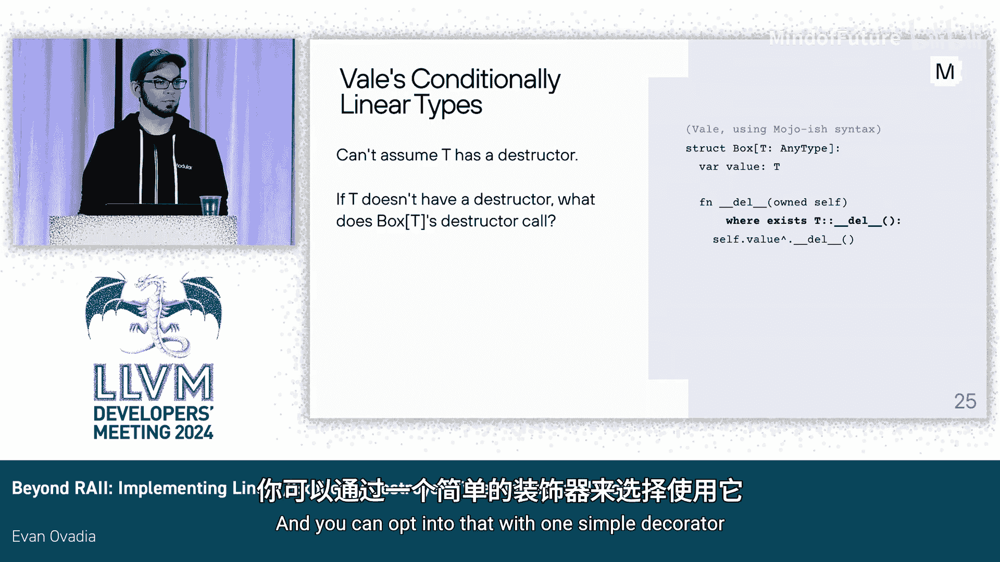

# 【2024-LLVM开发者大会-•-中英】-p62-P62-Implementing-Linear---Non-destructible-Types-in-Vale-and-Mojo--BV18eNfepENu_p62-

Testing 1，2，3。 it works nice。 Okay So hello， I'm Evan。

 and I'm here to talk to you all about linear or explicitly destroyed types inveil and Mojo。

 I'm a compiler engineer with modular working in the Mojo team。

 and I've also spent the last gosh like 11 years working on the compiler from my own language name Vail exploring things like region borrowing generation references in my favorite topic。

 linear types。 So before I explain what linear types R。 Here's a riddle for you all。

 Can you spot the common problem with these comments。 The first one is saying。

 remember to call join or detach on this thread before it goes out of scope。

 The second one is saying， hey， call， I'm returning to you a promise。

 So please remember to call set value on it。 The third one is saying。

 please remember to decelerate the car before you stop driving。

 The fourth one is saying before this entity is destroyed， remove its I D from the location map。😊。

So without knowing any of the context， you can kind of tell that the common problem is that they all rely on the programmer to remember to do something and we humans are awful at that。

 especially this human， and modern compilers don't really help us that much either。

 they're great at telling us what we can't ever do like with static typing。

 but they don't really ever tell us to do something later。

We can kind of get a halfway there with our AII， but that unfortunately can't help with any of these examples。

 there is indeed something beyond our AII that we're about to discover。So in this talk。

 I'll talk about what is the linear type and how it prevents bugs like these。

 and then I'll talk about the linear type hidden superpower。

 and I'll also call out some clues before we get there in case any of you want to figure it out before we get to that slide。

 and then I'll talk about how we implemented it in Mojo and the checkze lifetimes ML Ipass。

 and then I'll talk about Bas implementation， including its conditionally linear types。

 which I'm still working on adding to Mojo today。 If you have any questions。

 just remember that slide number in the low right there， and I can answer them at the end。Okay。

 so first， what does linear mean， like we've all heard linear types before。

 but what does it actually mean， The usual definition I see is not very helpful。

 It's a linear object must eventually be consumed exactly once。 I recommend ignoring that definition。

 and forgetting anything you might already know about linear types。

 We're gonna to look at things very， very differently right now。

 and we'll start by using my alternate definition here。 a linear object can't just go out of scope。

 you must eventually explicitly destroy in a specific way。

 and I'll show you what I mean with the basic example that I think really shows how linear types shine。

 If any of you have used the C plus plus SD thread before。

 you've run into this and you probably have battle scars to prove it。

 If you accidentally let the thread go out of scope like this code on the right without calling join or detach on it。

 the deor doesn't know what to do。 Does it wait for the thread to join。

 does it detach and let it run to the background， the poor de doesn't know what to do。

 So it panics calls SDD terminate and crashes your entire program。

So there is a half solution called J thread， but first I want to show you how linear types solve this。

So it'd be nice if we had something like this Mojo code on the right。

 we have a thread in a local variable named T and when we let it go out of scope。

 the compiler tells us can't delete T must call a joint or detach。

 it would be really nice if something could catch out a compile time like that so how do we make that happen？

Well， let's look at the definition of the struct thread right here and first notice this explicit destroy annotation。

 This means there's no destructor and objects of this type can't just go out of scope。

 and right after that， we specify a hint to show the user in the error message。

 but the user has to get rid of it somehow， so let's have some methods that take ownership of the object using this owned keyword which isn't new。

 It's just a keyword that says this is a pointer to data that you now own。

So the method does some things， and then it uses the new destroy keyword to finally destroy it。Now。

 join and detach are just regular methods。 It's the destroy keyword that's special。

 A types user like Fo shouldn't use the destroy keyword directly。

 A method should use it when it's ready to finally end the object。

 The destroy keyword will end the object， it'll call deors on the normal fields。

 and then it'll show errors for any unhandled linear fields inside the object。Congrats。

 we now have a linear type or in other words， an explicitly destroyed type。 Okay。

 so how does the user fix their function。 Li up two options。

 The first option is to call a method that takes it as an owned argument and destroys it。

Like this call to detach right here and see how it says tcart dot detach That carrot is existing mode just syntax for us moving it。

 transferring ownership into the methods's owned argument。

 and another option is to postpone destroying the thread and instead maybe add it to some longerli data structure like this list of thread here and whoever owns this list of thread。

 the compiler helps them remember to not let that go out of scope to instead drain the list and do something with all those threads before the list goes out of scope。

Thread is linear so a list of thread is linear too and I'll talk more about that when we get to the veil parts and the compiler makes sure that someone will handle it and the last option is to return T carrot or in other words move T into a return value for our collar and now the collar is responsible for figuring out what to do with it now they have to either call join or detach or move it to somewhere else。

So that's the first example of using the linear type。

 the compiler ensures you eventually actually decide when and how this object should go away。

 you could say it ensures you eventually make a decision。

 and that's a clue so remember that there are a lot of types like this where the compiler shouldn't assume when and shouldn't assume how you want to destroy your object。

And I mentioned Jthread earlier， Jthread tries to solve this problem by just assuming that you want to join。

 but this can be harmful like in this code here， we have a loop and we accidentally let the threads go out of scope too early and whoops we serialized this loop that we were hoping would be parallel。

So as you can see， even though RAII was a huge step forward， linear types takes it even further。

 you say exactly when and exactly how your object should go away。Also。

 some of you are wondering why C++ doesn't do linear types。

 it's because of exceptions and stack unwinding， and if anyone's curious about the solution to that。

 feel free to ask in the Q&A after。So that was one example。

 but there are a ton of ways that linear types help us and let's talk about that second one。

 so this is another example which also coincidentally has something to do with threads if you want to give a value to another thread you might use a promise and when you call set value on it。

 the other thread can see the value and use it， but if you forget like in this code then the other thread never gets the value if only something could help us remember to call set value。

So here's the Mojo equivalent。 you can see how it shows an error if we don't call set value and let's see that promise structure so here's the promisestruct with the explicit destroy annotation to opt into to it being a linear type so it can't just go a scope and there's a specifying that error message and of course we've got to give the user some way to get rid of these things right so we give them this set value method which takes an own self and also requires that value argument right there and then it does some dot dot dot things then it uses the destroy keyword to destroy the promise Okay so how do we fix that error message there Well once again we can move it into a method or we can postpone it by moving it somewhere else。

But let's say we do call set value， and oh wait we realize now we never actually calculated that result。

 so let's do that now。There we go， it's kind of like RAII。

 but the structure has a name and can require arguments。

So the compiler ensured that we eventually called set value。

 and it kind of also ensured that we eventually calculated that result， too。

 And that's the second clue。 Okay， last example。 So continuing theme of threading。

 Here's an example with a future that will contain a very important linear thing。

And this thing might be very important， perhaps it represents a pending request whose response that they need to act on。

 or perhaps it represents the airplane's current flight that they need to correctly land。

 so the user definitely shouldn't just let this go out of scope。Fortunately。

 they get an error about it And if you're curious， this is how the futurestruct is defined okay so how does the user fix that Well like the hint says they can call fca dot get and hey they get the result thing which is kind of nice。

 It's kind of like our AII where the deor returns a value to which is a big deal by the way。

 this solves a lot of problems deors usually have with returning errors and values and exceptions and so on and hold on a minute the compiler ensured that we eventually called get but it also ensured that we eventually took ownership of this result value and there's our third clue there。

So from these last three examples， we can kind of see a pattern emerging and no it's not that it's you know。

 they're all doing thread things， that's just a coincidence in the examples I chose。

These are the things that linear types did for us。 They ensured that we eventually made a decision like about those threads。

 They ensured that we eventually calculated and gave a value like to that promise。

 and they ensured that we eventually took a value like from that future right there。

 So these hint at something。 And if there's one thing I want everyone to come away from this talk with。

 it's the linear type hidden superpower that with linear types you control the future you can craft your linear types and their methods to ensure that specific things eventually happen in some order at some point in the future。

 You don't know when they'll happen。 But as soon as you create that linear object。

 You can be sure that those decisions will be made that data will be calculated or given or taken and the data will be destroyed in the correct way。

And you can combine these in interesting ways to help your users use your types correctly。

 and I'll show you in a few slides of just how powerful this is when a simple linear type single handedly solved three cache inconsistency bugs for me。

So now we're at my favorite slide that has a bunch of ways linear types can help us for most of these。

 I'll just quickly lay out the scenarios and leave the solution as an exercise for the reader or for the Q&A later so we can get to the implementation just after this。

 So we already saw how they help with threads， futures and promises。

 and they can also ensure that you correctly decelerate before ending your current driving session they can also ensure that you stop a rocket booster correctly depending on the situation not too early。

 not too late， they can ensure you handle a failed request rather than dropping it on the ground。

And they can make sure that you actually update your database row to reflect the outcome of your calculation。

 you can kind of see the pattern here。They can prevent node leaks when you accidentally drop your owning handles so to speak and cause orphan nodes and they can ensure that a message is actually handled and not forgotten in an orphan channel and this one blew my mind so spectacularly that it gets its own slide so here's an example fromveil but I'll show it in Mojo syntext just to be merciful here's a couple strs that I was using for a game and I'll explain what they do。

This is the central list of entities in the level and we wrap it in this live entity liststruct right here and it has an ad method and a remove method。

 nothing surprising so far， but wait this ad method returns to live entity handles Now these are both instances of this live entity handlesstruct right here that contains its index in the list an explicit destroy on it so they can't just go out of scope it looks like the only way to get rid of them is to give them back to this remove method。

So these handles only exist while the entity is still in the list so where did they go in the meantime in my case they were in some maps。

 a location to entity handle cache to tell it who's at what location and also a map of team to what entities are in that team and here's some comments just to emphasize that。

So what were the implications？The first is that if you have a live entity handle。

 you know that the entity is still in the list， it's kind of like weak pointer but more general。

 like this shows that if we have a handle， we can assume an arbitrary property of a distant object such as its membership in our source of truth list right here。

It's kind of like spooky knowledge at a distance or linear entanglement or something。

 but I still come up with a cool name for that。And also thank goodness。

 dangling live entity handles are impossible。And that's because you must take the handles out of the maps before you can use them to remove the entity from the list。

So the maps can never get out of sync with a list。 In other words。

 we just solved inconsistency bugs for these collections by crafting our linear types in a certain way。

 and like maybe I'm just a language iner， but that's like super cool to me。

So the two hardest problems in computer science were naming and cache and validation。

 and now it's just naming。So this blew my mind when I discovered this。

 I thought I was just making a struct linear on a whim to see what happened。

 but then I followed the ripple effect， seeing what Valil was trying to show me。

 and suddenly three places in the code just lit up and I could see exactly where I'd accidentally removed from only some of the collections and all of them and I just sat back and I was like。

 whoa whoa。And I should say this doesn't solve every bug。 You can still hand into mismatched handles。

 for example， but that's a much better problem to solve。Now， one last thing to freak people out。

 if you think of these two handles kind of like references， so to speak。

 then this is kind of like some sort of nonscod borrowing。

Or linear time linear compile time reference counting。 so to speak。

 I know I'm not making any sense there。 but if anyone sees where I'm going with this。

 let me know we can freak out about it。 Anyway， back Earth。

 let's talk about how we brought this into the Mojo implementation。And for that。

 let's get some context about normal nonlinearar types and how they work in Mojo right now。

 So Mojo is unusual here。 It doesn't insert deors at the end of the scope。

 It inserts them as soon as it can。 And in this case。

 it sees that the last use of ship is right here。 And so it inserts the deor call there。

 This is called Asap destruction。 and it makes it more efficient with memory and in theory could even speed up our code because a cache effects。

 but I have to measure that still。So how does the compiler handle these normal nonlinear types。

 it does this logic in the Cze lifetimes MLIR Pass。

 which finds out where lifetimes begin and end and it also inserts destructor calls。

 so let's see it in action for these normal nonlinear types。

So here's the shortened MLIR for our function there on the right。

And let's expand those dot dot dots a little bit。These are some bits of information in our MLIR from a previous use de pass。

 which tells us about when we defined and used various variables， but not when their last use。

 so now we need to figure out the exact lifetime begins and ends so that we can insert the structuresors。

To do this， we scan the code in reverse starting from the end。

 and we're about to see that call to print right there。

And that called print mentions that it's using the variable X。 Now。

 we're going in reverse from the end， and we haven't seen this variable before。

 So we know that this is the last use of x in the function。

So we note that its lifetime ends Now normally since this isn't a move。

 we would insert a Dell deor call right here， but we don't hear because x is just a primitive an integer。

 so let's continue scanning upwards and upwards and now we see that we're storing into X and this is the start use。

So we insert a lifetime start， that part's pretty easy。

And we're about to look up and see this load of ship right there。And we're scanning in reverse。

 remember， and we haven't seen ship before， which means that this is the last use of ship。

And so we insert a lifetime end， and since we're inserting a lifetime end， that's our cue to check。

 is this last use of move， no， so we call the destructor。So we answered a deor call right there。

Now remember this moment we're going to come back to this moment in a couple slides。

 but let's keep going just for completeness， so we continue scanning upwards， continue upwards。

 and we see that this call right here， this call to a knit。Was the first time we initialized ship。

 so we insert a lifetime start。And that's it， now that we have all of our lifetime starts and our lifetime ends and our deor callss。

We can continue on with the rest of the compilation and remember this was for a normal nonlinear type。

 so let's see this with a linear type now， here's some similar code。

 but now we destroy the ship via its land method， which also takes in a landing zone。

And here's the newly linear ship definition， nothing really surprising here。

Now we want to see this error here， so let's comment out that land call above。Now if we compile it。

 we should get。That error message that we want our check lifetimes pass to print out if everything works correctly so remember this step from last time we just added the lifetime end for our ship checkze lifetimes sees that it wasn't a move and so it checks for that explicit destroy annotation and it just prints out the error to the user and that's it。

 It was actually really easy to implement this for Mojo it slid into the existing design really cleanly which was awesome and I can't take credit for how well that worked that goes to Chris Latner and Jeff New。

So there's a big unanswered question which we haven't yet implemented for Mojo。

 but luckily we have the solution from Valil how do we make it work with generic containers like list and optional and dictionary and box and so on。

 they have destructors but their elements might not you just know it's a T。

 you don't know if T has a destructor or if it's a linear type。So what happens， and in other words。

 we have a box of tea。Which has a Dell destructor method， which usually calls T's destructor method。

 but if T doesn't have one， like if it's a linear type， we get this error。

 The answer is to use conditional conformance where our box only has a Dell method if T also has a Dell method that we can call something like this。

 So R Dell only exists when T has a Dell。 and it works for linear types。

 and I would know because I spent something like a year implementing this for veil。

 Moji will likely be a bit different in the syntax and also that it'll use a trait instead of asking for the function directly。

 but that's a pretty minor difference。And one of the big open questions is whether the linear type benefits are worth this extra consideration in our generic functions。

 I think so， but it's something that I'll be paying attention to pretty closely because it's in that fascinating intersection of compilers and program architecture and stuff。

 so speaking of which there's something beyond what I've talked about here。

The best language features compose well with each other and there's a very interesting power that arises when a language has both borrowing and linear types like Moja does。

 but I will mysteriously leave that unexplained for now。

 but someone can ask about it in the Q&A after。So where do we go from here。

 The next step is to finish off conditionally linear types and once we do that。

 we still have to update the standard library to use them and once that's done we'll probably launch it behind a compiler flag that's off by default。

 of course。And then people can play around with it， see what works， see what breaks。

 see how easy the fixes are， and then this is super important。

 we're going to get feedback from the community to see how well it did at scale right and if we decide that linear text are worth it。

 then we'll enable it by default。So that's it， that's linear types。

 I hope you found that enlightening and I'm happy to answer any questions that you all might have。

 Thank you。Hi， yeah。 thank you for I have a few questions。

 How do you handle early returns Like do you like force people to just not use them when you work with a linear type without like with explicit distractor sorry I think I missed that first part of early returns early returns。

 Yes， okay so I had to deal with this with breaks and continues an early returns and all sorts of stuff like that。

 Yeah the answer is that if it's a linear type then you have to explicitly destroy it before you do the break before you do the return before any of those control flow constructs the most interesting case that I ran into this and I didn't actually implement this into veil but it was a fun thought experiment was with the inveil I wanted a question mark operator like I think Ru has where it'll automatically bubble up exceptions and in some case that would have let things go out of scope。

 And so in that case I just said you can't use the question mark you have to explicitly do something like a try catch and explicitly destroy these linear types that are still existing。

 Yeah Yeah I guess。You can always wrap in another function of so。

have a few questionsSo can a user just call destroy on this linear type and I'm really glad you asked that So in Valil。

 you could only use a destroy keyword if you were in the same file as the type that defined it and that worked well because sometimes the type itself wants to be the only one to destroy itself like the threads in the future and the promise and sometimes another class in the same file might want to destroy it like that example with live entity list it was destroying something that it wasn't itself it was destroying the handle in Mojo。

 there's no such thing as private and I don't know if that's ever going to change So if since we don't have private protections。

 it'll just have to be kind of a code smell for now like if you see someone using destroy something on a type they haven't defined that's your queue to ask them to put a comment there why or to maybe change their code they actually follow the conventions that the typess definer was hoping that you'd follow。

It's a big deal。 So， and what you do， you have the A S deor cause。

 Do you generate a lot of duplication with this when you have earlier returns， basically。

You go and your last use might be multiple branches at the same time。

 Do you generate one when they all merge or you generate multiple and hope someone removes the duplication。

 So if I understand the question correctly， its， it's how do we deal with Asap destruction when if statements are involved。

 So if we。Use something for the last time in only the then or the else branch like both for example if you in both and then basically you have kind two places at the same time where that last time used in a primitive way you would generate the two distractors like two calls to dead destroy Yeah so if that happens then you look at where they last use it in the then branch and you put a distract call right after that and you look at the place where they last use it in the else branch and put a call to the distractor right after that if you only use it for the last time in one of the branches。

 things get more interesting let's say you only use it in the then branch then you would look for the last use in that then branch and then insert the call right there and for the else branch there's no uses of it in there so you just insert the distractor call at the start of the else branch Yeah but basically yeah let's also good case。

Basically， hope that someone else would， would reduce。Like there。

 you have difficult code duplication with this。Okay。Re cool talk， I'm wondering。

From an ergonomics point of view， what will you assume about any type， how much of this Okay。

 so you're asking for ergonomics， what will we assume about the any type I mean like so Swift has this like not copyable right so you assume that you can copy something so what's the plan for merger。

 how much will you assume about does it have a distractor or Yes。So that's a super good question。

 and this slide kind of gets to that where it shows that we don't assume that any type has a deor。

And that's why we got that error right there， because in this entire snippet of code。

 T is just in any type。 and any type after these changes， if the flag is enabled。

 any type won't have a Dell call。 It won't have a destructor because there's no way to just default。

 destruct it right So I just lost my train of thought。

 Yeah so right here and I want to point out this this is veil right here。

 It's just in Mojoish syntax。 So I don't have to inflict another language of syntax onto you guys。

 whatveil did was it said T isn't any type。 So we don't know from any type itself。

 that it has a Dell call， but we know from this extra constraint on the function itself that T has a Dell。

 for Mojo， this would look slightly different it would look kind of like。Dell has a， well。

 it would look kind of like it would say where T implements a trait called implicitly destructible。

 which has the Dell call。 I can I help So Sw So what you're saying is Swift assumes types are copyable unless you opt out of it。

 Mojo doesn't。And so Mojo without the linear type where any type just says it's destructible。

 it's not movable， it's not copyable， it's just destructible。

 And with this change he's removing the destructible requirement from any type。And so。

Mojo has a much more powerful type system than rust。

 I believe it's still significantly more powerful than Swift and so you can really model these types in a very nice way and has a nice decorator say。

 hey， this is a value type and then it gives you your copy construct and your move construct and you can opt into that with one simple decorator。

Co， thank you。Unfortunately， we don't have time for another question。 With that。

 let's thank this thank the speaker。