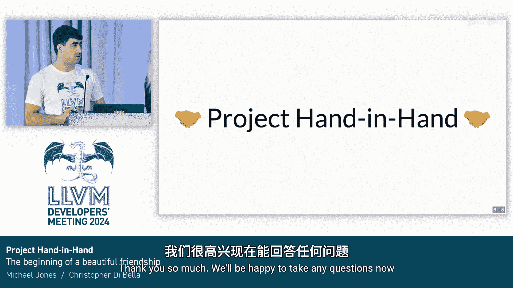

# 【2024-LLVM开发者大会-•-中英】-p63-P63-Hand-In-Hand---LLVM-libc-and-libc++-code-sharing.--BV18eNfepENu_p63-

Thank you。 So I'm Michael。 And this is Chris。 I， I work on LDM Lipsy and I work on Lipsy plus plus and occasionally client。

 Yeah， and so we're here to talk about a project for sharing some code between。😊。

LVM Liy and Li C plus plus。 So let's， let's start at the beginning。 Like。

 why do we need a Liby in LVM in the first place， Like you can say it's to complete the tool chain。

 And so we can make it more standalone and self hosted。 but like。L VM is not written in C。

 It's written in C plus plus。 Why do we need it Lib C。

 And the answer is basically Lib C has become the foundational library for a lot of languages。

 So like Lu and Python are interpreted and their interpreters are written in C and they call out to Lib C for a lot of functionality。

 Mojo and Ru are both compiled languages， but their standard libraries also call out to Lib C。

 because， who wants to write the math functions or like string to float conversion。 those are hard。

 And then C+ plus is perhaps the most extreme example。

 because Lib C+ plus actually contains all of Lib C inside of it or the standard says it does。

 obviously the separate libraries。 And so， you know。

 Lib C plus plus does this in provides a nicer interface for a lot of Lib C function。

 So here we can see the sign function they make sure it's defined in the global namespace if you want to call signine F。

😊，Directly， but if you want to just call sign on your float， then there's a function overload。

 So you don't have to specify all of that。 And then if you're including C math。

 then it'll also include。Math dot H， which is the Lipsy version。

 which includes all of the like Lipsy parts。For it。 And so like a lot of Lipsy functions。

 there's the Lips C plus plus interface， and then some specifics。

 And then they like call into a Liy function for the core functionality。And so。

For this like nicer interface in C plus plus， Lips C L V and Lips C is implemented in C plus plus so we can do things like template our internal functions。

😊，For like string to integer， because you have like A to I and stir to L and stir to L。

 L and stir to U L and stir to U L L。 And these are all like different functions that perform slightly different things。

 But like the code could be identical。If you had templates， if you， if you're writing this in pure C。

 then you're gonna to have to do things with like macros and。

Duplicating code so that you can get a decent interface。

 So C plus plus gives us a better syntax abstraction and a cleaner function interface internally。

 even though externally we're， we're still providing that same C function interface。

 And we designed it to be modular， at least in part， because these internal functions。😊。

They need to be。Completely internal。 Like we， we can't expose them。 So like our own interface。

We want our own interface internally to be more C plus plus like because it's more convenient。

 So let's talk about Lib C plus。 Yeah， Li C plus plus has a much larger surface area than Li C just generally speaking and Li plus plus has had a few missing features from C plus plus 17 for a while。

 And some of that is because floating point numbers are particularly hot。

 whole textbooks have been written on understanding how floating point numbers work。

 And that makes them scary。 And we want to make sure that we get these sorts of things right。

 which means you need to put in a lot of care。 And so we haven't actually gone implemented this for quite a while。

 So C plus plus 17 specifically added something called from chas， which is in the charcom header。

 And it's it's about converting strings to to。😊，To floating point numbers。

 And there's also an in overload， not really relevant for now。 Now。

 the most important part of what's on screen， which is called standard ease。 It's the。

 the text that the C plus plus standard has is the is the bit that's that's involved bold that says that from Charles is a。

Is almost identical to Cs Str to D。 It has a few exceptions。

 but otherwise its functionality is supposed to be the same as the C C library function。😡。

But if we contrast the two interfaces， we can see that they're quite different。

 the C+ plus1 takes a range of characters that is delimitd by two pointers， whereas the C function。

 strategy D takes a null terminated string and the way in which they hand back their values is is different in C++ it's returned as a reference to floatinging point number。

 whereas for str D it's returned as as it's return value and the return value from chas contains different information。

 there's also a format specifier， and the way in which they return their errors is differently is different in C plus+ it's a part of that from Chars result。

 whereas str to D returns it via Erno。 So the error channels are different and so the interface is just completely different。

 but the functionality is the same。And so really， that leaves us asking， well。

 why can't C plus plus just roll its own thing？ And again。

Floating point numbers are ridiculously difficult to get right。

 And so why should we spend time rewriting 2300 plus lines of code for something that Libps C has already done。

 It would be really nice if， if Lib C just。Had a different interface。

And the good news is that LV Lipsay already does this。

So L Lib C uses a function template for Ed string to float conversions。

 So that way they don't have to write stamp things out for for the Strta F Strta D。

 And is it straight LD Strta LD。 And so that's great because their function templates that have to be implemented in in headers。

 which is great。 And because it's just string to float conversions。

 there are no OS specific dependencies。 And so that makes it really easy for us to。

 to maybe work together。😊，So the real question then becomes。

 can Li C++ use the code that LVM Lib C has already provided it so that way we can implement from CAS with a common core。

And if we wanted to go down this path， then we'd need to consider what Lib C plus plus would need to do and what Lib C would need to do kind of separately。

 So from the Lib C plus plus side， things need to be user transparent that more or less means that we need to have a strict interface that that that limits Hiram's law。

 Now Hiram's law for those in the audience who don't know is an observation that was made by Hiram right about if there is something that is in that is user touchable it It doesn't matter whether or not you document it doesn't matter whether you say do not ever interact with this。

 It will break Use will eventually come to depend on it as the user base grows。

 And that is something that we need to contend with。 And so。

It needs to be provided in such a way that users don't even know that it's different。 It's。

 it's following the Azure for all that C++ provides where if you can。

 if you can do something slightly differently， but it behaves exactly the same。

 then that is good enough。But it is an unstable API API and so that means that we need to have a very explicit and narrow interface so that way we can avoid limiting the evolution of this particular library and we also need to have a plan for API changes because things do change over time and we need to make sure that we are not limiting ourselves by not having a plan that is very important。

And finally， Michael， I mentioned at the start that I occasionally work on clang。

 What would happen if I say wanted to start pulling things in on the clk side。

I think that's a great idea。 And something we should explore in the future。

 But we need to be careful and explicit about this。 If you start like randomly。

 including lipsy internals， I'm gonna scream。😊，Please， don't。Oh yes， that's right。

 So from the L V and Liacy side。 what do we need this for this to be success。 So like the。

 the code is already written in standal and C plus plus。

 So like we have an API similar to what Li C plus plus wants。 We needed to make a couple of tweaks。

 but nothing major。 And I already gave a talk in 2022 on this being a well optimized implementation。

 And for making that like explicit narrow interface the header only implementation means we can do indirect headers where we red orine the parts we want to expose in a specific name space so that it's explicit。

 like these are the parts you can touch。 And these are the parts that are。😊。

Even more of an implementation detail just for Lipsy。 So this is an example of one of those headers。

 And so we're providing Sir integer， but we're not providing like the。

 the thing that converts a char， like a， a char in base 16 to an integer。So like。

 what about the potential problems， What are the， the， the pitfalls that we want to avoid here。

 So the， the first one is。Coupling the public API can severely limit evolution。

 So when I first proposed this， one of the Glib C maintainers brought up an example of a time that Gliby and Li stood C plus plus tried this。

 and it went badly。 So they did what what they called live I O V tables where you could use a C plus plus stream as a C file star which if you think about it for a second。

 it's a cool idea。 I they， they describe it as the cool way， And it's an interesting way to do it。

 but it does not。😊，Like。Have that many benefits in the long term。

 And it severely limits how you can change these APIs。

 because now you need to make sure that your file star and your stream are in sync。 So like the。

 the eventual solution that they ran into was that they could not update this without breaking the API。

 So they broke the API because that that was the the only option they had。

And then what if they diverge？if they diverge， all we really need to do because this is evolution really is just move back the common ancestor so what we do is we start with the existing API and then we work out what the common functionality between the two new APIs are。

 what the divergence is， move the divergence into the respective libraries themselves。

 keep the common interface common to both places， and that's it。

 there's not really much of a change other than just a bit of shuffling to make sure that we meet the specifications of the respective libraries。

😡，And if they completely diverge， then all we need to do is take that that one function and split it out entirely。

 so that way everything else remains the same， but the thing that has diverged is now no longer a part of the common code this makes it a little bit difficult unless we adhere to the previous expectation that we are going to have a very strict and narrow interface that we follow and always need to make sure that we are followings that way we can robustly adhere to this part of the plan。

And Michael， its it's possible to do this because Libpsy and Lib C++ are part of the same Montepo。

 is that right？Yeah， so if we， if we were like two completely separate libraries and we wanted to do this sort of internal sharing。

 we'd need to worry about like API versioning and， you know what versions of Lipsy support。

 which versions of Liy plus plus， But we're in the same mono repo。 So if we want to change the API。

 we can change it in one atomic commit。 And then as long as everyone is building their Liy and their Liy plus plus from the same commit。

😊，It shouldn't have any issues。 There's， there's no like。ApiI versioning here， because the。

 the API version is a single commit。And based on this， it seems like it's gonna work。

 So I think there's only one thing left to do。So we did it。

 So LVM 20 will ship with from charge floatinging point。

And it's going to be based on the L VM Lib C code。 the， you can see the pull request up on screen。

 but it has merged， and it hasn't broken anything anything too bad。

 We had a couple issues with power PC， but nothing too bad。And from everything I've heard。

 it's been a success for both a Lisy Plus plus and L V and Lipsy。 And， you know， now we。

 we have a shared common core that we can。😊，Work on together。 I agree。 Thank you。 Yeah。

 A couple of special thanks for people who helped out with this project， Louis Dion。

 head maintainer of Liy Plus plus。 He helped out with organizing the Liy plus plus side and also with a lot of code review because I can't review the Li C plus plus code And speaking of not being able to review the C plus plus code。

 I also can't write it。 Mark the Weaver wrote the Li C plus plus parts。 So all the string parsing。

 So。😊，Big thanks to them。 And then also， everyone who participated on the RFC and on the pull request。

 there were a bunch of other people。 But I， I want you to know， I， I appreciate all of that as well。

 And then there' are some places we're considering future work。😊，So for the future。

 there are other areas that we suspect Libps C+ might benefit， and so that would be great。

 It may also be nice to put this sort of thing in other parts of LLVM。 for example。

 at the keynote this morning Aaron mentioned the concepts for math stuff that could be an potential avenue for sharing with other areas of LLVM but again。

 don't just start willingly including this and other areas LLVM。

 please talk with the hand in hand folks because otherwise Michael will will get very upset。

 and finally it might be nice to one day entertain the idea of building a single unified library that contains all of LOVM LipsC Lips C++ Libbar mind。

 So that way you only have to link one thing as opposed to having to remember which parts of the LLVM runtime that you want to combine into building your program。

😊，And with that， Michael， did I， did I leave anything， I think that's it， Okay， with that。

 this is project hand in hand。 Thank you so much。 We'll be happy to take any questions now。😊。

Thank you so much， Michael and Christopher， So there are two mics。

 either of feel free to wind up behind that one， or I can pass the mic to anyone else if you have questions。

So part of the problem here seems to be a sort of divergence between C and C plus plus。 is there any。

Hope that。 maybe be like。The C plus plus functionality doesn't seem like it would be not useful for C。

 Maybe we should like define a C 20 Y version that。

It has that new functionality because if if we had a public standardized C function that did the thing that C++ needs。

We could just call that directly and not have to do all of this work。That is true。 if。

 if the C Standard community wants to add。From charge floating point in some like slightly different interface。

 You can't do it the same way。 Then we， we definitely could look into that。

 Youd still have issues around errors and thingsca the Lipsy function returns an error by setting error no and I believe Lipsy plus plus doesn't。

 And there's also like， rules around when you're allowed to reset Er no。 So I I'm not。

I like the idea。 I'm not sure we could do it perfectly。

 but I think you could definitely get a lot closer。 Yeah， I mean， if it who's just that。

 you could wrap it with the function that saves and restores a no。Yeah。

 like if that was the only issue， But I think I don't know， the， the， the bigger issues were like。

That two sentence summary was like it uses different parsing rules。

 It doesn't use locale and like not using locale。 I'm sure is a thing that every C programmer wants right So I don't know。

 It seems like there's some scope here for。Doing something and see。Yeahh。Yeah。

 I think we definitely could look into doing that。Perhaps another area of future work。Hello。

 what is testing look like。So from the Liy plus plus side。

 the testing looks just like any other unit test。 We're just testing the， the。Public functionality。

 you know， on the Liy side， we have our own unit tests exercising the internal code and also like our public interface。

 So we know that the， the parsing。But also， like the conversion works on our side。

 But from the Li C plus plus side， we're not testing any of the like hand in hand specifics。

 We're just testing this as if it were any other Liy plus plus function。

One thing to remember is that it is user transparent。

 And so there's just a bunch of unit tests from the loop Sea plus plus side to ensure that it is still from chars and everything else is。

 is kind of behind the scenes。You mentioned that LVM Lips or sorry not LVM LipsC++ requires some changes to be able to get this work。

 were there any significant changes for LVM LipsC side on the internals that were required and did you find any of them limiting in how you would implement LVM LipsC and that could potentially restrict future directions that LVM Lipsy could take。

So we， we did need one minor change to on the L VM Lib side。 There was like。There's some like。

There's a specific pass of string to float， where you need to reparse the string for like performance reasons。

 And so we had to add a length limiter to that。 But other than that。It。

It didn't require anything major。 And so far， we haven't run into any places where it would be a major。

Maintenance burden to like。Re to add the functionality that Li plus plus needs。 If we did。

 we'd probably wantan to sync the interface down so that it's not so that we're below the layer that。

 where that would be a problem。Nice talk。 How do we mix。

 It looks like Liy Pro has a dependency on11 Li C。So if a user wants to mix different version of Liy。

Sa like muscle with lipsy plus plus， which I think more lot of traditional users do。

 like won won't discuss a comp issue。Yeah， I I had a similar question myself。

 and from what I understand the the idea is that it's built separately。 Lipsy has its own component。

 Lipsy+ class has its own component， but it's still just the same code in that's being called。

 Did I miss anything there Yeah， that's accurate。 And also the the dependences here is only internal。

 So like the the public Lipsy functions are still getting called through the public interface。

 This is just a special like internal interface for this one specific function。

if you wan to use muscle as a C library and Liy plus was LL VM， Yeah。

 it might be missing some functions，No， well， yes， kind of。 Basically。

 you can think of the Lipsy code that's being shared here as being effectively internal to Lipsy plus plus。

 So， it's not like muscle doesn't provide it， but muscle doesn't need to provide it。

 It's just like it's inside of Lipsy plus plus。Sorry to ask one more question。

 Like are there gonna be multiple libraries like one， like。

 we have Liy plus plus as Li C plus plus lip C plus A BI， There's lip element C。

 And means there gonna be another。Another layer。That has a commonality between Liy and Li C plus plus。

That was one of the options we explored when doing this design， and the。It might happen， but I。

 I'd say not any time soon， basically。业务。Right now。

 all of the code is inside of Lipsy and pulling it out would be a pain because， you know。

 we have this like nice narrow interface to Lipsy plus， plus， but inside of Lipsy。You know， it we've。

 we haven't been like trying to keep the interface narrow within our own library。

 So pulling it out would be a pain。 We did consider it。 But basically， right now， the。

 the code is being maintained by the Li developers。

 And so having it as a separate library would mostly just be confusing。 should be headers now。

 There's no runtime library that exists for any Yeah， yeah， like Nick said。

 it's all shared by headers。 So there's， there's no like separate like runtime libraries that are being linked。

 Thank you。I have a question。 I'm Robby from Apple and great work。Okay sorry。

 and I'm curious how what's the scale of so Apple is one of the vendors of lipsy++ that you might know so from that perspective I'm wondering what's the scale of the change that we should expect here and what cas I think every change involves some amount of qualification and testing。

Interesting for me to know。呃。So for if you're trying to build Lips C plus plus。

 if you're doing it just in the Cm， you don't need to do anything at all。

 We like hooked it up already。 if you are doing it in your own build system。

 if you're doing it like in in G N or a basil or something。

 there's a couple of things you'll need to hook up。

 But it's mostly just you need to point and include path when building， when building charcon。

 the like library for chacon in Liy plus plus， you need to include the Liy directory need need to define one macro and it should just work。

 yeah。Cool， sorry， I meant what is the scale of APIs that are expected to undergo this kind of change and would that be like hundreds of APIs or。

That'sIf I understand correctly you're asking about what the scale。

 what the impact will be on users is that future changes So my understanding is the future changes should basically behave in the same way it's not really going to impact users except that will get the functionality that they've been promised by the standard and it will be delivered by adding more code just like you would to when you're building out Li C++ and adding code directly to LiC++。

functions呃。For the number of functions， it depends on like exactly where it goes。

 So for like direct changes， I， I'd say maybe like tens or 20s in Liy plus plus。

 But if we end up doing the constant expert math through this， then that would be like 500 functions。

 But that's just because there are a lot of math functions。嗯。Okay， yeah。

 if that's it with the questions， then let's thank the speakers again and our next talk。

👏Beg in five minutes。