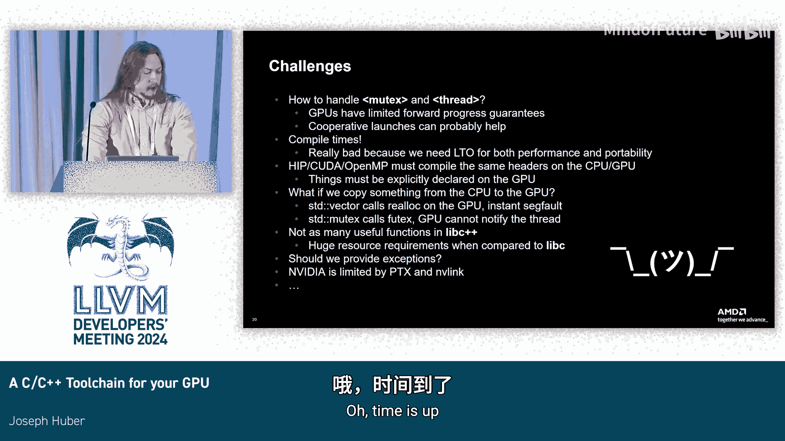

# 【2024-LLVM开发者大会-•-中英】-p64-P64-A-C++-Toolchain-for-Your-GPU--BV18eNfepENu_p64-

Hello， I'm Joseph Huber， I work at AMD and I'm just going to be talking about some of the weird work I've Dlan trying to get like a standard CNC++ tool chain that runs directly on the GPU。

So GPUs have come a long way since the humble beginnings of fixed function graphics hardware。

 now they do like a lot of general purpose or GP GPU stuff they say。 but even with that being said。

 you look at a lot of the GPUs and they kind of lack the same tool chains that even the simplest embedded processors have So I was like you know if these things are really general purpose。

 can I just run arbitrary CNncC plus plus on them。 and that was the， I guess motivating。

Motivationations behind doing this， even though like some of the stuff isn't practical。

 but it's it's more about the journey than the destination， I would say。

 but even with that being said， you know， it allows you to trivially port things to the GPU and you get generic implementations of a lot of fun things like math。

 thanks to the Ol and Wood Sea team。So if we're talking about porting existing CN C plus plus libraries to the GPU that kind of begs the question of how do you do that。

 right， because there's lots of options in this space。

 So I'm sure many of you are familiar with Kuta or its doppelgan or hip， so。

This is pretty ubiquitous for targeting code on GPUs right。

 but when you actually look at what we're trying to do here。

 we're just trying to compile some code that runs directly on the device and KUa is what we call like an offloading language which means it combines heterogeneous compilation jobs of like host compiles and device compiles for even multiple architectures into one like mega clang job and that introduces a lot of build system complexity that I'm sure anyone who's like tried to do KUa through Cma can tell you about so。

Also what's kind of annoying about it for this is that you need to manually put stuff like global and device on each function。

 but with that being said， let's kind of like take a look at how stuff like KudDa is implemented and maybe we'll learn something so we have this simple ax pi example that exists in every GP related slide deck as far as I can tell so you have this decorator on the function and then you have some weird calls with these block index things and you basically just have C++ code right so you then compile that with these like magic clang options and if you look at what the compiler is actually doing it's passing that code to the clang frontend with some magic。

Language options set。 And then if you look at what the runtime is doing。

 it's basically lowering those block index calls to these built in functions that client supports so。

You can see this is know peeling back the layers of what's going on here but we don't want to use KUa for now so let's look at some other options we have so the next one is openM this one is more of a standard C+ plus ish flavor solution and it basically does everything with pragmas so it's got the same issues that I have with KUa which is related to build systems mostly and also needing to like manually decorate things with saying what's on the host。

 what's on the GPU because since it's heterogeneous it doesn't want to assume that everything is shared。

So let's just you know look at this again， we have the same Sxpi example and we're doing this pragma。

 which basically turns this loop into some collection of runtime calls。

 and then we compile that except doing C++ with the AF Openmp flag set and we basically get a Kang frontronend job with the MD triple set with some language options for OpenM。

And then if we look at OpenM's runtime， you might see that it looks a little similar right we've got the same the exact same clang builtins to do the magic GPU stuff。

 so finally I'm going to think about openCL because OpenCL uses a much more traditional compilation approach which solves a lot of the issues I have with the offloading languages for stuff like this but the problem I have with openCL is that it is intentionally limited in the types of features it provides to try to make it run on as much hardware as possible。

 whereas I'm more interested in exploiting the highend hardware that most people have access to these days。

But。You know， and in that it's stuff like you know function pointers or recursion these things are I think explicitly forbidden by the open C standard but exist in a lot of existing programs so there's no real way to port that but either way you can look at this and you've got some decorator on your function you've got some runtime call and it basically looks like CRC++ you run it through the compiler and I'm assuming you get where I'm going with this but。

You take all of that and I'm like， well what's the easiest way to port an application and I think the answer to that is not porting it at all。

 So you've seen that pretty much every single one of these offloading languages is just kind of some front end into clang。

So why can't we just use CNC++ directly right and it turns out that Kang already has an option to directly target different architectures。

 it's called D Ta， so if we're targeting our amazing great MD GPU of course we just do D target equals MDGCN MDHSA and we invoke that same clang target you saw in the previous slides。

So if we do that， we can just take some like ISO C++， you know。

 this is like standards committee approved C++。And because you all things like Kuda could handle this and they're just based off of C++。

 we can easily just pass this through Kang and get functional device code that does this matrix multiply in this very CS101 way Now obviously the problem with this is that it's very slow because you're going to be running this on a single thread and obviously you do not want to run your $1000 piece of hardware as if it were a $100 raspberry pie So if you want to really use C++ on the GPU kind of need to break the conditioning of the standards committee and go into the wonderful world of compiler extensions。

So you'll see here that this looks a lot different， it's not super important what the code does。

 it's just like a blocked matrix multiplplayier that any introduction to GPU programming would give you。

 but what's important here is that you see we have like special decorators on the function that make it use the calling convention for kernels and then we have these addressbased things which are just target specific attributes for which type of memory this resides in。

 this is pretty much one to one correlation with coUa's shared keyword and then we have these like built ins the same ones you saw from the runtimes before that get you things like the gridI or the thread ID。

And then we also have in the loop， we just have these barrier builtins that are the same as sync threads。

 Now you might look at this and think， well， that looks terrible。 I don't want to do that。

 but first off， I have an RFc that tries to provide a resource directory header that will at least give you normal names for these things its more similar to what openC has And second。

 I think it's more important about how if we shift our perspective on how these GPU languages are compiled we can do a lot of fun things with it because I'm sure as many of you are aware。

 this is just crosscompiling and people have been doing crosscompiling for quite a while now So pretty much there's lots and lots of support even in clang and LVm for these types of things we already have build system support for it。

 So when you start thinking about it like that know any cross-compiling thing is basically targeting a tool chain And if you start thinking of the GPU as a tool chain well。

 any complete compiler tool chain has you know a compiler frontend， we've already got that。

 it's clang。It's an assembbller。We have that， it's called like what LVM machine code。yes。

 it's also an assembly， but it includes yeah， well we also have a linker LD。 LD basically。

But we don't have any runtime libraries， really， like we do have some runtime libraries。

 but not really。So with that in mind， let's just port the existing LVMC and C++ runtime to the GPU and how do you want to do that Well as I mentioned before。

 LLVM already has tons of support for crosscompiling so I'm sure many of you are familiar with like the runtimes build of LVM that a lot of the projects like LibC++ that was just talked about use Now what's really interesting about this build system is that one it basically lets you use a just built clang which is really important for the GPU because if you recall from those previous slides all of those compiler extensions said clang on them and not canoe so you pretty much need to use clang for any of this to work。

And what's also really interesting is that you can compile the runtime for multiple targets。

 so if you use the LVM runtime targets CMake option。

 you can pretty much enable all of the triples that you want to target for this and then once you have those enabled you can then individually pass arguments to each individual tool chain right and this syntax here of like D runtime underscore Tri underscore Var。

It's kind of ugly， but it's very powerful once you get used to it。

 So what it allows you to do is like we have this runtime to build here where。

You have like your X86 which is like your default target for your standard 64 Linux。

 and then we could enable I don't know the openmp or the offload targets if we want to do openmp offloading and then for the AMD target。

 we could enable a LibBC compiler at T LibC plus know all this stuff and then for like maybe the NVPX target。

 we just want LibC， you can do all of that individual because you have the control for each target as its own individual target okay。

So and because that already exists in LLVM we get to exploit the exact same handling that other tool chains get to use for doing this。

 which is handling through multiLs， so each runtime target basically gets its own directory if you set this LVM enable per target rundme thing that's default on in Linux。

 I think it's off on Windows， I don't know， but what it allows you to do is get a directory structure that looks something like what's on the right here。

 which is you have each relevant thing like the include directory and the library directory is qualified with the target triple。

And because it is qualified that allows you to name all of the libraries the same things like LibC。

A or LibM。A or have all the like standard C headers and they won't conflict with your host build that you probably care about using and what's also interesting there is that because it will include all of these for you when you do dash target equals andD or whatever all you need to do is pass likeLM orLC and it'll just find those libraries for you as long as it's in your tool chain so that's pretty much the plan of how this will look out so let's actually just pass those runtime to the runtime build and see how that works。

So first was LLVM LibBC， I actually to talk about this last year， if you really want the details。

 you can go back and watch that on YouTube， but pretty much the C library is the basis of all of the other interesting applications so I figured it was a good place to start and it's really neat about the LLVMC library is as you saw it was highly configurable。

So you can kind of just enable this subset of functions that actually work on the GPU and then add more as you go so system calls。

 as I mentioned last year are handled with these remote procedure calls long story short it's a client server protocol where you just have a CPU thread and a GPU thread basically communicating through some mutual exclusion okay so on the right here I just have something I copied from the entry points list and I just put that there to show that you know NviIDdia only has one printf I have every printf。

So it's a motivating example。So what's really cool about this as well is that if we're talking about treating a GPU as a regular tool chain。

 you'll notice that if you've ever done any work with like a normal litacy build。

 they will have like a startup object and that handles your things like starting up your main application and your start function。

 right？So we could emit the same thing for the GPU。

 And that allows us to start thinking of like just calling a main function on the GPU。 Obviously。

 you wouldn't want to do that if you're writing something that's supposed to run fast。

 but that's really helpful for unit testing because it allows you to just。

Copy paste existing unit tests and run them directly on the GPU and in order to actually run that many people who do crosscompiling are already familiar with the concept of emulators so you just put some program in front of your executable and then it'll run it for you and you basically test it on that target now I don't have an emulator but what I can do is write a similar tool that just launches it on the GPU for you and that's just something I call like a loader。

So once I have that built， I can also just do the same treatment to the compiler RT directory because Kang wants to be able to emit builttons in some cases。

 like not all cases but some cases so it's nice to have and porting this was pretty much straightforward because it's just C and as I told you it's just crosscompiling compiler RT already has support for crosscompiling to like a million different targets so the GPU really wasn't that special once I stripped away all the rig offloading stuff。

So。All I had to do was just add a few cases for like setting like one or two flags。

 and then it just worked。 And now I just have a static library for compiler I for Libse and all this stuff。

 And it pretty much lets you do weird things like I have here， which calls a main function。

 just does F print F to like stood out and then print some random like Rv value。

 And you can see compile this target it as same as you would with crosscompiling。

 do FT to get amazing LTO stuff。 you need to do MCPU or else there's like node backwards compatibility on GPUus。

 You need to specify that And then you do Lincoln， all the nice libraries we've made and Kangle will automatically handle finding those for you。

 And then just run it with a loader I wrote。 And now you just have something that pretends like it's a normal posted target。

So obviously Lib C++ is built on top of LibC so once we've got a mostly functional LibC。

 we can just build Lib C+ plus on top of this Now some of the LibpsC people already did some work to build LibpsC++ on top of LibpsC and LvM so thanks for that and I could just use the same thing and target it for the GPU and because these compilation jobs pretty much look like the same as every other embedded tool chain wants to do I pretty much didn't need to change anything at all。

 all I used was the existing configuration files that LibC++ has and I just put them in a big cache file the only things I had to change or like maybe three or four places where I put an if def to do something different but beyond that porting the vast majority of LibC++ was pretty much automatic I turned off things like threads and file systems and stuff like that because I don't really have an idea for how to support I could do file system but I wanted to keep it simple relatively for now Now also brief mention there are some other approaches that do LibC++ on the GPU but those are mostly approaches that。

I write this stuff custom and then give it a special name space。

 So this is kind of in a different domain。And that allows you to do really silly things like this。

 So you have Int Ma and I， this is a completely arbitrary example。

 but it's just the best I could think of to show that you wouldn't think this code would be running on a GPU。

 but you can do it。So you know we have like a random number generator that's initialized on the work。

 the thread ID， and then you just initialize a vector with that and then you stood C out and this all works just fine on the GPU like does it take forever to link。

 yes， does it use all of your resources， yes is it really slow， yeah， but it's interesting。

That's all I care about right so and you can see how we compile this is that we just pass in like every single library I just talked about building we have like the C library math library SQ plus the Lib C+ plus AB that's also included in there and Dins then we just need to tell it to use the Lib C++ library and also turn off exceptions because I don't know how to do that yet maybe I'll do that but that's even crazy than what I do now so I'll just leave that for a later date but。

Even without that artificial example， what's really fun about this is that it allows me to run a lot of the Lib Z+ plus test suite on the GPU because it already has support for these custom test executors because like I said a lot of people want to run this on embedded systems。

 embedded systems tend to use emulators for testing So I just stuck that with my AMD loader and I got to run most of the test suite。

 Now you see there's still a good number of failures like 154 they're actually were that I fixed a lot thanks to like Matt Arrsenau for fixing a lot of these but it's a good start。

 I know generally where the vast major of these are coming from it's from like weird Lib coal handlings。

 but we'll get to it。Okay， so you'll notice that everything I've mentioned was kind of silly。

 So I just like to bring it back to applying the stuff to the languages that typical users actually care about。

So offloading languages like I mentioned at the start are very convenient for typical users and we can still bring what we built here to applications like KUa or OpenMP or whatever。

 because all we're doing here is building a static library and because we have a static library and our offloading target has a linker that handles static libraries。

 as I mentioned in the first slides。All we need to do is pass these libraries to the device linker phase and you can do that with this dash X offload linker thing。

 you do need some support that's not default in KUDa I think itll probably finally make it default and sec Cling 20 so look forward to that I guess but。

This allows you to just write stuff in straight CNC plus plus and then link it in to offloading programs。

And it just works。 So I really like this way of programming because it's very it's close to what I'm used to。

 And then if I want to go back to an offloading language。

 it's trivial just to put it in there because I can just use regular cMake so。

And you'll see here the example I did here to exemplify this as calling stood sea out from an Openmp target region now I had to do this omp dec for the actual global。

 but I'm working on how to do that automatically， I was having some talks with the Ellsy Ps people。

Okay， so let's bring that all together and what have I really accomplished mostly just building a functional CN plus plus tool chain that targets the GPU。

 So it's not super practical for a lot of things， but there are things in there that some people might care about like I don't know。

 I've heard some talkings about one thing stood MD span or stood span on the GPU。

 you can do that with this just fine that works and you can also do testing on this。

 So if you've ever wanted to write int mainin and run it on a GPU you can do that。

And this is pretty much just a bunch of compiler SeeMake magic that you don't need to like I guess you can look at the slides if you want to build it。

 but this should be all that's required to do it。 I don't know if anyone who manages distributions and is in here。

 maybe someday I'll be able to convince them to do this in their tool chain as long as they support the per runtime target stuff。

 So then I don't need to tell people to build it， they'll just use it from their distributions packages。

So I could probably stay on the slide for ages， but I'll try to keep it more brief。

 There's lots of questions about like if you actually try to make this more practical right so how do you handle things like Mutex and threads because GPU is a very limited forward progress guarantees and their way of doing multithreading is completely different from what P threads expects。

 So if you wanted thread you need to like have your kernel launch start with some pool of workers that aren't there and then you'd need to have the one thread signal to the other workers to pick up some work and then you wouldn't have like ST at all。

 so I didn't really go there Mutex I think you could get to work if you had stuff like cooperative launches which is like the thing that Q and H can do now to basically guarantee that your kernel won't be evicted。

But really one of the main issues here are compile times so the compile times kind of get really bad when you start doing this stuff because Lib C plus plus is huge like doing stood C out generated 300。

000 lines of LVMR and that takes a long time to run through the GPU backends because they're really they don't expect you to do things like this you know GPU people expect you want to have a highly optimized kernel because you actually want to use your hardware to do it was intended to do so they do a lot of like quadratic optimizations and stuff there's ways that we can try to。

Address that， but it's just a limitation right now。

 for doing hip and couda stuff as I mentioned before。

 you pretty much need to declare which Li C plus plus functions are available right now that pretty much pans out saying they're all available。

 but that's just gonna to be some header magic that I haven't committed yet。

mAnd then there's also issues when you go to these offloading languages because like。

You need to start thinking about what happens when you copy things to and from the GPU to the CPU right so if I copy a stood vector and then realalocc gets called on the GPU。

 it's going to try to call free a realaloc whatever oh time oh sorry that's questions。

I thought that that was that anyway， I forgot to do this。This was a demo I did。

 which is compiling doom for this。So。I'll just leave that running while you ask questions。

Thank you so much， Joseph and as usual， there is one mic on this。 But， you know。

 if you have questions here。Or you can just enjoy the doom。

 So'll probably finish playing for too long。 Hi， way to bury the lead with doom。Yeah。

 I did want to kind of ask like immediately when I saw it Ma on a GPU， my thought went to， hey。

 if I wrote a loop and there's like this thing like auto vectorization。

 like would it be possible to actually get that to like。I don't know。 make kernels or whatever。

 Could you actually just write regular C++ and get it to do GPV things。

 That's kind of like as far as I know， that's kind of how GCC tried to do it where they went away from the SimT model We use an LVM。

 But I think you'd need to like turn that off。 And I don't think we support that。

 I need to consult people to do more backend stuff， but。

Maybe you need to think of it more as like vector intrinsics。It would be funny。Is it possible。

 is it a way to create under agnostic C+ plus source in this approach Yes。

 so that's what I mentioned briefly in the beginning is that I have an RF up on all on discourse that I just have that just does like if the and D GPpU it uses the AndD builtilin else uses like the NviIdia built in Most of these GPUs do the same thing for like 99% of what people care about。

 You can just provide rappers for that。So I seen you're compiling all these libraries to IR right have you given any thoughts on trying to compile it to a native image and then having some sort of dynamic linking or something do you anybody supporting it you can compile it to native IR just fine at least on NVDdia on AMD I mean so on AMD we have some issues with。

Doing the metadata analysis for like the packet launch for how many registerries you need。

 we don't handle that correctly， but hey if you use all the registers and it doesn't matter。

 but you could do that， the main reason we use LTO here is because you can like retarget it kind of like Spurvy。

 but there's like a few caveats that I don't have enough time to go into so。You have more questions。

If not， then let's thank Joseph again。