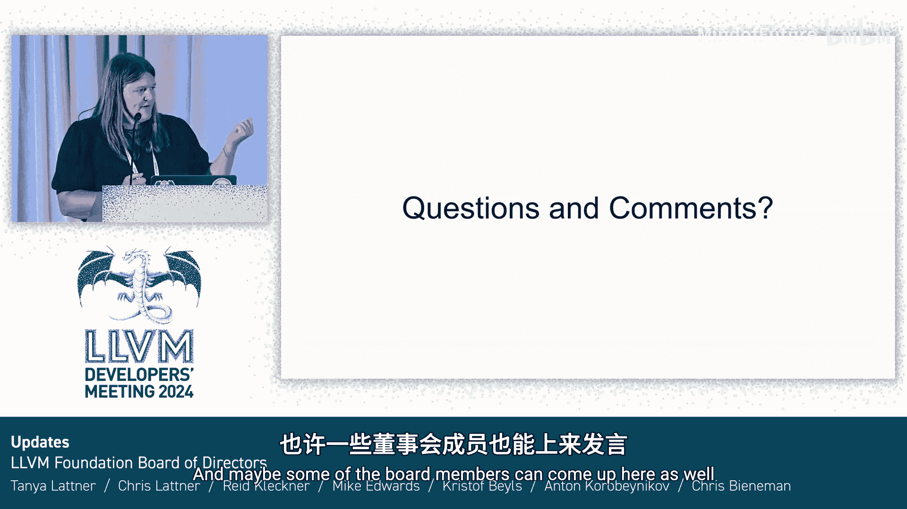

# 【2024-LLVM开发者大会-•-中英】-p65-P65-LLVM-Foundation-Updates--BV18eNfepENu_p65-

Okay。It is 1130 so let's get started Thank you for being here this is you know an informal talk we really want to get questions from you all and connect with you all and talk about the Elum Foundation but I do have a few slides that I'll go through I'm Tanya Laner I'm the executive director and president of the Alvum Foundation。

😊，If you were in the opening， you've pretty much already seen this slide。For anyone who overslept。

 so what is the Alvin Foundation， we are a 501C3 public charitable organization。

 it was founded in 2014 and by definition what it means to be a public charity is you serve the general public good。

 you're not like filling special interests or things like that。

 you are focused on your mission and the mission of your nonprofit。We had a nine person board。

 but we recently added and increased the board to 11 and the board is elected every two years。

And we only have one employee right now， hopefully to change， but that's me。As I mentioned。

 the E Foundation goal， you know we have a mission， we need to fill this mission。

 and I'll read this to you here， but our mission is to support education and advancement of the field of compilers and tools through educational events。

 grants and scholarships， increasing diversity within the field of compilers and tools。

And the Lium project and directly supporting the LVium project community and infrastructure and in short。

 we support the LM community by helping it grow fosterster community interactions work to keep LVium development productive through infrastructure and work to ensure the long term health of the Lium project LVium is over 20 years old and we like to see it be around for another 20 years。

Or more。So the way nonprofits work is that we organize everything into what we call programs and the Elvin Foundation has four main programs。

 Our first is what we call educational outreach， and that's events like the AiumDevelop meeting。Next。

 we have community。o， which is our initiative to increase diversity and inclusion within LVM and compilers and tools。

The scholarships and Grants program primarily focused on students right now。

 but we definitely would like to expand that a bit。And then most important。

 but last on this list right now is community health and growth and supporting this through project infrastructure。

 the legal issues， you probably remember the relicensing。

That's pretty close to across the finish line and other cross crediting efforts。

So who is on the board right now we have。I don't know if I should make them stand up。

 but we'll do that later。 We have Chris Bineman。 He is now the treasurer of the board。Chris Laner。

 we have Wei Wu he could not be here today。Reed Klener is our secretary。Mike Edwards。Kristopph Bas。

And Anton Corbeakcro， and then I'm Ta Latner。Obviously， and as I said。

 we've added three new board members and we're very excited。

 thiss is our official public announcement and we'll do another one later and we'll get their pictures and bios up there for you。

 but we'll be having Anna Zs， I don't know if she's here。😊，Oh， there she is， Yy。

 Anna Ss will be joining the board。And Anhu Da Gupta， hope I said that right？Thanks joining。

And last is Aliison Raandndaall and she is not able to make it here today。

 but we will be doing a more formal announcement with more information about their background。

 but we're super excited to expand the board because there's a lot of work to do and。

All three of them have unique experiences with LLVM and with other open source projects。

 so we're really looking to leverage their knowledge and experience over the next two years。

All right， I'm going to kind of go through these program updates quick and then we can get to like questions like or things you want to talk about。

So let's start with educational outreach。 We are again consistently organizing two dev meetings a year。

 which is fantastic。 We are trying to plan our first Asia conference。😊，The goal is for Tokyo。

 June 2025， we're working on securing a venue。And。For the US event， we've seen increased demand。

 which is fabulous， we had a wait list which makes me sad that we couldn't accommodate everyone。

 but it's great to see that people want to come to our events。

And we also have a very low what we call no show rates。

 so people who register and don't show up for this particular event， we only had one person。

 which out of 465 attendees is very impressive。嗯。All of the presentations are recorded and published。

 This is a great knowledge base for L of M。 We've seen fantastic traction on the YouTube channel。😊。

And we also provide support for local socials where we can， online。

 and Chris's done a great job with online synUs and office hours organizing that。

So there are a lot of interactive communication options that are available that really help effective collaboration within the Allivium Project。

What are the challenges we're facing right now， the costs are very high as you've seen ticket prices for this event continue to increase。

 that's even with subsidizing through sponsorship。And that's due to inflation， unfortunately。

So we do want to keep the costs down and make these events accessible。

 so we're constantly evaluating how can we do that？And something I was thinking about today is like。

 how big is too big。 There are more people that wanted to come that could not come this year。

 and it does it make sense to keep growing or is it better to keep it， you know， smaller。 Like。

 what is the right thing for the community to。Keep the effective collaboration and the networking and all the other wonderful things that we love about the LMDevelop Me。

And the last challenge is we definitely need to hire more of me， basically。The next program。

 community。You know， we brought in Vi speakers last year into 2023。

 we've combined this with our newcomer orientation。 We're trying to reach new audiences。Again。

 but this program hasn't gotten as much love because we need to we really need to get more people involved working on it。

 maybe that's paid staff， maybe that's volunteers， and it's been hard to keep some of the momentum within this program。

Scholarships and grants has been very successful。 this year we gave about $70。

000 to students to come attend events， which is fantastic。😊。

I constantly hear from them that this is a very rewarding experience to come to an albumium developers meeting。

 so it's great that we can provide。At least a little bit so they can get here。

 and this really helps grow the next generation of LM developers。

 So we believe this is a very important program to have。

Challenges are that we have more students than we can fund。 I always feel bad saying no。

 but we just honestly。Can't fund everyone， and we would like to reach more people for sure。

 We want more students to come and present their work at the LL M De meeting so。

We're interested in collaborating with universities professors to reach more students who are working on LVM to come and present their work。

Some of you are probably really interested in Lium project infrastructure。

 this is an area that you know we have a lot of great accomplishments we've been keeping the lights on。

 you know。😊，We've done a lot of transitions to new technology。

 this is over many years of efforts and lots of volunteers that have put their time and effort into these transitions。

The infrastructure helps you know over 5，000 contributors collaborate effectively。

 we've been working on relicensing， we have an amazing code of conduct committee。

 lots of great accomplishments in this area， however the need for infrastructure support is still strong and so we as a foundation fill we need to figure out a way to fund this better and to hire more staff to support the infrastructures。

 the projects growing infrastructure needs。So as you're probably hearing a theme here in that we're trying to expand the Al Foundation。

 we're currently interviewing for a program director to help specifically with our events and our travel grant program。

 we have bigger goals to hire someone specifically to work on infrastructure support and also a community manager。

And this will help you know， balance the workloads and help best sort of。

Help us get unstuck and start really supporting the project as best we can。

The challenge is finding the right people for these positions and so this is where I'm going to leverage all of you。

 if you know anyone that would be good fit for some of these roles。

 please come talk to us because we're definitely interested in people who are passionate。

 maybe it's about events or nonprofits or open source and infrastructure。

 we're looking for those people that want to work with us。And lastly， as we grow。

 we will have to reevaluate our revenue coming in to make sure that we can properly staff the foundation and pay for that staff。

 so that's something we're looking as well， but also balancing。

 we don't want to increase ticket prices too much to not make these events accessible。With that said。

 definitely looking for more sponsors。So if you are interested in sponsoring the LVM Foundation。

 your support would help make it so 5，000 contributors can continue to collaborate effectively。😊。

Help us so that everyone contribute and collaborate in a safe environment。

 Help us grow the next generation。😊，And ultimately help。

pHelp the foundation and the project so more corporations can contribute more easily。

 we believe that the LVM Foundation is an amazing return on investment and if you are interested in sponsoring the LVM Foundation。

 please reach out to me or any of the board members that you saw on the slides earlier。

With that said， I would love to take your questions， your comments， your advice。

 anything you want to add to help us you know。Help the El project in the best way。

 so I'll kind of open it up now。And maybe some of the board members can come up here as well。

Make them do some talking。Maybe no questions。Questions。

Did you guys have anything to add to all of that？Oh， we got Tom， great。嗯。

I was wondering if it would be possible to get the board minutes updated on the website a little bit more quickly。

 I noticed that the last update is from April， so I I was kind of wondering what's been going on with the board and it would be interesting to see what the minutes。

Yeah， I think so I've taken over the role of secretary from Kit and。I guess April' is a while ago。

 but so that's my responsibility now we've discussed some the logistics to the last board meeting。

 but I haven't learned the ropes， all figured out。Yeah， we also did a， this is my fault。

 I did a website refresh and I messed it all up， so R's going to clean it up for me。

I had one other question too， you mentioned that three roles you're hiring。

 could you talk a little bit more about like what those roles would be and like how they would be interacting with the community。

I'll take a quick sta with the so the infrastructure rule is something we've talked about a lot。

 you know。We've previously talked about like as an infrastructure director role is something we've framed。

 I think one of the things that we've kind of learned from watching as we've tried to grow infrastructure is that we don't actually need someone who's going to be a director like setting high level direction。

 we have lots of talented people in the community who care a lot about infrastructure who can help provide that direction and describe what their needs are but we really need from the foundation is someone who's going to come in and build it make it happen know someone who's gonna to come in and be able to like Tanya like undersells herself like like to a crazy degree。

She's rebuilding our website like the name one other like open source foundation or No nonprofit foundation where the executive director is rebuilding the website like we've done a lot with a really like shoestring budget and a shoestring framework。

 Tanya does an amazing amount of work We need some people who can come in and just like execute on her vision rather than putting it all on her shoulders and that's frankly。

 the theme of all I think all of the positions is getting people who can come in and execute on the vision that Tanya has and the vision that the board helps shape so that we're not relying on you our secretary having time to update the webage like the secretary should take notes and be able to like have someone else make sure that they get on the web page on time。

 so our infrastructure role is really gonna be about the nuts and bolts of how do we get it done。

 how do we actually execute and build out something rather than the direction We need a program。

ho can kind of be a force multiplier to Tanya so that we can do more events。

 We can do more things and Tanya doesn't have to be in the middle of all of it。

 And I think in some ways， the community manager is again the same thing。 It's a force multiplier。

 It's how do we get ourselves and Tanya out of the day to day of everything keeping the lights on so that we can do some bigger picture things。

所以谢谢哦 look。The only thing I was going to add to that was just to kind of specifically address your question。

We expect these people to be very involved in the community right we want them to sort of be the face of a lot of these things we want them to be a contact point for everybody。

 we want people to be very comfortable being able to reach out。

 request make requests to these people get information from them I mean I think that's part of again just to reiterate a little bit of the problem like everybody up here is super dedicated to this we all love the foundation we love the project we love the community we want to do everything that we can't we're all super busy right and it's like time just keeps getting eaten away by all of the other things in life and and unfortunately the foundation just isn't get in the love that it needs and so we're hoping by throwing dollars at this and getting some people who actually can dedicate their time in a reasonable amount of time during the week to move things forward that will start to get that traction。

Yeah， the only thing I's going to add is that I mean I think that in terms of profile。

 I think that what we're looking for is more junior people that are growing in their career so both because we want them to do the actual work。

 not come up with the ideas， the ideas are not the problem around here。

 but also I mean just honestly we're competing against big tech and other places to hire people。

 And so that's a major issue and the foundation doesn't have。Our issues and things like this。

 And so really looking for people that are really smart early in their career that are really like motivated to have impact。

 that love community， that can actually work with people like that's a kind of intersection。

So put are just a comment I was listening to the description on the roles and some of what you're asking for really sounds more like a contract project to get something accomplished there's definitely a need for an ongoing role I can see that but that sounds incredibly hard to hire for。

And if there's things that are well scoped that you could contract out with trusted contractors。

 that might be a model to get some things done while waiting for that hire。

I don I feel like I have a question for Tanya， which is kind of like。

 to what extent are we able to contract out， I don't know， we work with Bline。

If we contract it out as much as we can for event planning， I don't know。Right。

I I think that is a valid point。 we could probably contract some things out。

 I think one of the things that is part of why hiring is pretty appealing is because I think there's no end to the streams。

 right。You know we have website updates that need to be done。

 but then you know we also like we actually had some like trial compute credits that were issued to us to give it to see if we could make use of them from the infrastructure perspective they expired because we didn' we couldn't find a volunteer in the community to do them if we have someone who's on staff who can just like hey。

 you know， GitHub gives us $10，000 in credits that we can play with for a month。

 we have someone who can take it up and do it， it makes it a lot easier for us to execute on things I think to your point though。

 like we probably can look for opportunities to contract and we probably should to avoid growing too many staff but we do have a baseline like we really need to get some people in。

I mean， I think it's a great idea。 I think the other。Trade off there as we want。

A person that we can invest in right And so one of the issues with dealing with the broader community is like there's a very big aspect of getting to know some of the personalities。

 And so we'd want to look for a contract if we went with a contract or path。

 we'd want to have like a slice of a human not。A role that keeps getting passed around between a whole bunch of other different humans and stuff like that。

 But if you have good suggestions on who we could talk to。

 then that's definitely something we should explore。Yeah。

 I think I would just add to that that you know part of what we're looking for as well is to actually be able to build a consistency and so getting a person that can be responsible for things and have ownership of things。

 I think will help build out that experience Philip to your point though and you said it perfectly which is a wellcoed and defined project that we can actually hand off to somebody I I think the best way we could do that is to get somebody that can execute on helping to scope those things and then work with the contractor directly to actually drive things and get them forward。

I was curious on an earlier slide there's a bullet point about like things the board accomplished and there's a point about supporting local meetups。

 do you have concrete examples of ways that the LivVM board supported local meetups？

We were funding some meetups a small amount so and we also。

We do pay for the Meup pro subscription where all of the al meetups， maybe meetetup。com。Yes。

Which oddly is not cheap。Yeah看。😊，that is something we wanted to expand though Yeah and we also have like the foundation as a Zooms membership so we can host virtual things through zoom that are on a paid memberships there's you know。

There's definitely an area where we can expand this more and Christtph should talk about the stuff that he's done with the office hours and things。

 this is all like how we start， well I'm very he interested in the meetups。

 not the physical in person ones， yes yeah。I mean we we we do have a program for funding them when when we get funding requests。

 I think in our budget we every year we've had more budget allocated than we actually spend on meetups I so I think one of the things we need to hear from actual meetup organizers How can we help you like make them sort like more effective or something like that funding request form I can fill out somewhere is like how does that board at LVM。

 org。Shoot us an email and like let's talk about it really because think I think there are things that we can do to help we do one thing that we do want to do with our meetup program。

 though is like we don't want to give blank checks to meetups。

 We don't want to you know we don't want to be paying for an open bar somewhere where a bunch of people just go out and have a bar night。

 we are looking for events that bring value to the community。

 and I know that you've been for years involved in the Mountain View meetups here which have been wonderful and extremely productive in terms of the building community and and helping get things done。

 I mean frankly， like the number of times I went to the Mountain View socials just to like get someone to review my patch and help things through it's hugely valuable。

 So if there's ways that we can support you， we should figure that out。

And then I was just curious about the election congrats the new board members can the board describe the election process like who votes when does that happen people say they want to run and then I don't know did I forget to vote or something like what is that process so the Ivin Foundation is not a memberbased nonprofit so we are a selfelecting board so that means that board members elect in the next board and the way that we've structured this which we're always looking to fine tune and we do every year actually fine tune it is that we send out a call for people who are interested in being on the board the board members also reach out to people within our community and outsider community to try to get interested parties to we call apply and then we take all of those interest forms that we get and we look at it and we've developed somewhat of a skill matrix about what we're looking for in terms of board members。

Because。Being on a nonprofit board is very different than being a software engineer or developer there's different skill sets that we're looking for such as you know we have to fill the role of a treasurer so we're looking for someone who has some bookkeeping or accounting background with another nonprofit that could be very valuable to us or are looking for someone that has some knowledge of you the hiring process for nonprofits or the legal concerns so we have a skill matrix that we look at and we try to assess we have people self-asses what in that form we had people selfasses like what skills do they have and then we apply that to the matrix to try to make sure that。

The composition of the board covered all the skills that we're looking for。

 I hope that makes sense Can I just add one thing， which is she's not here。

 but Allison Raynolds joined the board this year so if you haven't。

 I'd encourage you like do Google search and find out more about her background long history in many different open source communities brings a ton of experience she'll be the first person that we're bringing into the board from outside of all of yeah。

Right and if you think about that， I mean I love all these people for a variety of people for a variety of reasons。

 longtime allium contributors and users and everything else getting a new perspective is actually really important and so I'm really excited about that because I think will help us grow much faster and ask hard questions is like why are you doing this this way everyone else does it that way and stuff like this and so I think that a lot of that is also really healthy and really good and I'm very excited about that？

one other thing too。 this has come up but we've talked about this a couple in previous years too about like the election process。

 and I think it's really important to kind of not think of the LVM Foundation necessarily as like a community body the LVM Foundation is effectively a company at the end of the day。

 it is In company that has company byl and the people who are on the board have fiduciary responsibilities to the company。

 Now the catch here is the LVM Foundation is in a unique position among the companies that participate in LVM in that it's only purpose for existing is to support LVM bylaw yes。

 and so like this is different from， say， any of the employers whose employees are here in that as we act in the capacity of the LVM board like we are actually required legally to act in what we think is the best interest of the community and that's a little different。

 It's a little like。Gotta swap your brain and think about it a little differently。

That gives us the ability to do things like， you， when we hire for people to work on LVM。

 they're here to work on LVM， nothing else and to support the community in any way that we can。

So just following up on the email board atLium。org， if you have a question about meetups。

 if you have any ideas on how to make the community better。Like that's really what the board is for。

 And so if you have ideas， please shoot an emails like these friendly people like we're trying to be nice and helpful and we can't do everything。

 of course， but never hurts to ask。 And if you if you want like more crossreencing from some other group or you have an idea for。

 for example， the Tokyo meetup came from somebody's really passion says hey。

 we should have the Tokyo De meeting it came from somebody's really passionate that， hey。

 I have a big community here， we think it would be great to do this and。Response is like。

 that sounds crazy。 Let's give it a try。 right， we'll see how it goes， right， it wasn't no。

 we can't do a new thing。 it's more about what we're looking for as good ideas and people that can help push things forward。

Great， any other questions？All right， well now you know what we look like。

 so find us in the next you know what's left of the De meeting and tell us all your great ideas or ask your questions offline and thank you for attending。

