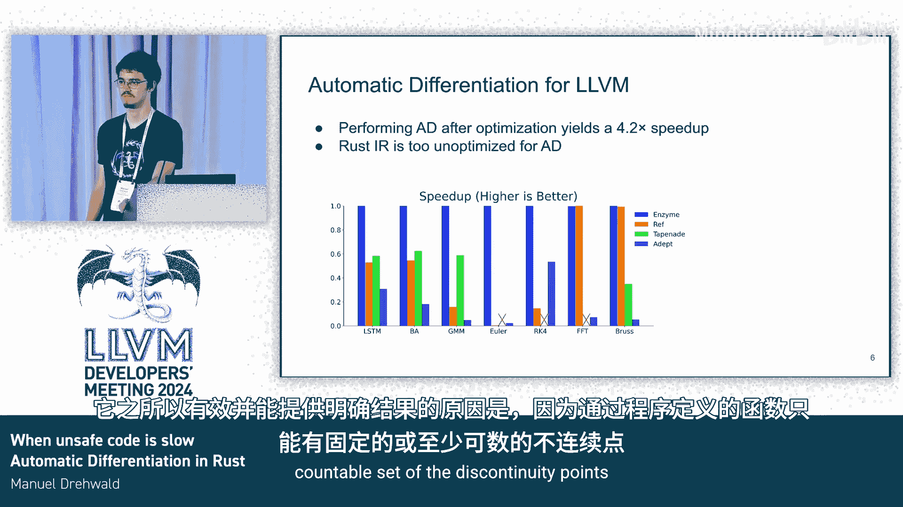

# 【2024-LLVM开发者大会-•-中英】-p66-P66-When-unsafe-code-is-slow---Automatic-Differentiation-in-Rust--BV18eNfepENu_p66-

Thank you for the introduction。 So， yes， as the title says， I'm here to talk a bit about rust。

 and what makes Ru special。 So for me， the interesting question was how good is aiomatic rust because nowadays we have a lot of programming languages out there。

 And you can write fastcode in many of them。 But the question is how fast is gonna to be by default。

 and I think rust is in a pretty good position for that and one of the things I often hear about rust is that safety is somewhat of a concern for people because it might get in the way of performance。

 So that's something I've been analyzing， especially for my feed of interest。

 which is HPC scientific computing or machine learning。 and。😊。

To first introduce unsafe to those people who might not be familiar with it yet。

 So it's not that unsafe is completely changing the way in which we compile our rust code。

 Unsafe is really just a really superficial check of whether you mark your code region or your function as unsafe。

 And in that case， you get five superpowers from rust we call them。

 So really interesting for scientific computing are mainly the first two which I've highlighted here。

 So unsafe rust allows you to dere， a raw pointer。 So that's pretty much basic C style。

 We usually don't really use raw pointers。 That's more a thing of like ffi。

 if you want to call it to other languages， but there might be some application for it right The second case。

 which we have is call an unsafe function method。 There are some provided by the rust standard library。

 but you might as well write your own unsafe functions。

 which you usually do if you cannot prove that preconditions might met。

 So you want to like outsource the responsibility to use of your function。

 and there are three more cases， So you can。😊，Excccess and modify amable aesthetic static variable。

 which， I mean， globals are kind of。But you should not do that unless you know what you're doing so。

It's rarely the case that you need to do it。 We also either to implement an unsafe trade， which is。

De。 and finally， you can access fields of a union， which is similar to inums。

 except they are not tech or you are to some extent responsible of what you do with them。😊。

I don't really see much usage of unions in rust， but they do exist。 And just to point out again。

 once we check whether you like do one of those five things。 And if you're in an unsafe block。

 that that's all we really do with unsafe afterwards， we throw the information away。

 So from the rust MIR onwards。 The whole code can either becomes completely safe or unsafe。

 However you want to see it。 it's not changing our compilation model。So as I said。

 one of the reasons why I wanted to give that talk and talk a little bit about unsaife frost is I feel like there's a misconception about it out there。

 And people often feel that Ro is kind of great。 It's safe。 but then it's low。 or it's fast。

 But then you have to write it like C。 So that's something I've told by I've been reading a lot online。

 But like even people here。 some folks I've been talking to。 We're concerned about。

 So I want to give some examples of。😊，While it's not only in general wrong。

 but like it's more the opposite。 So our safety gives us a lot of compiler information。

 And not all of that is used by LVM yet。 Nikkita talked a bit about yesterday。

 but we hope to make more and more use of all information within LBM and actually get performance out of it。

😊，And not just catch up to other fast languages。 So about automatic differentiation， it's。

 in general， a pretty basic concept We had eventually in calculus in the past， so。😊。

If you w to look at the function here x times x or x squared。 the derivative of it is two times x。

 It's a pretty simple concept。 You see like how much does the function change at a specific point。

 And I mean， such a basic example， isn't interesting for computer science， right So in reality。

 we do a function which have various inputs， various outputs， a common one in machine learning。

 for example， a neural networks， which have huge tensor inputs， images and weights。

 and a single output， which is our loss。 So in their cases。

 it becomes much more interesting about why we want to differentiate something。

 And that's also the point where A then comes in our performance benchmarks。 So a while ago。

 there was a new out tool out there。 I mean， in the past。

 we were able to differentiate Python quite well。 a few other tools existed。

 But then to PHD students came along and thought about what actually would be the case if we do it on AVM level。

😊，And as it turns out， AVM does not only give you a benefit of supporting various languages at once。

 It also allows you to get a quite decent speedup over preexisting tools。

 because what usually happens is with AD。 you have some source code transformation So you get some code in and some code out and the new code which you get out。

 your source level still computes a derivative。 That's kind of nice because then you can analyze the code like as a user。

 you can see what gets generated by your tool But performance wise that's a bit tricky because the reference pipeline。

 which is highlighted here in orange does pretty much like source level A。

 So an al tool is first applied。 Then we optimize our code and see what the performance comes out and the same tool applied in a different order where you first take your input code and that case of C plus bus but it doesn't really matter。

 you lower your input to AVM。 you first from optimizations。

 then you differentiate and then you optimize again。 So it's the same number of optimizations。

 It's just a different order。 and apparently you are a lot faster。😊，It's medium of 4。2 x。

 So it's pretty decent。 And the issue we have in Ru as again mentioned already yesterday。

 we don't really do many optimizations on rust IR。 The few。

 which we do on MR are mainly there to improve compile times because we do performmorphization to make life easier for LBM。

 But that doesn't mean that our rust I in any way efficient。 So we do need to rely on it。

 And that's the reason why we are kind of interested in using LEDBM based Al in the rust compiler。😊。

走。😊，One of the reasons that was pretty much my selling pitch to Ru compiler people。

 So big pation for neural networks is maybe the most glimamorous at the time。

 But there are a lot of applications in high performance computing and scientific computing out there which make use of automatic differentiation。

 So these are the ones I am in touch with to some extent。 but obviously there are much more。😊。

So about the current status， it got approved by the compiler team。

 It got a bit later approved by the language team。 So now we have。

Been able to upstream most most of our rust for， including alternative support。 there's one open PR。

 as you can see， but we do hope to get it in in a month or so。

 the work is also supported by the rust Foundation to a fellowship。 So thanks to them for that。

 And yes， so now to get back to the interesting part of my talk。

 Why am I claiming that unsafe code is low。 So I have five benchmarks。

 It's classic C plus plus versus rust。 The C plus plus is taken from previous papers。

 So it's actually quite well optimized。 it use all the fancy tricks restrict has been way profit and analyze。

 So it's not just some random code。 and I've been adding some more variations to it。

 So we have no C plus plus code with restrict and without and I mean。

 without it usually what people would write in your dependencies。 and we have rust code。

 which is written as a normal rust code high level types references vectors。

 whatever you're used to in rust and I have a raw pointer version of rust。

 So that's pretty much if you read your rust code as it would be。What do you get out of it。

 we well for niceD have two competing C plus plus2 is tapard and adapt。

 Tpanard supports Fortron and C plus plus， which will be relevant later and adapt is for C is like code。

 So do not talk much more。 Here are benchmarks。😊，And just to make it clear。

 all the code is handled by A tools。 But if you like leave those a tools out of the loop。

 everything is like completely identically fast。 It's in like one or2% range of differences。

 So the only interesting part is really8， how much does the performance change if you want to compute derivatives。

 It's five different applications。 And if you pay a closer attentions or the first two are rust。

 The second two are C plus plus using the same Auto tool based on ABM。

 And the green ones are completely unrelated out tools， which fall a bit behind。😊。

So the dark red and the light blue ones are the ones which are optimized。

 So the first one is safe for us。 The light blue is C plus plus using all the restrict qualifiers wherever you can。

 And then we we have orange the rust row pointer， which is pretty much C light code。

 And we also have the C plus plus version just by stripping oh no As information from restrict。😊。

So to have a slightly closer look at how the performance is doing。

FFT is one of those benchmarks where C plus plus were close， but not identical with rust。

 So we have 0。 54 seconds for both rust versions and 0。64 for the C plus plus version。

 The second 1 I have been added because there was no I S usage。

 no research usage in their case anyway。 So rust is slightly ahead and。That's interesting。 I mean。

 I've been talking about you should not write your rust code like it would be C code because we see later Y。

 but there are some cases which are actually valid And that's like which I've highlighted at the beginning。

 So you can mark small code regions as unsafe and use one of those superpowers。

 and one of them is calling unsafe functions， which in this case are provided by rust standard library。

 So it instead calling the standard support function， which does some bounce checking。

 We now call the swap unchecked， which trusts you on having like your indies inside of your vectors slice bones。

 And that gives us approximately 40% performance improvement。

 So it's one of those cases where LBM is not yet able to do successful bounce checking。😊。

We can help out with that no issue， and hopefully at some point we'll be able to fix this specific case in AVM。

 I felt that C++ is also to some extent curious about using mobile bond checking by default。

 So there should hopefully be some work done in the future。😊，And to look at the next。

 and in my opinion， most interesting difference， that's a benchmark where we have three like first spots。

 The first one is on the left side， Ru with in a safe idiomatic style。

 The next one just lightly behind almost close to noise is C plus bus using all the risk qualifiers everywhere。

 And the third place is an that K tabout， which is a two which also supports forran。

 So we see a 10 x performance penalty for rust。 if you。😊。

Start writing your ro code as C code and we see still a4ex performance penalty for C plus plus if you remove all your risk qualifiers。

 and if you think about why and if you look a bit closer about what a does that actually makes a lot of sense。

 So to explain a little bit what a does on a technical level。

 we kind of go along those functions which you care about。

 which you want to compute gradients and doubleda function length。

 the way you do it is we look at the code， we mirror it。

 So originally you've been running your code ones from the beginning to the end。

 now instead of like leaving the function at the end。

 you run it in reverse order from the end to beginning。

 which means effectively double the length and then we modify both parts of these this new function。

 So in the forward pass， the original one， we cache variables。

 which we might need later for computing derivatives and in the second pass， then you reverse past。

 which we have added， we either reload stuff， which we have cache before or we recompute which of the two we do is kind of a tough question。

😊，There's no clear answer to it， but there are good tradeoffs and that's pretty much the reason why we dot need unsafe in automatic differentiation and therefore like all applications why we need restrict and all all in all of these applications because if you think about what you want to cache。

 it's everything that gets overwritten and that's needed later， if you look at， for example。

 the classic gem example， we have a lot of input parameters， but the interesting ones are matrices。

 A， B and C。😊，C is usually the one which gets overwritten。

 Does't really matter which last routine you look at， so。If you don't have any as info in that case。

 you have to assume that every time you overwrite C。

 you alsorite A and B because what happens if you pass in three times the same pointer。

 And now you are not catchching C only， but you're catchching like every single variable out there。

 which is indirect。 So pointer reference， whatever。 And that's pretty bad。

 So that's why know as is not surprisingly having a 10 x performance difference here。

 And C plus plus is a little bit luckier as we've seen on the previous slide。

 it only gets a4 x performance penalty， And that's because。😊。

We do not like inside of our differentiated code。 We do allocate a couple of functions。

 And the way C plus plus and C allocate memory is a bit more straightforward for us。

 We have some more interactionss， which makes it harder of our A tool to understand that。

 We've been working on some fixes。 But for other fixes， we want to have。😊，For example。

 Alis information onstruct returns， because right now。

 you can add an ideass information to single pointers。

 You cannot really add no ideasas if you return astruct。

 So there's some work going on on the AVM side， which should make the unsafe thrust a bit faster。

 But generally， if you just stick to aiomatic safe rust。 you， in this case， should be fine。And why。

It's not only about the run time。 It's obviously also compile times。

 if your call compise for hours or days。Few people will use your to， so。

There are some challenges to A D。 And the biggest one we have is we need really good type information。

 which isn't always there。 So we need to figure out things。 in the case of A D。

 simply a me copy is not a me copy。So it does matter if you copy 64 bys of loads or 64 by of double。

 And if you do not know which one you do， as you can see on the bottom left。

 you might get the wrong derivative。Which is pretty bad。 So on the C plus plus side， we are lucky。

 C plus plus has TB A A， which gives you some information， not all the way， but， I mean。

 it's decent enough。 on the rust side， it's a bit bad。 We don't have TB A A yet。

 and we probably not get it。 So we need to think of some other things。😊。

What I've been doing in my work over the last couple of years is finding out that AVM has OC pointers。

 and even before you were not really supposed to use OC types。 So I thought I'd help it out。

 We have our own rust IR， which is called MIR。 and there we have types。

 So I started adding some analysis pass and I've been lowering those type informations just to find out afterwards that we are now introducing OPAC types。

 So there are some trickys to it good thing is we don't need type information everywhere。

 we'll be able to get a lot of that from just a few locations where it's relevant and propagated inside of our Auto tool。

 So we should be hopefully fine。 and yeah for compile types。😊。

We have some comparison from some chemistry applications since I work a lot with chemistry people。

 they running some jack code， which effectively out of memory during Jing time without jtting。

 the performance was unusable with Jtting。 It was crashing during jet time。

 So they were between a rock and a hard place。 Russ came in and we two orders of magnitudes of compile time improvements。

 It's pretty simple code。 So yeah， there's not much to simplify about the code。 They were。

 they just moved over。 Russ has pretty nice Inter up with our languages。

 So now we are all happy without two magnitudes of improvements。😊。

We were wondering can C plus plus do better。 We have TBBA。

 how does it compare to the type information I create and we compare rust vectors to C plus plus vectors or pretty much hopefully yeah。

 unfortunately C plus was somewhere in between rust and Python not as bad as Python but still quite behind we can see the baseline is in all cases kind of okay a couple of seconds for 50000 lines of not 50000 in this case。

 but for some lines of code for rust we made interesting distinction。 if you write unsafe code。

 you need to use specific functions So it's not only slower as we've seen before on run time。

 it's also slower to compile because now you don't use the like standard bit in array brackets。

 you use some special function code， which just takes longer to compile the only special case here is release bit of rust Ru is really aggressive on vectorizing code So the AVmiR which I got from rust was highly vectorized even though the code was pretty random which was interesting。

😊，C plus+ code was just doing in the scalar operations。

 So that explains a little bit why the rust release speed is so slow here。😊。

We obviously care about correctness a lot。 It's an experimental feature。

 So I'm not going to complain we have perfect correctness and safety right now。

 but it's something we keep in mind。 So to give some examples of why A D and rust is tricky。

 especially if you go ahead and like start modifying lower level I R is。😊，Checking shadow memory。

 So the way enzyme works。 or generally our A D tool works。

 And Ru is if you have a variable and you want to figure out how does this input variable like correlate with the output changes is you give it a shadow memory。

 enzyme is going to write the shadow memory use the shadow memory to write the gradients into it。

 So after a function call， a magic one， you can just read out the gradients from there。 now。😊。

Rs has a good type system。 So whatever can be checked at compile time is gonna to be checked at compile time by our type system。

 There are a few types which have runtime properties。 The first one is a vector。

 which is a dynamically sized array。 So you decide that runtime how long it is in the past。

 if you would call that function。 D in that case is a function generated by alternative。

 it would just do random things usually it's array of bonds。 So if you're lucky it just crashes。

 if you're unlucky it overwrite some memory next to it。 we have extra handling for this case yet。

 there are few other array vector types， which we don't tend it yet。

 but that's pretty straightforward。 we just add some bounce checking should usually be fine since people tend to differentiate large section code because otherwise they could do it by hand。

 So a single bounce check once at the beginning of a function isn't really relevant。

 I haven't even disabled it for my benchmark marking。😊。

There are some more cases where we do need to care about rust types not being lowered into LVM types。

 one is the mutability。 So at lower levels enzyme is not really aware of which memory is mutable and what's immutable。

 we are thinking about having some improvements there for some performance optimizations。

 but for now you can just bypass those checks if you pass the right types in So rust has mutable and immutable references。

 if you now create astruct with some immutable references inside。You might be unlucky。 in some cases。

 we can recognize that data is marked is immutable that that's in the bottom line， in that case。

 we warn you about it。 But in other cases， like struck， it's too complex。

 how analysis doesn't figure it out yet。 So we need to improve that a little to make sure that no one is over writing immutable memory on AVM level。

😊，And yes， one of the last cases we have is enums， enums is another case where we at runtime decide which type you're actually getting。

😊，Rus has a couple of。R about how you can cast one type to another。 So generally， if the target type。

Is gonna be valid。 No， no matter what you write into it。 then it's fine to cast。

 So if you have a float and you write that into an integer， like the fine resides。

 then you're probably gonna be fine。 If you have a pointer and especially like a 64 bit pointer and start writing a float into that。

 It's probably not fine。 And then there are even worse things because the previous one。

 we could eventually check on ABM level， the last one is pretty bad because we cannot figure out on ABM level。

😊，We have initially out optimization。 So reference does look does still have 64 bits。

 It has the same layout on ABM level。 We do not know what it means。 So yeah。

 do people have any questions。First all， thanks for listening。Thanks， Manuel。This song。You know。

 I was very excited to come to this talk and learn about auto differentiation。

 and I did see the slide go by with the exploration of。

Mo differentiation based on continuous function differentiation。

 specifically of the exponential function。And for me。

 that really doesn't bring it down to Earth as to what the differentiation is that you're doing。

 you know， we're not in a continuous domain。So maybe maybe it's point wise differentiation we're talking about。

 it's also not clear to me what the domain is that we're doing differentiation over。Okay。

 so for that to say， usually add toolss are not super well defined on points which are not fully differentiated with the reason that for example。

 for neural networks， if you have like a relu， which at a specific point is not clear or has subgrads only then that point will really rarely be hit。

 so add toolss tend to differ what they return in that reside。

 enzyme specifically has the promise that you get a valid sub gradientdient。

For other alternative toolss， I'm not sure what they return in these cases。

It is correct it is handled， and we do have some flags in which you can slightly alter the behavior for these specific cases。

Yep。So can I like surmise from what you're saying that like the tool sort of lifts these integral functions into a continuous domain？

And then like the symbolic differentiation on a continuous domain。

It's not necessarily symbolic so the way it works is since we are working on AVM IR level。

 what we trace is the control flow。 So if you since we have memory as the original inputs and we have shadow memory which is moved along so the way I usually like explain my safe AD in this level is whenever we have some control flow which might be not continuous if we take the like one branch for the primary one。

 well also move our shadow memory along the same branch and that way we handle noncontuous cases。

Okay， so like if I surm that auto differentiation is all over a domain that's like the LVMR is the input。

Representation of the function that you're talking about and then the differentiation that you're doing is really just like a very complicated algorithm that's hard to explain。

 but it's not really analogous to continuous differentiation any more than that you want to say something to that。

Yeah， I just wanted to answer to the question。 essentially。 So the point is。

 you have the function that is defined by the program。

And all the points of discontinuity that you might have are quite well defined。 For example。

 it's the controlflow。Meaning that we can essentially end like and the number of these points of discontinuity is actually countable。

 so you cannot have like noncountable set of points of discontinuity for the function defined by the program。

So in the way how Alative is working is essentially when you have the。

 So you have essentially the partially continuous function with the discontinuity point in the like control flow。

 Like if you have like if X then a else B， right？ So you can you can think about this as the like partially continuous function。

 So in the way how the alternativeative is essentially structured is， well， you are。

Differentiating the like piecewise。 and then stick them together。So as a result。

 we usually have the sub gradientient， right， but it's quite well defined。

So it's not like we extend into some， some con that may know。 So we're just doing things peacewise。

And the reason why it is working and why it is like providing well defined results is because the program。

 like the function defined by the program， can have only like either either the like fixed or like at least countable set of the discontinuity points。

Thank you。 Thank you， Manuel。 Our next talk will start in5 minutes。

