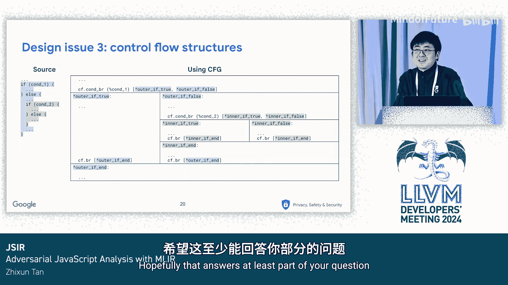

# 【2024-LLVM开发者大会-•-中英】-p67-P67-JSIR---Adversarial-JavaScript-Detection-With-MLIR--BV18eNfepENu_p67-

Alright， hello， everyone。 today we're gonna talk about JSIR。

 a ja JavaScriptscript intermediate representation based on ML IR for detecting adversarial code。

A little bit of background here。 JavaScript appears everywhere。

 They show up in HTML pages on the web。They show up in mobile apps built with cross platform frameworks like React nativeative。

 and they show up in browser extensions。Now， as you can imagine。

 Google operates in all of these places， so we invest a lot of engineering efforts into detecting malicious code on all sorts of platforms。

Now， for example， the Google Play store for Android has a feature called PlayProtect that scans an app before you download it。

A large part of these detection systems is about analyzing the code to spot malicious or suspicious behaviors。

Now， these behavior signals are then fed into other systems to make an overall decision on our action。

 such as banning the app or showing a warning sign。

So we want to analyze JavaScript code to find malicious behaviors。 Now。

 what do these malicious behaviors actually look like Now， let's take a look at two examples。

Our first example is sography。Stconography， AK A concealed writing means hiding information in something else。

 Now that something else here could be in any form like a message an image or even a video。Now。

 the code that we're showing here first loads the data from an image。Now。

 the data is really just an array of numbers representing the color of each pixel。

The code then manipulates this array in multiple steps。

 and we can kind of roughly see that it's incrementally building up a string variable called message。

And in the end， the string is actually passed into the function Eval。

 which treats the string as a piece of code and executes it。

So now we understand that the code we're really showing here is a decoder of some malicious code hidden in an image。

Now， the attacker does this to try to circumvent detection systems。

Stchography is not very difficult to implement， and there are tools on GiHub that does this for you。

You can just upload a piece of text and an image， and the tool generates a new image that looks almost identical to the image that you uploaded。

 but with the text text are hidden in it。Now， the tool also gives you a library to extract and decode the text from the generated image。

Now our solution to staography is taint analysis， which is a kind of data flow analysis to try to find malicious information flows Now in this example。

 we do have such an information flow from get image data to Eval。

So taint analysis kind of works like this。We start from a source which in our case。

 is a function called to get image data。And then we incrementally find all variables in the code that are tainted。

 meaning polluted by the source。And finally， we find that a tainted variable is passed into the function E。

Tint analysis is a data flow analysis， which is typically done in an IR。

 where we run an iterative algorithm on a CFG meaning control flow graph until convergence。Now。

 ideally， the IR would be SSA based， which makes the algorithm more optimized。All right。

 our second example is obfuscation， which is the act of intentionally making the code more complex。

This example uses one particular obfuscation technique called string splitting。

We can imagine that if an attacker wants to redirect the user to a malicious website。

 they can split up the URL into several pieces， making it harder to spot。Now likewise。

 obfuscation is not difficult to implement either， since there are also tools out there to do it for you。

Now， obviously， our goal here is to offer sorry， to the office skater code now。

In this particular example， we need to perform constant propagation to combine these string pieces to recover the original strings。

Now， constant propag is also a kind of data flow analysis。

And it's very common in compiler optimization。However。

 unlike a typical compiler which performs these optimizations on the IR and then converts the IR into some lower level representation such as machine code。

 in our use case， we actually want to output simplified JavaScript code。In other words。

 we want source to source transformation。Now， this is because the obfuscation is largely used by reverse engineers who actually manually read code to identify malicious behaviors。

So now we are kind of seeing that we have some conflicting requirements here。On one hand。

 we want to perform analyses for signal extraction so that the analysis results can be used in rule based decision engines and M classifiers。

 etc。On the other hand， we want to perform source to source transformation to simplify the code to assist reverse engineers。

 analysts and manual reviewers。Now， both of these use cases involved data flow analysis。

 so we want an IR and a CFG to perform these analyses。

But then source to source transformation seems to suggest that we don't want a low level representation。

 and perhaps we just need to limit ourselves to an AST。

Because we can certainly generate JavaScript code from the AST。Introducing JSIR。

 a carefully designed JavaScript IR that can be fully lifted back to an ASD。

Our goal for JSIR is that not only can we perform data flow analysis。

 but we also make it possible to perform an entire round trip from JavaScript source to AST to IR。

 and then back to ASD and all the way back to source。This way。

 after we make some transformations on the IR， we can generate JavaScript source that reflects these transforms。

And for the remaining unchanged part of the IR， we can generate the original source。

So with that goal in mind， now let's take a tour of JSIR and in particular。

 I'm going to talk three design issues that we encountered to make the round trip possible。

So let's start with something quite simple。On the left hand side， we have an expression。

1 plus2 plus 3。And in the middle part， we have the IR。

 where we list the computations in a linear way and assign each intermediate result to an SSA value。

So how can we possibly lift this IR back to the source？I mean。

 if we map each SSA value to a variable， that would definitely generate something different from the original source。

And more importantly， it's less readable。Which defeatt the purpose of code simplification。

So what do we do here？Well， let's take a look at the last operation in the IR。

 which is expression statement。It doesn't really capture any semantics of the original code。

 but we still keep it during IR generation from the ASD。

What's interesting about this op is that if we recursively trace the Ut chains in the IR。

We can see that it starts to look like an AST。I'll even go one step further。

 There's actually a one to one mapping from each IR operation to an AS T node。

So by designing JSIR in this way to preserve all information from the AST。

The round trip sounds a little bit more reasonable。But there's something we can't really get around。

For this recursive traversal work， we need to identify the root operation to start the traversal。

 Now， in this case， the root operation is the expression statement。

Now we design JSIR such that these routes are explicit and easy to find， for example。

 we know that a block of JavaScript code is made of a list of statements and each statement contains expressions。

So in JSIR， we define a trait to mark certain operations as statements。

 such as the expression statement operation in this example。

So that they're the root operations for recursive traversal。All right。

 so in the previous example we showed that SSA values in the IR don't get lifted into variables in the source code。

So this means that if we do want to represent variables in the IR， we need to do it explicitly。

So in this example， we have a equals a plus 1。Now， in the IR， we use dedicated operations for them。

 the L value is represented as identifier ref， and the R value is represented by identifier。

And the rest is the same as the previous example。Now we basically still have a one to one mapping from the IR back to the ASD。

There's one caveat， though。I mean， technically speaking。

 we don't really need to differentiate between identifier and ident ref if the round trip is the only thing that we care about。

We introduced this to so that we can capture the semantics more accurately in the IR。

 and this we will make the data flow analysis easier。Alright。

 things start to get trickier when we have control flow structures。 Now， in this example。

 we have two levels of if statements。MLR does give us two ways to represent control flow structures。

Either using regions or control flow graphs。Regions accurately capture the nesting structure。

 and it's just like the ASD， so it's not surprising that if we use regions。

 we can lift the IR back to the ASD。CfGs， on the other hand。

Explicitly represent the lower level branching behaviors。

 which are more suitable for running data flow analysis algorithm。

But we seem to have lost the original nesting structure。

But the structure of the CFG does have some remnants of the original structure。In this example。

To represent an if statement， we start with a conditional branch that splits into two cold paths and both paths and with unconditional branches to merge together。

And the inner if statement is represented in the same way。

And we just replaced the block with a subgraph of the same structure。

By laying out the blocks in this 2D format， we can see that each block maps to a part of the control flow structure in the original code。

We can actually point to a block and say， hey， this block maps through the true branch of the outer if statement。

 or like that block maps through the false branch of the inner if statement。

So what if we just add annotations on the IR to make this mapping explicit？More specifically。

 at the beginning of each block， we add an annotation up that describes what this block represents。

And furthermore， we can group annotations of the same control flow structure with a token。

In this example， we have two tokens， one for the outer if statement。

 and one for the inner if statement。These tokens and annotations allow us to traverse the CFG recursively as if we are traversing an ASD。

And when we encounter the creation of the token， F1。

 we can then trace its use dev chain to locate all annotation ops that use this token as an argument。

And from there， we locate all of the blocks that map to parts of the if statement。

So does this design work？Well， yes， we have tested more than 5 billion JavaScript samples。

 and the vast majority of them succeeded in the round trip from source to ASD to IR and back to the same source with only formatting differences。

Another proof that this design actually works is that we also have an internal use case of JSIR which decompes the react native bycode to JSIR。

 and then all the way the JavaScript source。And last time we checked on a data set of bytecode files。

 about 70% of them can be decompiled into the source code。

 and failures actually mostly due to out of memory crashes。All right。

 one note on the representation of control flow structures。

It's pretty obvious that the region based representation is more readable and intuitive。

So is it possible to just perform data flow analysis on this instead of the CFG based representation？

Well， the MLR data flow framework does recognize branching behaviors in between regions。

 so we're actually fairly close。The only remaining issue is to find a way to model。

 break and continue statements， which are unusual branching behaviors such as jumping out of two levels of regions。

We see that Mo already kind of implements this and there's an RF to upstream a version of this solution。

We're really looking forward to this because then we can actually get rid of the CFG based representation entirely。

With that， let's summarize the takeaways of this talk。First。

Maicious JavaScript is a prevalent problem。Google cares about this。

 and we develop systems and dedicate people to this problem space。And I think that in general。

 the combination of compilers and security is a very interesting field where we can make a lot of impact。

Second。Our experience further proves that MLI is powerful enough to represent general purpose languages like JavaScript。

We hope that our project in similar projects like Kang IR can give people more confidence in this。

And folks can find new use cases of MLIR。And lastly， as we described in this talk。

 it is actually possible to design an IR that can fully convert back to an ASD。And finally。

 I'd like to end the talk with some open questions。First。

We can see that there's an industry trend to build high level language specific IRs。

So is it actually possible that in the future， we don't really need the ASD at all？I mean。

 we might still want to build some sort of parse tree just during parsing。

 but we don't need to do any analyses or transforms on an ASD and we'll just do all of those on a high level IR。

We're seeing some projects moving in this direction， for example。

The Mo compiler seems to go to MLR land as soon as possible。

 and then all analyses are done on different IRs。The carbon compiler also converts code into a high level IR as soon as possible。

Second question。There are actually a number of ASD based JavaScript tooling frameworks out there。

 such as Babble and ES Liinnt。They expose the ASD as a public API so that users can traverse and transform the ASD fairly easily。

So。😊，Could JSI actually become the foundation of an IR based JavaScript tooling framework。This way。

 it makes it easier for people to author data flow analyses。And， third。You might not know this。

 but JavaScript actually has a standard ASD specification called ES3。

And popular JavaScript tooling frameworks are kind of all based on ES3 with some minimal variations。

 so is it actually possible to also come up with a JavaScript IR standard？Yeah。

 so these are some of the things that we' are thinking about。 And in the meantime。

 feel free to check out our Gitthub repo just released today。

 we're still in the process of releasing more components into the repo。 so stay tuned and thank you。

😊，Thank you， Luc， any questions？Hi， thanks for the great talk。So I imagine how do you handle。

 how do you handle constructs like， for example， loops。

 Because they don't have control flow that's as uniform as like if and then， right。

 because you can also have break and continue。 Yeah， so。Break and so sorry。

 let me actually go to this slide。Yeah， actually loops are represented similarly compared to if statements when we use the CFG based representation。

 we just have more and more annotations and it actually works in a code base you can actually check it out and I do think that the CFG representation with annotations is kind of not very intuitive and it's fairly difficult to use because。

When you do some analysis on this representation， you want to then export the analysis results to other representations。

 so if we consolidate onto the regionbased representation then everything happens on one representation is going to be easier and then in terms of how you can actually represent break and continuous statements using the region based representation like I said。

 there's a RF to actually do that， actually it requires a modification of the MRIR offstream and you also need to modify the data flow framework to actually capture this kind of branching behavior I think that there's a talk about Mojo which has a little bit detail about how this is done by them。

Yeah。Yeah， hopefully that answers like at least part of your question。 Okay， yeah， thanks， yeah。

 thanks。

