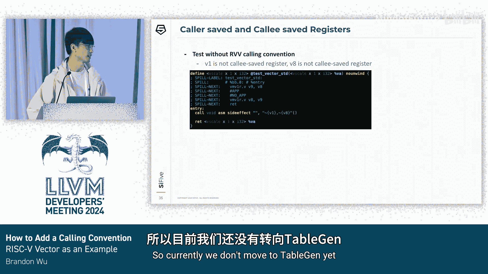

# 【2024-LLVM开发者大会-•-中英】-p68-P68-Support-a-new-Calling-Convention-in-LLVM--BV18eNfepENu_p68-

Hi， I'm Brendan。 And today I'm going to talk about how to add a calling convention。

 and I'll take risk5 vector as an example。Okay， so for the agenda。

 I'll first give a brief introduction to Col convention。

 Then I'll talk about the risk5 vector and its stake layout。 And lastly。

 I'll dive into the implementation detail in L O VM。Okay。So what's the calling convention， Basically。

 calling convention is the protocol between Col and Col。

 and it defines some rules for color and col to communicate。Smoothly in physical machines。

 there's no any core instruction that has argument。

 The way for two subluines to pass the argument is through registers or memories。

 And the rules of passing argument is defined by calling convention。 So， for example。

 let's say we have a function performing， multiply and add。In this function。

 it causes subroutines to do the multiply and add respectively for calling multiply。

 we need to place the arguments which are A and B in some places like registers or memory and multiply then read those input from the same registers or memory to perform computation。

And these role are all defined in calling convention。Same for calling the a function。Okay。

 so calling commission also defines the set of registers for return value。When return to the call。

 both of them also need to know which registers or memory to use。Okay， during procedural call。

 some registers might be covered when using registers after the call。

 we need to make sure the data is consistent。So calling convention also defines a set of registers that need to be saved either by call or by calling。

Okay， let's talk about risk 5 A BI and stake layout。

So risk5 has three different kind of data registers， which are integer registers。

 floating point registers and vector registers。And first。

 we have 32 integer registers named x 0 to x 31。We also have as for each register to make users easier to identify the purpose of them。

And register in the red box are what we are focusing in today's talk。

 which are argument registers and calla registers。So there are also 32 following point registers。

12 of them are cola registers， and eight of them are argument registers。

So before we dive into the stack layout， let's talk more background about risk5 vector。

Ris5 vector is a scalable vector， and its lens is defined by each hardware。In Ra 5。

 there are 32 vector registers， which is same as Intel's A VX and armss S VE。

Each of them is in vin bit。There， there's also one CR called V B in risk5 vector to hold the vector lens in bys。

For example， if the vector length is 1，28 B and BM B would be 1，28 divided by8， which is 16 B。

And risk 5 has a vector V type CS SR for recording configuration。

 such as 11 with computation policy and vector register group multiplier， etca。Okay。

 so the image illustrate the difference of vector register arrangement for standard calling convention and vector calling convention。

The reason we need another calling convention other than the standard calling convention for vector is that in some applications or libraries。

 they don't really use vector register heavily on the other hand。

 the latency for vector loads and store instruction are high。

 So it's better to have another choice for other usages。

The upper image is the standard calling convention， and the lower one is vector calling convention。

 The main difference between these two calling convention is calling call save registers。

In standard calling convention， all of vector registers are calla。

 which means it caller's responsibility to keep the register state across procedural calls。However。

 in Victor calling convention， V 1 to V 7 and V 24 to V 31。A colleagues saved。

They are only saved if the need to occupy any of them。

And every function maintains its own memory space during the call， which is known as a call stack。

Here， here is the stack layout of risk 5。 As you can see， there are five sections in total。

From top to bottom， we have a fully allocated area for variable arguments。

 scalable col save registers， scalable local variables， RVV objects and variable size objects。

And I'll describe them in detail， in following slides。First。

 we have Scalar callab registers and scalar local variables。Let's say we have a simple function。

 which with the local variable declared。 The assembly of the code is in the middle block。

And the first line in the block adjust the stack down for preserving all of registers。

 Then we have a we have scalar call save registers starting from S-16 and scalar local variables start starting from S P minus-20。

The relative position on the stake is shown on the rightmost picture。Next。

 we add the RVV local variable。The size is calculated by reading the VM B CS SR and multiply by 2。

This is placed right below scalar local variables。There's one thing to mention is that RVV object section contains not only vector local variables。

 but also vector call save registers。 Col save registers are placed right below the vector local variables。

Okay， then we have variable less argument。Here we save all of the arguments in pre pre allocated area no。

 no matter their use or not， this is not only for access simplicity it it also release those registers for register allocator to lower the pressure。

Okay， the next section is variable size object。Some local variable size are unknown during compilation。

 for example， an array with size defined in other objects。

We need to get the variable from symbol table to calculate the exact size， and the size need to be 1。

21，28 B aligned line， which is specified in the spec。And so， here。

Is the cow snippet in the purple box。And to calculate the exact size during wrong time。First。

 it reads the variable from symbol table and shift left by2 since it's an integer type。

 which is4 byte。Then at 15， followed by and instruction to ensure the offset is aligned correctly。

Okay， so those are five sections of risk 5 caustic layout。Okay。

 let's talk about implementation details。To enable calling convention。

 we need we need an attribute to pass the information from front end to back end。

And there are some files need to modify to get it work。The first file is called attribute TD。

And this file gathers all of the attributes with different aspect for risk5 vector call。

 we need to define an attribute for declaration and function type。

The keyword in C or C plus and some other Fland information are also described in this section。

We also need to define an en in specifyifiers that age。

 This is used to keep the information in client site for all other following functions before backend。

We also need a way to map the calling convention attributes from front end to back end。In C G call。

 does CP P， we have a function called cl coldcom to L O VM Cocom to do the mapping job。Okay。

We also need to define an Eam in a calling comp dot age。

 This is used to keep the information from L O VM I R all the way down to machine code。

And the L token that H files defines vector calling convention keyword in L VM IR。

And the token would be pass by A parel and convert to corresponding calling convention Ym in L O VM。

On the contrary， the A SM writer admitids the corresponding keyword in L VMIR for each calling convention Yam。

Okay， for now， we know how to add an attribute keyword for the coding convention in both Can and L O VM。

We are also able to make the parel recognize the calling convention keyword in M O IR。

 So let's take a look at a test case to see what we we've already done in the previous slides。

In the upper image， we have a bar function declaration with risk 5 vector C。

Then we make a call to the bar function in the test function。

And the generated L VM I R is shown in the lower image by running the command K dash target risk 5。

64 dash S dash emit L VM。And you'll see the risk5 vector call vector CC attribute is correctly lower to the L VM I R from front end。

 and it will be later used by selection deck to determine the mechanism and the set of registers to lower the calling convention。

Okay， next， we are going to talk about RVV specific concepts for vector registers。

The first one is called Elmo， which send for vector group multiplier。 For example。

 the leftmost image illustrate Lmo equals one， which means the data occupies only one vector register。

 However， in the middle in the middle image where Elmo equals 2。

 It means data occupies two vector registers。And this is one of flexibilities in Ri 5 where users have full control over resources in terms of vector registers。

And the second concept is called an F， which is short for number of fields in a segment。

This is basically used in segment low store instructions that need multiple。

Register group to be consecutive。In the following slide。

 we will use RVV type to represent vector type with only L more。

 and well use vector tobo type to represent the vector type with both L more and NF concept。Okay。

 there are also constraints for those two vector types in previous slides。For RBB type。

 we we have a group of registers。 The first concern is that starting registers should be multiple ofelmo。

And the second question is that all registers in a group should be consecutive。In example one。

 we have L more equals2， and we have V 2 and V3 for this type。嗯。

Which is valid since the starting register is V2 and is multiple of two。

 and V 2 and V3 are also consecutive。However， in example 2， although V1 and V2 is consecutive。

 the starting register is not multiple of two。 And under contrary。

 example 3 is invalid because the registers in a group should be consecutive。Okay。

And the constraint for a tu type vector2 type is based on our VV type with an additional constraint。

 which need all of the groups to be consecutive。 In other words。

 and all of NF times Elmo registers should be consecutive。In example4。

 the type has ma equals 2 and NF equals 2， so the starting register should be multiple of2 and all four registers should be consecutive。

However， in example 5， it's invaded because it breaks the consecutive rule for all the groups。

So an important question is， how do we model our V type and tu type？For RVV type。

 we already have V scale in L VM to model it。 For example。

 As say we have V in 64 and1 for representing I I 64 RVV type with L more equals1。And it is models。

 it is modeld as v scale times 1 times I 64。 Since each block is 64 Bs in risk 5。

This is same as how our models S V E。However， there are no existing mechanism to model the vector to what type。

 Let's say we have a type B in 64 M2 times 4。Which has L equals 2， and N F equals 4。

One possible way to model it is。Is through the same way as RVV。

 which could be something like v scale times a times I64。However。

 this approach would be ambiguous between the type we in 64 M2 types 4 and we in 64 M M4 times 2。

 because the total number of vector registers is the same。

So we are not able to identify whether it's LLmo 2， NF4 or L 4 NF2。S VE also has N F concept。

 but it doesn't haveel more。 So the current mechanism is sufficient for S V E。

And originally we use structure type to represent the vector tu ball type where Nf is map to the number of elements in the sh and each element is of scalable vector type with specifiedelmo For example。

 a vector tu type with Lmo2 and Nf4 Nf4 is represented as a struck type with four elements and each element is an Lmo 2 scalable vector However。

 this approach has a potential problem in selection deck the struck type is flattened to its element type where the group information is gone。

 So it's not possible to inference is type exact type we need a new type for handling vector2 pole in risk5。

So fortunately， RO VM has a building type called target extension type that has type arguments and also integer arguments In vector to type。

 we use type argument to encode Lmo information and integer type to encode NF information。

Theelmo info is represented by scalable vector type with A B integer as its base element。

And N F is represented directly by its value。And it's obvious that RVV types can be directly lower to scalable vector MvTs。

 which are introduced by S VE。 However， in risk 5， we introduce we introduce new Mvs for vector24 types。

During instruction selection， target extension type is converted to its corresponding abilityvT with Elmo and NF information。

 for example。V in 64 m2 times 4 is lower to MVT type。

 which is risk 5 underscore n times 16 I8 times 4， which which only contains Elmo and NF information。

 but eliminate element type information， which is trivial to back end。And each。

 each M VT also has its register class that each register class is map to a set of registers constructed by rules we just discussed earlier。

Okay， so in the next few slides， I'm going to show you how to deal with the vector risk5 vector calling convention in the back end。

One thing to mention before we proceed is that all of the registers are allocated by general Reg allocator。

 except for those related to calling convention， we have to implement the rule in each backend to specify the physical registers for input agreement and the return values。

So what we need to do first is to define the set of registers that are managed by CoI。

 which are also called Colli saved registers。In risk 5 vector calling convention。

 we have V1 to V 7 and V 24 to v 31 in Col register set。

 we also need to add the super registers such as V 2 M2， V V4 and4 V 24 M8， etctera。

Because different register group uses different instruction for low store， for example。

 to store only a single V2 register。 we we use a V S1 R， which means store 1，4 registers。 however。

 to store V2 M2， which is V2 with Lmo equals2， we need to we need a V S2 R to handle it。

 if we don't add V2 M2 to the register set back will decompose V2 M2 to2 Lmo equals1 vectorta registers and use2 v S1 R to store it。

 which is not expected and optimized。Then we need to implement the target hook get call Sa racks to determine the life in and lifeout registers in a function to tell colorer whether to store those registers or not。

 in this case， we don't need color to save and restore those registers。

Only col needs to save and restore them when using any of them。Okay。

 and this is the utility function to collect all of quality safe information that need to be safe。

In this call。Before spells and reloads， we need to assign an offset for all the registers that need to be saved in the course deck。

 We also need to align each frame。 In our case， a bit a byte alignment for RVB register。

 it has fractional Elmo， which means the data would occupy only a portion of the vector register。

 However， for simplicity， we always want the object size to be at least one vector register。

 which is a byte in RV modeling。And one thing to mention is I'm also working on an optimization to try to make the vector register bills to store only valid data。

And in， in other words， if it only occupies a fraction of a register and we don't necessarily necessarily need to use the four register store instruction。

 we can use other lower， lower overhead instruction instead。Other benefit is that we。

 we don't need to allocate the four vector register size in the core stack for those objects is。

 if it doesn't use off the space。Okay， this is the target hook that emits the actual instruction for spelling register。

Likewise， we also have a reload， a re restore target hook for the stick slot。

Let's see what changes we've made。 This is a simple test case that has a an in line assembly call with two clubboard registers。

 V1 and V 8。In standard calling convention， the caller is responsible for keep off the vector registers state during procedural call。

 so the percent V is originally placed in V8。When it enter the function test vector standard after the inline assembly。

After the in line assembly， it needs to make sure the data is consistent。

 so we can see there's a register move instruction before and after the call to act act as spill and reload。

And if we apply calling convention keyword， which is risk 5 vector C to the function。

 B1 becomes a call saved register， which need to be saved by test vector col。

When calling the subroutine。 So there's another few lines of code in the red box that handle the spills of vector registers。

Once the set of registers for each class are defined， we need to define three other target hooks。

 which are lower formal argument， lower return and lower call。Basically。

 we just need to use C state to help with that。I'll show you the register set in the following field slides。

So this is the RVB register set。 We need to define all of the registers that includes。

Every L mall and from V A to V 23。So we have M Mo 1， L 2， El 4 and L 8。For vector tubo type。

 the NF information is separated using underscore， and it also defined in the the same file。Okay。

 sometimes the， the arguments number are not are greater than the are number of registers。

 which means some arguments are not assigned to。A register。

 a physical registers for those that are not handle yet。 we need to make them pass by reference。

 which is basically storing data to the stack and pass the stack address by using general purpose registers。

Okay， so in the first test case， we are able to see that percent X and percent Y are passed by V 8 M 8 and V 16 M 8 respectively and as we expected。

However， in the second case， it run out of registers。

 So percent x 1 and percent y 1 are past by registers and percent Y x2 and percent Y 2 should be past by reference。

 the four register load instructions in the red box are used to read them back from stack。

Sa mechanism applies to vector2 prototype。The definition of registers already model the constraints so we can just handle them in the same way。

And same for vector tobo type running out of registers。Okay， so let's conclude what we have today。

We have a brief recap of calling convention and we have an introduction to risk5 vector A BI。

 we've learned about risk5 stack layout and finally we dive into details of implementation。

 including adding function attribute and handling function arguments and handling color safe and quality safe registers。

Yeah， that's my content today。 Thank you。Thank you， Brendan。 any questions。Yeah。

 thank you for the talk。 Is there anything else like as a part of this process that you could do within table gen。

Or is it， I believe you're just defining the registers used。 Yeah， actually， we can define the。嗯。

How to。Lower the calling convention in in tablegen。 And I I， I know that A R 6。

64 or some intel staff do the same thing。 But in risk 5， we， we haven't do that。 I mean。

 maybe there's， there's some historical reason reason。 and we have some special rules for risk 5。

 So currently we we don't move to tablegen yet。

Thank you。 Thank you。