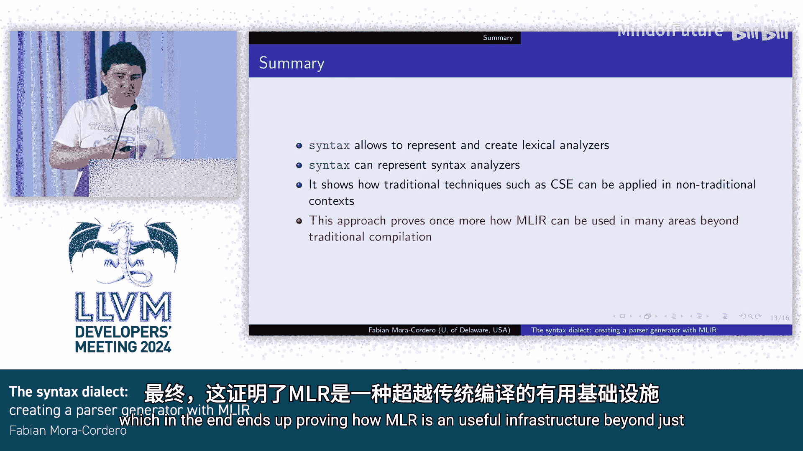

# 【2024-LLVM开发者大会-•-中英】-p69-P69-The-syntax-dialect---creating-a-parser-generator-with-MLIR--BV18eNfepENu_p69-

So。As。Yes， this is the presentation on the syntax dial here's the outline of the talk first we'll give why am I interested on this then we'll expose the syntax dial and how what we can do with it so the motivation for it is that。

In my dissertation， what I wanted to explore is more modular compilers and languages and。

One of the things that this led me to was to explore dynamic parsing combinators。

 so for example on the lesson on the right what we have is like some code but the main compiler doesn't need to know what OMP or GPU or MLIR is in the code。

 so I need it that way to say hey， once you encounter the keyword let's emvoke the parsing combinator。

And。So basically that is the main motivation of why I needed this because there were no existing tools that provided me with the flexibility for this。

 so I ended up building one。So the syntax like it's just a high level description of formal grammars。

Like。If you see the figure on the list on the right。

 you'll have your traditional things like terminal ants or pseudo or more。

So it's pretty it's able to represent all your traditional expressions。

 but there's also some high levell synta features like for example。

 functions over the synax so you can use like creating you can create something like a macro to interleave like for example。

 if you ever use LBM core， you have like interleave commma or interleave。

 So this ends up fulfilling the same function where you can just say。

 let's have like this generic function and let's apply some use it to create new expressions so and。

The dialect itself also has dedicated operations for lexical and syntical syntactical analysis。

 which we'll see layer。嗯。And yeah， on the listen on the right。

 we also have like how they are changers after MLI are in line。

 which just simply ins the macro function， which and this is pretty helpful for when you are trying to have like something like interlive which is pretty common So with this this means that you can just have one interlea and start using it。

Now， one of the things in terms of the design is that most operations are either pure or constantlike in terms of MLities means that they have no side effects or they behave like a constant。

 which means that we can use CSC。Or common of expression elimination to optimize the redundancy。

 So for example， on the list on the right what we have is at the bottom at the top a listing for a rule that has some redund disency because you have A B or ABC。

 which means that you are computing two times and A B on the bottom that redund distanceency is eliminated by CE。

 So withard。Can use traditional optimizations to even start optimmizing like a formal grammar。Now。

 in terms of lexical analysis with syntax。We create because my goal was have being able to generate all of these and build a compiler was so I created like a table jam back and to create this syntax analyzers。

 which in the end end sub meaning that this project is fully dependent only on LBM and MLIR。

And it starts with a pretty high level description in table then just saying， hey。

 this is just going to be one of the rules like for a identify her and that will produce like the full MLR code。

Then this MLR code gets analyzed and optimized and then translated into C plus+ in terms of the implementation for thes。

 they are just facingcing their traditional DFA。Algoritum。In terms of lexical transformations。

 we begin with lining and canal niizing and applying CSE because we also have like some can caizations。

To just remove， for example， if you have c or more or N inside the ced or more。

 you have another c or more， then you can say that is just one seatd or more。

And then we are start transforming the IR into a DFA。In this case， the DFA is not minimal。

 but it already has like all the elements to create like the Leer。

 so you have your states and your transitions， then we perform traditional DFA minimization。

Which then we can finally use it to generate C plus flow and。In this case。

 this is pretty straightforward， but it has the benefits of that it's。

 you can also modify these lowerings。 so maybe you could。Further customize this to one's needs。

 which was the main point of creating all of this。So now with syntax analysis， with syntax。

It's the same guest basically we also created a table gym backend for this in this case。

 the listen on the right shows one of the features that we needed or that we wanted in our compiler。

 which was like dynamic parsing combinators and that is shown on line for team where you have the a team 3 is a macro so it means。

That that expression inside a hashtag ding expression is going to go through the parsel macro and hashtag ding expression。

 it is just saying， hey， I need you to emvoke the dynamic parsing combator which allows to basically have accessibletenible syntax syntax on the。

And in general。There's no limit to what you can introduce for new ideas in terms of the parsing or yeah。

 in terms of the parsing， so。This means that all of this is quite flexible to start incorporating new ideas。

 And as it also can be seen on the figure， it has support for saying， hey。

 I need this code plug being executed after this。 So it is pretty nice to start working on things that are not traditionally supported by。

Other syntax analyzers。Now， in my particular case， I was interested on generating partan expression grammars instead of traditional things like a。

Bar thirds， or。A lot parsers。 So， and as I said before。

 this has a native support for dynamic parsing combminators。

 So it's pretty straightforward how you can use it to create like new parsing。Of some code。Now。

 in terms of the syntax transformations。We start with the table den code。

 And so it's pretty standard。 in this case， is A or B or the A O C or C O D。

And that is just the parsel and it just has one rule and then we start performing alignning canononicicalize and apply CSC to。

 again start removing redundancies， get rid of all the macros and have like one coherent syntax now。

After this， what we do is we analyze the grammars and we start saying。We start saying。Hey。

 maybe we can optimize this because if you know about parsing expression grammars。

 they are basically recursive descent parsers and if you use packra， they might be a linear time。

 but then that means that your' have like a bigger memory footprint。

 what we found is that we can actually further optimize that because in many cases you can make decisions of。

Local decisions of when you don't need to backtrack to a previous state。 So for example。

 in this case， this is materialized on the IR by having switch and any expressions。

 So if you remember the initial paring rule was A or B an A。Ors A C。

 and the other was one was like C And D。 So in this case， the analysis determined， hey。

 you can actually switch and。Fully determine which branch are you going to take based on the first like the first token。

 And in this case， the switch will go either to the any on line 15。

 which is I need to backtrack or it might be go might be going to this line 14。

 which is like an end operation。 So in this case， this means that。We can。

Make local decisions and remove some backtrack that it might not be needed。

Wwhichch ends up improving performance Now in terms of future work。

 which is the part that interests me the most in this project is being able to jet compile this dialect So this means that we have like a grammar and in that grammar。

 we can take it directly to LBMIR and then use the execution engine and being able to execute it right away。

 which。In this case means that we can have LBM optimize rex recognizers on the fly。

 which might perform better in if you have like a system where you required to perform many rejects。

Quries many times this this might end up saying in time。

And the other thing that we are that I particular， interested is in the possibility of self extensible programming languages。

 where if you can have。Like a jit this outer into a syntax。

 then you just need to put that model at the top for creating new syntax。

 and then you can reuse that function later on to parse new syntax and the syntax was decorated。

In the same language。Now， the biggest barrier for GitT compilation in this case is that。

My all the wrong time that was created for doing this is heavily reliant on C plus plus。 And like。

 for example， standard optional， so。You need to transform that into more friendly C code to be actually able to J compile。

So the summary is， well， with syntax we can create and analyze lectureors。Also， synt and。

We find that this means that we can apply traditional compiler techniques to even optimize things like formal grammars。

 which in the end end proving how MLOR is a useful。

Infrastructure be just regional compilation。So here's the acknowledgements and some questions。

