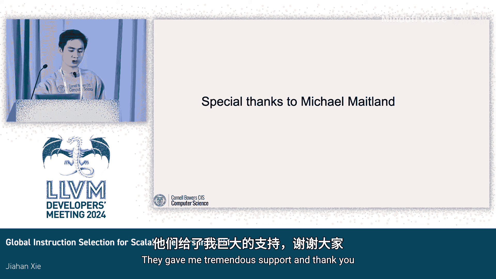

# 【2024-LLVM开发者大会-•-中英】-p71-P71-GISel-for-Scalable-Vectors---Expanding-the-Horizon--BV18eNfepENu_p71-

Hello everyone， thanks for coming。 my name is Johan and I'm a student at Cornell University and today I'm going to talk about global instruction selection for scalable vectors and first。

😊，呃。Excuse me。I like to first say why are we here and who should care about this。

 so the purpose of this talk is to demonstrate our support for scalable vectors in the global instruction selection framework and we will also like to give some tips for other targets if they want to have they have similar plans。

So today's talk will be covering the following points。 First， we will。

 I will introduce some notion about global IL and scalable vectors。

 And I will introduce our implementation work。 Finally， I will give a demo。Cool。

 and we will start with global instruction selection。 It is called GSL for short。

 and it's a framework that provides a set of reusable passes and utilities for instruction selection。

 and it is global because it operates on the whole function rather than a single basic block as compared to selection tag。

And it's meant for a replacement for selection deck。 And as a matter of fact。

 I will give a demo to compare these two。And GSL has four passes， IR translator， legalizer。

 Reg bank selector and instruction selector。And it also has some optional passes， such as combiner。

 which can be inserted between some passes。 But we will focus on the four main passes。

So to begin with the first pass of GSL is IR translator。

 which converts LVMIR into generic machine IR generic machine IR shares similar data structure with machine IR。

 it is more generic because it has less constrain as the GSL pipeline proceeds。

 we will constrain the GMIR finally to MIR。And the second pass is legalizer。

 An instruction is considered legal if the target can will later be able to select it to a target specific instruction。

 And in the legalization phase， we just replace unsupported generic MRs with supported ones。

And the third pass is Reg bank selector， it will bind generic virtual register to register banks and by virtual register。

 I mean， those temporary abstract placeholders that is not yet being mapped to any physical register yet and by generic。

 I mean they they have not been assigned with register class constraints and for register banks。

 you can just think them as a cluster of registers that share similar properties within a register bank。

And the final and the fourth pass is instruction selector where at this point that all of the GMMR will be constrained enough that it become MIR and it will transform them to target specific instructions。

Cool， and I also like to introduce a little a little bit more about scalable vectors。

 It is scalable on top of fixed size vector because it has a constant multiple called V scale。

 which is unknown at compile time， and it is hardware we independent。

 but it is fixed for all back scalable vectors across the entire program。😊。

And here I would like to give a small example of a scalable vector with number of elements equals 3 and I 32 element type。

 and we can scale it by V scale equals 1，2，3， so on， and so forth。And next。

 I would like to explain our implementation work， which consists of some prework on parsers machine verifier。

 some calling， and then I will explain our that those four main passes to begin with is we have to first support the MIR to be able to parse it and we've done that And the next thing is that the machine verifier is updated so that we can copy from fixed size vectors to scalable ones。

 as long as the minimum size of the destination register， which is the scalable ones。

 can hold the fixed size。 and it can be expressed as the following code。

And after adding those support， as you can see， the MR files are still completely generic。

 and we can copy between physical and virtual registers and vice versa。 In an example。

 we have shown we can copy V 8， which is a physical register to a scalable。

And if a target wants to support scalable vectors in GSL， it has to support call lowering as well。

 and to be specific， they should enable passing scalable vectors as function arguments。

 they should be able to return scalable vector from those function calls。

 and they have to enable the call instruction according to target specific ABI as well。

And moving moving on is the first phase of GSL。 And since we mainly focus on ALU operations and loading stores。

 and these are pretty straightforward。 And since we are operating on generic MIR。

 which is target independent， it is usually applicable to all targets。

 And if you want to support more op codes， you can implement the corresponding translate op code function in global IL slash IR translator file。

And， and fortunately， for IR translator， the things that you need to change might not be significant。

 I'm here， take an example。 we just migrate to use from an ons site type to type size explicitly。

 And it's done for translate the load up code。However。

 legalization can be challenging because as opposed to selection that。

 which uses a machine value type and extended value type， GSL uses something called low level type。

 and it cannot differentiate integer types with flow types。And if， if you。

 if a target wants to support their legal types， scalable vector types。

 they need to map L LT to target specific vector types。

 by using some scalar types as the building block。 here。

 I show that you can how you can construct a scalable vector of scalrs。

 You can also construct a scalable vector of pointers or booles， etc cetera。

And you can implement the legalization logics using legalizer info with legality predicates and legality queries。

 And for ALU operations， they are pretty easy and they share some logics where it is legal if the target support factor instructions followed by some target customized target specific predicates。

But for load and store， there are some nuances。 For example。

 we need to implement some custom logics using custom if for special cases。

 like if you have a load store for nonstand alignments。 And if the custom if evaluates to true。

 it will eventually invoke the customized legal load store function that you need to put your custom function implementation there。

And since our work chooses to legalize instructions and types that risk5 vector extension can support。

 we calculate and legalize everything based on the following map。

 and which is heavily relies on some。Notions and parameters such as vector register L， Elmo， S。

 E W in RVV。 But I won't because of gravity， I won't dive too deep into this。

The third phase is register bank selection。 So intuitively。

 we just map scalable vectors to vector register bank。

 and we also need some target specific function to map up values to register banks using the value mapping class based on the size of the up。

 and in our case， we chose to partition a single vector register bank into four parts based on different sizes of Elmo in RVB。

And the final phase is instruction select phase for the ALU instructions。

 It's pretty straightforward table and just work out of the box。

 That is great Before load and store a vector of pointers。 It might not be that sufficient。

 because in selection that pointer types are typically converted to integer machine value type or extended value type before legalization。

 But in GSL， we need to define some custom logic to cast pointers to S X lane。😊。

And there are also some interesting ongoing discussion regarding should we and when to introduce target specific。

 quote， unquote， generic up codes。Yes， but they are still ongoing discussions。 And next。

 I would like to give a demo on using the sex B example。

 So it just a times vector scalable vector X plus scalable vector Y。And after loading to LVM。

 I'm just showing the code for completeness， but you should really focus more on the on the lines in the boxes。

 So the first part is where we set the scalable vector dry length。

 and we also compute the number of remaining scalar iterations since the total number n might not be divisible by the scalable size。

 And the next thing is that we spt the scalar a to a scalable vector。And here's the vector body。

 which does interesting real work on a times a X times a plus y。And finally。

 it some remaining scalar iteration and some cleanup work。

And here is the lowering result from SB using GSL framework in RVV in Risk5 assembly。

 and here is the lowering result from selection deck。 and I would like to point out some differences。

Between the differences between them。 And I will also focus on those interesting parts。

 And the first is the vector parts。 So if you remember。

 we first split scalar A into a scalable vector， but。For a selection deck in the green box。

 it does not do any split at all。 And nor does it do add and multiply。

 it just do a vector accumulation。 And in a single operation。 And that's done。 But in GSL。

 we it turns out that it translates everything literally。

 So it's split scalar A using V and V operation in risk 5。 And then it does multiply and finally。

 V add with Y。And there's another point that is irrelevant to a vector。

 but thought I could also bring it up， which is selection deck does some optimizations for when calculating the remainder and GSL again translated literally again well。

 it seems like GSL is less optimized， but I guess it's just because GSL is still kind of working progress and at least we have something done。

But I enjoyed a lot from G IL's advantage of progressive lowering testing。

 where you can come up with a minimum example and just lower phase by phase by face。

 and which is relatively more difficult in selection deck。

And finally I would like to give some tips if other targets want to support it。

 so especially to deal with the type information and first use lowle types wherever you can and you can migrate from on sign to type size in target register info and if you want to compare something with equals0。

 use the zero method instead and if you want to use greater than arrow use type size is no greater and if you want to get if you want to compare with some fixed size values。

 we just use getn mean value and if you want to get the number of elements in the vector you should switch from get nu elements to get element count。

嗯。And the our future work is to improve G the GSL's framework to exploit more in interbasic block optimizationizations。

 and， of course， to support more outputcodes as well。

And Aslon Bals gives special thanks to Michael and the Sci5 team。They gave me tremendous support。

 And thank you。

