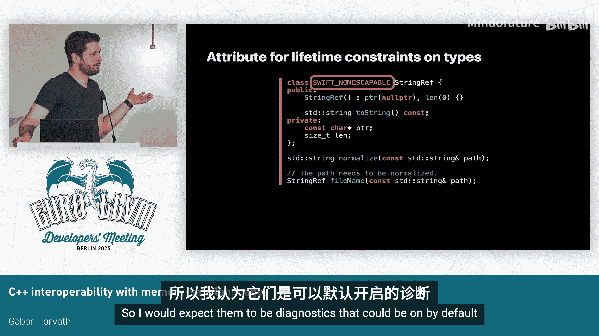

# 2025LLVM欧洲开发者大会-p01-P01-C++-interoperability-with-memory-safe-languages--BV1EoE9zUEbG_p1-

Let's talk about intererability and safety。So memory safety in particular is really important because a huge portion of severe vulnerabilities have been traced back to memory safety issues in the past。

And。We want to improve the safety of our applications in general。

 The some regulatory bodies picked up on this problem。 So there are regulations in the way to。

To move as the safer space like and force use of memory safe languages and some mitigations in some domains。

 but more importantly， it is a moral imperative to improve the safety of these applications because we want to protect user data and。

We want to have safe applications in mission critical domains。So。

We have existing code written in some memory unsafe languages。

 so we have these worst oceans of unsafe code， and the question is how can we improve the safety？

And according to some recent studies， actually most of the critical vulnerabilities are in newly written code because we tend to find vulnerabilities in existing code over time so that have sort of a decay so if we cannot do and we often cannot do a fully rewrite。

 the best bank for the buck is to start to write new code in a memory safefe language。

 so we will end up having this small islands of safe code in a vast ocean of unsafe code。

And over time， we try to grow these islands。So to summarize this and to take home a point。

 so I want to acknowledge that we also want to make the ocean safer and in fact we are making C++ safer。

 we are adding new language features， we are adding new mitigations to improve memory safety。

 but it is unlikely that we will get to get C++ the fully memory safe language in the near future so what we really want to do we want to lower the barrier to write the first line of safe code in a codebase and we want to make it as easy as possible to start those islands and to grow those islands。

 and to do that we need to have better bridges。So this talk is mainly about how we build these bridges。

 how we build these bridges in a particular way that it is really easy to adopt these memory safe languages and it is really easy to grow these islands because everything is incremental and we can just sprinkle in a little bit of additional information and we get a little bit of additional value。

So there are many different aspects of memory safety， but in this dark in particular。

 I will focus on lifetime safety because this proved to be a really challenging task to solve and also this is crucial to get right when we are intering with memory safe languages。

So let's talk about lifetime safety， so lifetime safety is a property that we only access objects within their lifetime。

 so let's look at an example here we create a stood string temporary object and we get a pointer into the buffer of this stood string and this temporary object the lifetime of this temporary object will end at the end of the full statement。

 so this pointer P will deno after this statement， so this is like a classic use after free error if we use pointer P later on。

So in C++ it's quite challenging to get lifetime safety right one reason is the confusing rules around the lifetimes of temporary objects like sometimes they get lifetime extended sometimes they do not and these rules are not always intuitive but more importantly C++ is using a vast number of memory management techniques。

 so if you see a called snippet like this， we might have no idea are we supposed to free this object that piece pointing to。

 is this an intrinsically reference counted object。

 is this something that has a lifetime tied to my object or would this pointer be invalidd later on because it's part of some memory pool or is this pointing to static memory so there is a huge number of options all of which can be expressed in C++ and what option？

Did we choose to manage this particular object is not expressed in the APIs in any way。

 so we just sometimes rely on some conventions and we have all of these techniques used in the same application because these different memory management techniques have different pros and cons performance wise。

And it makes it really challenging to reason about C+ plus code。

Also sometimes we have nontri invariance so for example。

 if I have a vector heavilyator into that vector， I push back an element to that vector。

 the vector's buffer might be reallocated and then I have a dangling vector。

 another classic use of the free error and it might be quite apparent in this like three lines of code。

 but imagine if these three lines are like in separate source files。

 even separate modules in our big code base， it's really hard to find these errors。

And once we are starting to intererate between different languages that opens up new possibilities to introduce lifetime errors。

 whenever I have a mixed code， I have a solid vertical line for C++ and the dash one for Swt So here we are using a C++ vector from Swift and lifetimes of objects the root for object lifetimes is different between the two languages so in Swt when we see the last use of an object that's where the compiler can end the lifetime of that object and because this information is not there in the APIs。

 the compiler doesn't know that the vector and the iterator are related so since the lifetime of the vector can end after this use we will end up with the dangling iterator and that introduces a memory safety issue So the question is how can we improve this situation and one could say let's just。

Add the missing information to the APIs and we are done right so why don't we just do that the problem is there is a big design space here with different tradeoffs and depending on what we want to achieve and what our priorities are we might want to end up at different places in this design space so here are some examples like some aspects of the design space some projections of it and let's see what we want to get if our main goal is to make adoption as easy as possible so we can encourage our users to start to take advantage of using a memory safe language as soon as possible。

So first of all， we want this information that we sprinkle in the code base to be incremental first of all。

 the users might consume code， third party code that they can autonotate。

 so we need to be able to interact with code that is not even unnotated in the limit。

And when we start to add donnotations to make the interrupt safer。

 we want our users to be able to start unnotating only the important APIs。

 start onnotating only the boundaries between the two languages because if we tell our users first you need to adopt the notnotation language to the entirety of your code base before you can get the benefit of a memory safe language well that's not going to happen memory safe languages are really great。

 but they are only great if they are used so our main goal is to make sure that they are used。

On the other hand， having viral annotations have value because virality can help us to spread these annotations to adopt them to get more safety。

 so the best way to get there is to have optional virality so people can use these diagnostics to drive the option of these annotations。

 but they can do it on their ownccord and they can do it in their own pace and they can do it very see value from these annotations。

We don't want to do too much inference because it makes APIs harderder to understand。

 but even more importantly， we want adding these annotations to be rewarding。

 we want both the C+ pluscode and the memorySafe code to benefit from these annotations and if the compiler can optimize based on the presence of these annotations and can get additional undefined behavior people can get additional undefiified behavior after adding these annotations。

 that would be really bad because that would be punishing in some way。

 we never want to punish our users to try to adopt safer constructs。

And as I mentioned earlier in C++ we can express any sort of memory management techniques and it's very unlikely we will ever have an annotation language or a type system that can express all of those so what we are aiming for we are aiming for a solution that's easy to adopt that's easy to understand that doesn't feel foreign to C++ developers and so we want to have this sweet spot that can express the construct that we are interested in but still it's something that people are willing to take into their C++ codeb without feeling being forced to write another language。

Okay so let's take a look how we can annotate lifetimes in Kk today。

 so there are two very similar pieces of code that I showed you earlier and if we run this or if we compile this today we get the warning for the first one but we don't get a warning for the second one so we get the warning for the first one for the same reason I talked about earlier。

 and the second one is safe so the question is how can Kk tell that the first one is problematic but the second line is okay。

And the reason Kang can tell that because we have this annotation called Kang lifetime bound。

 and this annotation in this case specifies that the return point of lifetime of the return pointer will end。

 then the lifetime of the implicit this object ends。So using this annotation on string。

 Kang can tell， okay， the lifetime of the temporary string will end at the end of the full expression。

 so the lifetime of P will also of the lifetime pointed by P will also end so it can generate this diagnostic and this attribute actually been part of Kk for the last seven or eight years。

 so this is not really new， although there are some recent improvements in abststream Kang thanks to some people at Google to make these diagnostics way more useful。

And another new annotation that was edited recently by some of our friends at Google will help diagnosing this case when we try to add like a temporary string to string you a temporary string into a set。

 and this is thanks to a new annotation that can describe that， okay。

 now the lifetime of a value will be captured by some other value。

So this is disenttation and diagnostics are there in the just released version of Kang。

Okay so this is what we have in today and let's take a look at what we could have that would make the situation better when we want to inter with other languages。

 but also how C++ can benefit from some of these additional facilities so here we have a piece of C++ code stringgraph is a reference object and we have an API that returns a string graph here。

 but we have no idea what is the lifetime of this return stringgraph object。

 so it would be great if we had an annotation that would sort of force the compiler to check all uses of this type and would warn that okay we are returning a reference type so we supposed to have the lifetime annotation there so this is the sort of optional virality that we can use to drive adoption of these diagnostics。

And in fact， we did add an annotation like that for so this annotation was motivated by interoperability。

 but as you saw， it's fairly useful for C++ even if we never consider interoperability。

So this annotation is new in our fork， but let's see how this annotation is used when we are trying to use C+ plus code from Swif。

 so we see the same C+ plus code as before and let's imagine we tried to use some of these APIs from Swt。

So we introduce the new optional language mode in Swift， strictly memory safe mode。

 and in strictly memory safe mode， when we use a foreign type like stringgraph in this example。

 we will get a diagnostic that we are using unsafe code。

And the reason why that code is considered unsafe by the Swift compiler is because the Swt compiler has no idea if this is a reference type that might have some life dependencies or if this is a value type that is self-contained and we don't need to reason about all of those dependencies so in this case in strictly memory Sawiift we need to call out explicitly that this is an unsafe operation and then we need to audit that code by hand and need to make sure that all of these lifetimes match up by hand。

On the other hand。If we want to use this type safely from Swift。

 we can specify that this is a reference type and the swift nomenclature for that is like nonescapable。

 but I don't want to go into too much details about that in Swift。

But let's see what happens if we add this annotation。

 so we will get this warning that I showed you earlier that like we have this API that lacks lifetime annotations。

And if we use this from see if we add this missing annotation。

And we now try to recompile this piece of swift code， we will get a diagnostic。

And this diagnostic will call out an actual lifetime error in the Sw code。

So here the problem is normalizedist path is a local variable and the lifetime of that variable will end when we return from this function and the string graph we return depends on this local variable so we will have a use after free error so adding this annotation on the C++ side will enable Sw to do full B checking basically and this is a compile time like zero obstruction thing that we get on the swift side consumingum these C+ plus anitations。

When we look at some templated types like vector， you can see a vector of string graph supposed to be considered a reference type because it does have some lifetime dependencies。

 but the vector of string is a value type because it's completely self-contained。

 so to unnotate these generic types we have some conditionalnotations where whether type is a reference type or not depends on the template arguments。

This is also a new annotation and the last thing that we had to add now that we have we unitnoted string graph as a reference type when we see a function like this the compiler will ask us to add lifetime annotations here but here we don't really need lifetime annotations because the return string graph has static lifetime and the string graph that we take never escapes this function so we added well first of all we generalize the to no escape previously it could only apply to pointers now it can apply to arbitrary types and we added another annotation to mark that the return value has static lifetime and these are newop these are new。

In our fork。So let's take a look at why these annotations prove to be particularly useful for incremental adoption。

 first of all， these annotations are not viral so one can choose to only annotate the important APIs or the APIs at the language boundaries。

 so we are not forced to spread them throughout the codeb so we don't need to do like a big adoption work before we start to see the benefits。

 sprinkling a little bit of annotation and see a little bit of value and you can do it as you wish as you have time。

They also don't need to be exhaustive。 So， for example， here。

 mean can return reference to either of the arguments， but only one of those。

One of those dependencies are unnotated， so this would still be considered unsafe because we have a reference that doesn't have lifetime annotations but at least it has some partial annotations。

 this is very important to allow these partial annotations because some APIs might have lifetime contracts that we cannot express using these incremental annotations。

So sometimes we cannot express something so for example we cannot express that the return pointer has the same lifetime as the first element of despair pair。

 we might need another feature like namedLis for this and this is something that we might be interested to adopt in the future but we don't our goal is not to be able to express it everything our goal is to find a sweet spot that's like that works for people and also we would like to be able to。

I am。Also we would like to be able to keep this relatively simple because C++ might need to intererate with multiple languages。

 not just with but also R and maybe some more， so we might not want to reimplement the type system of every language C++ intererates with in C++ because we couldn't like write C+ plus code that inters with all of those C languages at the same time。

 so we might need a lowest common denominator approach。And。Very important。

 currently on the C++ side we do not get the full benefits。

 even if the C++ compiler has all the information it needs to detect a lifetime issue， it might not。

 but it's not doing full on data analysis to do that at the moment。Hopefully it will at the future。

 we will see， but we are currently doing what we are currently hoping for if the barrier of using a memory safe language is low enough。

 whenever people need this sort of full contract checking。

 they can use a memory safe language to begin with。

 so we might not need the full analysis on the C++ side。Okay。

 so let me summarize this talk using these annotations。

 we can express some information that is not available in C plus+6 St system and using existing clientk features。

 we found that we only need to add very few minor extensions to make it work surprisingly well for interop。

 especially because sometimes the。BoThe API， the target language boundaries tends to be somewhat simpler than the。

Are there other APIs？And both C++ and the memory safe language can benefit from these incrementalnotations and I cannot stress this enough。

 the main goal and driving force behind this was the easy adoption because we want people to be able to start growing those islands as soon as possible as effortlessly as possible and if we don't want to see friction and pushback from the authorss of the C++ code and what we encourage our users to do is to rely on memory safe languages when they need lifetime contract enforcement。

So that was all， I'm open to answer some questions。Questions。question。

 is there a way already to kind of do this automatically for some like easily inferable attributes for like existing code？

That it is automatically sprinkle the easy stuff in we don't have that currently。

 but I don't see a reason why that wouldn't work for the easy cases。

 like it's unlikely that we would be able to infer onnotations for everything。

 but I think there is a huge portion of code that could be automated could be unnotated automatically。

And the question， I guess there's at some point， it will always be like， I guess a gap。

 if you just start using it incrementally。 And then there's， I guess， some。Some places where there's。

 like， I guess， a property missing。 I there a way to know like what are the things， Like let's say。

 I have a code base I start adding annotations。 Is there like a way to know what are like potential things I guess I would still need to add by essentially manually verifying or rewriting code。

Yes， so if I understand it correctly， your question is how can you tell if you still need some additional annotations how do I know that I edit all the annotations to make it I guess safe yeah。

 so I fortunately I think in order to know that you need full contract checking so which is something that we could add to C++ at some point but any time I think when we have those guarantees that you will find all of the missing or all of the wrong annotations edit point you have such strict checking that would not be easy to adopt。

 so I think that is an inherent trade of that you either get something that's incrementally adoptable or you get something that that has these full safety guarantees with full contract checking and I don't think that you can have both I hope I will be proven。

But yeah， so I think the best place to be to have the incremental version and people could opt into the full contract checking if they want to。

Alright， thanks。6。Very interesting talk thank you I have actually two questions you mentioned named lifetimes and I wonder if you're going looked into it export using this instead of the attributes and then the second one is is this attributes something that you see as feed for mainly in boundary or something that is potentially extendable to bring like more safety to just the C+ pluscode base Yeah so we haven't looked into named lifetimes yet but there is a team at Google that I believe are looking really actively intoname lifetimes and I'm really excited for that work and we'll be really curious what comes out of that so there is some work happening in that space but like not in our team at the moment。

So the second question whether whether it's only for the boundaries or whether it's useful for C++。

 I think this is really useful for C++ like C++ code can have a lot of benefits from using these annotations。

 I think Ilia is here and he probably has a lot of experience rolling these annotations out at Google and my understanding is that it did find bugs in the C++ code base there so I think it already proved to be useful for C++ even if we do not consider inter whether people are willing to take it in their code base that's a different question how the community reacts to these annotations。

 that's something that we will see in the future I guess。Thank you。Yeah。

 I I'm actually at Google with the team that works on the lifetime bound annotations and named lifetimes is an neighboring team as well。

 So we could probably chat about it after the。After this， the quick reaction to this。

 like we are not actually yet working on the name lifetimes， but we are actively discussing it。

 So there is no active work happening right now， we're actually focused on。

Getting this control flow based analysis， at least internal inside one function， not interprocedural。

 not interprocedural just yet。But the question that I had is actually。

 you had a slide where that was escapable if the type is escapable for a vector。啊。

That is a thing that we're struggling with and maybe you have ideas about that。

 how do we express situations where a vector of pointers say there is a vector of static pointers and there is a vector of pointers of the same type。

That have the lifetime of my function。We obviously， want to have。

K of like two different annotations apply to those types， depending on what the annotations of。

 not what the annotations of Tr， but rather what the lifetimes of T are kind of like the same type。

Different lifetime requirements。What what if you had a template string graph， for example。

 that would be an owning or nonowning string graph based on something that's not in the type like runtime value。

 Yeah， you have any ideas how to deal with that。 I believe in those cases。

 the annotation doesn't belong to the type levels So vector of string graph is is always a reference type or an unescapable type。

 And if there is an API that returns a。Vectctor of static string graphs。

 then I think the annotation that describes that， okay， this is actually static lifetime。

 what we return that belongs to the API so。I think those are two different limitationsnotations。

 one on the type level and one of the API level， yeah。

 but if that doesn't work for your useC I would be really interested to discuss this offline。Yeah。

 yeah， let's let's chat about it more。 There is more complicated code examples while it falls apart。

Okay， thank you。Thank you for your talk， is there some ongoing effort to have this annotations part of the Cquesttra standard？

Not currently， so。We are relatively early in rolling these out internally。

 so we would like to gather more experience before we go to the committee with any of these。

May I have one last question。 I'm just curious， what is the compil time cost for handling these annotations。

 So the compilation time cost for。For the diagnostics from Kk is actually pretty cheap。 they are。

 So the diagnostics that I showed you。Earlier that are already part of Kang。 Okay， let's go there。

 Yeah， so diagnostics like this， these are on by default。

 So cheap enough that we get these diagnostics。All the time。

 But once we have like something that is actually doing data flowlysis like。

It is possible that those might need to be obtained， so I'm not sure what the cost would be there。

 the small additions that we made like marking a type preference type or value type explicitly these annotations are also really cheap so everything I showed in this talk should be really cheap on the C+ plus side Comp time wise。

 so I would expect them to be diagnostics that could be on by default。

Thank you。 And let's thank our speaker again。