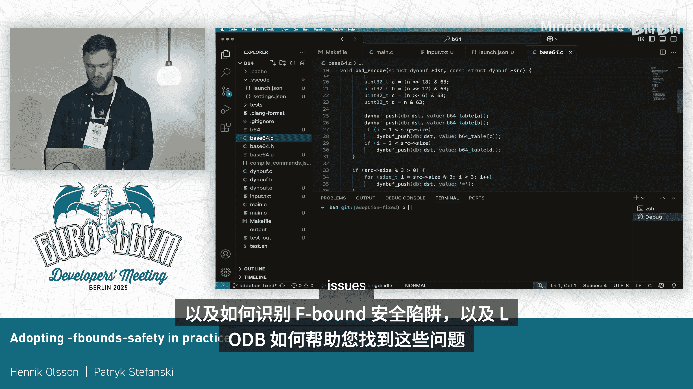
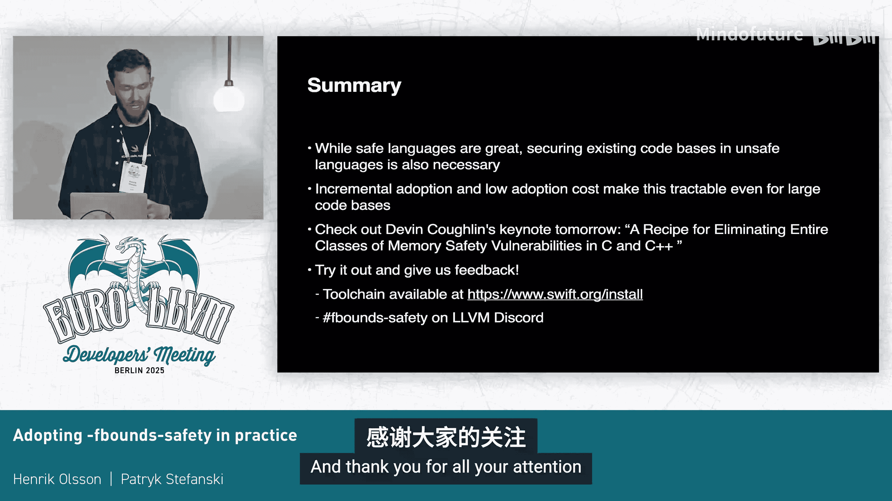

# 2025LLVM欧洲开发者大会-p02-P02-Adopting--fbounds-safety-in-practice--BV1EoE9zUEbG_p2-

Right， so my name is Henrik and this is Patrick and we're compile engineers in the Se languagengu extensionss group at Apple。

 we mainly work on F Bo safety which is our language extension for Bo safety in C。This one。

Here's today's agenda， first I'll give an introduction to Fbound safetyfe。

 then Patrick will do some live adoption and then I'll show what debugging at runtime errors looks like once Fbound safety is enabled。

So we announced this extension at URLLLVM 2023 along with an RFC。

 and last year we started doing our upstreaming which is still ongoing。

 eventually we're aiming to fully standardize the syntax and semantics for compatibility across tool chains。

But the complete upstreaming is a bit of a long process。

 so this year we've completely open sourced our implementation in the swift fork of Kang as a bit of a sta ground。

诶。You can either clone that and build Kleline yourself， or you can go to Sw。

org and download a snapapshott development toolchain available for Mac， Windows and Linux。

And while we would eventually like to add support for objective C and C++ right now。

 this is only supported for C。So now that you know where you can get your tolching。

 let's talk about why you would want to。So memory safety bugs are across the industry the leading source of security vulnerabilities。

 accounting for about two thirdds of all security vulnerabilities。

 and historically they've been used in many high profile attacks to get remote control of victims devices and there are many big established security critical code basis that we all rely on everyday written and see code where security matters greatly。

 but in a language offering minimal memory safety。And of course the safest option would be to use language offering full memory safety。

 but rewrites of this scale are a massive undertaking， and we need security today， not in a decade。

And this is where Fbound safety comes in。Fbound safety detects and prevents out of bounds accesses unlike other bound safety mitigations for C like 45 source。

 Fbound safetyfe offers a comprehensive model for preventing out of bounds access from being exploited by attackers。

This improves security by forcing attackers to find other bugs of other types that are harder to exploit。

And I want to be clear here， while FB safety can help you find bugs。

 that's not really its intended purpose。It's meant to be used in production where it can prevent live attacks。

Let me show you how this is achieved。If bones safety enforces bone safety rules at the language level。

And here are the strategies to achieve us。The compiler prevents out of bound memory access at runtime via our automatic bounce checking。

😊，With Fbound safety enabled， this is not an opt。If the compiler doesn't have enough information to emit a runtime check。

 or if it has so much information that it knows the axis is unsafe。

 it will tell you this via an error at compile time。If this is the case。

 the program can add the necessary balance information so that the compiler has enough information to emit the runtime check and then you can compile your code。

The compiler also rejects expressions that don't guarantee the correctness of these bounce annotations so that the information is reliable once you run into the bounce check。

😊，Let me show you what this means in practice。The Bo Safety extensionsion provides bone snotations for programmers to apply on function types。

 struck fields， globals。For example， counted by。Using the balance information from the counted by annotation。

The compiler can insert bounce checks。As you can see。

This buggy loop condition will end up going past the end of the buffer。

 but the inserted bounce check will trap the program instead of accessing the out of bound memory。

Programmers must provide this sufficient bounce information。

 otherwise the compiler will reject the code and make the programmer add the bound sanitation。

If we use the same example again， without the counted by annotation。

 the buffer doesn't have the necessary bounds， so when we try to do the array indexing。

 the compiler reports an error。To make the code work。

 the programmer needs add the balance annotation so that error can be removed。

This way the extension effectively secures all pointers by default。

 but it's not enough to add the required bounce information， it must also be accurate。For example。

 the programmer must also ensure that the count is updated whenever the pointer is and vice versa。

Otherwise， a pointer that started out with correct bounce information may end up with outdated bounce information when one of them is updated and then you run into a bounce check and it's not actually the correct bounce。

In this example， Buff and count are briefly out of sync with each other since the count is decremented before the pointer is incremented。

 but Fbound safety requires that they're in sync at all times。

So the compiler reports this as an error。To make the code work。

 the programmer must move the assignments so that they're next to each other。This way。

 the extension maintains correctness of the bounds annotations at all times。Luckily。

 not all pointers need pound sanitations。For local variables。

 the compiler can track the bounce automatically， and this speeds up adoption since it doesn't require manually adding an annotation。

 but also because the more flexible semantics doesn't require moving the assignments around。

 like I just showed you。Since there's no external bounds to fall out of sync with。

 let's use the same example again。But this time， we'll instead rename the parameters and introduce local variables with the original names of the parameters。

Now the type of buff is no longer dependent on count so they don't have to be kept in sync anymore and the memory axis isn't actually at a bounce。

 so the code is fine as it is now， there will still be a bounce check。

 but the bounds are kept within the Buff pointer so we don't have to move the assignments。

This scales a lot better because we only have to make a change at the beginning of the function。

 regardless of how many reassignments there are throughout the function。

And it also reduces the dip with upstream if you're doing downstream adoption of an open source project。

So Fon safety does impose strict rules on how pointers can be used。

 but despite that adoption is still quite easy。Most pointers don't need annotations at all。

 so the number of places you need to manually edit is pretty small in our experience it roughly takes one engineer hour per 2000 lines of code to fully adopt Fbound safety for reference for a million lines of code that's 12。

5 engineer weeks。Because it maintains API compatibility。

 you can still use libraries that don't use FB safetyfe， or if your code is a library。

 you can adopt FB safety without breaking the bills of your users。

This also enables incremental adoption， so you don't need it to open a separate branch where you do the full adoption and then try to merge back all at once。

 you can secure code piece by piece over the course of several releases if you have to。

 and this is essential for securing large code bases。

And this is something we've already done at Apple。Because although the implementation was recently open source。

 it's been used in production internally at Apple for years at this point。

Fbound safetyfe has been adopted in millions of lines of critical software。

 running in the hands of consumers on all Apple platforms。

And while much of that code is not open source， adoption in the X&U kernel is。

 in case you would like to take a look at that。Development is ongoing。

 but the current state of E safety works and helps keep our devices secure today。

All this with an overhead we consider reasonable I don't want to focus too much on performance。

 but you can't really mention it without also showing numbers。

 so let's take a look at a few benchmarks。And before I show these numbers。

 I just want to mention that these numbers are from 2023， so if you try to repeat them today。

 they might be slightly different， but they should be in the right ballpark。诶。Anyways。

 we found an average of 9。1% code size increase and 5。1% runtime overhead。

 but as you can see from the ranges， overhead varies quite a bit depending on the application。

And in general， the impact tends to be smaller in applications that already have manual bounce checks because the optimizer can remove redundant bounce checks。

 but there's still some work that could be improved in the optimizer to remove more redundant bounce checks。

However in actual adopters， the end to end overhead has been less significant than this， for example。

 we measured the runtime overhead in your audio codex to be roughly 1%。😊。

Which we're happy to pay for security To and binary size overhead is also smaller than these numbers。

 since this also only measures the text section of the binary。

And so we have a handful of bounce snotations with different pros and cons。

 each suitable for a different scenario that I'm going to show you， let's start with counted by。😊。

Couned by lets you specify an expression representing the number of elements that fit in the buffer。

Normally this is just a parameter or astruct field。

 but it can also include constants or simple arithmetic expressions。😊。

The expression is evaluated in each bounce check， which is why it needs to remain in sync with the pointer。

Counedbyy is great for communicating information between local context because it uses information that is already there and preserves the ABI。

 sostruct fields， function parameters， return values， this is where it shines。

It's not just a single annotation though countbi is part of a family of three other similar annotations。

 each with slight semantic differences， for example， imagine we want to annotate B0。

 which takes a void pointer and a size。Vooid isn't really a type with a size though。

 so it doesn't make sense to talk about the number of elements in the buffer。Instead。

 we can use size by。This lets us represent the size of the buffer in the number of bytes rather than the number of elements。

Now imagine we want to annotate Malik。Here we pass the size to Malik， but when the allocation fails。

 Malik can still return noll， which isn't really a buffer with the size。So for situations like this。

 we have counterbiol or size biol。And for this variance。

 the balance check first checks whether the pointer is null， and if it is。

 it ignores the size parameter。As a rule of thumb， use counterbyy when you can and others when you need to。

The counter by family pointers are bound checked on every memory axis， but also for each assignment。

In the case of function parameters， that means that the caller will check the balance before making the call。

 like in this example where n needs to be checked at runtime。

This means that fo can fully trust that the count is correct without knowing where the point you came from。

Next up， we have single。Single represents a pointer to a single element or a null pointer。

Because of this， we'll always get a compilation error if we're trying to perform pointer arithmetic on it。

 so we can't index into the pointer unless of course the index is0。😊，We could。

mit a runtime check for dynamic indexing， but we don't allow this because most of the time if you try to perform dynamic indexing on a single pointer。

 you're actually just missing bounce information and we would like to catch that error at compile time rather than a runtime and if you actually want to index with index0 just use a constant value rather than a dynamic one。

Finally， we have by indexdexable， unlike counted by。

 this lets you index both in the positive and the negative direction， hence the name。

This is accomplished by changing the representation of the pointer into a wide pointer。

 carrying both the upper and lower bound along with the pointer。In this example。

 the compiler will transform the pointer into wide pointer and emit a bound check at runtime when the pointer is referenced。

It doesn't emit the bounce check during reassignment， however。

 because if the pointer is out of bound， that information can still be stored in the pointer so that if you later access the pointer。

 the error will be caught at that point。This differs from normalcy in that in normalcy。

 it's undefined behavior just to construct a pointer that's out of bound。

 but here that's completely fine。So bying exible is very flexible。

 the compiler will allow almost anything because there has so much information to use for roundtime checking。

😊，However， since it changes the pointer representation， it's not AB compatible with normal pointers。

 so the caller must be aware that the function is expecting a wide pointer。

This is a problem for backwards compatibility and incremental adoption。

 because even if the caller and the col share the same definition in the same header。

If the collar is in a translation unit compiled without FPo safety enabled。

 it won't even know what byta inexible is。Leading to an ABI mismatch。

So this is a bit of an issue for using bio indexable instructionss and functions。

 at least in public headers， but the flexibility makes biota indexmable great for local variables where ABI isn't really a factor。

Finally， we have an escape patch we call unsafe indexexable。

This is just a normal C pointer where you can do anything you normally would with a C pointer。

 no comp time restrictions， and no bouncets。This is helpful for interacting with libraries that don't use F bound safety because we can call their functions despite them not having bound safety annotations。

😊，The library can of course do unsafe things with our pointer。

 but we've done what we can to secure the code that we control。

This process is pretty smooth because pointers implicitly convert between different pointer counts。

 let's take a look at how that works and when explicit conversions are required。😊。

Here's a model of the core of the Fbound safetyfe point of conversions。

Bioeneictable being the most flexible count acts as a common middle ground between the other counts。

 Converting to bio anenetable is just a matter of transferring bounds。So now bound check is needed。

 on the other hand， converting to counted by cell pointer safely。

 requires index inserting a bounce check to make sure that the number of elements in the incoming pointer is equal to or greater than the count expression。

Safely converting a single， similarly requires checking that the pointer actually points to something since the biota inible pointer could be out of bound。

Finally， converting to unsafe Inexable is just a matter of removing the balance set permission。

These conversions all happen automatically。 so you don't need to insert any explicit casts because the compiler just knows what to do。

 But there isn't any implicit conversion from。Unsafe indexable， however。

To forge a safe pointer from unsafe Inable， you need to use an unsafe building fotain。

This informs the compiler of the bounce， but it also helps with auditability since you're being explicit about unsafely forting a safe forger。

A large fraction of pointers in function parameters，structs。

 and local variables don't need any explicit annotations because the default is already correct。

These defaults make the adoption process easier。Because pointers and functions signatures structure and globals are implicitly single。

 except foreign system headers， then they're unsafe indexable so that you can still call functions in libraries that you don't control。

是。For this reason we recommend including all external headers as system headers。

 unless you manually annotate those headers， otherwise the compiler will likely emit a bounce error originating in this headers when you enable Fbound safety。

The defaults for ABF visible pointers can also be changed using pragmas if needed。

For local variables， they're all implicitly biodi andexable。

The compiler is usually able to optimize away the unnecessary balance if you don't use the full power of binary indexible。

 so the overhead isn't as big as if it were on the ABI surface。Of course。

 you can always override these with explicit annotations， but if there's nothing there。

 these are the defaults。So that was a brief overview of Fbound safety there are some additional bound annotations and somatic edge cases that I didn't cover so if you're interested in a deeper dive I suggest watching the initial announcement at URLL of M 2023 and of course read the available documentation the upstream K docs reflect the target of our upstreaming work and not the current implementation。

With that， I'll hand it over to Patrick。Hello， I'm Patrick and I work in Se Laguage extensionsion team at Apple together with Hendrich。

 and today I'm going to show you how to adopt Fbound safety in practice。I sorry。

Ebound safety allows us to do adoption incrementally。

 our recommendation is to enable Fbound safety in a single fire。

Doing that will likely cause the compiler to emit a bunch of compilation errors and other diagnostics and To diagnostic will guide you how to annotate the code。

And when you fix the compilation errors you should run a test to check if there are any runtime issues and here having a runtime good test coverage is extremely important。

And when the tests are successful and the code comps。

 you can repeat the step one until the ebound safety is enabled everywhere。

And when you enable Fbound safety everywhere， you can benchmark the performances such as runtime and code size。

And if you are not happy with the performance。You can optimize the code and we have optimization remarks specifically for Fbound safety that will guide you how to optimize the code and they show you where the bound checks are emitted。

So you can also adopt advanced safety in libraries， but there is a caveat for public headers。

Because system headers， the default attriing system headers， is unsafe indexable， however。

For non system headers， default attribute is single for AB visible pointers。

And this can cause mismatch if you include your headers in your library that you adopted atbound safety as a system headers。

 because the default attribute will be unsafeexable， however if you adopted this already。

 the attributes should be single。And to solve that， we have a building called pointer check A As S。

 which you can add at the beginning of the file， and this will change the default A attributes to single for the whole file。

And this will change that attribute regardless whether this file is included as a system header or not。

So your public headers in your library should always use this building to avoid this mismatch and signal that they have adopted Fbound safety。

And also， libraries have another more lightweight option instead of full adoption。

 which we call headather only adoption。This is useful for libraries that don't want to pay the cost of full adoption。

 either in terms of like time investment or runtime overhead。

And you can do this by only annotating public headers or public interface。And。

But you don't annotate and don't enable advanced safety in your implementation。

So the implementation is not secured with Fbound safety。However。

 clients that are adopting Fbound safety will see those annotations and they will get the safe interface。

Other clients that are not adopting Fbound safety won't see those annotations and they won't pay any cost。

So one good example is Ley， so for example， you can annotate a mem copy with size by annotation and this will ensure that on the call side a boundary check is emit that you are passing buffers with correct size。

But you don't have to annotate， you don't have to enable a safety implementation of mapM copypy。

And this is also useful for safer interop in other languages because those bounds on notation provide more information to the compiler。

But if you want to do headeron adoption， please remember to add a test case where you create a single C file that includes all the headers。

 this will check that those annotations in that header at this compile。And with that。

 this is the incremental adoption， and I will show you。Demo life， how to do it。

 but I will show you only have two first steps。So to illustrate thebound safety adoption。

 we developed a simple program。This is the program is called B64 it's a simple command line tool that will let you encode and decode base 64。

And this program is using make files to build the project， so maybe I can show you that。

So we can build a project， as you can see。This project contains free C files。

And you can just build B64 utility and you can use this to encode and decode B64 by 64。

So we have an encoded string and we can also decode it。

And we get the string back and also this project contains our test， script。

Which let us run some tests and check whether everything is fine。

So we will do this adoption in Clementality， which means we we will enable Fbound safety in file。

 one file， and then we will repeat this process for our adult file。And so we will enable this。

 we will get probably some compilation errors， we will address them。

 and we will arrange the test every time we enable Fbound safety for a single file。And。

We will repeat this until the whole project is adopted。So let's start the adoption。

 maybe let's start this with D Buff C。啊。This is a simple implementation of dynamic buffer that can grow over time。

 we have a structure， and we have a couple of functions which let us manipulate the dynamic buffer。

So to enable Fbound safety， we have to pass Fbound safety flag as the compilation flag。嗯。

So now the plank will compile this project or this file with Fbound Safety Fl。

And we will get a couple of compilation errors， but we can see those errors in Viual Studio code。So。

 let me。Show them to you。 So here is the first error。And。

So the problem here is that we cannot index into a single pointer。

 the compiler says a sub on a single pointer data must use constant index of zero to being bounce。

And data here is a function parameter， which means that function parameters are on AB layer。

In Advbound safety， A visible pointers are single by default， which what we can see here。

So the compiler complains that it cannot prove that this axis is safe。

And it is correct because we are looping from index zero to size。And。

So the pointer must point to at least size element for this axis to being bound。

 and we can exactly express this with counted by annotation and we will annotate this with。Couned by。

Size。It means now that we inform the compiler at this pointer my must point to a size element。

And now the compiler will emit a bound check on the call side to ensure that we are passing correct pointer and size。

 more， we will emit a bounce check here in the loop to ensure that I is smaller than size。

And since here， the bounce check condition is going to be the same as the loop condition。

 the compiler more likely will optimize this check away。So now the function compiles。

 there is no other problem， so let's see another issue we have here。Os。And again。

 a compiler says that we cannot index into a single pointer this time the data pointer is defined in test structure。

here。And。So the structure is used in different headers and it is on AB layers。

 so we don't want to change the API and again A visible pointers are single by default。

So we want to annotate this to provide more bounce information。

This structure contains capacity and size， and we will annotate this with counted by capacity because this will allow us to access the whole buffer and capacity denotes the number of bytes allocate in the data pointer while the size is the logical size。

 it says like how many elements are currently used in the buffer， so let's do it。And now。

 as we can see， the error， the issue is gone。 and so let's check。Other issues。So。

We have an issue here and this is actually an issue that is caused by our annotation。

And the compiler says that assignment to data requires corresponding assignment to capacity。

And from the slides we remember that counted by has some compiler restrictions。

 and one of those restrictions is that both counted by pointer and each size or date or its count must be assigned together。

And here we have assignment to data and its count is assigned at the end of the function and in between we have course to MESAT and this is something that is not allowed by Fbound safety so we have to slightly modify the code to make sure that both data and capacity are assigned together。

 so we can introduce， for example local variable。And changed the assignment to。

This new local variable。And now at the end， we can assign to the data pointer。

And now this new data is a bidirectional indexable pointer because this is local variable and by default local pointers are bidirectional indexable and we don't get those compilation errors because bidirectional indexable are flexible however the compiler will emit a bounce tag before assignment to data and capacity to ensure that the new data contains at least new capacity elements。

 and。If this is not true， then we will trap at runtime。So now this problem is fixed。

We can see whether we have another issue。And yes， we do。 There is another issue like that。 again。

 we cannot index into a single pointer。And。Here again， B is a function parameter。

 which means it has like single attribute by default。However。

 this function is a static void static function， which means it's not on AB layer and we can actually change this pointer representation to a white pointer。

So we can annotate this with bydirect online indexexable。And the problem is fixed。

 the compiler will emit a bounce tag here before we are accessing the buffer at index I。

 we could also use counted by notation。So we can， for example， ournot native we've counted by。

And yeah， this issue is also solved。And the question is whether we should use bidirectional and textable or counted by。

 and our recommendation is to。If you can use counted by because there is a size available。

 you should use counted by instead of bidirectional indexable。

 one reason behind this is that bidirectional indexable is size of three pointers and counted by API compatible with Ros C pointer and other reason is that usually counted by could be better optimized by the optimizer。

So now。We don't have any other issues here in this file。

 So remember from the incrementalement adoption process we can。Test the file whatever it works。

So we ran a test there is no issues so we can incrementally adopt Fbound safety and in another file。

So let's do it，Adopiveers。In base 64， and base 64 is。Basically， to implementation of B 64。

 and we have encode code function and decocode。So the first step is to add Fbound safety flag。

We will do it。And now the compiler will compile this file with Fbound safety。And。

We don't have any issues in this file。Because we don't do any pointer automaticme in this file except for data at eye and。

This doesn't cause any compilation diagnostic because we already。Adopted Fbound safety in this file。

And we have already accounted bynotation， so no issues， no new issues here， but however。

 the compiler will emit a new bounce check to ensure that I is smaller than capacity here。

So it's a good idea。To。Ganted tests。To ensure that we still don't have any anti issues。

 and yet we adopted successfully advanced safety in two files。

So let's continue this process and let's。Addopt Fbound safetyfety inas file9。c。

And now we have a couple of issues in this file。So let's see what the compiler says and now we have a similar issue to the previous issues that we cannot index into a single pointer and RV must use a context constant index of 0 to being bounce so we have to annotate this and we know the annotation we should use it's counted by。

And now the issue is gone here we have another issue。

 the compiler says that we are trying to initialize bidirectional and indexable pointer with incompatible type unsafe indexable and local pointers are bidirectional indexable by default。

 however we initialize this from stood in and stood in is defined in St IO。

 which is a system headers， and by default system headers are unsafe indexable。So。If stood IO。

 adopted that safetyities won't be an issue because stood in and stood out。

 would have and here have open would have to bounce information。

ButSt Io doesn't adopt a Bo safety in this example。

 So we have to provide additional bound information to the compiler and。

Since unsafe indexexbook can point to arbitrarybit many elements。So we don't have bounce information。

 we have to in the compiler that stood in and stood out points to exactly one file pointer and we can use Unsafe。

Forge single。Oopps。To say， please use this pointer and assume bounce of a single pointer。

And we can use this to fix other problems as well。So we will use this here。And here。

So now the problems are fixed。This building is necessary to inform the compilers about the bounce of the pointer。

 but it is also useful if you want to do called auditing because you can just grab the source code for unsafe and it will show you the places where you are converting from unsafe to safefe pointers。

And now we can compile this project。And run the tests。And all the tests are successful。

 so we achieved our goal and the program is Bo safefe。And with that。

 I will hand it over to Hendri to show you some debugging。Right， so now the compiler is happy。

 but that doesn't mean and the test pass， but there is actually still a bug in this program because we only had six test cases。

 it's not very good test coverage。So we're going debug runnttime trap in this code。

 And you can either imagine this happened in。A better test suite with more extensive coverage。

 or if this was a replay of some attack that was prevented。 So we have this。诶。Well create a file。诶。

And create some。Carefully。Crafted input。From our attack here。Ohoops。There we go， and then。

We should be able to。Are we missing the。Whoops。That's a shame。Let's see if we can fix this live。嗯。嗯。

And the exccutable is called。P 64， right？And。Her。I'm not used to this keyboard layout， How do I。诶。

We'll fix it like this。 That's fine。诶。嗯。And then。Let's。Give it some output， as well。All right。

 let's see if that works。There we go， All right， so we see that we've encountered a trap here。

 we get this nice error message saying bounce check failed dereferencing above bounce。

And this is using the new as of last year verboose trap functionality in K。

 so this exists in upstream Kang and LDB， and it works by encoding the message in a fake in line stack frame so you can see here we've got this in line stack frame with the message。

And。In normal LDB， it would know to skip this stack frame and go directly to the real stack frame。

 but the BS code extension is aware of this so let's go there manually and then we can see here's where the trap actually occurred。

We're indexing into B64 table， that one is actually in bounce， but this is the out of bound axis。

And then we can see for this disc pointer we have。Here it says。嗯。嗯。Right。

 with the downstream version of LDB， it would show the bounds here。

 so this will be part of our upstreaming process， it would tell us this is counted by capacity for data here and we see that capacity is8 we can see that J is 9 so we're out of bounds and that's why trapped。

嗯。😊，And the problem here is we have this dynamic buffer right that grows when we add things to it。

 but this function is actually just directly accessing the internal data pointer instead of using the public API。

But before I show you the fix， I want to show you the disassembly of this。Function。

 so we can see here we stopped at this breaking instruction with the。

With the immediate upper end OX 5519 and this is a value that's reserved for Fbound safety so if you see this in a stack trace or something cord dump。

 then you immediately know that this is an Fbound safety trap。And in this function。

 let me give you some more space here。We can see theres， there's a bunch of different。A brick。

Instructions with their own separate messages。But if this was in an optimized build。

 this is just an completely unopimized debo build。 If this was in an optimizeized build。

 they would all be merged into one break instructions with with the branches going to the same instruction。

 So we would lose source information and you know if so if you want to see where the trap actually occurred and why。

You either need to do an unopimized build， or if that's not an option。

 you can use F unique traps as a can the flag and then it will prevent the merging of these traps。嗯。

So let's see if we can。诶。Let's see here。 What's the。Where do we talkgg this terminal？Oh， is it there。

 Oh， here we go， perfect。诶。呃。Go， let's go back to。Where was。Let's all right， we need to make。

And we can run this again。And know， we should have。Some output here。There we go。

 and here's our encoded value。Let me just quickly show you what the fix was。嗯。So instead of just。

Accessing the values directly， we now use the official Denbu B push API。

 and so when we add new elements， it willll actually grow the buffer。诶。

So this was a quick demo to show you how Fbound safety prevented the out of bound axis and how to identify Fbound safety traps and how LDB can help you find these issues。

Let's go back to the presentation。Rui。Let's see here。Right。

 so this was just a small demo project that we created to fit within the timeframe of this presentation。

 but if you want a bit of a bigger project， we have adopted FB safety in the open source project GIFlib。

 which is an established C codebase for processing Gi images and that's available at our GitHub here。

 if you want to take a look and then as I mentioned before we also have adoption in X&U。

So in conclusion。Fbound safety enables incremental adoption。

For large code bases as well as small and helps you catch bio safety issues。

In production before the attacker is enabled to exploit them if you find this interesting。

 there will be some more similar content in our colleague Devs keynote tomorrow and a recipe for eliminating entire classes of memory safety vulnerabilities and see++ so definitely check that out and yeah go ahead and try it out。

 give us feedback。You can talk to us here at the conference or whenever at the Fbound Safety Chan on Discord。

 and thank you for all your attention， will not take questions。

Hi， question。 So what is the limitation of this expressive language for counted by like can I do counted by this variable designate。

 you know， the power of two of the error length because a lot of legacy code does like wacky and codings off or like also things like。

 you know， I don't use a local to store the。You know， the array I like， oh。

 I use it global because a lot of O T programs like to do that。 And then like。

 what is the idea to expand it with like， I don't know。

 more features or is it the idea that everyone writes like， you know。

 clean sea code where you have pointer length。We do have some limitations that we don't want to give up。

 like for example， you can't just call arbitrary functions the only time you can call a function is part of the expression is if it's annotated as pure and I think theres some other restriction on that。

 but basically like it has to be able to be evaluated a compile time。So no runtime function calls。

You can do some arithmetic， you know plus minus multiplication， maybe bitshift yeah。

 I think bitshift is probably fine， so power of two could potentially be done with global variables。

 there are some restrictions where the pointer variable and the count variable have to be in the same scope。

Because otherwise it's really hard to track that they're updated at the same time。

 if if the global variable is a compile time constant。

 like if it's a constant variable that's you know in the constant section and everything。

 you can use it， but if it's a mutable variable， then it's really hard to check that they're updated together。

Well， and let someone else ask something。Hi， yes good talk。 Thank you。

 So how well are variable link array supported and flexible array members。Yeah。

 so counted by supports flexible array members， so you can refer to other structure fields in the flexible array members。

Yeah。Is there anything specific that restricting those？Yeah， no。

 it's like they work as long as you have the， you know， some kind of。

Information in thestruct about the length of it。 you can annotate that with counted by all right。

 great， thank you。Hey， I was wondering if like you have to modify your original design based on a text that you saw in the real world or did your yeah you come up with a spec and after shipping that you never saw any exploitation of memory in production。

So you're saying。Did we do an implementation and then realize， oh， we don't actually cover。Yes。

Not that I'm aware of we have found cases where it's like， oh yeah。

 we didn't actually have banche in some cases， but we haven't found any cases where that was also simultaneously used in attacks。

Yeah， we both haven't been part of the entire project since the beginning。

 so we haven't seen the really early stages， so yeah， we could talk to some other colleagues。

 I have been part of it a longer time later if see if there's some information there。

 but I don't know if see and another question， why does unsafe forced single require specifying the type explicitly。

 can't inferd from a point on type？嗯。On。Depends ans for could be used also when you can forge a pointer from an integer。

 so you don't necessarily have to have to use the same type。

 so for example you can have void star as the back pointer value and you can forge file pointer。Okay。

 thank you。I just want to ask so you've completed this exercise。

 the next step would be that you benchmark， and suppose that you notice there is some performance overhead that you don't like。

 you mentioned you could get some insight in where the runtime checks are and something about optimization remarks to help avoid them。

 could you say a little more about that， I would be interested。

So we have optimization remarks that will tell you where the bouncets are emitted。And so， you can。

Look into it and maybe like rework the code and so on to like。The factor the code slightly to。

Be able to optimize it better。 Suppose that you have a bounce check in a tight loop where you really want a bounce check to be outside of the loop before the loop or something is how can you accomplish that。

So， maybe you can change the。So， if you have counted by。And you see there is a bounce check。

 so you can， for example， change the loop condition， maybe or like。

Changnge the account you encountereded by， and it will maybe optimize this bounce check。

 or also sometimes you can reorder loop。And。In that case， if you iterate from size to zero。

 then the bounce check is usually hoisted outside of the loop。Okay thank you or you could。

 you know if it doesn't do that for you， you could manually do a bounce check before the loop and then the ones inside the loop become redundant。

 there are also cases where if you have really complex count expressions like if you do division inside your count expression that's going to be really expensive so maybe you could figure out a way to work around that but yeah。

Hi， sorry， just to keep on top of time， we might just have time for one more question if any other questions you might just take it outside。

😊，Thanks for the presentation and my question is about C++， do you know。

 are you aware of any obvious challenges in making this work with C++ or have you just not looked at it yet？

The the biggest challenge is just there are so many more constructs in C++ So we recently added support for just syntactically using the expressions in C++ templated functions and parsing them properly that wasn't supported before。

 but even then like it's not really supported for runtime in C++ the。Covering the entire language is。

 is going to take a while。 But could you just do it for the C each subset of the C plus plus。

Probably like if the like， if it's。If there's a need for that， that could absolutely be done。

 but then you'd have to figure out， like， okay， do we just。Error， if you're。

Using templates or whatever。Thank you。