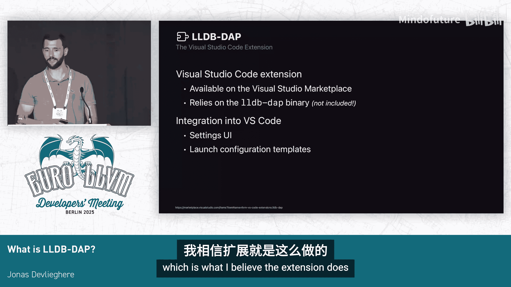

# 2025LLVM欧洲开发者大会-p03-P03-What-is-LLDB-DAP--BV1EoE9zUEbG_p3-

Hi， everyone。 My name is Jonas， and I work on debugging at Apple。 And today。

 I want to talk to you about LDD Dap。So Dap stands for debug adaptaper Procol。

 and it's an open standard developed by Microsoft for communication between development tools like IDs and editors and the debugger。

 and the goal is to have a unified experience for debugging across languages without having to have all the tools and all of the debuggers implement custom support for each other。

The protocol is JSON based and it defines these messages and there's three types of messages。

 there's requests， there's events and there's responses。

 And so a request is a message sent from from the client to the debug adapter。

 an event there's also reverse request from the debug adapter back to to the client。

 an event is an unprompted message sent from the debug adapter to the client and then a request a response is the reply to a request。

 So let's look at one of those in detail。 I went with breakpoints locations because it's kind of simple and it fits on a slide。

 The purpose of this request is to get all the locations for a source breakpoint。

 And so in this particular case I'm looking for a breakpoint in driver do c online 780 and so the protocol defines the arguments to this request。

 This is fixed。 and so in our case we have a path a name and a line number and so it's going to send that off to the debug adapter which is going look at this request handle it by passing it off to the debug implementation。

cent response。 So in this case， like I said， simple request。

 So our breakpoint resulted in exactly one breakpoint location， namely at location at line 7，80。

 column 19。And one thing to notice here is that the response omits a bunch of information from the request because it is a response to a particular request。

 In this case， the one we sequence number 3。 And so it's a little more efficient that way。

So let's talk about D in LDB specifically。 And before I do。

 I want to highlight that I didn't create LDB D。 This is really like a community effort。

 I think at this time， it's probably one of the most active parts of LDB。

 and we see contributions from various individuals and companies。😊，So first off。

 we need to distinguish between two things。 There's LDB Dap， all lowercase。

 which is the debu adapter server。 And then there's LDB D， all uppercase。

 which is the visual studio extension。 And we'll look at each in detail。So as I said， LDBD。

 all lowercase， it's a standalone binary that implements the debug adapter protocol。

 So what it does is it's going to take those requests。

 it's going to translate those into SB API calls， which is LDB's stable API。

 and then use that to send those responses back to the client。

This is LDB D basically serves as the adapter between the D protocol and LDB。 hence the name。

 This binary is part of the LVM release starting with LVM 19。

 and it comes with Xcode in the command line tool starting with Xcode 160。

 Another interesting thing to note is that LDB D is implemented on top of LDB stable API。

 So you can swap out the。😊，The version of LDB underneath。

 which is useful if you have a downstream fork with custom language work I can support。

 And basically any tool that needs to talk with LDB D will do so through the server。

 Then if you're using visual Studio code， you want to download the LDB extension All uppercase。

 So this extension is written in Typescript。 and it basically tells visual studio code how to use this。

 And it provides a few nice extra。 It has a settings Ui where you can specify the path to LDB。

 it can enable some options and it has templates for launch configurations which is how you tell visual studio code how to launch or attach to something。

 One thing I want to mention is that the extension does not come with the binary。

 it will find it automatically if you have it in your path but for now， you need to specify yourself。

 One way we can solve this in the future is to download the binary from the latest LVM release。

 which is what I believe the client the extension does Just to wrap it up。

 I want to show you what this looks like here I'm debugging LVM with LDB in visual Studio code。

 All the U elements are standard。 really everything。😊。

Going on here is like this is powered by LDB Do under the hood。

 And you you get full access to debuggger。 You can type commands in the debu console and the bottom。

 So if you haven't already， please try it out。 Thank you。

